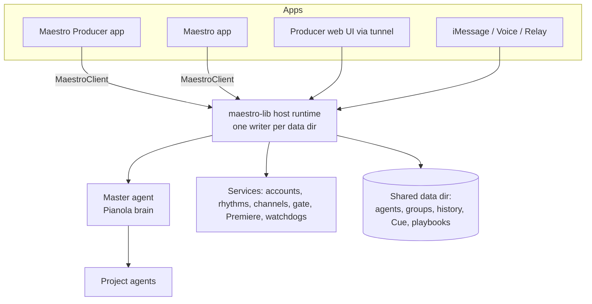

# Maestro Producer: plan

Status: proposal, revision 2, 2026-11-24. Not started. Builds on the maestro-lib plans on
`rc` (`maestro-tui-requirements.md`, `maestro-tui-client-api.md`, `maestro-tui-runtime.md`)
and reuses Pianola (`pianola-implementation-plan.md`, `pianola-phase2-goal.md`).

## 1. The goal

Bring one expert's way of running Maestro to a lay user, so that by launching an app and
starting to work they get the setup of a power user without building it.

The user describes the **ideal end state** of a project. One **master agent** takes it from
there. Behind it, maestro-lib runs every agent, delegation, Cue routine, Auto Run, account
and channel. The user can talk to the master agent from the app, from their phone's
messages, or from a browser anywhere.

**Two apps, one fleet.** Maestro Producer is a separate download from Maestro. Both are
clients of the same maestro-lib runtime and the same data directory. A user who starts on
Producer and grows into a power user installs Maestro and finds every agent, group,
routine, playbook and transcript Producer made, ready to inspect and debug. Producer is to
a lay user what the expert's own master agent is to him today: the one front door to the
whole fleet.

### 1.1 History of the idea

| Date       | Source                            | What it added                                                                                                                  |
| ---------- | --------------------------------- | ------------------------------------------------------------------------------------------------------------------------------ |
| 2026-09-12 | Voice note "simplified mode plan" | A list of chats and nothing else. One top-level orchestrator. All machinery hidden. A graph view of the agents.                |
| 2026-10-06 | Dictation                         | Agents set up "as if making a company", a team put on a goal. The expert's own tuning hidden from the user.                    |
| 2026-11-11 | Dictation                         | "The simple version of Maestro, built on top of the same library."                                                             |
| 2026-11-12 | Meeting                           | Offer the simple part for free, with Maestro under the hood.                                                                   |
| 2026-11-13 | Naming session                    | **Producer** (the person who hires the maestro). Ship action: **Premiere**.                                                    |
| 2026-11-24 | This revision                     | Separate app. Master agent with reach to every agent and the home directory. Accounts, rhythms, message buses, remote control. |

## 2. How the expert runs Maestro today

Sources: the agent roster, the delegation graph, every agent's Cue subscriptions and recent
Cue activity, `stats.db` (90 days), provider transcripts (60 days), the master agent's own
`cue.yaml` and the tools it calls. Human prompts were classified with System One (4,246
prompts, calibrated engine, all rows answered).

### 2.1 Scale

| Measure                         | Value                                                                     |
| ------------------------------- | ------------------------------------------------------------------------- |
| Agents                          | 124 (103 Claude Code, 18 Codex, 3 OpenCode) in 19 groups                  |
| Delegation edges                | 109: 76 from group grants, 33 explicit. 68 agents have none.              |
| Turns, last 90 days             | 13,719 (10,308 interactive, 3,411 automated), 2,162 agent hours           |
| Auto Runs, last 90 days         | 146 spec-driven (3,320 tasks), 44 goal-driven (1,667 tasks)               |
| Cue subscriptions               | 223 on 25 agents. About 1,000 runs in the latest 2.3 hours, 999 completed |
| Prompts sent to agents, 60 days | 29,840, of which 86% came from templates (Cue, consults, synopses)        |
| Provider accounts               | 3 Claude plan accounts and 2 OpenAI accounts, one shared transcript tree  |
| Cloudflare projects on disk     | 26 wrangler configs                                                       |

### 2.2 The master agent

The expert's master agent is his vault agent. Its peer description: "Primary agent and
fleet router ... Delegate work that needs his accounts, his house or a reminder to him."
It holds 20 explicit delegation edges (the second most after the Maestro dev agent), and
it carries 87 Cue subscriptions. 80 of the 87 are shell commands that call a library of
Python tools in the vault. They fall into five layers:

| Layer               | What runs                                                                                                                                                                                                                               | Generic or personal                 |
| ------------------- | --------------------------------------------------------------------------------------------------------------------------------------------------------------------------------------------------------------------------------------- | ----------------------------------- |
| L1 Fleet upkeep     | Claude account rebalance (every 2 h), Codex account rebalance (3 h), "waste no tokens" burner (4 h), auth health check (daily), Cue self-heal watchdog (hourly), pipeline health check (daily), ops telemetry                           | **Generic**                         |
| L2 Rhythms          | AM, PM, chat, stocks and podcast briefings; Director's Notes daily and weekly; weekly review; daily instruction-file audit; memory promote, audit and smoke test                                                                        | **Generic shape**, personal content |
| L3 Message buses    | iMessage command bus (every 3 min, only messages the owner wrote with an `@agent` marker), Google Voice SMS poll (every minute), mail triage, owed replies, deadline extraction, a "Radar" ledger of proactive items with a send budget | **Generic**                         |
| L4 Ingest           | Calendar, meeting recorders, dictation, wearables, music history, health devices, phone location                                                                                                                                        | Per user                            |
| L5 Life automations | Orders, reservations, trips, cameras, family reminders                                                                                                                                                                                  | Personal                            |

Three lessons in those tools matter more than any one feature:

- **Everything gets a watchdog that re-runs, not only alerts.** "The old watchdog only
  alerted, which still made him do the work." A weekly job that failed once sat stale
  for 324 hours. Jobs that exited 0 while their data source was dead logged six
  "successes". The fix was an artifact check: did the output actually land?
- **Hard-fail on empty.** The Director's Notes snapshot writes nothing and exits 2 when
  the synopsis is empty or the provider login expired, so it never produces another
  0-byte note.
- **Quota does not roll over, and stalled playbooks rot.** The burner spends expiring
  quota on the oldest unfinished playbook first, because it is the most likely to be
  forgotten and to have drifted from the code.

### 2.3 What the expert types

| Intent                     | Share of 4,246 human prompts |
| -------------------------- | ---------------------------- |
| Build or change something  | 28%                          |
| Status, recall, explain    | 13%                          |
| Fix a bug                  | 12%                          |
| Review, test, merge        | 7%                           |
| Write prose                | 6%                           |
| Release, deploy, configure | 6%                           |
| Research                   | 4%                           |
| Orchestrate agents         | 3%                           |
| Set up automation          | 3%                           |
| Other                      | 17%                          |

About 8% of them push back on finished work ("still not working", "have you tested
this"). And prompt-level rules do not change behavior: 27 agents carry a "use LSP" note,
yet LSP was called 176 times against 230,744 shell commands.

### 2.4 What this means for Producer

- **F1. The expert's advantage is setup, not typing.** 86% of prompts are automated, and
  orchestration plus automation are only 6% of what he types. Producer's core job is to
  do the setup a lay user cannot.
- **F2. The chat must serve three verbs:** build, fix, and "tell me what happened".
- **F3. Verify before "done".** A quality gate runs before Producer reports, not after.
- **F4. Practices live in code.** Gates, defaults and services, never notes in a prompt.
- **F5. Layers L1 to L3 are the product.** They are generic, they are what makes the
  fleet survive unattended, and no lay user will ever build them. L4 and L5 are recipes
  a user opts into.

## 3. The user's day in Producer

1. **Install and onboard.** A short Q&A: who are you, which AI subscriptions do you have,
   how do you want to be reached (app only, iMessage, Google Voice, Discord, Slack), what
   time do you start and end your day. Producer then logs in each account (section 5),
   sets up the channel (section 7) and turns on the briefings at those times.
2. **Start a project.** "I want a booking site for my studio, live on my own domain, with
   a weekly sales email." Producer makes the project folder, a group and at least one
   agent, writes the agent's peer description, grants delegation, and writes the ideal end
   state into the project.
3. **Work.** The user talks to the master agent in the app or by text. It plans, hands work
   to the project agents, runs long work as hidden playbooks on worktree branches, checks
   the result and reports back with screenshots.
4. **Rhythms.** A morning briefing (what moved, what needs you), a PM briefing, an
   end-of-week briefing. Weekly, the master agent reads the week's Director's Notes for each
   project, compares it with the ideal end state, and proposes or starts the next steps.
5. **Ship.** Premiere puts the project on Cloudflare (section 8).
6. **Grow.** One day the user installs Maestro and sees all of it: agents, groups, Cue
   pipelines, playbooks, transcripts.

## 4. The master agent and projects

- **One master agent per user.** It is a normal Maestro agent named "Master" by default.
  It has consult and delegate access to every agent, and Producer keeps those grants in
  place as agents are added.
- **A project is a folder plus a group.** The folder lives under one Producer projects
  root. The group holds at least one agent, more when the work calls for it (for
  example a site agent and a content agent). Each agent gets the per-project pattern the
  expert uses: its own repo, a peer description of what to consult and delegate it for,
  and grants to its teammates.
- **The ideal end state is a file in the project,** owned by the user and quoted into every
  weekly review. Progress is always measured against it.
- **The orchestration brain is Pianola.** Reuse `src/shared/pianola/`: the plan DAG
  (`pianola-tasks.ts`), the orchestrator iteration, the risk policy and the learned
  decision profile. Its invariants carry over unchanged: high-risk always escalates to the
  user, every decision is recorded before anything is sent, and ordering is enforced by the
  DAG, not by prose.
- **Home directory reach goes through services, not through the model.** The master agent
  asks the account service to add an account or the channel service to connect a bus. It
  does not edit dotfiles or symlinks itself. See R2.

## 5. Accounts: add, log in, pool, rebalance, burn

This is the expert's most valuable hidden setup and the one no lay user can reproduce.

| Step           | Today (manual)                                                                                                                       | Producer                                                                                                                                                                   |
| -------------- | ------------------------------------------------------------------------------------------------------------------------------------ | -------------------------------------------------------------------------------------------------------------------------------------------------------------------------- |
| Add            | Create `~/.claude-<name>` or `~/.codex-<name>` by hand                                                                               | "Add a Claude account" makes the config dir                                                                                                                                |
| Share          | Symlink `projects`, `plugins`, `skills`, `CLAUDE.md` and `settings.json` (Codex: `sessions`, `plugins`, `skills`) to the primary dir | Done by the account service, so an agent moved between accounts keeps its history and resumable sessions                                                                   |
| Log in         | Run the provider's login in a terminal with the right env                                                                            | A button: "Log in to the Claude account you use for work (name@example.com)". It opens the provider's own login with the right config dir. Producer never sees a password. |
| Stay logged in | Daily auth health check fires a red toast                                                                                            | The same check. A dead login shows the same button in the app and in the user's channel.                                                                                   |
| Pool           | Agents pinned to accounts by an env var                                                                                              | Every agent draws from the pool. The account is a runtime choice, never a user setting.                                                                                    |
| Rebalance      | Claude: forecast quota pressure every 2 h. Codex: probe `allowed` and limits every 3 h                                               | The same two policies, as one account service with a per-provider strategy                                                                                                 |
| Burn           | Spend expiring quota on the oldest stalled playbook                                                                                  | On by default, with a monthly cap the user can see                                                                                                                         |
| Retry          | Agent Resilience retries on quota and overload                                                                                       | On by default                                                                                                                                                              |

Existing code to build on: `resolveAgentAccountDir()` (`src/shared/agentAccountDir.ts`),
`getProviderAccountDirs()` (`src/main/agents/provider-account-dirs.ts`), the provider
profiles in `src/shared/providerProfiles.ts`, `classifyCredentialKind()` in
`src/shared/providerAuthIdentity.ts`, and the Codex auth reader in
`src/main/agents/codex-auth.ts`. The rebalance and burn policies exist today as two vault
scripts (about 3,100 lines between them). They become a maestro-lib service.

## 6. Rhythms

| Rhythm             | When                    | What the user gets                                                                                     |
| ------------------ | ----------------------- | ------------------------------------------------------------------------------------------------------ |
| Morning briefing   | Start of the user's day | What moved overnight, what needs them (logins, approvals, replies owed), today's calendar if connected |
| PM briefing        | End of the user's day   | What got done, what is still running, what is blocked                                                  |
| Week in review     | End of the user's week  | Per project: progress against the ideal end state, and the proposed next steps                         |
| Director's Notes   | Daily, and weekly       | Saved as dated notes in each project. Feeds the weekly review.                                         |
| Next-step proposal | Weekly                  | The master agent proposes work toward the end state. Low-risk items start; others wait for a yes.      |

Each rhythm ships as a Cue bundle (`maestro-cli bundle`) installed at onboarding, so the
user sees it as a pipeline once they open Maestro. Every rhythm has an artifact check and
a self-heal re-run (section 2.2 lessons), and hard-fails instead of writing an empty
briefing.

## 7. Channels: talk to the master agent anywhere

| Channel        | How it works today                                                                                                                   | Producer setup                                                               |
| -------------- | ------------------------------------------------------------------------------------------------------------------------------------ | ---------------------------------------------------------------------------- |
| In app         | Chat                                                                                                                                 | Default                                                                      |
| iMessage       | A scanner every 3 minutes reads only messages the owner wrote that carry an `@agent` marker, and spends no tokens when there is none | macOS only. Needs Full Disk Access, granted in onboarding with a guided step |
| Google Voice   | A poller every minute, sending through the web composer                                                                              | Optional. Gives the master agent its own number                              |
| Discord, Slack | Maestro Relay bridges a channel to an agent                                                                                          | Optional, uses Relay                                                         |
| Browser        | Live mode over a Cloudflare tunnel with Web Login                                                                                    | Section 7.1                                                                  |

The bus pattern stays: a cheap scanner on a heartbeat, a `cli.trigger` handler that runs
only when there is real work, and outbound messages tagged with the agent's name.

### 7.1 Remote control

Use the same remote path Maestro has: the web server, the Cloudflare tunnel and Web Login
(`src/main/web-server/live-mode.ts`, `startTunnel()`). The difference is what it serves:
Producer's simplified web UI, not the full Maestro interface. Maestro Lite's device
pairing (OPAQUE code plus host approval) is the model for adding a phone.

## 8. Premiere: ship to Cloudflare

| Concern       | Default                                                                                                                                                         |
| ------------- | --------------------------------------------------------------------------------------------------------------------------------------------------------------- |
| Stack         | Pages (static or Astro), Pages Functions or a Worker, D1 for data, R2 for files                                                                                 |
| Account       | The user's own Cloudflare account through `wrangler login`                                                                                                      |
| Environments  | A preview for every change. Production only after the user approves the preview.                                                                                |
| Secrets       | Collected once in a form, stored with `wrangler secret put`, never in chat                                                                                      |
| Cost guard    | The expert's D1 rules become checks that block Premiere: indexed query paths, edge-cached D1 reads, batched multi-query endpoints, no client polling under 30 s |
| Domain        | Optional step after the first production deploy                                                                                                                 |
| Remote access | The same Cloudflare account can host the user's tunnel (section 7.1)                                                                                            |

## 9. Architecture

### 9.1 Decisions

- **D1. Two apps, one runtime.** Producer and Maestro are separate apps that share one
  data directory. The maestro-lib rule holds: one process writes, everything else is a
  client. The TUI proof of concept (`src/tui/startup.ts` on the `maestro-tui` branch)
  already picks between the three startup modes Producer needs: host in process, attach to
  a running host, or attach to the desktop.
- **D2. The host becomes a background service.** Rhythms, buses and rebalancing must run
  when neither app is open. `maestro-cli host` (a detached runtime that also runs Cue) is
  the start. Producer installs it as a login item. Either app attaches to it.
- **D3. The master agent is a normal agent; Pianola is its brain.** Reuse
  `src/shared/pianola/`. Do not build a second orchestrator.
- **D4. Services do the dangerous work.** Accounts, symlinks, channels, deploys and
  delegation grants are deterministic maestro-lib services with a read for every write. The
  master agent calls them; it never edits the home directory directly.
- **D5. Producer's objects are ordinary Maestro objects.** Agents, groups, Cue bundles and
  playbooks, with no Producer-only formats, so Maestro can open all of them.
- **D6. Practices are code.** A versioned house prompt plus gates with pass or fail
  results.

### 9.2 Library gaps

`MaestroClient` today covers connection, agents, groups, tabs, turns, Auto Run, group
chats, consults, history, settings, providers and events.

| Gap                      | Needed                                                                                      |
| ------------------------ | ------------------------------------------------------------------------------------------- |
| G1 Routines              | Cue and scheduled tasks on the client: create, install a bundle, pause, delete              |
| G2 Delegation grants     | Grant and revoke on the client                                                              |
| G3 Worktrees and git     | Create, merge, PR status on the client                                                      |
| G4 Account service       | Add, share (symlink), log in, health, pool, rebalance, burn (section 5)                     |
| G5 Channel service       | iMessage, Google Voice and Relay buses with owner-only intake                               |
| G6 Watchdog service      | Artifact checks and self-heal re-runs for every routine                                     |
| G7 Quality gate          | Tests, verification and screenshots, with evidence attached to the answer                   |
| G8 Premiere service      | Preview, promote, status, cost checks                                                       |
| G9 Awaiting-input signal | A parser-level "the agent is asking" marker (Pianola found none exists)                     |
| G10 Prompt assembly      | Library-owned, so a turn is the same agent in both apps (TUI gap L12)                       |
| G11 Host as a service    | `maestro-cli host` as a login item, and the desktop able to attach to it instead of hosting |

## 10. Phases

| Phase         | Scope                                                                                                                     | Exit test                                                                                                |
| ------------- | ------------------------------------------------------------------------------------------------------------------------- | -------------------------------------------------------------------------------------------------------- |
| 0. Brain dump | The 20-minute unstructured brain dump asked for on 2026-11-11, turned into the house prompt, gate list and onboarding Q&A | Reviewed by the expert                                                                                   |
| 1. Fleet core | Producer app shell on maestro-lib, host as a service (G11), master agent, projects, accounts (G4)                         | A tester adds two Claude accounts, logs in through the button, creates a project, and sees it in Maestro |
| 2. Work loop  | Hidden playbooks on worktrees, quality gate (G7), awaiting-input signal (G9), Pianola wiring                              | Under 3% of tester prompts push back on finished work (expert baseline: 8%)                              |
| 3. Rhythms    | Briefings, Director's Notes, weekly review toward the end state, watchdogs (G6), routines (G1)                            | A tester's briefings land on time for two weeks with no manual repair                                    |
| 4. Channels   | iMessage, Google Voice, Relay (G5), remote web UI through the tunnel                                                      | A tester runs a project for a day by text only                                                           |
| 5. Premiere   | Cloudflare path (G8)                                                                                                      | A tester ships a site with a D1 table to preview, then production, with cost checks passing              |

## 11. Risks

- **R1. Hidden failures.** The expert's own stack shows silent failures are the main way
  automation dies. Every routine needs an artifact check, a re-run, and a plain "needs
  you" card when the re-run fails.
- **R2. Blast radius.** A master agent that reaches every agent, the home directory and
  the user's messages is the highest-value target on the machine. Inbound text from a
  channel is untrusted: intake accepts only the owner's own messages, System One screens
  for instructions aimed at agents, and high-risk actions always escalate. Dotfile and
  credential work stays in services (D4).
- **R3. Cost.** Lay users will not watch quota or Cloudflare bills. Per-project budgets,
  a visible monthly cap on burning, and the D1 cost checks.
- **R4. macOS permissions.** iMessage needs Full Disk Access, which a signed app must
  request. This depends on the Apple signing work.
- **R5. Two apps writing one data dir.** Solved only if D1 and D2 hold. Any shortcut that
  lets Producer write the stores directly while Maestro runs will lose data, because the
  desktop renderer rewrites the sessions store every few seconds.
- **R6. Personal recipes leaking into the product.** L4 and L5 are one person's life.
  Ship the shapes as optional recipes, not his content.

## 12. Open questions

- **Q1.** Name of the master agent in the UI: "Master", the user's choice, or a Producer
  persona name?
- **Q2.** Which channels ship first? Recommendation: in-app plus iMessage on macOS, then
  Relay, then Google Voice (the most brittle, it drives a web page).
- **Q3.** Does the host service run under the user's login only, or also on a home server
  through Federation for laptop-lid-closed work?
- **Q4.** Is Producer free and open source, with hosted runtimes as the business?
- **Q5.** Phase 0 format: an agent interviews the expert, or a free-form recording that an
  agent turns into the house prompt?
