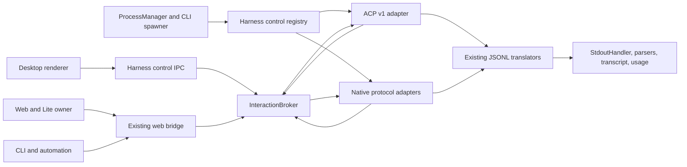

# Native harness control plan

Status: implemented; provider-specific live-qualification limits are recorded in [Native Harness Control](../docs/agent-guides/NATIVE-HARNESS-CONTROL.md).

Baseline: current worktree fast-forwarded to `origin/rc` at `6fdc9a92b1ad2c34452dca097c675f2170426362`.

## Decision

Build a transport-neutral **harness control plane**, with ACP v1 as one adapter rather than as Maestro's internal domain model.

Every native transport is an **opt-in per-agent mode alongside the current flow**, using the same selection model as Claude's TUI/API mode. The current transport remains the default and remains available. There is no global native cutover, automatic native upgrade, or removal of the current flow.

Use each harness's richest maintained protocol:

- ACP for Grok, Qwen, Factory Droid, Gemini CLI, and explicitly configured generic ACP agents.
- Codex `app-server`, OpenCode HTTP/SSE, Copilot SDK JSON-RPC, Hermes TUI gateway JSON-RPC, Pi/OMP native RPC, and Claude Agent SDK streaming input for their native integrations.
- The existing Claude `maestro-p` control socket where its observed TUI steering behavior is still required.

This gives Maestro one interface for lifecycle, interactions, capabilities, and honest steering verdicts while preserving provider-specific behavior behind adapters. ACP alone cannot meet the steering goal: stable ACP v1 standardizes prompting, streaming updates, cancellation, and permission requests, but not mid-turn steering or a standard follow-up queue. ACP v2 documents exist, but the protocol repository explicitly says version 1 is current stable. Do not target v2 wire messages yet. [ACP versioning](https://github.com/agentclientprotocol/agent-client-protocol#versioning) [ACP v1 prompt lifecycle](https://github.com/agentclientprotocol/agent-client-protocol/blob/main/docs/protocol/v1/prompt-turn.mdx)

## Goals

1. Relay native permission, question, and elicitation requests to the correct desktop, web, or CLI owner and return exactly one valid answer.
2. Support real in-turn steering where the harness exposes it, with evidence that distinguishes accepted, consumed, queued for a later turn, refused, dropped, and unknown outcomes.
3. Expose runtime-negotiated capabilities instead of inferring control support from a provider ID or installed version.
4. Reuse Maestro's existing parsers, transcript rendering, session IDs, usage accounting, stop ladder, and provider history storage during migration.
5. Cover interactive desktop, owner-operator web/Lite, and CLI/automation call sites without unattended approval hangs.
6. Make adding an ACP-compatible harness primarily a launch descriptor and conformance exercise, not another output parser and control implementation.

## Non-goals

- Do not rewrite every provider event into a new canonical event model as a prerequisite. Existing JSONL translators are the compatibility mechanism during the cutover.
- Do not replace or deprecate the current per-agent transport flow. Native control is an additional selectable mode.
- Do not replace native Claude, Codex, OpenCode, Hermes, Pi, or OMP protocols with less capable third-party ACP adapters.
- Do not simulate steering with prompt text, terminal keystrokes, or cancellation while labeling it `absorbed`.
- Do not auto-install or auto-update agents from the ACP Registry. Initial generic ACP support launches an explicit user-configured local binary only.
- Do not broaden sandbox, filesystem, network, account, or deployment permissions as a side effect of native transport adoption.
- Do not change provider history formats or the provider-translation contract.

## Current Maestro foundations

| Existing seam                   | Evidence                                                                                                            | Reuse in the plan                                                                                                                        |
| ------------------------------- | ------------------------------------------------------------------------------------------------------------------- | ---------------------------------------------------------------------------------------------------------------------------------------- |
| Spawn and lifecycle chokepoint  | `ProcessManager.spawn()`, `interrupt()`, `kill()`, and `steer()` in `src/main/process-manager/ProcessManager.ts`    | Route native control through one handle on `ManagedProcess`; retain process-tree cleanup and generation checks                           |
| Provider-specific control state | `sdkController`, `opencodeClient`, `opencodeSessionId`, and `codexAppServer` in `src/main/process-manager/types.ts` | Replace incremental transport-specific fields with one `HarnessControlHandle` while adapters retain native state privately               |
| Codex native protocol           | `src/main/codex-app-server/` and `CodexAppServerSpawner`                                                            | Keep `turn/steer`, request IDs, event translation, sandbox verification, and pre-acceptance fallback rules                               |
| OpenCode native protocol        | `OpencodeServerSpawner` and `src/main/opencode-server/event-translator.ts`                                          | Keep the shared server, SSE filtering, JSONL translation, and abort behavior; add permission responses                                   |
| Claude approvals and questions  | `src/main/permission-relay/`, `PermissionPrompt`, and `permissionRequestStore`                                      | Move broker semantics out of the Claude-only relay; preserve the relay as one adapter during migration                                   |
| Steering verdicts               | `src/shared/chatSteering.ts`                                                                                        | Reuse the two-clock verdict model: immediate delivery followed by observed absorption or follow-up execution                             |
| Static provider features        | `src/shared/maestro-lib/providers/capabilities.ts`                                                                  | Keep static launch/display features; add a separate negotiated runtime control capability object                                         |
| Remote owner route              | `permission:respond` and `process:permission-request` in `src/main/web-server/handlers/bridgeDenyList.ts`           | Extend the existing owner-operator route with generalized interactions and withdrawal messages                                           |
| CLI-owned turns                 | `src/cli/services/agent-spawner.ts` and `src/shared/maestro-lib/turns/`                                             | Reuse Node-only transport clients; route interactive requests through the existing Maestro bridge or apply an explicit unattended policy |

The present Codex app-server integration answers server-side approval and question requests automatically by policy. OpenCode's spawner already identifies `permission.updated` as the foundation for bubbling requests, but its translator currently handles message parts, idle, and errors. These are the shortest paths to visible approval coverage beyond Claude.

## Protocol findings

### Recommended transport by harness

| Harness                                      | Recommended target                                                                       | Approval and question path                                                                                                                                                | Steering reality                                                                                                                                 | Priority                                                  |
| -------------------------------------------- | ---------------------------------------------------------------------------------------- | ------------------------------------------------------------------------------------------------------------------------------------------------------------------------- | ------------------------------------------------------------------------------------------------------------------------------------------------ | --------------------------------------------------------- |
| Claude Code                                  | Claude Agent SDK streaming input for API mode; keep `maestro-p` for interactive TUI mode | `canUseTool` and user-input callbacks; dynamic `setPermissionMode()` and `interrupt()`                                                                                    | SDK streaming supports queued messages, not a portable absorption guarantee. Keep observed maestro-p verdicts for true in-turn behavior          | P1                                                        |
| Codex                                        | Existing native `app-server`                                                             | Server-to-client approval, user-input, and MCP elicitation requests                                                                                                       | Native `turn/steer`; RPC success means delivered, later `userMessage` evidence means absorbed                                                    | P0                                                        |
| OpenCode                                     | Existing `opencode serve` HTTP/SSE                                                       | `POST /session/:id/permissions/:permissionID`; inspect live schema for any additional question variants                                                                   | `prompt_async` is asynchronous submission, not proof of in-turn steering                                                                         | P0                                                        |
| Factory Droid                                | Native ACP initially; native `stream-jsonrpc` where its richer controls are required     | ACP permission requests, or `droid.request_permission` and `droid.ask_user` on JSON-RPC                                                                                   | No portable steering claim. JSON-RPC has multi-turn and interruption controls                                                                    | P1                                                        |
| Copilot CLI                                  | Official Copilot SDK over JSON-RPC                                                       | `onPermissionRequest`, user-input and elicitation handlers                                                                                                                | `send({ mode: 'immediate' })` is native immediate delivery; `abort()` is separate. Plain `send()` remains queued submission                      | P1                                                        |
| Grok CLI                                     | Native ACP via `grok agent stdio`                                                        | ACP permission requests and tool updates                                                                                                                                  | No standard ACP v1 steering                                                                                                                      | P1                                                        |
| Qwen3 Coder / Qwen Code                      | Native ACP via `qwen --acp`                                                              | ACP permission requests and session mode controls where advertised                                                                                                        | No standard ACP v1 steering                                                                                                                      | P1                                                        |
| Hermes                                       | Native TUI gateway JSON-RPC rather than ACP                                              | `approval.request`/`approval.respond`, `clarify.request`/`clarify.respond`, secret/sudo events, expiry withdrawal, and `pending_approval`/`pending_clarify` resume replay | Native `session.steer`; acceptance is queued delivery, not consumption. A completion carrying `pending_steer` must remain open for the follow-up | P1                                                        |
| Pi                                           | Native `pi --mode rpc` plus extension UI subprotocol                                     | Extension select/confirm/input/editor requests; actual tool approval depends on the active extension/policy                                                               | Native `steer` delivers after current tool calls and before the next model call; `follow_up` is distinct                                         | P1                                                        |
| OMP                                          | Native `omp --mode rpc` or `rpc-ui`, selected from required UI behavior                  | Extension/tool dialogs; `--no-ui` makes tool approvals fail closed. `rpc-ui` controls tool dialogs independently of extension UI                                          | Native `steer`, `follow_up`, queue removal/promotion, abort, and subagent steering                                                               | P1                                                        |
| Antigravity                                  | Keep CLI initially; add a Python SDK sidecar only as a dedicated adapter                 | CLI headless soft-denies tools it cannot approve and rejects control frames. Python SDK `ask_user` policy handlers provide real approvals                                 | No native steering claim from the reviewed CLI protocol                                                                                          | P3                                                        |
| Gemini CLI, currently placeholder in Maestro | Native ACP via `gemini --acp`                                                            | ACP permission requests                                                                                                                                                   | No standard ACP v1 steering                                                                                                                      | Conformance reference, not a required new-provider launch |

Sources: [Claude streaming input](https://code.claude.com/docs/en/agent-sdk/streaming-vs-single-mode), [Claude permissions](https://code.claude.com/docs/en/agent-sdk/permissions), local `docs/agent-guides/CODEX-APP-SERVER.md`, [OpenCode server](https://opencode.ai/docs/server/), [Factory Droid exec and JSON-RPC](https://docs.factory.com/droid-exec/overview), [Copilot SDK](https://github.com/github/copilot-sdk/blob/main/nodejs/README.md), [Grok agent mode](https://github.com/xai-org/grok-build/blob/main/crates/codegen/xai-grok-shell/README.md), [Qwen ACP launch](https://qwenlm.github.io/qwen-code-docs/en/users/integration-zed/), [Hermes programmatic integration](https://hermes-agent.nousresearch.com/docs/developer-guide/programmatic-integration), [Pi RPC](https://github.com/badlogic/pi-mono/blob/main/packages/coding-agent/docs/rpc.md), [Pi commands](https://github.com/badlogic/pi-mono/blob/main/packages/coding-agent/docs/rpc-commands.md), [Pi extension UI](https://github.com/badlogic/pi-mono/blob/main/packages/coding-agent/docs/rpc-extension-ui.md), [OMP RPC](https://github.com/can1357/oh-my-pi/blob/main/docs/rpc.md), [Antigravity headless](https://antigravity.google/docs/cli/headless/), [Antigravity policies](https://antigravity.google/docs/sdk/policies/), and [Gemini ACP](https://github.com/google-gemini/gemini-cli/blob/main/docs/cli/acp-mode.md).

### Why ACP remains worth implementing

The official ACP catalog already includes Factory Droid, Gemini CLI, GitHub Copilot, Hermes, OpenCode, Qwen, and many additional harnesses. Grok separately documents native ACP through `grok agent stdio`. Claude, Codex, and Pi are also listed through adapters, but their direct native protocols are a better Maestro fit for control depth. [ACP agent catalog](https://agentclientprotocol.com/get-started/agents) [Grok agent mode](https://github.com/xai-org/grok-build/blob/main/crates/codegen/xai-grok-shell/README.md)

One stable ACP v1 client provides:

- Version and capability negotiation through `initialize`.
- `session/new`, optional `session/load`, `session/prompt`, and `session/cancel`.
- Text, thought, tool-call, plan, mode, configuration, usage, and other `session/update` variants when supported.
- Agent-to-client `session/request_permission` with opaque option IDs and `allow_once`, `allow_always`, `reject_once`, and `reject_always` hints.
- Optional client filesystem, terminal, elicitation, MCP, and authentication surfaces.

Omitted capabilities mean unsupported. Maestro must negotiate rather than probe by method calls that could have side effects. [ACP initialization](https://github.com/agentclientprotocol/agent-client-protocol/blob/main/docs/protocol/v1/initialization.mdx) [ACP tool calls and permissions](https://github.com/agentclientprotocol/agent-client-protocol/blob/main/docs/protocol/v1/tool-calls.mdx)

Initially advertise no ACP client filesystem or terminal capability. Let agents use their own tools. Those callbacks would make Maestro responsible for executing file and terminal operations and require a separate root-scoped security design.

## Architecture

### One deep control module, multiple adapters



The control seam is small. Protocol details, request correlation, capability negotiation, fallback, and native event translation live behind it.

### Module layout

| Path                                                 | Responsibility                                                                                              |
| ---------------------------------------------------- | ----------------------------------------------------------------------------------------------------------- |
| `src/shared/harness-control/types.ts`                | Renderer-safe capability, interaction, response, and transport-status contracts                             |
| `src/shared/harness-control/validators.ts`           | Runtime validation for every IPC/web payload and unknown protocol value                                     |
| `src/shared/maestro-lib/harness/`                    | Node-only reusable ACP/RPC clients with no Electron imports                                                 |
| `src/main/harness-control/HarnessControlRegistry.ts` | Select adapters, own handles, bind session/tab/turn/generation identity                                     |
| `src/main/harness-control/InteractionBroker.ts`      | Pending requests, owner routing, timeout, cancellation, withdrawal, exactly-once resolution, audit metadata |
| `src/main/harness-control/adapters/`                 | Thin wrappers around existing Codex/OpenCode/Claude modules and new native clients                          |
| `src/main/ipc/handlers/harnessControl.ts`            | Validated renderer command interface and event subscriptions                                                |
| `src/renderer/stores/harnessInteractionStore.ts`     | Generalized FIFO display state and settled-request removal                                                  |
| `src/renderer/components/InteractionPrompt/`         | Permission options, questions, elicitations, provider/action context, and safe default focus                |
| `src/main/web-server/`                               | Explicitly allowlisted generalized interaction methods/events after owner authorization is implemented      |

Do not add transport-specific fields to the four duplicated static `AgentCapabilities` interfaces. A connection reports runtime capabilities after initialization; static provider capabilities remain launch-time hints only.

### Core contracts

```ts
type HarnessSteeringSupport = 'in-turn' | 'follow-up' | 'none';

interface HarnessControlCapabilities {
	protocol:
		| 'acp'
		| 'codex-app-server'
		| 'opencode-http'
		| 'claude-sdk'
		| 'copilot-sdk'
		| 'hermes-gateway'
		| 'pi-rpc'
		| 'omp-rpc'
		| 'droid-jsonrpc'
		| 'legacy';
	protocolVersion: string;
	agentVersion?: string;
	steering: HarnessSteeringSupport;
	permissionRequests: boolean;
	questions: boolean;
	elicitations: boolean;
	modelSwitch: boolean;
	modeSwitch: boolean;
	imagePrompts: boolean;
	resume: boolean;
}

interface HarnessControlHandle {
	getCapabilities(): HarnessControlCapabilities;
	steer(request: { id: string; text: string }): Promise<SteeringResultFrame>;
	interrupt(): Promise<void>;
	close(options: { sync?: boolean; shutdown?: boolean }): Promise<void>;
}

interface HarnessInteractionOption {
	optionId: string;
	label: string;
	kind: 'allow-once' | 'allow-always' | 'reject-once' | 'reject-always' | 'choice' | 'other';
	description?: string;
}

interface HarnessInteractionRequest {
	requestId: string;
	sessionId: string;
	tabId?: string;
	spawnGeneration: number;
	turnId?: string;
	toolCallId?: string;
	kind: 'permission' | 'question' | 'elicitation';
	provider: string;
	title: string;
	detail?: string;
	toolName?: string;
	input?: Record<string, unknown>;
	options: HarnessInteractionOption[];
	secret?: boolean;
}
```

Native request IDs and option IDs remain opaque inside the adapter. Maestro mints its own request ID and binds it to session, tab, spawn generation, and the native responder. The renderer never supplies a native response object.

Questions and elicitations must have typed answers. Do not generalize Claude's current `AskUserQuestion` deny-with-message workaround into other providers.

### Steering semantics

| Native observation                                                             | Maestro result                  |
| ------------------------------------------------------------------------------ | ------------------------------- |
| RPC/socket accepted text for possible in-turn delivery                         | `delivered`                     |
| Harness evidence shows the running loop consumed it                            | `absorbed`                      |
| Harness explicitly runs it as a later user turn                                | `queued`                        |
| Accepted but the turn ended without consumption evidence                       | `dropped`                       |
| No active turn, blocking dialog, unsupported transport, or precondition failed | `refused` with reason           |
| Transport failed or admission cannot be proved                                 | `unknown`; never report success |

Provider-specific traps:

- Pi/OMP `steer` returning `disposition: queued` means queued for the current agent loop. Map that immediate response to `delivered`, not Maestro's `queued`, which means a follow-up turn.
- Hermes `run.steered` likewise proves queued delivery at a future tool boundary, not model consumption. `pending_steer` on a terminal event requires replay as a normal prompt.
- Codex keeps its current delivered-then-absorbed sequence and `expectedTurnId` race protection.
- Copilot `send()` and Claude SDK streaming input provide queued follow-up behavior. Their UI action is Queue, not Steer, unless later native evidence proves otherwise.
- ACP v1 exposes no standard steer verb. Cancel plus a new prompt is a separate destructive user action, never an implicit steering fallback.

### Interaction lifecycle and fail-closed rules

1. Adapter validates the native request and registers a broker-owned responder before emitting UI state.
2. Broker binds the request to session/tab/generation and routes it only to an authorized owner surface.
3. UI displays native options in native order. Deny/reject is default-focused; no keyboard shortcut approves by accident.
4. Broker validates the selected option against the registered request and settles it once. Duplicate or late responses return `not-found`/`already-settled` without invoking native code.
5. Turn cancellation answers all ACP permission requests with `cancelled`; other adapters use their native cancel/reject behavior.
6. Native withdrawal, process exit, spawn replacement, or owner loss removes the displayed request and resolves or marks it according to protocol semantics.
7. Malformed requests, unknown option kinds, unavailable owners, and timeout never become approval. Full Access is the only explicit auto-allow policy, and it does not override harness-enforced deny rules.
8. `allow_always` and `reject_always` are returned only when the user selects the native option. Maestro does not claim durable policy persistence unless the harness actually provides it.
9. Secret/elicitation values use secret UI fields, are omitted from logs/transcripts/analytics, and are never echoed in audit records.
10. Audit metadata records provider, session, request kind, selected option kind, origin surface, and timestamps. Raw commands, inputs, secrets, and environment values stay out of logs by default.

No prompt is retried on a second transport after acceptance or uncertain acceptance. Fallback is legal only during setup before the harness accepts the first prompt, preserving the current Codex rule.

### Connection ownership

Keep `ManagedProcess` as the logical turn/lifecycle record and `HarnessControlHandle` as its control facet. Initially a native connection may still be created per turn, matching current behavior. Do not make persistent sessions a prerequisite for approvals or steering.

Once adapters are stable, a registry may retain native connections per provider session/tab and lease them to successive `ManagedProcess` turns. The key must include provider, provider session, workspace, account/configuration identity, and SSH remote identity. Spawn generation still protects individual turns. Connection persistence must not merge two tabs, cwd roots, accounts, or remote hosts.

OpenCode already has a shared server, and Copilot has a runtime/session split. Treat server lifetime and provider-session lifetime separately from Maestro's turn completion events.

## Delivery phases

### Phase 0: Characterization and conformance contract

- Pin the supported protocol versions and minimum harness versions in a machine-readable support manifest.
- Capture sanitized request/response fixtures from installed harnesses, following `src/__tests__/fixtures/codex-app-server/` and its schema-generation precedent.
- Build a fake bidirectional harness for malformed frames, out-of-order responses, unknown methods, backpressure, cancellation, disconnect, and delayed user decisions.
- Record launch flags, authentication requirements, resume support, content types, approval options, and steering evidence for each provider. Documentation alone does not certify support.

Acceptance: every adapter has fixtures for initialize, prompt, stream, permission, cancel, resume where supported, and terminal failure. Every claimed steering mode has a recorded same-turn consumption case or is downgraded.

### Phase 1: Control contracts and provider-neutral broker

- Add shared contracts/validators, `HarnessControlHandle`, `HarnessControlRegistry`, and `InteractionBroker`.
- Wrap the existing Claude relay, maestro-p steering, Codex app-server, and OpenCode controller without changing default transport selection.
- Route `ProcessManager.steer()`, `interrupt()`, and `kill()` through the handle. Remove new transport-specific fields from `ManagedProcess` rather than adding another one.
- Generalize renderer and web contracts while preserving existing behavior until each caller is migrated. Retire the Claude-only public contract after migration; do not leave a permanent alias layer.

Acceptance: existing Claude permission/question flows and Claude/Codex steering pass their current observable-contract tests. Cross-session, stale-generation, duplicate-response, timeout, and exit-withdrawal tests pass before any new provider uses the broker.

### Phase 2: Approval propagation for Codex and OpenCode

- Replace Codex's method-level automatic request answers with broker requests in Standard mode. Preserve explicit Full Access auto-approval and Read-Only denial policy.
- Map command execution, file change, permission-profile, user-input, MCP elicitation, and dynamic-tool requests separately. Unknown or unsupported requests fail closed.
- Handle OpenCode permission events and call the native permission response endpoint. Filter every event and response by both server session and Maestro generation.
- Extend the prompt UI beyond Allow/Deny to native options, request details, and provider identity.

Acceptance: a real Codex and OpenCode turn pauses before a write/command, displays the correct tab/action, resumes only after the selected answer, and records the tool outcome. Escape, Stop, window loss, and web disconnect never approve or hang indefinitely. Read-Only remains enforced by the harness.

### Phase 3: Stable ACP v1 adapter and first agents

- Add `@agentclientprotocol/sdk` and implement newline-delimited JSON-RPC over stdio using the official client SDK.
- Negotiate protocol v1, validate the selected version, and refuse unsupported versions before creating a session.
- Implement session new/load, prompt content, updates, tool-call correlation, cancellation, authentication routing, and permission options. Advertise no fs/terminal client capabilities initially.
- Add native launch descriptors for Grok `agent stdio`, Qwen `--acp`, and Factory `exec --output-format acp`. Use Gemini ACP as an additional conformance target without bypassing Maestro's new-provider checklist.
- Add an advanced generic ACP launch descriptor only after the same path passes with the built-in agents. No registry-driven installation.

Factory limitation: its docs say `--disable-builtin-skills` is unsupported in ACP mode and available through JSON-RPC initialization. If Maestro requires that behavior for a configured Droid session, route that session to `stream-jsonrpc` rather than silently dropping the restriction.

Acceptance: the ACP compatibility kit and Maestro fake-agent contract pass. Live Grok, Qwen, and Factory probes prove prompt streaming, permission allow/reject, cancellation, resume when advertised, and no cross-session events. Unknown capabilities are not called.

### Phase 4: Native steering for Pi, OMP, and Hermes

- Implement Pi RPC and OMP RPC clients with command IDs, continuous stdout reads, strict JSONL framing, response/event separation, queue inspection, and extension UI responses.
- Negotiate OMP RPC v2 when advertised, including bounded chunk reassembly; otherwise use v1 within its frame limits. Do not assume Pi and OMP remain wire-identical.
- Select OMP `rpc-ui` when tool dialogs are required. Never use `--no-ui` while promising approval prompts; the native docs explicitly fail tool approval closed in that configuration.
- Implement Hermes gateway `client.capabilities`, approval/clarify requests, `request.cancel`, `open_requests`, `session.steer`, and `session.interrupt`. Use stdio first; WebSocket is a separate authenticated transport decision.

Acceptance: steering during a multi-tool run changes the next model iteration in the same run for each adapter. A steer racing final response is replayed or returned to the composer exactly once. Pi/OMP follow-up and steering queues remain distinct. Hermes reconnect reconstructs pending interactions without duplicate answers.

### Phase 5: Claude SDK and Copilot SDK migration

- Add Claude Agent SDK streaming-input transport for local API-mode turns. Move `canUseTool`, `AskUserQuestion`, dynamic permission mode, and interrupt onto native callbacks. Keep maestro-p interactive mode and SSH on supported existing transports until equivalent acceptance exists.
- Verify SDK behavior for background-subagent permission requests and streams spanning multiple results before enabling it by default.
- Add Copilot SDK sessions with permission, user-input/elicitation, events, model selection, resume, and abort. Distinguish queued plain `send()` from `send({ mode: 'immediate' })` native steering, and retain sessions through keyed leases only after per-turn acceptance passes.
- Validate packaged runtime discovery on Windows, macOS, and Linux, including Copilot's optional platform runtime packages and Claude's CLI version compatibility.

Acceptance: Claude API Standard mode no longer needs the MCP permission relay on the qualified path and preserves images, usage, cost baselines, resume, system prompts, and additional directories. Copilot approval and question requests reach the broker and Stop aborts native work. Legacy transport remains available per agent until live qualification passes.

### Phase 6: CLI, automation, and persistent-session ownership

- Route CLI-owned native turns through the same Node-only clients. Interactive CLI/web requests use the Maestro owner bridge; unattended Cue/Auto Run/batch runs must declare an approval policy of deny, preauthorized rules, or an explicitly owning interactive client.
- Prevent background runs from waiting forever for a prompt nobody owns. Surface `waiting_for_approval` in AgentRun/CLI state and terminal denial as a real outcome.
- Add persistent native connection retention only after per-turn adapters pass. Lease connections to turns, close them on tab/config/account/remote changes, and reconcile app restart without claiming unknown in-flight work completed.
- Cover group chat with the same ownership rules; do not broadcast one participant's approval request to unrelated sessions.

Acceptance: desktop, web/Lite, and CLI can each answer the same authorized request exactly once, with competing responses resolved deterministically. A 100-turn persistent-session smoke run has no orphan children, listener growth, cross-tab events, duplicated prompts, or unbounded queued output.

### Phase 7: Antigravity and optional expansion

- Keep Antigravity CLI behavior explicit until a Python SDK sidecar is justified. Its stream-json input rejects control frames and headless mode soft-denies unapproved tools.
- If implemented, isolate the SDK sidecar behind the same native adapter, forward `ask_user` policy calls to the broker, pin Python/runtime dependencies, and define packaged discovery and shutdown.
- Consider additional ACP agents only through the generic descriptor and conformance process. Native steering still requires a documented extension or harness-native adapter.

Acceptance: Antigravity approval works through the SDK without falsely advertising steering or changing CLI users. No provider is marked supported solely because its name appears in the ACP catalog.

## Verification strategy

| Risk                                              | Required proof                                                                                                            |
| ------------------------------------------------- | ------------------------------------------------------------------------------------------------------------------------- |
| Wrong session/tab receives a prompt or response   | Concurrent sessions with colliding native request IDs; broker IDs and generation binding prevent cross-talk               |
| Double approval or late answer mutates a new turn | Duplicate response, delayed response, spawn replacement, reconnect, and native ID reuse tests                             |
| Approval hangs or fails open                      | Escape, timeout, owner disconnect, process death, unknown method, malformed request, and unsupported option tests         |
| Steering is falsely reported                      | Same-turn consumption fixtures plus accepted-but-dropped, follow-up, final-turn race, and transport-unknown cases         |
| Prompt runs twice during fallback                 | Fault injection before and after native prompt acceptance; retry only before proven non-acceptance                        |
| Read-Only or sandbox policy weakens               | Native effective-policy echo where available plus live attempted write denial                                             |
| Persistent transport leaks resources              | Repeated turns, app shutdown, remote disconnect, stdout backpressure, child-tree inspection, listener and handle counts   |
| Remote user approves another owner's work         | Authenticated owner routing tests for desktop, web/Lite, CLI, and competing clients                                       |
| Provider upgrade changes the wire contract        | Version/capability negotiation, generated schema/fixture refresh, unknown-field tolerance, and explicit support downgrade |
| Existing rendering regresses                      | Existing parser, transcript, usage, session storage, steering, permission-relay, and focused ProcessManager suites        |

Run focused unit/integration tests on every phase, then exercise the actual UI and at least one real harness turn for each newly enabled adapter. Live provider checks are version-qualified acceptance, not ordinary mocked-suite evidence. Record sanitized fixtures and exact harness versions. Do not certify SSH, images, resume, background subagents, or packaged runtimes from local text-only tests alone.

Before offering native control for an agent, run the existing formatting, all three TypeScript configurations, ESLint, and the repository push-gate tests required by the project. Transport selection is per agent as `current` (the default) or `native` (opt-in). A native selection may fall back only during pre-acceptance setup, must report which transport is active, and must never silently change the saved selection.

## Rollout order

1. Broker and runtime capabilities with no default transport change.
2. Codex and OpenCode approvals, because native foundations already exist.
3. ACP v1 with Grok, Qwen, and Factory.
4. Pi, OMP, and Hermes native steering.
5. Claude SDK and Copilot SDK after compatibility and packaging qualification.
6. CLI/automation and persistent-session ownership.
7. Antigravity sidecar and generic ecosystem expansion.

Each stage remains independently shippable. A failed native probe leaves that agent on its current transport; it does not disable the control plane or force other providers back to output-only integrations. Native control is offered only as an optional per-agent mode beside the current flow.
