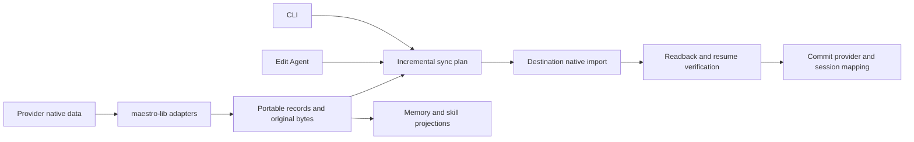

# Provider translation and reversible switching

Research baseline: 2026-10-13, branch `provider-translation-layer`, commit `0dca5bd096`.
Status (2026-10-14): Claude Code/Codex converters and one CLI/UX migration path are implemented. Tests and isolated acceptance are authored but NOT EXECUTED. Both directions remain unverified. The original guinea pig and provider homes were read only.

Live QA update (2026-10-17): exercised isolated Claude Code 2.1.302 / Codex 0.163.0 sessions after explicit test authorization. CLI preflight exposed undeclared installed versions and the selected Claude profile's shared `projects` link. Native resume also exposed invalid foreign message IDs and provider-added persistence metadata. The implementation now declares these versions, pins the canonical selected projects directory, preserves nested-link checks, uses provider-assigned Codex IDs, and estimates capacity from projected history instead of archived diagnostics.

The production translation service completed Claude -> Codex -> Claude with real native files and Codex app-server, using isolated stores and a no-op desktop notification boundary. `maestro-cli send --session ... --read-only --no-system-prompt --no-history --no-synopsis` resumed both destinations and recalled the original conversation-only marker. A further CLI turn read the carried instruction, memory, skill and subagent-definition markers. Draft and queue fixtures survived the service round trip. Skill execution, subagent invocation, arbitrary tool histories, attachments and repeated incremental synchronization remain uncertified; both directions remain unverified. The running desktop must be rebuilt before its full CLI migration path can use these source fixes.

Final static review (2026-10-14): retained the implementation and existing documentation edits; completed the 29 implementation checkboxes across all seven phase documents. `npm run lint` passed, production ESLint passed with `--max-warnings 0`, and `npm run docs:verify` reported zero findings across 713 paths and 262 index entries. Static TypeScript checking of the 11 new translation test files reported zero diagnostics; syntax parsing covered all 28 changed test files without executing modules. The prepared acceptance driver passed `tsc -p .maestro/scratch/provider-translation-driver-tsconfig.json --noEmit`. No LSP surface was available. Native acceptance and test execution remain pending a direct request; no provider homes or original-agent data were modified, and no branch switch, commit, hooks, push or PR occurred.

## Product contract

An agent keeps its identity, tabs, transcript, history, memories, and portable skills when its provider changes. The incoming provider receives the conversation and knowledge required to continue. Returning to a previous provider imports intervening changes exactly once.

Support is directional and versioned. Having a History reader, a resume flag, or a preserved Maestro transcript does not prove native import support. A supported pair removes the warning only when the particular migration can deliver its complete portable payload. Unsupported pairs and partial migrations explain the exact limitation. Migration failures preserve the old provider and its session pointers.

Separate three guarantees:

| Code | Guarantee             | Required evidence                                                                                                                |
| ---- | --------------------- | -------------------------------------------------------------------------------------------------------------------------------- |
| D1   | Data preservation     | Original records and attachments survive byte-for-byte in a recoverable archive, including unknown records                       |
| D2   | Context continuity    | Destination actually resumes with ordered conversation, tool evidence, and accessible memories; new turns survive switching back |
| D3   | Capability continuity | Instructions, skills, subagent definitions, and required tool bindings load with equivalent supported behavior                   |

D1 alone is insufficient to claim D2 or D3. Signed Claude thinking and encrypted Codex reasoning cannot simply be turned into valid foreign reasoning blocks. Preserve their original bytes and provenance; do not forge signatures, expose encrypted content, replay tool execution, or treat old system prompts as the new provider's system instructions. Report material runtime limitations even when the archive is complete. A smaller context window also remains a limit: never silently summarize or truncate history to make a switch succeed.

## Research snapshot before implementation

| Code | Finding                                                                                            | Evidence                                                                                                                |
| ---- | -------------------------------------------------------------------------------------------------- | ----------------------------------------------------------------------------------------------------------------------- |
| F1   | Edit Agent preserves tabs and parks provider IDs, but does not sync context between providers      | `src/renderer/utils/providerTabSessions.ts:30`; `src/renderer/hooks/session/useSessionLifecycle.ts:249`                 |
| F2   | CLI switching still discards tabs, file previews, closed history, and queue, and kills the process | `src/renderer/hooks/remote/useAppRemoteEventListeners.ts:1783`; `src/cli/commands/update-agent.ts:223`                  |
| F3   | Seven native History readers are registered                                                        | `src/main/storage/index.ts`: Claude, Codex, OpenCode, Factory Droid, Copilot, OMP, Grok                                 |
| F4   | Current History message types flatten native content; they are not a lossless interchange format   | `src/main/agents/session-storage.ts:33`; `src/renderer/utils/contextExtractor.ts`                                       |
| F5   | Project memory UI and operations already exist, currently for Claude only                          | `src/main/memory-manager.ts`; `src/main/ipc/handlers/memory.ts`; `src/renderer/components/MemoryViewer.tsx`             |
| F6   | Headless provider lifecycle already lives in maestro-lib                                           | `src/shared/maestro-lib/run/session.ts`; `launch/launch-plan.ts`; `run/start-turn.ts`; `host.ts`                        |
| F7   | Codex RPC and framing already exist, but under main                                                | `src/main/codex-app-server/rpc-client.ts`, `protocol.ts`, `server-requests.ts`; `docs/agent-guides/CODEX-APP-SERVER.md` |

F2 must be removed through one shared switch operation, rather than giving the CLI a second converter.

## Provider readiness

These are research confidence levels, not released conversion support. No pair is certified today.

| Code | Provider                             | Current evidence                                                                                                                              | Decision                                                                                    |
| ---- | ------------------------------------ | --------------------------------------------------------------------------------------------------------------------------------------------- | ------------------------------------------------------------------------------------------- |
| P1   | Claude Code                          | Installed 2.1.296; native JSONL, memory files, existing reader and sanitizer, project instructions and skill examples                         | Enough to begin both directions with P2; reverse native writing still needs resume proof    |
| P2   | Codex                                | Installed 0.162.1; 2,017 session JSONL candidates; rollout and SQLite stores; generated protocol schema; local memory files and generation DB | Enough to begin both directions with P1; prefer native import and history injection         |
| P3   | OpenCode                             | Installed 2.0.25; legacy and current SQLite records; reader; documented native export/import                                                  | Strong next candidate; current v2 storage and memory semantics need adapter work and proof  |
| P4   | Copilot CLI                          | Installed 1.0.95; 127 JSON/JSONL candidates; `events.jsonl`, workspace metadata, SQLite store; reader and recovery docs                       | Next candidate; full memory and cloud sync behavior need investigation before certification |
| P5   | Factory Droid, OMP, Grok             | Existing native readers describe schemas; no local default-home samples found in this pass                                                    | Enough to plan extraction, insufficient for verified import and round-trip sync             |
| P6   | Pi, Qwen3 Coder, Hermes, Antigravity | Supported in provider registry, no registered native History reader; no relevant local session samples found in this pass                     | Research required before conversion support                                                 |
| P7   | Gemini CLI                           | Legacy registry ID, withheld from picker; local home exists without sampled sessions                                                          | Do not expand scope into a new provider integration                                         |

OpenCode's live DB contains both legacy `session/message/part` tables (440/2,763/8,695 rows) and `session_v2/session_message` (449/2,928 rows). Its current messages have typed records and sequence numbers. Do not assume the existing older reader covers everything.

Codex's live homes include `state_5.sqlite` (thread metadata), `thread_history_1.sqlite` (turn/item projection), and `memories_1.sqlite` (22 `stage1_outputs` rows at inspection), alongside JSONL and memory files. Whole-DB transplantation would copy unrelated threads, accounts, and runtime state; portable import must select the relevant records.

## Reuse newly available Codex mechanisms

Ran `codex app-server generate-json-schema --experimental --out .provider-translation-schema` against installed 0.162.1. Inspected the generated definitions, then removed this temporary schema directory.

`ExternalAgentConfigMigrationItemType` includes `AGENTS_MD`, `CONFIG`, `SKILLS`, `PLUGINS`, `MCP_SERVER_CONFIG`, `SUBAGENTS`, `HOOKS`, `COMMANDS`, `MEMORY`, and `SESSIONS`. Migration details can select individual memories, sessions, skills, and subagents. A nonempty `cwd` denotes repository scope. Schema availability proves an API shape, not successful or lossless conversion.

Official documentation describes `externalAgentConfig/detect` and `externalAgentConfig/import`, completion notifications, and import history. Reuse the built-in importer where it meets scope and fidelity requirements. Its one-way configuration import is not Maestro's repeated synchronization contract. [Codex App Server](https://learn.chatgpt.com/docs/app-server)

`ThreadInjectItemsParams` requires `threadId` and `items`. `thread/inject_items` persists prebuilt Responses items into model-visible history without generating a turn, providing a candidate for incremental sync. Prove reload and subsequent CLI resume behavior before relying on it. `ThreadResumeParams.history` is marked unstable, for Codex Cloud, and explicitly DO NOT USE in the installed schema; exclude that shortcut. [History injection](https://learn.chatgpt.com/docs/app-server#inject-items-into-a-thread)

## Guinea pig baseline

- Agent: `92eb2f16-433d-4ecd-bb87-885c8a64b2f7`, Distribution Stack, Claude Code, `/Users/pedram/Projects/Distribution`.
- Maestro tab: `a77c0b6c-83c5-4275-baa9-9098994993f1`.
- Native Claude session: `62838201-7db3-4922-a465-3ea7d00babb3`.
- `maestro-cli session show <tab-id> --json` returned two displayed messages: one user, one assistant.
- Native file: `~/.claude/projects/-Users-pedram-Projects-Distribution/62838201-7db3-4922-a465-3ea7d00babb3.jsonl`, 396,951 bytes, 57 records.
- Native types: queue-operation 4, attachment 27, user 6, atis-latch 4, last-prompt 5, assistant 6, system 2, cost-state 2, mode 1. Content arrays include four tool calls and four tool results. Record count is not conversation-turn count.
- Project memory: `MEMORY.md` (300 bytes), `failing-autorun-playbooks-run-directly.md` (1,634), `distribution-root-is-local-only.md` (1,437), total 3,371 bytes. Memory bodies were not needed for this research.
- Project `AGENTS.md` already symlinks to the 15,748-byte `CLAUDE.md`.
- Numerous other native sessions and three sampled child transcripts also exist in the project directory. The selected tab is small; the whole project archive is larger.

Live data can change. Re-resolve IDs, account roots, active state, bytes, and hashes immediately before any migration. The selected tab is the first acceptance target, not authority to copy every project session indiscriminately.

## Architecture

Implement a star topology: each provider reads and writes a portable model. Avoid a separate converter for every provider pair. The library has no Electron or renderer imports; hosts supply account roots, identity, metadata persistence, and UI progress.

Portable records retain role, text/content blocks, attachment bytes or verified references, tool call/result linkage, timestamps, provenance, branch/parent relationships, compaction boundaries, and native opaque records. The archive keeps raw source bytes separately from deterministic semantic hashes. Display text extraction remains useful for rendering, but cannot be the transport.

Proposed public library operations: plan, apply, inspect result, and recover/rollback a provider migration. Exact names should follow existing exports. Plans include source/destination/provider versions, roots, scope, per-tab mappings, conflicts, missing capabilities, record counts, and a fidelity result. Expose the same planner through CLI dry-run and Edit Agent. Unsupported direct library/CLI apply refuses unless the caller explicitly accepts listed limitations.

Incremental sync uses source-provider/native-record identity plus the last successfully imported checkpoint. Imported records retain original lineage so an A -> B -> A -> B cycle does not echo its own history. Repeated identical messages remain distinct events. Memory uses three-way comparison against the last shared version; both-side edits retain both variants and block a clean switch rather than using timestamps to overwrite a preference. Preserve deletions as tombstones, forks as branches, and compaction as a boundary rather than a new duplicate conversation.

While a source turn is running, allow the user to select the new provider but defer migration commit and the next destination turn until the source settles and final events are captured. Do not kill the current turn, acknowledge premature success, or migrate a partial tail. Reuse `turnProvider`, provider slots, persistence flushing, busy checks, and queue machinery.

Stage, read back, verify, then commit each agent-wide operation. All selected tabs must succeed before the agent's provider changes. A durable operation journal enables recovery after a crash between destination writes and mapping commit. Backups, hashes, and tracked ownership permit rollback without deleting newly authored work. Use consistent SQLite snapshots through supported readers/APIs; do not copy an active SQLite DB without its transaction state.

## Memories, instructions, skills, subagents

Default proposal: this agent's owned open/closed/history conversations, project memories, and the instructions/skills/subagents it can use. Account-global knowledge needs an explicit scope choice; unrelated agents' histories are excluded. Project histories shared by multiple Maestro agents require ownership-aware selection.

Claude's memory root may follow repository/worktree identity or configured `autoMemoryDirectory`; resolve provider account homes and actual overrides rather than hardcoding the default. [Claude memory](https://code.claude.com/docs/en/memory)

Codex memories are generated state with delayed consolidation, not a mirrored Claude project folder. A memory bridge must make imported project knowledge immediately discoverable, preserve links/evidence, and collect later changes without hand-editing a generated global summary or enabling global settings. Prefer native import where it delivers this contract; otherwise use a managed project-scoped projection plus provider discovery bindings. [Codex memories](https://learn.chatgpt.com/docs/customization/memories)

Shared instruction and skill bodies are appropriate. Codex discovers project skills in `.agents/skills` and instructions through `AGENTS.md` precedence. Preserve existing symlinks such as the guinea pig's `AGENTS.md`; do not create duplicate instruction loads or overwrite distinct files. [Codex skill discovery](https://learn.chatgpt.com/docs/build-skills), [Codex instruction discovery](https://learn.chatgpt.com/docs/agent-configuration/agents-md)

Claude skills can carry execution settings such as forked contexts, model choices, and hooks. Claude subagents use Markdown/frontmatter, while Codex custom agents use TOML definitions. Share portable bodies; translate supported execution metadata and retain unsupported fields in the archive with a capability limitation. Symlinking unlike definition formats does not create equivalent behavior. [Claude skills](https://code.claude.com/docs/en/skills), [Claude subagents](https://code.claude.com/docs/en/sub-agents), [Codex subagents](https://learn.chatgpt.com/docs/agent-configuration/subagents)

Credentials are destination configuration, not translated memory. Existing account/MCP/tool bindings must be checked; do not copy keys or broaden permissions to make a skill appear compatible.

OpenCode has a documented JSON export/import route; prefer that to writing internal SQLite tables. [OpenCode CLI](https://opencode.ai/docs/cli/#import)

Copilot keeps native files plus a derived session store; reindexing can also sync data to GitHub. Investigate that side effect before offering a silent local migration. [Copilot session recovery](https://docs.github.com/en/copilot/how-tos/copilot-cli/use-copilot-cli/chronicle#reindexing-the-session-store)

## Engineering reuse

Read `CLAUDE-AGENTS.md`, `CLAUDE-SESSION.md`, and the task-specific guide before edits. Use existing `generateUUID`, `canonicalJson`, `encodeClaudeProjectPath`, `createKeyedWriteQueue`, provider account/profile/environment resolvers, launch/run functions, `switchTabProvider`, `updateProviderSlot`, session-store mutations, and IPC/CLI patterns. Move only the required environment-neutral implementation into shared code and preserve existing wrappers. Do not duplicate a JSONL parser, RPC client, memory reader, or atomic writer.

`src/main/utils/atomic-json-store.ts` already has `atomicWriteFile` for JSONL. `src/main/agents/claude-transcript-sanitizer.ts` already handles linked-list repair and account-scoped thinking shells; retain those invariants when factoring reusable pieces. The in-process keyed queue alone does not protect against another provider process: adapters also need a quiescent source or a provider-supported mutation channel.

## Delivery and validation

Task-based playbook: `/Users/pedram/Projects/Maestro/.maestro/playbooks/2026-10-13-Provider-Translation/PROVIDER-TRANSLATION-01.md` through `07.md`. Authored on 2026-10-13; implementation and launch authorized on 2026-10-14 for agent `9bbc8bf6-ed8a-459b-b373-4d04f776fd02`. The run includes dependency baseline repair and final provider-onboarding documentation. Native conversion and acceptance remain unverified until their evidence exists.

Implement Claude/Codex first. Build a generic registry now, leave other pairs unverified until their adapters and evidence exist. Do not add OpenCode/Copilot adapters merely because their formats are readable.

Update test cases whenever code changes. Do not run test cases or live provider acceptance cases until Pedram asks. Run `npm run lint`. LSP navigation is useful for Session/AITab and switch call sites if an LSP surface is available; none was exposed to this research session.

Authoring checks on 2026-10-13: all seven phase documents have executable checkbox tasks (27 total); Prettier check passed for the research and all phases; `git diff --check` passed. `maestro-cli refresh-auto-run --background --agent 9bbc8bf6-ed8a-459b-b373-4d04f776fd02 --json` returned success. `npm run lint` exited 2 at `src/main/lite/pairing/host.ts:5` with TS2307, missing `@serenity-kit/opaque` or its type declarations. Only documentation changed; no tests ran, no provider conversion occurred, and the guinea pig remains unchanged.

Acceptance execution, once requested: snapshot the guinea pig into isolated provider homes inside this worktree; convert Claude -> Codex, continue with a fact recalled from earlier context, create a new memory/history delta, convert back to Claude, and repeat with no duplicate imports. Check original artifact hashes, destination resume, missing attachments, memory discovery, skills and subagent loading, crash recovery, and all-tabs atomicity. Only then qualify the tested direction/version/payload classes for warning-free switching. A real switch of the original agent follows separately, with backups and applicable native-home write scope.

## Open scope decision

Q1: Should user/account-global memories and skills be included automatically, or should the first release migrate project knowledge plus selected user-level resources? Recommended: project knowledge plus selected user-level resources. Until decided, home-wide import remains excluded.

For the authorized 2026-10-14 implementation, proceed with project knowledge plus selected user-level resources. This scope permits useful implementation without copying unrelated global knowledge; account-wide expansion remains a separate choice.

## Implemented support and evidence (2026-10-14)

| Direction              | Declared versions | Implementation                                                                                            | Certification                                            |
| ---------------------- | ----------------- | --------------------------------------------------------------------------------------------------------- | -------------------------------------------------------- |
| Claude Code → Codex    | 2.1.296 → 0.162.1 | Native extraction, fresh thread/injection/readback, original lineage, scoped resources and managed memory | **Unverified**; explicit warning acceptance required     |
| Codex → Claude Code    | 0.162.1 → 2.1.296 | Native extraction, new linked transcript/readback, original lineage, scoped resources and managed memory  | **Unverified**; explicit warning acceptance required     |
| Other provider/version | None              | No conversion declared                                                                                    | Blocks; native History/resume capability is insufficient |

The actual mapping is [provider-translation-native-formats.md](provider-translation-native-formats.md). Registration and the new-provider example are in [PROVIDER-SUPPORT.md](../PROVIDER-SUPPORT.md#provider-translation-contract). CLI and Edit Agent use `src/main/provider-translation-service.ts` through the same renderer service and `agents:translateProvider` IPC contract. Plan/apply/status/recover/rollback share maestro-lib. Provider changes preserve queues, drafts, file tabs and closed/snoozed tabs, park source IDs, and wait for final source events. History aliases follow open and closed native mappings across hops; unresolved entries retain their records and refuse a foreign native resume. Source-provider queued settings use destination defaults without destroying the queued item.

Scope is project knowledge and exact selected user-level resources. No account-global generated memory, credentials or provider database transplantation. Compatible native skill/subagent projections are separate from archived unsupported execution metadata. Codex paginated-only history without complete native rollout evidence blocks. Opaque reasoning, foreign branches and compact runtime state remain explicit limitations. Original provider homes and guinea pig were never mutated during implementation.

### Authored cases, not executed proof

| Invariant                                                                                       | Concrete cases                                                                                                                |
| ----------------------------------------------------------------------------------------------- | ----------------------------------------------------------------------------------------------------------------------------- |
| D1 native bytes/provenance, roles/tools/attachments/opaque rows                                 | `translation-contract.test.ts`, `translation-native.test.ts`, synthetic fixture README; existing native History tests updated |
| D2 A → B → A → B, repeated identical text, edited/truncated/divergent records                   | `translation-reconcile.test.ts`, `translation-adapters.test.ts`                                                               |
| D3 memory links/metadata/discovery, conflicts, tombstones, native resources and symlink escapes | `translation-resources.test.ts`, `translation-projections.test.ts`, Memory Manager/Viewer and capability tests                |
| Direction/version/payload gating, no-op and paginated-only refusal                              | `translation-adapters.test.ts`, `translation-native.test.ts`                                                                  |
| All-tab mapping, parked IDs, closed/snoozed History, drafts and queues                          | `translation-session.test.ts`, providerTabSessions and lifecycle/remote tests                                                 |
| Deferral, partial failure, tracked rollback, staged commit/recovery and later-work refusal      | `translation-transaction.test.ts`, lifecycle sync cases                                                                       |
| One IPC/CLI/UX result and limitation gate                                                       | preload/agents, ipc/handlers/agents, CLI update-agent, EditAgentModal and remote configuration cases                          |
| Acceptance authorization, source safety and scratch credential inputs                           | `translation-acceptance-inputs.test.ts`; opt-in driver prepared, **not executed**                                             |

The translation tests above are under `src/__tests__/shared/maestro-lib/`. No passing-test or native-lossless claim is made. No PR, commit, push or test-executing hooks were run.

### Preparation and verification commands

- Dependencies: `npm ci --ignore-scripts --cache .maestro/scratch/npm-cache --no-audit --no-fund` completed; baseline `npm run lint` passed.
- Real TOML parsing: pinned `smol-toml@1.9.1`; install scripts disabled, unrelated dependency/lock changes removed.
- Read-only research: `codex --version`, `codex app-server generate-json-schema --experimental --out .maestro/scratch/provider-translation-schema`, `claude --help`, source `session show` and native SHA-256 inspection. No native imports or continuations.
- LSP tools were sought but no LSP surface was exposed; used repository navigation and static TypeScript checks.
- Final `npm run lint`: **passed** (renderer/shared, main and CLI TypeScript checks).
- ESLint on all changed production TypeScript/TSX with `--max-warnings 0`: **passed**. Repository ESLint ignores tests/scripts; they were not represented as linted test behavior.
- Prettier on changed files: **passed**. `npm run docs:verify`: **passed**, 713 asserted paths and 262 index entries, zero findings.
- `tsc -p .maestro/scratch/provider-translation-driver-tsconfig.json`: **passed**, static compilation only. TypeScript parser syntax checks: **passed**, 25 changed test files, without loading or executing their modules.
- `git diff --check`: **passed**. Final read-only original transcript hash: **unchanged**, 396,951 bytes, `c387b8b87df38202cce069790b821c2789f97297e30aba5012c899c632b83948`.
- Tests, acceptance, native imports and native continuation were **not executed**. No PR, push, commit or hooks. Work remains in `provider-translation-layer`; no branch switch occurred.

### Prepared isolated acceptance

`scripts/provider-translation-acceptance.mjs` refuses execution without `--execute-isolated-acceptance`. A future explicitly authorized run also requires `--claude-auth` and `--codex-auth` paths already staged inside this checkout's ignored scratch, `--recall-question` and `--expected-recall`. Do not copy entire provider homes/config/DBs to satisfy those flags. The driver re-resolves source agent/tab/native IDs, effective account and idle state, confines writes to fresh scratch HOME/provider homes/project, checks original source hashes, and prepares three native continuation hops with recall and memory deltas. It records evidence without auto-promoting registry declarations to verified.

### Seven-phase implementation index

| Phase | Delivered artifact                                                                                                                             |
| ----- | ---------------------------------------------------------------------------------------------------------------------------------------------- |
| P01   | Dependency/lint baseline, native-format mapping, installed schema investigation, read-only guinea pig evidence, synthetic fixtures             |
| P02   | Portable contracts, directional registry/planner, private durable archive and journal                                                          |
| P03   | Shared native readers, Claude staged writer, Codex RPC extraction/injection and scoped importer/pagination utilities                           |
| P04   | Actual memory roots and overrides, project discovery bridge, native compatible instructions/skills/subagents, conflict limits                  |
| P05   | Original-event reconciliation, all-tab transaction/recovery, parked IDs and persisted migration state, live-turn deferral and queue provenance |
| P06   | One IPC/remote/CLI/Edit Agent operation, accurate warnings/results, existing Memory Viewer bridge                                              |
| P07   | Targeted cases authored, isolated acceptance driver prepared, static verification and final new-provider contract documented                   |

P01–P07 are implementation/preparation records. They do not certify native resume, recall, capability equivalence or lossless repeated round trips. The explicit limitations in the native mapping remain part of the implemented contract.

### Implementation audit, 2026-10-14

The existing seven-phase implementation and user documentation edits were retained. The audit added selected-account validation before Claude transcript writes and Codex history injection, including file/parent symlink escapes; retained out-of-scope nested resource links without importing their bodies; and blocked selected aliases outside approved resource categories or missing explicit resources. Durable staged `destinationObserved` hashes now survive mapping-commit crashes without accepting later native edits/turns as the import baseline. The host requires recovery/rollback before replacing unfinished operations and defaults status/recovery to the persisted operation ID.

Regression cases were added to `translation-transaction.test.ts`, `translation-adapters.test.ts`, `translation-resources.test.ts`, `translation-projections.test.ts` and `src/__tests__/main/provider-translation-service.test.ts`. They remain **unexecuted**. The final contract and concise onboarding guidance in all three requested documents include these invariants.

Static checks: `npm run lint` passed; ESLint with `--max-warnings 0` passed on 61 changed production files; `npm run docs:verify` passed with 713 asserted paths, 262 index entries and zero findings; focused Prettier and `git diff --check` passed. TypeScript syntax parsing covered 26 changed test files without importing/executing them; `tsc -p .maestro/scratch/provider-translation-driver-tsconfig.json --noEmit` passed for the prepared driver. No tests, acceptance cases, native imports, provider turns, PR, push, commits or hooks were run. The branch remains `provider-translation-layer`; the original guinea pig and provider homes were not modified.

### Resource ownership and CLI response audit, 2026-10-14

Retained the existing implementation and user documentation edits. Native resource projections, managed knowledge bodies and discovery indexes now share one journaled staging writer in maestro-lib. Creation intents remain unowned until exclusive file/alias creation succeeds; colliding files with identical bytes and unowned dangling links cannot be removed by rollback. The writer also creates the discovery-index directory when there are no selected knowledge files.

The migration timeout now applies to the CLI migration call rather than ordinary config edits. Its web bridge keeps the reply channel open beyond the settings deadline and reports a timeout as uncertain completion with a migration-status instruction. The transaction, CLI and existing web-server factory cases cover these changes and remain **unexecuted**. The three requested provider-onboarding documents now describe the ownership and response-timeout contract.

Current static evidence: `npm run lint` passed; ESLint with `--max-warnings 0` passed on 61 changed production files; `npm run docs:verify` passed with 713 asserted paths, 262 index entries and zero findings. TypeScript syntax parsing passed for 27 changed test files without loading their modules. `tsc -p .maestro/scratch/provider-translation-driver-tsconfig.json --noEmit` passed. Both conversion directions remain **unverified**. No test or live acceptance cases, native imports, provider continuations, commits, hooks, PR or push were executed. No branch switch occurred, and the original guinea pig and provider homes were not modified.

### Historical recovery and destination environment audit, 2026-10-14

Preserved the seven-phase implementation and existing documentation edits. Recovery/rollback now reject a historical operation ID when the agent has a different current operation; status can still inspect historical journals. The library also refuses rollback of a committed journal after a later switch replaces its active operation ID, protecting previously committed native artifacts. The Codex import channel now reuses `buildAgentEnvironment` for destination provider defaults, global settings and destination credentials, then pins the planned account root; source-specific session environment overrides are excluded.

Regression cases were added to `src/__tests__/main/provider-translation-service.test.ts` and `src/__tests__/shared/maestro-lib/translation-transaction.test.ts`. They are **authored, not executed**. `PROVIDER-SUPPORT.md`, `CLAUDE-AGENTS.md` and `docs/agent-guides/AGENT-INFRA.md` describe the implemented guards and launch-environment contract.

Static evidence from this audit: `npm run lint` passed; scoped ESLint with `--max-warnings 0` passed on 61 changed production files; the repository's dash-only ESLint configuration passed on 28 changed test/JavaScript script files. That configuration excludes the TypeScript acceptance driver, which passed `tsc -p .maestro/scratch/provider-translation-driver-tsconfig.json --noEmit` separately. `npm run docs:verify` passed with 713 asserted paths, 262 index entries and zero findings. Syntax parsing passed on 27 changed test files without importing their modules; focused Prettier passed. No LSP surface was available. Both native conversion directions remain **unverified**; no tests, live acceptance, provider imports/turns, commits/hooks, PR or push were run. The branch remains `provider-translation-layer`, and the original guinea pig/provider homes were not modified.

### Native identity commit audit, 2026-10-14

Preserved the existing seven-phase implementation and documentation edits. The shared `commitTranslationSession` now refuses a mapping when a tab's native source ID changes after staging, including closed tabs and saved inventory. Lifecycle/IPC delivery remains idempotent only when the destination ID and parked source ID both match. A late native ID cannot replace a staged empty tab unnoticed; failure leaves the input agent unchanged.

Added regression cases in `translation-session.test.ts` without executing them and updated the final contract in all three requested provider guides. `npm run lint` passed; scoped ESLint with `--max-warnings 0` passed on 61 changed production files and on the final shared commit change. `npm run docs:verify` passed with 713 asserted paths, 262 index entries and zero findings. Focused Prettier passed; static acceptance-driver compilation with `tsc -p .maestro/scratch/provider-translation-driver-tsconfig.json --noEmit` passed. No LSP surface was available. Both conversion directions remain **unverified**. No tests, live acceptance, provider imports/turns, commits/hooks, PR, push or branch switches were performed; the original guinea pig and provider homes were not modified.

### Read scope audit, 2026-10-14

Reviewed all seven phase documents against the existing implementation and preserved the user's documentation edits. Native transcript snapshots and pre-commit rechecks now reuse `assertTranslationTarget` against approved account roots, including parked/checkpoint accounts. Return-trip managed knowledge directories stay inside the project, bodies stay inside the managed tree, and owned native projections stay inside the project. Managed memory links retain link evidence without importing unselected bodies; managed collection limitations now reach preflight.

Added unexecuted regression cases in `provider-translation-service.test.ts` and `translation-resources.test.ts` for file/parent escapes, same-byte retargeting after preflight, whole knowledge-directory retargeting, managed memory and selected-user directory links, owned projections, and return-trip limitation propagation. Updated the implemented contract in `PROVIDER-SUPPORT.md`, `CLAUDE-AGENTS.md`, and `docs/agent-guides/AGENT-INFRA.md`.

Static checks: final `npm run lint` passed; ESLint with `--max-warnings 0` passed on all 61 changed production files and again on the final two production files. The dash-only ESLint configuration passed on both updated regression files. `npm run docs:verify` passed with 713 asserted paths, 262 index entries and zero findings. Focused Prettier and `git diff --check` passed. Syntax parsing covered 27 changed test files, with a final repeat on the two updated files, without importing or executing test modules. The prepared acceptance driver's `tsc -p .maestro/scratch/provider-translation-driver-tsconfig.json --noEmit` passed. No LSP surface was available. Both directions remain **unverified**; no tests, live acceptance, native imports, provider turns, commits/hooks, PR, push or branch switches were performed. The original guinea pig and provider homes were not modified.

### Codex import readiness audit, 2026-10-14

Retained the seven-phase implementation and existing documentation edits. The shared host now opens the selected-account Codex import channel for ready plans with no limitations as well as explicitly accepted warnings. A certified complete plan therefore does not require an acceptance flag. Blocked, deferred, no-op and unaccepted-warning plans do not open the channel; the library remains responsible for their refusal or deferral.

Expanded `src/__tests__/main/provider-translation-service.test.ts` to cover those six readiness cases, destination launch settings, channel forwarding and cleanup. The cases are **authored, not executed**. Updated the actual channel contract in `PROVIDER-SUPPORT.md`, `CLAUDE-AGENTS.md` and `docs/agent-guides/AGENT-INFRA.md`.

Current static evidence: `npm run lint` passed; ESLint with `--max-warnings 0` passed on all 61 changed production files and the dash-only configuration passed on the updated test file. `npm run docs:verify` passed with 713 asserted paths, 262 index entries and zero findings. Focused Prettier and `git diff --check` passed. The updated test file passed syntax parsing without module execution, and `tsc -p .maestro/scratch/provider-translation-driver-tsconfig.json --noEmit` passed for the prepared acceptance driver. No LSP tool was exposed. Both native directions remain **unverified**. No tests, live acceptance, provider imports/turns, commits/hooks, PR, push or branch switches were run. The branch remains `provider-translation-layer`; the original guinea pig and provider homes were not modified.

### Clean deferred migration audit, 2026-10-14

Reviewed all seven phases against the existing implementation and preserved the existing user documentation edits. The shared CLI/UX renderer client now continues clean deferrals without requiring warning acceptance, retains the plan's verification state, and restores saved deferrals after reload without granting additional consent. Replanning the completed source still refuses newly discovered limitations before native apply.

Added `src/__tests__/renderer/services/providerTranslation.test.ts` using existing Session/AITab factories. Cases cover clean deferral with omitted/false/true acceptance, shared pending completion, native mapping/draft preservation, saved deferral restoration and new-warning refusal. Cases remain **authored, not executed**. All three provider-onboarding documents describe the final deferred client contract.

Static evidence: `npm run lint` passed; ESLint with `--max-warnings 0` passed on all 61 changed production files and the dash-only configuration passed on the new test file. `npm run docs:verify` passed with 713 asserted paths, 262 index entries and zero findings. Static TypeScript checking with the new test explicitly added to the lint program passed without loading test modules; syntax parsing passed on 28 changed test files. No LSP surface was exposed. Both conversion directions remain **unverified**. No tests, live acceptance, native imports/turns, commits/hooks, PR, push or branch switches were run. The original guinea pig and provider homes were not modified.

### Absent rollback target audit, 2026-10-14

Preserved the existing seven-phase implementation and user documentation edits. Shared rollback now validates selected roots before checking whether a target exists, so restoring a backup cannot bypass the parent-symlink guard for an absent file. A missing backed-up projection can be restored only when its deletion is journaled; files deleted after staging require inspection instead of being recreated over later user intent.

Added three regression cases in `translation-transaction.test.ts`: journaled deletion restoration, refusal after a later deletion, and refusal when a deleted resource's parent is replaced with an external directory link. Cases remain **authored, not executed**. The final provider contract and both onboarding guides describe these rollback requirements.

Static evidence: `npm run lint` passed; ESLint with `--max-warnings 0` passed on all 61 changed production files, and the dash-only configuration passed on the updated test file. `npm run docs:verify` passed with 713 asserted paths, 262 index entries and zero findings. Focused Prettier and `git diff --check` passed. Syntax parsing passed on 28 changed test files without importing or executing them. `tsc -p .maestro/scratch/provider-translation-driver-tsconfig.json --noEmit` passed for the prepared driver. No LSP surface was available. Both directions remain **unverified**. No tests, live acceptance, provider imports/turns, commits/hooks, PR, push or branch switches were run. The branch remains `provider-translation-layer`; the original guinea pig and provider homes were not modified.

### Library retry and test-import audit, 2026-10-14

Retained the seven-phase implementation and existing documentation edits. `applyTranslation` now returns a committed journal's saved result without native writes. Other non-planned operations or journals with existing mappings/writes refuse replay and preserve their recovery evidence. Added regression cases for committed retries with later native work and seven states containing staged artifacts; these cases were authored, not executed. All three provider-onboarding documents describe this library requirement.

Static TypeScript checking exposed source imports one directory too high in eight translation test files, which ordinary production lint and syntax parsing had not detected. Corrected those imports and annotated session fixtures with the existing shared contract. The unchanged four-level import of the repository-root acceptance driver remains correct. A TypeScript program using `tsconfig.lint.json` plus all nine translation test files now reports zero diagnostics without importing or executing test modules. Syntax and relative-import checks across all 28 changed test files also report zero findings.

Current checks: `npm run lint` passed; ESLint with `--max-warnings 0` passed on 61 changed production files, and the dash-only configuration passed on all nine translation test files. `npm run docs:verify` passed with 713 asserted paths, 262 index entries and zero findings. Focused Prettier and `git diff --check` passed. No LSP tool was available. Both native directions remain **unverified**. No tests, live acceptance, provider imports/turns, commits/hooks, PR, push or branch switches were run; the original guinea pig and provider homes were not modified.

### Host preflight identity and retry audit, 2026-10-14

Preserved the seven-phase implementation and existing user documentation edits. The shared host now retains the reviewed `planId` after refreshing and matching its fingerprint. Apply retries inspect the saved journal before opening a native channel: a current, settled commit returns its saved result, while historical commits, unfinished staging, mappings and write intents refuse a new import. A committed journal with unsettled agent state requires recovery.

Added unexecuted regression cases in `src/__tests__/main/provider-translation-service.test.ts` for ready/deferred preflight identity, current/historical/destination-mismatch retries, unsettled commits and staging evidence without a persisted active migration. Static TypeScript checking also found two existing mock callback signatures incompatible with Vitest's inferred unknown arguments; corrected those signatures. Updated the contract in `PROVIDER-SUPPORT.md`, `CLAUDE-AGENTS.md` and `docs/agent-guides/AGENT-INFRA.md` without replacing the existing edits.

Checks: `npm run lint` passed; ESLint with `--max-warnings 0` passed on all 61 changed production files; the dash-only ESLint configuration passed on the updated test file. A TypeScript program using `tsconfig.lint.json` plus that test file reports zero diagnostics without importing or executing test modules. `npm run docs:verify` passed with 713 asserted paths, 262 index entries and zero findings. Focused Prettier, `git diff --check` and `tsc -p .maestro/scratch/provider-translation-driver-tsconfig.json --noEmit` passed. No LSP surface was available. Both conversion directions remain **unverified**. No tests, live acceptance cases, provider imports/turns, commits/hooks, PR, push or branch switches were run. The original guinea pig and provider homes were not modified.

### Native tool linkage audit, 2026-10-14

Read the seven phase documents and retained the existing implementation and user documentation edits. Shared native extraction now blocks duplicate tool calls/results, results preceding their calls, and invalid tool message roles before staging. Parallel calls can still receive results in a different order once the calls exist; original bytes are retained without replay or history reordering. Added Claude/Codex regression cases to `translation-native.test.ts` without executing them. Removed the duplicate local `createMockAITab` declaration from the lifecycle tests, reusing the existing canonical factory. All three requested provider guides now state the tool-link contract.

Static evidence: final `npm run lint` passed; ESLint with `--max-warnings 0` passed on all 61 changed production files, and the dash-only configuration passed on both updated test files. `npm run docs:verify` passed with 713 asserted paths, 262 index entries and zero findings. A focused TypeScript compiler program checked the 11 new translation test files plus the updated lifecycle test with zero diagnostics, without executing modules. A separate broader check of all 28 modified test files reported 255 diagnostics, largely mock/API typing mismatches; it is not passing evidence for the full test set, which repository lint excludes. Focused Prettier, `git diff --check` and static acceptance-driver compilation passed. No LSP surface was exposed. Both directions remain **unverified**. No tests, live acceptance, native imports/turns, commits/hooks, PR, push or branch switches were run. The original guinea pig and provider homes were not modified.

### Backup integrity audit, 2026-10-14

Read all seven phase documents and retained the existing implementation and user documentation edits. `TranslationArchive` now archives and validates backup bytes from projections, resource writes and native mappings on both write and reload. Direct `recoverTranslation` rollback also validates every backup hash before restoring or deleting any target, including absent targets with journaled deletions. Corrupt backups cannot replace later native work or bypass the original-byte integrity contract.

Added five parameterized regression cases in `translation-transaction.test.ts` for backup archive integrity, durable-journal preservation on failed writes, corrupt reloads and refusal before any rollback target mutation. Cases remain **authored, not executed**. Updated the implemented backup contract in `PROVIDER-SUPPORT.md`, `CLAUDE-AGENTS.md` and `docs/agent-guides/AGENT-INFRA.md` without replacing their existing edits.

Checks: `npm run lint` passed; scoped ESLint with `--max-warnings 0` passed on all 61 changed production files, and the dash-only configuration passed on the updated test file. A TypeScript compiler program using `tsconfig.lint.json` plus the updated transaction test reported zero diagnostics without executing modules. `npm run docs:verify` passed with 713 asserted paths, 262 index entries and zero findings. Focused Prettier, `git diff --check` and `tsc -p .maestro/scratch/provider-translation-driver-tsconfig.json --noEmit` passed. No LSP surface was available. Both directions remain **unverified**. No tests, live acceptance, native imports/turns, commits/hooks, PR, push or branch switches were run; the original guinea pig and provider homes were not modified.

### Deferred warning acceptance audit, 2026-10-14

Reviewed all seven phases and retained the existing implementation and user documentation edits. Deferred migration acceptance now stores complete limitations with the existing `canonicalJson` utility in both maestro-lib and the shared CLI/UX renderer client. Replanning must match the tab, artifact, severity and message, so an accepted warning code cannot silently authorize changed evidence. Saved legacy code/artifact-only acceptance requires renewed review when warnings remain; clean saved deferrals still resume without granting warning acceptance.

Updated the transaction persistence case and added renderer cases for changed tabs/messages/severity, exact saved acceptance with reordered keys and colon-containing artifact IDs, and refusal of legacy acceptance. Cases remain **authored, not executed**. The final contract in `PROVIDER-SUPPORT.md`, `CLAUDE-AGENTS.md` and `docs/agent-guides/AGENT-INFRA.md` describes these requirements.

Checks: `npm run lint` passed; ESLint with `--max-warnings 0` passed on all 61 changed production files and the dash-only configuration passed on 28 changed test files. A TypeScript compiler program using `tsconfig.lint.json` plus both updated regression files reported zero diagnostics without executing modules; syntax parsing passed on all 28 changed test files. `npm run docs:verify` passed with 713 asserted paths, 262 index entries and zero findings. Focused Prettier, `git diff --check` and static compilation of the prepared acceptance driver passed. No LSP surface was exposed. Both native directions remain **unverified**. No tests, live acceptance, imports, provider turns, commits/hooks, PR, push or branch switches were run. The branch remains `provider-translation-layer`; the original guinea pig and provider homes were not modified.
