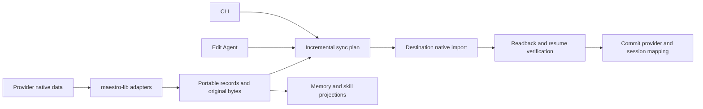

# Provider translation and reversible switching

## Current status (2026-10-17)

| Direction            | Versions (source -> destination) | Verification   | Native evidence date                |
| -------------------- | -------------------------------- | -------------- | ----------------------------------- |
| Claude Code -> Codex | `2.1.296` -> `0.162.1`           | **Unverified** | None; acceptance skipped 2026-10-17 |
| Codex -> Claude Code | `0.162.1` -> `2.1.296`           | **Unverified** | None; acceptance skipped 2026-10-17 |

These are the minimum versions and sole declared schema-coverage versions in `src/shared/maestro-lib/translation/support.ts`, not native-certified versions. No direction is verified for any version. **Native acceptance skipped; certification deferred** under the explicit unattended-run inputs. No native hops ran or evidence files were generated. SSH acceptance was also skipped; SSH Ensemble choices remain disabled. See the [Hardening log](#hardening-log) for the acceptance record and [[provider-translation-native-formats]] for the mapping.
Live QA update (2026-10-17): exercised isolated Claude Code 2.1.302 / Codex 0.163.0 sessions after explicit test authorization. CLI preflight exposed undeclared installed versions and the selected Claude profile's shared `projects` link. Native resume also exposed invalid foreign message IDs and provider-added persistence metadata. The implementation now declares these versions, pins the canonical selected projects directory, preserves nested-link checks, uses provider-assigned Codex IDs, and estimates capacity from projected history instead of archived diagnostics.

The production translation service completed Claude -> Codex -> Claude with real native files and Codex app-server, using isolated stores and a no-op desktop notification boundary. `maestro-cli send --session ... --read-only --no-system-prompt --no-history --no-synopsis` resumed both destinations and recalled the original conversation-only marker. A further CLI turn read the carried instruction, memory, skill and subagent-definition markers. Draft and queue fixtures survived the service round trip. Skill execution, subagent invocation, arbitrary tool histories, attachments and repeated incremental synchronization remain uncertified; both directions remain unverified. The running desktop must be rebuilt before its full CLI migration path can use these source fixes.

Final static review (2026-10-14): retained the implementation and existing documentation edits; completed the 29 implementation checkboxes across all seven phase documents. `npm run lint` passed, production ESLint passed with `--max-warnings 0`, and `npm run docs:verify` reported zero findings across 713 paths and 262 index entries. Static TypeScript checking of the 11 new translation test files reported zero diagnostics; syntax parsing covered all 28 changed test files without executing modules. The prepared acceptance driver passed `tsc -p .maestro/scratch/provider-translation-driver-tsconfig.json --noEmit`. No LSP surface was available. Native acceptance and test execution remain pending a direct request; no provider homes or original-agent data were modified, and no branch switch, commit, hooks, push or PR occurred.

## Product contract

An agent keeps its identity, tabs, transcript, history, memories, and portable skills when its provider changes. The incoming provider receives the conversation and knowledge required to continue. Returning to a previous provider imports intervening changes exactly once.

Support is directional and versioned. Having a History reader, a resume flag, or a preserved Maestro transcript does not prove native import support. A supported pair removes the warning only when the particular migration can deliver its complete portable payload. Unsupported pairs and partial migrations explain the exact limitation. Migration failures preserve the old provider and its session pointers.

Separate three guarantees:

| Code | Guarantee             | Required evidence                                                                                                                |
| ---- | --------------------- | -------------------------------------------------------------------------------------------------------------------------------- |
| D1   | Data preservation     | Original records and attachments survive byte-for-byte in a recoverable archive, including unknown records                       |
| D2   | Context continuity    | Destination actually resumes with ordered conversation, tool evidence, and accessible memories; new turns survive switching back |
| D3   | Capability continuity | Instructions, skills, subagent definitions, and required tool bindings load with equivalent supported behavior                   |

D1 alone is insufficient to claim D2 or D3. Signed Claude thinking and encrypted Codex reasoning cannot simply be turned into valid foreign reasoning blocks. Preserve their original bytes and provenance; do not forge signatures, expose encrypted content, replay tool execution, or treat old system prompts as the new provider's system instructions. Report material runtime limitations even when the archive is complete. A smaller context window also remains a limit: never silently summarize or truncate history to make a switch succeed.

## Research snapshot before implementation

| Code | Finding                                                                                            | Evidence                                                                                                                |
| ---- | -------------------------------------------------------------------------------------------------- | ----------------------------------------------------------------------------------------------------------------------- |
| F1   | Edit Agent preserves tabs and parks provider IDs, but does not sync context between providers      | `src/renderer/utils/providerTabSessions.ts:30`; `src/renderer/hooks/session/useSessionLifecycle.ts:249`                 |
| F2   | CLI switching still discards tabs, file previews, closed history, and queue, and kills the process | `src/renderer/hooks/remote/useAppRemoteEventListeners.ts:1783`; `src/cli/commands/update-agent.ts:223`                  |
| F3   | Seven native History readers are registered                                                        | `src/main/storage/index.ts`: Claude, Codex, OpenCode, Factory Droid, Copilot, OMP, Grok                                 |
| F4   | Current History message types flatten native content; they are not a lossless interchange format   | `src/main/agents/session-storage.ts:33`; `src/renderer/utils/contextExtractor.ts`                                       |
| F5   | Project memory UI and operations already exist, currently for Claude only                          | `src/main/memory-manager.ts`; `src/main/ipc/handlers/memory.ts`; `src/renderer/components/MemoryViewer.tsx`             |
| F6   | Headless provider lifecycle already lives in maestro-lib                                           | `src/shared/maestro-lib/run/session.ts`; `launch/launch-plan.ts`; `run/start-turn.ts`; `host.ts`                        |
| F7   | Codex RPC and framing already exist, but under main                                                | `src/main/codex-app-server/rpc-client.ts`, `protocol.ts`, `server-requests.ts`; `docs/agent-guides/CODEX-APP-SERVER.md` |

F2 must be removed through one shared switch operation, rather than giving the CLI a second converter.

## Provider readiness

These are research confidence levels, not released conversion support. No pair is certified today.

| Code | Provider                             | Current evidence                                                                                                                              | Decision                                                                                    |
| ---- | ------------------------------------ | --------------------------------------------------------------------------------------------------------------------------------------------- | ------------------------------------------------------------------------------------------- |
| P1   | Claude Code                          | Installed 2.1.296; native JSONL, memory files, existing reader and sanitizer, project instructions and skill examples                         | Enough to begin both directions with P2; reverse native writing still needs resume proof    |
| P2   | Codex                                | Installed 0.162.1; 2,017 session JSONL candidates; rollout and SQLite stores; generated protocol schema; local memory files and generation DB | Enough to begin both directions with P1; prefer native import and history injection         |
| P3   | OpenCode                             | Installed 2.0.25; legacy and current SQLite records; reader; documented native export/import                                                  | Strong next candidate; current v2 storage and memory semantics need adapter work and proof  |
| P4   | Copilot CLI                          | Installed 1.0.95; 127 JSON/JSONL candidates; `events.jsonl`, workspace metadata, SQLite store; reader and recovery docs                       | Next candidate; full memory and cloud sync behavior need investigation before certification |
| P5   | Factory Droid, OMP, Grok             | Existing native readers describe schemas; no local default-home samples found in this pass                                                    | Enough to plan extraction, insufficient for verified import and round-trip sync             |
| P6   | Pi, Qwen3 Coder, Hermes, Antigravity | Supported in provider registry, no registered native History reader; no relevant local session samples found in this pass                     | Research required before conversion support                                                 |
| P7   | Gemini CLI                           | Legacy registry ID, withheld from picker; local home exists without sampled sessions                                                          | Do not expand scope into a new provider integration                                         |

OpenCode's live DB contains both legacy `session/message/part` tables (440/2,763/8,695 rows) and `session_v2/session_message` (449/2,928 rows). Its current messages have typed records and sequence numbers. Do not assume the existing older reader covers everything.

Codex's live homes include `state_5.sqlite` (thread metadata), `thread_history_1.sqlite` (turn/item projection), and `memories_1.sqlite` (22 `stage1_outputs` rows at inspection), alongside JSONL and memory files. Whole-DB transplantation would copy unrelated threads, accounts, and runtime state; portable import must select the relevant records.

## Reuse newly available Codex mechanisms

Ran `codex app-server generate-json-schema --experimental --out .provider-translation-schema` against installed 0.162.1. Inspected the generated definitions, then removed this temporary schema directory.

`ExternalAgentConfigMigrationItemType` includes `AGENTS_MD`, `CONFIG`, `SKILLS`, `PLUGINS`, `MCP_SERVER_CONFIG`, `SUBAGENTS`, `HOOKS`, `COMMANDS`, `MEMORY`, and `SESSIONS`. Migration details can select individual memories, sessions, skills, and subagents. A nonempty `cwd` denotes repository scope. Schema availability proves an API shape, not successful or lossless conversion.

Official documentation describes `externalAgentConfig/detect` and `externalAgentConfig/import`, completion notifications, and import history. Reuse the built-in importer where it meets scope and fidelity requirements. Its one-way configuration import is not Maestro's repeated synchronization contract. [Codex App Server](https://learn.chatgpt.com/docs/app-server)

`ThreadInjectItemsParams` requires `threadId` and `items`. `thread/inject_items` persists prebuilt Responses items into model-visible history without generating a turn, providing a candidate for incremental sync. Prove reload and subsequent CLI resume behavior before relying on it. `ThreadResumeParams.history` is marked unstable, for Codex Cloud, and explicitly DO NOT USE in the installed schema; exclude that shortcut. [History injection](https://learn.chatgpt.com/docs/app-server#inject-items-into-a-thread)

## Guinea pig baseline

- Agent: `92eb2f16-433d-4ecd-bb87-885c8a64b2f7`, Distribution Stack, Claude Code, `/Users/pedram/Projects/Distribution`.
- Maestro tab: `a77c0b6c-83c5-4275-baa9-9098994993f1`.
- Native Claude session: `62838201-7db3-4922-a465-3ea7d00babb3`.
- `maestro-cli session show <tab-id> --json` returned two displayed messages: one user, one assistant.
- Native file: `~/.claude/projects/-Users-pedram-Projects-Distribution/62838201-7db3-4922-a465-3ea7d00babb3.jsonl`, 396,951 bytes, 57 records.
- Native types: queue-operation 4, attachment 27, user 6, atis-latch 4, last-prompt 5, assistant 6, system 2, cost-state 2, mode 1. Content arrays include four tool calls and four tool results. Record count is not conversation-turn count.
- Project memory: `MEMORY.md` (300 bytes), `failing-autorun-playbooks-run-directly.md` (1,634), `distribution-root-is-local-only.md` (1,437), total 3,371 bytes. Memory bodies were not needed for this research.
- Project `AGENTS.md` already symlinks to the 15,748-byte `CLAUDE.md`.
- Numerous other native sessions and three sampled child transcripts also exist in the project directory. The selected tab is small; the whole project archive is larger.

Live data can change. Re-resolve IDs, account roots, active state, bytes, and hashes immediately before any migration. The selected tab is the first acceptance target, not authority to copy every project session indiscriminately.

## Architecture



Implement a star topology: each provider reads and writes a portable model. Avoid a separate converter for every provider pair. The library has no Electron or renderer imports; hosts supply account roots, identity, metadata persistence, and UI progress.

Portable records retain role, text/content blocks, attachment bytes or verified references, tool call/result linkage, timestamps, provenance, branch/parent relationships, compaction boundaries, and native opaque records. The archive keeps raw source bytes separately from deterministic semantic hashes. Display text extraction remains useful for rendering, but cannot be the transport.

Proposed public library operations: plan, apply, inspect result, and recover/rollback a provider migration. Exact names should follow existing exports. Plans include source/destination/provider versions, roots, scope, per-tab mappings, conflicts, missing capabilities, record counts, and a fidelity result. Expose the same planner through CLI dry-run and Edit Agent. Unsupported direct library/CLI apply refuses unless the caller explicitly accepts listed limitations.

Incremental sync uses source-provider/native-record identity plus the last successfully imported checkpoint. Imported records retain original lineage so an A -> B -> A -> B cycle does not echo its own history. Repeated identical messages remain distinct events. Memory uses three-way comparison against the last shared version; both-side edits retain both variants and block a clean switch rather than using timestamps to overwrite a preference. Preserve deletions as tombstones, forks as branches, and compaction as a boundary rather than a new duplicate conversation.

While a source turn is running, allow the user to select the new provider but defer migration commit and the next destination turn until the source settles and final events are captured. Do not kill the current turn, acknowledge premature success, or migrate a partial tail. Reuse `turnProvider`, provider slots, persistence flushing, busy checks, and queue machinery.

Stage, read back, verify, then commit each agent-wide operation. All selected tabs must succeed before the agent's provider changes. A durable operation journal enables recovery after a crash between destination writes and mapping commit. Backups, hashes, and tracked ownership permit rollback without deleting newly authored work. Use consistent SQLite snapshots through supported readers/APIs; do not copy an active SQLite DB without its transaction state.

## Memories, instructions, skills, subagents

Default proposal: this agent's owned open/closed/history conversations, project memories, and the instructions/skills/subagents it can use. Account-global knowledge needs an explicit scope choice; unrelated agents' histories are excluded. Project histories shared by multiple Maestro agents require ownership-aware selection.

Claude's memory root may follow repository/worktree identity or configured `autoMemoryDirectory`; resolve provider account homes and actual overrides rather than hardcoding the default. [Claude memory](https://code.claude.com/docs/en/memory)

Codex memories are generated state with delayed consolidation, not a mirrored Claude project folder. A memory bridge must make imported project knowledge immediately discoverable, preserve links/evidence, and collect later changes without hand-editing a generated global summary or enabling global settings. Prefer native import where it delivers this contract; otherwise use a managed project-scoped projection plus provider discovery bindings. [Codex memories](https://learn.chatgpt.com/docs/customization/memories)

Shared instruction and skill bodies are appropriate. Codex discovers project skills in `.agents/skills` and instructions through `AGENTS.md` precedence. Preserve existing symlinks such as the guinea pig's `AGENTS.md`; do not create duplicate instruction loads or overwrite distinct files. [Codex skill discovery](https://learn.chatgpt.com/docs/build-skills), [Codex instruction discovery](https://learn.chatgpt.com/docs/agent-configuration/agents-md)

Claude skills can carry execution settings such as forked contexts, model choices, and hooks. Claude subagents use Markdown/frontmatter, while Codex custom agents use TOML definitions. Share portable bodies; translate supported execution metadata and retain unsupported fields in the archive with a capability limitation. Symlinking unlike definition formats does not create equivalent behavior. [Claude skills](https://code.claude.com/docs/en/skills), [Claude subagents](https://code.claude.com/docs/en/sub-agents), [Codex subagents](https://learn.chatgpt.com/docs/agent-configuration/subagents)

Credentials are destination configuration, not translated memory. Existing account/MCP/tool bindings must be checked; do not copy keys or broaden permissions to make a skill appear compatible.

OpenCode has a documented JSON export/import route; prefer that to writing internal SQLite tables. [OpenCode CLI](https://opencode.ai/docs/cli/#import)

Copilot keeps native files plus a derived session store; reindexing can also sync data to GitHub. Investigate that side effect before offering a silent local migration. [Copilot session recovery](https://docs.github.com/en/copilot/how-tos/copilot-cli/use-copilot-cli/chronicle#reindexing-the-session-store)

## Engineering reuse

Read `CLAUDE-AGENTS.md`, `CLAUDE-SESSION.md`, and the task-specific guide before edits. Use existing `generateUUID`, `canonicalJson`, `encodeClaudeProjectPath`, `createKeyedWriteQueue`, provider account/profile/environment resolvers, launch/run functions, `switchTabProvider`, `updateProviderSlot`, session-store mutations, and IPC/CLI patterns. Move only the required environment-neutral implementation into shared code and preserve existing wrappers. Do not duplicate a JSONL parser, RPC client, memory reader, or atomic writer.

`src/main/utils/atomic-json-store.ts` already has `atomicWriteFile` for JSONL. `src/main/agents/claude-transcript-sanitizer.ts` already handles linked-list repair and account-scoped thinking shells; retain those invariants when factoring reusable pieces. The in-process keyed queue alone does not protect against another provider process: adapters also need a quiescent source or a provider-supported mutation channel.

## Delivery and validation

Task-based playbook: `/Users/pedram/Projects/Maestro/.maestro/playbooks/2026-10-13-Provider-Translation/PROVIDER-TRANSLATION-01.md` through `07.md`. Authored on 2026-10-13; implementation and launch authorized on 2026-10-14 for agent `9bbc8bf6-ed8a-459b-b373-4d04f776fd02`. The run includes dependency baseline repair and final provider-onboarding documentation. Native conversion and acceptance remain unverified until their evidence exists.

Implement Claude/Codex first. Build a generic registry now, leave other pairs unverified until their adapters and evidence exist. Do not add OpenCode/Copilot adapters merely because their formats are readable.

Update test cases whenever code changes. Do not run test cases or live provider acceptance cases until Pedram asks. Run `npm run lint`. LSP navigation is useful for Session/AITab and switch call sites if an LSP surface is available; none was exposed to this research session.

Authoring checks on 2026-10-13: all seven phase documents have executable checkbox tasks (27 total); Prettier check passed for the research and all phases; `git diff --check` passed. `maestro-cli refresh-auto-run --background --agent 9bbc8bf6-ed8a-459b-b373-4d04f776fd02 --json` returned success. `npm run lint` exited 2 at `src/main/lite/pairing/host.ts:5` with TS2307, missing `@serenity-kit/opaque` or its type declarations. Only documentation changed; no tests ran, no provider conversion occurred, and the guinea pig remains unchanged.

Acceptance execution, once requested: snapshot the guinea pig into isolated provider homes inside this worktree; convert Claude -> Codex, continue with a fact recalled from earlier context, create a new memory/history delta, convert back to Claude, and repeat with no duplicate imports. Check original artifact hashes, destination resume, missing attachments, memory discovery, skills and subagent loading, crash recovery, and all-tabs atomicity. Only then qualify the tested direction/version/payload classes for warning-free switching. A real switch of the original agent follows separately, with backups and applicable native-home write scope.

## Open scope decision

Q1: Should user/account-global memories and skills be included automatically, or should the first release migrate project knowledge plus selected user-level resources? Recommended: project knowledge plus selected user-level resources. Until decided, home-wide import remains excluded.

For the authorized 2026-10-14 implementation, proceed with project knowledge plus selected user-level resources. This scope permits useful implementation without copying unrelated global knowledge; account-wide expansion remains a separate choice.

## Implemented support and evidence (2026-10-14)

| Direction              | Declared versions | Implementation                                                                                            | Certification                                            |
| ---------------------- | ----------------- | --------------------------------------------------------------------------------------------------------- | -------------------------------------------------------- |
| Claude Code → Codex    | 2.1.296 → 0.162.1 | Native extraction, fresh thread/injection/readback, original lineage, scoped resources and managed memory | **Unverified**; explicit warning acceptance required     |
| Codex → Claude Code    | 0.162.1 → 2.1.296 | Native extraction, new linked transcript/readback, original lineage, scoped resources and managed memory  | **Unverified**; explicit warning acceptance required     |
| Other provider/version | None              | No conversion declared                                                                                    | Blocks; native History/resume capability is insufficient |

The actual mapping is [provider-translation-native-formats.md](provider-translation-native-formats.md). Registration and the new-provider example are in [PROVIDER-SUPPORT.md](../PROVIDER-SUPPORT.md#provider-translation-contract). CLI and Edit Agent use `src/main/provider-translation-service.ts` through the same renderer service and `agents:translateProvider` IPC contract. Plan/apply/status/recover/rollback share maestro-lib. Provider changes preserve queues, drafts, file tabs and closed/snoozed tabs, park source IDs, and wait for final source events. History aliases follow open and closed native mappings across hops; unresolved entries retain their records and refuse a foreign native resume. Source-provider queued settings use destination defaults without destroying the queued item.

Scope is project knowledge and exact selected user-level resources. No account-global generated memory, credentials or provider database transplantation. Compatible native skill/subagent projections are separate from archived unsupported execution metadata. Codex paginated-only history without complete native rollout evidence blocks. Opaque reasoning, foreign branches and compact runtime state remain explicit limitations. Original provider homes and guinea pig were never mutated during implementation.

### Authored cases, not executed proof

| Invariant                                                                                       | Concrete cases                                                                                                                |
| ----------------------------------------------------------------------------------------------- | ----------------------------------------------------------------------------------------------------------------------------- |
| D1 native bytes/provenance, roles/tools/attachments/opaque rows                                 | `translation-contract.test.ts`, `translation-native.test.ts`, synthetic fixture README; existing native History tests updated |
| D2 A → B → A → B, repeated identical text, edited/truncated/divergent records                   | `translation-reconcile.test.ts`, `translation-adapters.test.ts`                                                               |
| D3 memory links/metadata/discovery, conflicts, tombstones, native resources and symlink escapes | `translation-resources.test.ts`, `translation-projections.test.ts`, Memory Manager/Viewer and capability tests                |
| Direction/version/payload gating, no-op and paginated-only refusal                              | `translation-adapters.test.ts`, `translation-native.test.ts`                                                                  |
| All-tab mapping, parked IDs, closed/snoozed History, drafts and queues                          | `translation-session.test.ts`, providerTabSessions and lifecycle/remote tests                                                 |
| Deferral, partial failure, tracked rollback, staged commit/recovery and later-work refusal      | `translation-transaction.test.ts`, lifecycle sync cases                                                                       |
| One IPC/CLI/UX result and limitation gate                                                       | preload/agents, ipc/handlers/agents, CLI update-agent, EditAgentModal and remote configuration cases                          |
| Acceptance authorization, source safety and scratch credential inputs                           | `translation-acceptance-inputs.test.ts`; opt-in driver prepared, **not executed**                                             |

The translation tests above are under `src/__tests__/shared/maestro-lib/`. No passing-test or native-lossless claim is made. No PR, commit, push or test-executing hooks were run.

### Preparation and verification commands

- Dependencies: `npm ci --ignore-scripts --cache .maestro/scratch/npm-cache --no-audit --no-fund` completed; baseline `npm run lint` passed.
- Real TOML parsing: pinned `smol-toml@1.9.1`; install scripts disabled, unrelated dependency/lock changes removed.
- Read-only research: `codex --version`, `codex app-server generate-json-schema --experimental --out .maestro/scratch/provider-translation-schema`, `claude --help`, source `session show` and native SHA-256 inspection. No native imports or continuations.
- LSP tools were sought but no LSP surface was exposed; used repository navigation and static TypeScript checks.
- Final `npm run lint`: **passed** (renderer/shared, main and CLI TypeScript checks).
- ESLint on all changed production TypeScript/TSX with `--max-warnings 0`: **passed**. Repository ESLint ignores tests/scripts; they were not represented as linted test behavior.
- Prettier on changed files: **passed**. `npm run docs:verify`: **passed**, 713 asserted paths and 262 index entries, zero findings.
- `tsc -p .maestro/scratch/provider-translation-driver-tsconfig.json`: **passed**, static compilation only. TypeScript parser syntax checks: **passed**, 25 changed test files, without loading or executing their modules.
- `git diff --check`: **passed**. Final read-only original transcript hash: **unchanged**, 396,951 bytes, `c387b8b87df38202cce069790b821c2789f97297e30aba5012c899c632b83948`.
- Tests, acceptance, native imports and native continuation were **not executed**. No PR, push, commit or hooks. Work remains in `provider-translation-layer`; no branch switch occurred.

### Prepared isolated acceptance

`scripts/provider-translation-acceptance.mjs` refuses execution without `--execute-isolated-acceptance`. A future explicitly authorized run also requires `--claude-auth` and `--codex-auth` paths already staged inside this checkout's ignored scratch, `--recall-question` and `--expected-recall`. Do not copy entire provider homes/config/DBs to satisfy those flags. The driver re-resolves source agent/tab/native IDs, effective account and idle state, confines writes to fresh scratch HOME/provider homes/project, checks original source hashes, and prepares three native continuation hops with recall and memory deltas. It records evidence without auto-promoting registry declarations to verified.

### Seven-phase implementation index

| Phase | Delivered artifact                                                                                                                             |
| ----- | ---------------------------------------------------------------------------------------------------------------------------------------------- |
| P01   | Dependency/lint baseline, native-format mapping, installed schema investigation, read-only guinea pig evidence, synthetic fixtures             |
| P02   | Portable contracts, directional registry/planner, private durable archive and journal                                                          |
| P03   | Shared native readers, Claude staged writer, Codex RPC extraction/injection and scoped importer/pagination utilities                           |
| P04   | Actual memory roots and overrides, project discovery bridge, native compatible instructions/skills/subagents, conflict limits                  |
| P05   | Original-event reconciliation, all-tab transaction/recovery, parked IDs and persisted migration state, live-turn deferral and queue provenance |
| P06   | One IPC/remote/CLI/Edit Agent operation, accurate warnings/results, existing Memory Viewer bridge                                              |
| P07   | Targeted cases authored, isolated acceptance driver prepared, static verification and final new-provider contract documented                   |

P01–P07 are implementation/preparation records. They do not certify native resume, recall, capability equivalence or lossless repeated round trips. The explicit limitations in the native mapping remain part of the implemented contract.

### Implementation history (2026-10-14)

The initial seven-phase implementation followed research on 2026-10-13 at `0dca5bd096` on `provider-translation-layer`. Repeated audits hardened account and symlink boundaries, journaled write ownership, backup integrity, native identity commits, recovery/retry guards, destination environments, tool linkage and deferred warning acceptance. Regression cases were authored and statically checked; lint, scoped ESLint, docs verification and acceptance-driver compilation passed. A broader static check reported 255 test typing diagnostics, so it was not full-suite validation. Tests and native acceptance were not executed during these audits; original provider homes and the guinea pig stayed unchanged. These historical static checks do not certify native resume or round-trip continuity; later hardening and acceptance decisions follow below.

## Hardening log

### 2026-10-16: Ensemble baseline

Baseline executed on 2026-10-17 for [[ENSEMBLE-01]]. `command git fetch origin` succeeded. Branch `acappella` at `14ac0a4a3daf5cfdb73dc55033d7da12187364d3` matches `origin/acappella` and already contains `origin/rc` at `295ef6667656fdd773aaec0d12032f2933067220`; no fast-forward or merge was needed. `node_modules` is a real directory, so no reinstall was needed.

The requested translation suite passed before any changes: **11 test files passed, 0 failed; 134 tests passed, 0 failed, 0 skipped**. Command:

```bash
env -u MAESTRO_USER_DATA -u MAESTRO_CLAUDE_BIN -u MAESTRO_QUERY_SOURCE -u CLAUDE_CODE_SESSION_ID npx vitest run src/__tests__/shared/maestro-lib/translation-*.test.ts src/__tests__/main/provider-translation-service.test.ts src/__tests__/renderer/services/providerTranslation.test.ts
```

`rtk proxy npm run lint` and `rtk proxy npm run lint:eslint` both exited 0. `npm run docs:verify` reported 1,393 asserted paths, 453 index entries and zero findings. Focused Prettier and `command git diff --check` passed.

This is unit-test baseline evidence only. Native resume, context continuity and resource discovery remain unverified; no real provider homes were modified.

### 2026-10-17: Read-only native transcript probe

Added `scripts/provider-translation-probe.mjs` for [[ENSEMBLE-01]]. It bundles and imports the existing native extractor, samples the most recent files across Claude account homes and nested Codex sessions, and reports file counts per diagnostic code. `clean` means no blocking diagnostic; warning and info counts remain separate. Each code counts a file once, and files can contribute to several codes. Claude subagent subfolders are excluded. The probe reads provider homes without writing to them; generated bundles and optional JSON reports are confined to `.maestro/scratch/`, with symlink and hard-link output rejection. Message content and diagnostic messages are never printed or stored in reports.

Baseline command:

```bash
node scripts/provider-translation-probe.mjs --json .maestro/scratch/provider-translation-probe/baseline-2026-10-17.json
```

| Provider    | Sampled | Clean | Blocked | Blocked fraction |
| ----------- | ------- | ----- | ------- | ---------------- |
| Claude Code | 300     | 240   | 60      | 20%              |
| Codex       | 300     | 299   | 1       | 0.33%            |

Claude block codes: `native-project-root-mismatch` in 60 files and `unfinished-tool-call` in 6 files, with overlap. Warning codes: `opaque-runtime-state` in 300 files, `native-attachment-state` in 300 files, and `native-boundary` in 6 files. Codex block codes: `unfinished-tool-call` in 1 file. Warning codes: `historical-instructions` in 300 files, `opaque-runtime-state` in 300 files, and `native-boundary` in 12 files. Both providers had no info codes. The current sample differs from the earlier review; these are live, mutable transcripts and an in-flight tool call can block extraction. This measures extraction only, not version compatibility or native resume acceptance.

Added synthetic regression coverage for CLI validation, newest-file sampling across accounts, identity extraction and fallback, subagent exclusion, per-file diagnostic counts, future info severity, missing/malformed metadata, output privacy, unchanged input bytes and mtime, and scratch output confinement. Test cases were not run, per the standing conductor instruction.

Validation: `rtk proxy npm run lint`, `rtk proxy npm run lint:eslint`, `npm run docs:verify`, focused Prettier, script syntax checking, and `command git diff --check` all passed. No task images were supplied.

### 2026-10-17: Ensemble 02 extraction recheck

Re-ran the read-only probe after the cwd-origin, interrupted-tool-call, severity-tier and plan-telemetry changes in [[ENSEMBLE-02]], at commit `109eab74d2`:

```bash
node scripts/provider-translation-probe.mjs --json .maestro/scratch/provider-translation-probe/ensemble-02-2026-10-17.json
```

| Provider    | Sampled | Phase 01 blocked | Phase 02 clean | Phase 02 blocked | Blocked fraction |
| ----------- | ------- | ---------------- | -------------- | ---------------- | ---------------- |
| Claude Code | 300     | 60 (20%)         | 300            | 0                | 0%               |
| Codex       | 300     | 1 (0.33%)        | 300            | 0                | 0%               |

Neither provider emitted a block code, including `native-project-root-mismatch` or `unfinished-tool-call`; no code crossed the 2% investigation threshold. These are fresh samples of live, mutable transcripts, not a replay of the baseline's exact files.

| Provider    | Severity | Code                            | Files |
| ----------- | -------- | ------------------------------- | ----- |
| Claude Code | info     | `opaque-runtime-state`          | 300   |
| Claude Code | info     | `native-attachment-state`       | 300   |
| Claude Code | info     | `native-cwd-drift`              | 66    |
| Claude Code | warning  | `interrupted-tool-call-dropped` | 27    |
| Claude Code | warning  | `native-boundary`               | 6     |
| Codex       | info     | `historical-instructions`       | 300   |
| Codex       | info     | `opaque-runtime-state`          | 300   |
| Codex       | info     | `native-cwd-drift`              | 1     |
| Codex       | warning  | `interrupted-tool-call-dropped` | 2     |
| Codex       | warning  | `native-boundary`               | 12    |

All always-on codes now appear as info; warnings remain separate for interrupted calls and native boundaries. Counts are files per code and can overlap. This probe measures extraction only: it does not establish native resume, context continuity, resource discovery, or Sentry delivery. No provider homes were modified. No code or tests changed, and test cases were not run, per the standing conductor instruction. No task images were supplied.

Validation: `rtk proxy npm run lint`, `rtk proxy npm run lint:eslint`, `npm run docs:verify` (1,397 asserted paths, 455 index entries, zero findings), focused Prettier and `command git diff --check` passed.

### 2026-10-17: Ensemble 03 compaction-window recheck

Updated [[provider-translation-native-formats]], [[PROVIDER-SUPPORT]], [[CLAUDE-AGENTS]] and [[docs/agent-guides/AGENT-INFRA]] for [[ENSEMBLE-03]]. The destination receives the source provider's own latest compaction summary/replacement history plus later records; Maestro never writes a summary itself. Pre-compaction records and original transcript bytes remain archived. Projection, capacity and plan counts use the active window, tool-link checks exclude archived calls, and return-hop reconciliation retains archived identities.

Re-ran the existing read-only extractor probe after the implementation and synthetic fixtures in `c63add9f8f`:

```bash
node scripts/provider-translation-probe.mjs
```

| Provider    | Sampled | Clean | Blocked | Blocked fraction |
| ----------- | ------- | ----- | ------- | ---------------- |
| Claude Code | 300     | 300   | 0       | 0%               |
| Codex       | 300     | 300   | 0       | 0%               |

| Provider    | Severity | Code                            | Files |
| ----------- | -------- | ------------------------------- | ----- |
| Claude Code | info     | `opaque-runtime-state`          | 300   |
| Claude Code | info     | `native-attachment-state`       | 300   |
| Claude Code | info     | `native-cwd-drift`              | 54    |
| Claude Code | warning  | `interrupted-tool-call-dropped` | 18    |
| Codex       | info     | `historical-instructions`       | 300   |
| Codex       | info     | `opaque-runtime-state`          | 300   |
| Codex       | info     | `compaction-window`             | 12    |
| Codex       | info     | `native-cwd-drift`              | 1     |
| Codex       | warning  | `interrupted-tool-call-dropped` | 1     |

Neither provider emitted a block code or a `native-boundary` warning. Twelve Codex files reported `compaction-window` as info. This Claude sample contained no compaction windows; it does not provide live Claude compaction evidence. Counts are files per code and can overlap; clean means no blocks, not no warnings. Samples are fresh, mutable transcripts, not a replay of earlier probe files. The probe reads provider homes without modifying them and reports no message content. It measures extraction only, not native resume, context continuity or resource discovery; both translation directions remain unverified.

The task explicitly requested the translation suite. It passed **11 test files / 244 tests, with no failures or skips**, including the synthetic Claude two-compaction and Codex replacement-history/message fixtures, projection/archive preservation, active-window capacity and repeated return-hop coverage:

```bash
env -u MAESTRO_USER_DATA -u MAESTRO_CLAUDE_BIN -u MAESTRO_QUERY_SOURCE -u CLAUDE_CODE_SESSION_ID TMPDIR="$PWD/.maestro/scratch/ensemble-03-tests" npx vitest run src/__tests__/shared/maestro-lib/translation-*.test.ts src/__tests__/main/provider-translation-service.test.ts src/__tests__/renderer/services/providerTranslation.test.ts
```

`rtk proxy npm run lint` and `rtk proxy npm run lint:eslint` exited 0. `npm run docs:verify` checked 1,399 asserted paths and 456 index entries with zero findings. Focused Prettier and `command git diff --check` passed. Vitest printed the existing advisory about `__dirname` compatibility with Vite's future native config loader; no test failed. This task changed documentation only, reused the existing probe and tests, and executed no native provider import or resume. No task images were supplied.

### 2026-10-17: Ensemble 06 live SSH acceptance awaiting target

The live SSH check in [[ENSEMBLE-06]] could not start: `.maestro/scratch/ssh-acceptance.json` is absent from the `acappella` worktree, although the preceding human step is checked. No approved remote target or explicit skip was available. The live-check task remains unchecked with a new human gate requesting either `{"skip": true}` or `{"sshRemoteId": "<configured-test-host-id>", "projectPath": "<disposable-remote-project>"}` in that file.

SSH acceptance result: **Claude Code to Codex unverified; Codex to Claude Code unverified.** No hop was attempted, so plan status, limitations, fact recall and remote write-boundary verification have no live results. Phase 08 must not treat this entry as evidence to enable the Ensemble pill on SSH agents. No scratch agent was created, no SSH command ran, and no provider home or remote file was modified. This is a pending prerequisite, not an explicit skip or a failed translation.

### 2026-10-17: Ensemble unattended run, explicit acceptance skips

Pedram requested removal of the Ensemble Auto Run human gates and unattended continuation. Created `.maestro/scratch/ssh-acceptance.json` and `.maestro/scratch/acceptance-auth/inputs.json` with `{"skip": true}`. This supersedes the pending-target entry above.

SSH live check skipped. SSH acceptance result: **Claude Code to Codex unverified; Codex to Claude Code unverified.** Native acceptance skipped; certification deferred. No provider turn, scratch agent, SSH command, credential staging or provider-home write was performed. These decisions are not passing acceptance evidence; SSH Ensemble choices remain disabled without live proof.

Removed the three human gates from the active Ensemble playbook. Remaining tasks must update tests without executing them and run lint, ESLint, docs verification and static checks. Missing native acceptance inputs resolve as explicit skips; dependent certification and OpenCode work resolve as deferred, while independent Ensemble implementation continues. Runtime integrity checks and write boundaries remain required.

### 2026-10-17: Ensemble 06 SSH acceptance skip verified

Read `.maestro/scratch/ssh-acceptance.json` and confirmed `skip: true` for [[ENSEMBLE-06]]. **SSH live check skipped.** This explicit decision supersedes the earlier missing-target prerequisite. SSH acceptance result: **Claude Code to Codex unverified; Codex to Claude Code unverified.** Phase 08 must keep SSH Ensemble choices disabled without live evidence; certification remains deferred.

No live hop was attempted, so plan status, limitations, fact recall and remote write-boundary checks have no live results. No scratch agent was created, no SSH command or provider turn ran, and no provider home or remote file was modified. No code or tests changed; no test cases were executed and no task images were supplied.

### 2026-10-17: Ensemble 07 native acceptance skip verified

Read `.maestro/scratch/acceptance-auth/inputs.json` and confirmed `skip: true` for [[ENSEMBLE-07]]. **Native acceptance skipped; certification deferred**. Both Claude Code to Codex and Codex to Claude Code remain `unverified` in `src/shared/maestro-lib/translation/support.ts`.

No native hop or test case was executed. No credentials were accessed, no provider turn ran, and no provider home or original-agent data was modified. No acceptance evidence was generated. This completes only the acceptance skip-handling task; no human gate was added. No code or tests changed, and no task images were supplied.

### 2026-10-17: Ensemble 07 native acceptance repair deferred

**Native acceptance repair deferred; no hops executed**. Confirmed `skip: true` in `.maestro/scratch/acceptance-auth/inputs.json` and no `evidence-*.json` files in `.maestro/scratch/provider-translation-acceptance/`. There are no native hop results to inspect or repair for [[ENSEMBLE-07]]. Both translation directions remain `unverified`; certification remains deferred.

No tests or provider turns were executed, and no credentials, provider homes or original-agent data were accessed. No code or tests changed; no task images were supplied. This completes only the repair skip-handling task, without a human gate.

### 2026-10-17: Ensemble 07 certification deferred

**Certification deferred; native acceptance not executed**. Confirmed `skip: true` in `.maestro/scratch/acceptance-auth/inputs.json` and no `evidence-*.json` files in `.maestro/scratch/provider-translation-acceptance/` for [[ENSEMBLE-07]]. Both Claude Code to Codex and Codex to Claude Code remain `unverified` in `src/shared/maestro-lib/translation/support.ts`; no native certification evidence or tested-version changes were declared.

This completes only the certification skip-handling task. No code or tests changed, no test cases or provider turns ran, and no credentials, provider homes or original-agent data were accessed. No human gate was added; no task images were supplied.

### 2026-10-18: Ensemble 10 OpenCode mapping deferred

**OpenCode adapter deferred; baseline native certification unavailable**. Read `src/shared/maestro-lib/translation/support.ts` and confirmed that Claude Code to Codex and Codex to Claude Code both remain `unverified`. Under [[ENSEMBLE-10]], this completes only the first task's deferral handling; OpenCode mapping research and its implementation steps were not executed.

No code or tests changed, no test cases or live provider acceptance ran, and no OpenCode session was exported. No implementation or certification is claimed; no human gate or halt marker was added. No task images were supplied.

### 2026-10-18: Ensemble 10 OpenCode adapter implementation deferred

**OpenCode adapter deferred; baseline native certification unavailable**. Rechecked `src/shared/maestro-lib/translation/support.ts`: Claude Code to Codex and Codex to Claude Code both remain `unverified`. Under [[ENSEMBLE-10]], this completes only the second task's deferral handling. Extraction, native import/export readback, adapter registration, direction declarations and service identity resolution were not implemented.

No code or tests changed, and no test cases or live provider acceptance ran. No provider homes were accessed or modified. No implementation or certification is claimed; no human gate or halt marker was added. No task images were supplied.

### 2026-10-18: Ensemble 10 OpenCode fixtures and probe deferred

**OpenCode adapter deferred; baseline native certification unavailable**. Rechecked `src/shared/maestro-lib/translation/support.ts`: Claude Code to Codex and Codex to Claude Code both remain `unverified`. Under [[ENSEMBLE-10]], this completes only the third task's deferral handling. Synthetic fixtures, extraction/projection/round-trip/blocking/readback tests and the OpenCode probe extension were not implemented. The probe and translation suite were not executed; no sample counts or certification evidence are claimed.

No code or tests changed, and no test cases or live provider acceptance ran. No provider homes were accessed or modified. No human gate or halt marker was added; no task images were supplied.

### 2026-10-18: Ensemble 10 OpenCode support documentation deferred

**OpenCode adapter deferred; baseline native certification unavailable**. Rechecked `src/shared/maestro-lib/translation/support.ts`: Claude Code to Codex and Codex to Claude Code both remain `unverified`. Under [[ENSEMBLE-10]], this completes only the fourth task's deferral handling. Updates to `PROVIDER-SUPPORT.md`, `CLAUDE-AGENTS.md`, `docs/agent-guides/AGENT-INFRA.md`, `docs/multi-provider.md` and the provider readiness table were deferred because the OpenCode adapter was not implemented. No OpenCode direction is declared implemented or certified.

No code or tests changed, and no test cases, translation suite or live provider acceptance ran. No provider homes were accessed or modified. No human gate or halt marker was added; no task images were supplied.
