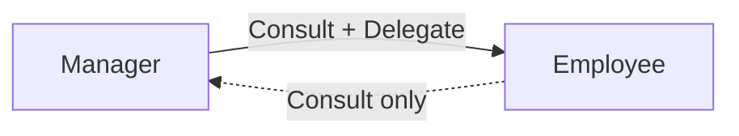

Agent Delegation lets one agent reach another agent **without being told to in a message**. Normally an agent only talks to another agent when you type `@name`. Delegation removes that step: you decide once who an agent may reach and how, and the agent decides for itself, mid-task, whether to reach out.

An agent that another agent may reach is its **peer**. The list of an agent's peers is its **roster**. A roster is a permission list, the same way [Additional Directories](./general-usage) are: an agent reaches exactly the agents on its roster, with exactly the access listed, and nobody else.

The feature has four parts. Each has its own section below.

| Part                                            | What it is                                                         | Where you set it                                                      |
| ----------------------------------------------- | ------------------------------------------------------------------ | --------------------------------------------------------------------- |
| [Roster](#where-peers-come-from)                | Who one agent may reach, and how                                   | The **Peers** tab of Edit Agent                                       |
| [Group defaults](#a-roster-for-new-agents)      | The roster a new agent in a group starts with                      | The **Peers** tab of Group Settings                                   |
| [Consultation budget](#the-consultation-budget) | The most agent turns one of your messages can set in motion        | **Settings > General**                                                |
| [Delegation Graph](#the-delegation-graph)       | Every roster drawn as one picture, which you can also edit by hand | The hamburger menu, Quick Actions, or an agent or group's right-click |

## Why It Exists

A backend agent that needs to know what the API consumer expects can ask the frontend agent itself. A release agent can hand a changelog to the docs agent and carry on. Without a roster, every one of those hand-offs waits for you to notice and type the mention.

A roster keeps this safe because it is explicit. An agent that is not on the table is out of bounds, and the agent is told so in its own system prompt.

## Consult and Delegate

Each peer carries two independent permissions. In the Peers tab they are two squares, **R** and **W**. They are two different mechanisms, not two strengths of one.

| Square           | Authorizes                 | The agent runs                                                                         | What happens                                                                                                                                     |
| ---------------- | -------------------------- | -------------------------------------------------------------------------------------- | ------------------------------------------------------------------------------------------------------------------------------------------------ |
| **R** (Consult)  | Asking the peer a question | `maestro-cli ask <agent-id> "<question>"`                                              | The answer comes back to the asking agent. The peer runs in a hidden background tab, so the conversation you have open with it is never touched. |
| **W** (Delegate) | Handing the peer work      | `maestro-cli dispatch <agent-id> "<task>" --new-tab --notify-on-complete <its-own-id>` | The task lands in a new tab of the peer, and the delegating agent gets a turn of its own when the peer finishes.                                 |

The two squares combine into four labels, which are the ones the agent reads:

| R   | W   | Label                                                                      |
| --- | --- | -------------------------------------------------------------------------- |
| lit | lit | **Consult + Delegate**                                                     |
| lit | off | **Consult only**                                                           |
| off | lit | **Delegate only**                                                          |
| off | off | **No access** (an exclusion, see [Precedence](#precedence-and-exclusions)) |

A consult runs **as the peer**. It takes the peer's own model, Run on target, and gateway, so the answer is what the peer would have said. A hand-off from an agent is marked in that agent's transcript so you can see who reached whom.

### A Relationship Has One Direction

A roster is one agent's statement about who **it** may reach. It says nothing about the way back. If Manager has a row for Employee, Manager may reach Employee. Employee may reach Manager only if Employee's own roster says so, and it can say so with different access.



Here the manager hands work down, and the employee can only ask questions up. That is two rows on two rosters. Maestro never mirrors one from the other.

## Where Peers Come From

Open **Edit Agent** (right-click an agent in the Left Bar, or `Cmd+K` then "Edit Agent") and go to the **Peers** tab. The same tab is in the New Agent dialog. Three sources feed a roster, and the tab has one control for each:

- **Add Peer** adds an **explicit row**. Pick the agent, light R and/or W, and optionally write a note.
- **Peers in my group** is one checkbox with its own R and W squares. It is the **group grant**: it covers every other agent in the same group.
- **Worktree family** is the **worktree grant**, the same idea for worktrees: the worktree parent, the sibling worktrees, and this agent's own worktree children.

The **note** on an explicit row is the hint the agent reads for when to reach that peer ("owns the billing schema, ask before changing a migration"). It is guidance, not a change to the access rule. Write notes the way you would brief a new teammate.

### Groups and worktrees are resolved live

The group and worktree checkboxes do not copy a list of agents. They store a grant, and Maestro works out who it covers **each time the agent starts a turn**. So:

- Drag an agent into the group and every agent with the group grant can reach it on its next turn.
- Drag it out, rename it, or delete it, and the roster reshapes with no further configuration.
- A group grant covers the agent's own group only. A group nested inside another is a separate team, and neither the parent group nor a child group is reached.
- An agent that is in no group has nobody for the group grant to cover. The checkbox says so.

When the group grant and the worktree grant both cover one peer, the peer gets the union of the two, so either one granting a square grants it.

## Precedence and Exclusions

The three sources are applied in this order:

1. The **group grant** adds every other agent in the agent's group.
2. The **worktree grant** adds the worktree family, merged with the group grant by union.
3. An **explicit row** then **replaces** whatever the grants gave that peer. It does not add to them.

Because a row replaces rather than adds, one row can both raise and lower access:

- A group grant of **R** plus a row of **R + W** for one agent gives that agent full access and leaves the others consult only.
- A row with **neither square lit** is an **exclusion**. The group grant covers everyone else, and that one agent is left out. The Peers tab flags such a row so it is never mistaken for an empty one.

Deleting a row is different from lighting no squares. Deleting restores whatever the group or worktree grant says about that agent. An exclusion keeps the agent out.

An agent is never its own peer, and a row that points at an agent that no longer exists resolves to nobody.

## What the Agent Sees

The roster is rendered into the agent's system prompt as a `## Peer Agents` section:

```markdown
## Peer Agents

| Agent    | Agent ID    | Access             | Notes                  |
| -------- | ----------- | ------------------ | ---------------------- |
| Frontend | `a1b2c3...` | Consult + Delegate | Owns the checkout flow |
| Docs     | `d4e5f6...` | Delegate only      |                        |
```

Below the table the prompt teaches only the commands the roster allows, so an agent whose peers are all consult only is never shown the delegate command. It also tells the agent to decide for itself, from the notes and what it knows of each peer's scope, whether a peer is the right one to reach, and to tell you which peer it reached and why.

The access column is a hard rule, like a directory permission. Reaching an agent that is not on the table, or going beyond the access listed, is out of bounds.

Because the prompt is built when a turn starts, a change you make applies from the **next turn**. A turn already running keeps the roster it started with.

## A Roster for New Agents

[Group Settings](./features#groups) has the same **Peers** tab. What you set there is the roster a **new** agent in that group starts with: explicit rows, the group grant, and the worktree grant.

Do not confuse this with the group grant itself. They answer two different questions:

|                    | The group grant (**Peers in my group**)        | A group's default roster (Group Settings)            |
| ------------------ | ---------------------------------------------- | ---------------------------------------------------- |
| Belongs to         | One agent                                      | The group                                            |
| Says               | "I may reach whoever is in my group right now" | "A new agent here starts with this roster"           |
| When it is applied | Each time the agent starts a turn              | Once, when the agent is created                      |
| After that         | Follows the group's membership                 | The agent owns its roster, and the group is not read |

So a group default of "Peers in my group: R" gives every new agent a live group grant, and that is usually the one line a team needs.

Editing a group's defaults does not change the agents already in it, unless you [publish](./features#publishing-a-save-to-existing-agents) the save. A publish **replaces** each agent's explicit rows with the group's rows. It does not merge them, and the publish dialog names that before you confirm. A group Maestro made for a git worktree family has no Group Settings.

## Group Chats and Moderators Have No Peers

A [group chat](./group-chat) and its moderator have no peer roster, and the moderator's settings have no Peers tab. A group chat is already a roster: the moderator routes to the participants you mention. Peers are for the agents you work with one on one.

## The Consultation Budget

A group grant on a five-agent group makes a fully connected graph: A asks B, B asks C, C asks A. Each hop is a full agent turn, so the whole thing needs a bound.

The **consultation budget** is one number: the most consults and delegations that may be spent while working on **one of your messages**. It counts the whole chain. An agent that consults a peer who consults another peer spends two. Both consults and delegations draw on the same budget.

| Value        | Meaning                                                             |
| ------------ | ------------------------------------------------------------------- |
| `25`         | The default. Generous for a real collaboration, fatal to a runaway. |
| `0`          | Peer consults and delegations are switched off entirely.            |
| `1` to `500` | A tighter or looser bound. There is no unlimited.                   |

Change it in **Settings > General > Consultation Budget**, or from the CLI:

```bash
maestro-cli settings set maxConsultationsPerTurn 10
```

The agent is told how much is left as each turn starts, so it can ration its consults instead of finding the ceiling by hitting it. When the budget is spent, the next `ask` or `dispatch` is **refused by name**, with the count and the setting that controls it, so the agent knows the peer was never reached and does not mistake a refusal for an empty answer.

## The Delegation Graph

A roster answers "who can this agent reach?" for one agent. The Delegation Graph answers it for all of them at once. It draws each agent as a node and each permission as an arrow, so you can see the shape of a team: who may hand work to whom, who can only ask, and who is connected to nobody. It shows configured permissions, not a history of completed delegations.

The graph reads the same three sources the Peers tab writes, and in Edit it writes to them. A change made on the graph shows in the agent's Peers tab, and a change made in the Peers tab shows on the graph. The graph stores its layout choice and node positions separately for each scope. View mode reuses the Document Graph canvas; Edit retains the relationship editor.

### Opening It

| Where              | How                                                             | Opens on              |
| ------------------ | --------------------------------------------------------------- | --------------------- |
| **Hamburger menu** | **Delegation Graph**                                            | Every agent           |
| **Quick Actions**  | `Cmd+K` / `Ctrl+K`, then **Delegation Graph**                   | Every agent           |
| **Quick Actions**  | `Cmd+K` / `Ctrl+K`, then **Delegation Graph:** and a group name | That group            |
| **Left Bar**       | Right-click a group header, then **Delegation Graph**           | That group            |
| **Left Bar**       | Right-click a linked agent, then **View Delegation Graph**      | Its connected cluster |
| **CLI**            | `maestro-cli open delegation-graph [--group <group-id>]`        | Either of the two     |

The graph has no keyboard shortcut by default. You can give it one in **Settings > Shortcuts** (see [Keyboard Shortcuts](./keyboard-shortcuts)).

### Scope

The first control in the toolbar picks the **scope**: **All agents**, one group, or the agent cluster you opened. The agent context-menu action appears when the agent has an incoming or outgoing peer relationship.

A group's graph draws the agents of that group, and also any agent outside the group that an arrow joins to one of them. It does not draw an arrow between two agents that are both outside the group. Switch to **All agents** to see those.

An agent's cluster follows both incoming and outgoing arrows, including indirect connections and agents in other groups. From the global view, select a linked agent and choose **Show cluster**, or double-click a node in View. **Show all agents** returns to the fleet. If the cluster's anchor agent is deleted, the graph returns to all agents.

### Reading the Graph

An arrow from A to B means **A may reach B**. Two arrows between a pair mean each can reach the other, and the two can carry different access. All arrows have one color. The line tells the kinds apart:

| Line                      | Badge   | Meaning                                                             |
| ------------------------- | ------- | ------------------------------------------------------------------- |
| Thin and dashed           | **C**   | Consult                                                             |
| Thin and solid            | **D**   | Delegate                                                            |
| Thick and solid           | **C D** | Consult and delegate                                                |
| Any of the three, fainter |         | The arrow comes from a group or worktree grant, and no row names it |

**C** is consult, the **R** square of the Peers tab. **D** is delegate, the **W** square. Badges appear on the editor's arrows and in the selected-agent panel. The buttons of the graph and the CLI call an arrow an **edge**.

In Edit mode, the border of a box tells you the state of the agent:

| Border                           | State                                                                                |
| -------------------------------- | ------------------------------------------------------------------------------------ |
| Solid                            | In the scope, with at least one arrow                                                |
| Dashed, with a **No peers** line | In the scope, but it reaches nobody and nobody reaches it                            |
| Dotted and dimmed                | Outside the group, joined to it by an arrow. The box names its own group             |
| Dotted, with **No edge yet**     | Outside the group, [added by you](#adding-an-agent-to-a-groups-graph), not connected |

To learn more about one relationship or one agent:

- **Hover an arrow in Edit** to read it as a sentence ("Backend may consult Frontend"), with the source that produced it and the note on the row.
- **Click an agent** to highlight its relationships. A panel lists who it **can reach** and who it is **reachable by**, and has an **Open Peers tab** button that takes you to that agent's settings.
- **Legend** in the toolbar explains the lines and cluster navigation, and counts the agents, arrows, and mutual pairs on screen. In Edit it also explains node borders.

### Arranging the Graph

The layout control offers **Hierarchical** (top-down rows), **Force**, **Radial**, **Mind Map**, and **Lobes**. The global view defaults to **Lobes**, which groups linked communities, including disconnected clusters. Group and agent-cluster views default to **Hierarchical**. The graph remembers a layout you choose for each scope. **Fit** brings the whole graph into view, and the minimap provides an overview.

You can drag any agent to a new place, in either mode. The scope is then marked **Manual**, and Maestro leaves every agent where you put it. Positions are saved for each scope separately and are still there after you restart the app. Manual placement hides the algorithm's cluster outlines. **Reset layout** forgets the arrangement and returns to Lobes globally, or Hierarchical for a group or agent cluster.

Moving a box changes where an agent is drawn. It never changes who the agent can reach.

### View Mode

The graph opens in **View** every time. You can pan, zoom, move nodes, select an agent, and change the scope and the layout. You cannot start an arrow, and a click on an arrow does nothing. **Open Peers tab** opens the selected agent's settings if you want to change a relationship without entering Edit.

View is the default for a reason. The graph of a real fleet is a dense target, and a slipped drag on a surface that looks read-only would rewrite an agent's permissions with no sign that it had.

### Edit Mode

Switch the toolbar from **View** to **Edit** to change who can reach whom. The canvas gets a colored frame so the mode is visible where your pointer is, and each agent shows two dots: one at the bottom, where an arrow leaves it, and one at the top, where an arrow lands.

The mode is never saved. Close the graph and it opens in View again, so it can never open already armed. In neither mode does a key delete anything.

#### Drawing an arrow

Drag from the bottom dot of agent A to the top dot of agent B. A small editor opens where you dropped it, with the title `A -> B`. Check the direction there before you confirm.

1. Light **Consult**, **Delegate**, or both. These are the R and W squares of the Peers tab, with the same wording. A new arrow starts as consult only.
2. Optionally write the note the agent reads for when to reach this peer.
3. Press **Add edge**.

Maestro then writes one explicit row for B into **A's** roster. Nothing is written to B, and nothing is written before you confirm. **Cancel**, the close button, and `Esc` discard the arrow. A click elsewhere on the canvas does not.

The editor tells you what you need to know about the pair before you save:

- **The arrow already exists.** The editor opens with its current access and note, and the button reads **Save edge**. You are editing the arrow, not adding a second one.
- **The arrow comes from a grant.** The editor names the grant. Saving writes an explicit row for that one agent, which [overrides the grant](#precedence-and-exclusions) for it. The grant is not changed.
- **The reverse arrow exists.** The editor says so ("Employee may already consult Manager"). You are building the second half of a pair. Nothing is copied from the reverse arrow and nothing is changed for the other agent.

Two drops make no arrow, and the graph says why at the drop point:

- An agent onto itself. An agent is never its own peer.
- On a group's graph, between two agents that are both outside the group. That graph would not draw the arrow. Switch the scope to **All agents** to connect them.

#### Changing or removing an arrow

Click an arrow, on its line or on its badge, to open the same editor with a delete action. The badge also takes `Enter` and `Space`.

Removing an arrow is not always a delete, because not every arrow has a row behind it. The button is named for what it writes, and a toast says which of these happened:

| The arrow came from                               | The button reads | What is written                                             | Result                                                                                                     |
| ------------------------------------------------- | ---------------- | ----------------------------------------------------------- | ---------------------------------------------------------------------------------------------------------- |
| An explicit row, and no grant covers the peer     | **Delete edge**  | The row is removed                                          | The arrow is gone                                                                                          |
| An explicit row, and a grant also covers the peer | **Delete edge**  | The row is removed                                          | The arrow **stays**, now fainter, because the grant applies again. Remove it once more to exclude the peer |
| A group or worktree grant                         | **Exclude peer** | A row with **no access** is added. The grant is not changed | The arrow is gone, and the peer stays excluded while that row exists                                       |

The third case is the one to understand. A grant produces arrows that have no row, so there is nothing to delete. Maestro writes an [exclusion](#precedence-and-exclusions) instead: "everyone in my group, except this one". If you later switch the group grant off, that row is still on the agent's Peers tab, flagged as an exclusion. Delete it there when you no longer need it.

Turning off both squares on an arrow that exists does the same thing. The button changes to **Save as excluded**, and the editor says that this keeps a row with no access and is not a delete.

#### Adding an agent to a group's graph

A group's graph leaves out every agent that no arrow joins to the group, so there is no box to draw an arrow to. In Edit, the **Add agent** control in the toolbar lists those agents under the group each one is in. Pick one and it appears on the canvas.

Adding an agent to the graph **does not move it into the group** and changes nothing about it. It is a way to get a box to connect to:

- Draw an arrow between it and an agent of the group, and it stays on this graph as an agent outside the group.
- With no arrow, it is gone from the graph when you close the graph or change the scope. A notice says so while it is there, with a **Take off the graph** button.

On **All agents**, every agent already has a box, so the control has nothing to offer.

## From the CLI

Everything above has a `maestro-cli` verb, so a team can be scripted across a fleet. Agents may be given by id, a unique id prefix, or display name.

```bash
# One explicit row: r (consult), w (delegate), rw, or none (an exclusion)
maestro-cli update-agent Backend --peer Frontend:rw --peer Docs:w

# The hint the agent reads for when to reach a peer
maestro-cli update-agent Backend --peer-note "Frontend:owns the checkout flow"

# Delete a row. This is not the same as :none
maestro-cli update-agent Backend --remove-peer Docs

# The two derived grants: r, w, rw, or off
maestro-cli update-agent Backend --group-peers r --worktree-peers rw
```

| Flag                               | Does                                                                                   |
| ---------------------------------- | -------------------------------------------------------------------------------------- |
| `--peer <agent>:<r\|w\|rw\|none>`  | Sets one explicit row. Repeatable.                                                     |
| `--peer-note <agent>:<text>`       | Sets the note on a row. Repeatable. Needs a row, and empty text clears it.             |
| `--remove-peer <agent>`            | Deletes a row, so the group and worktree grants apply to that agent again. Repeatable. |
| `--group-peers <r\|w\|rw\|off>`    | Sets the group grant. `off` clears it.                                                 |
| `--worktree-peers <r\|w\|rw\|off>` | Sets the worktree grant. `off` clears it.                                              |

These flags are a **patch**: naming one peer leaves the other rows alone. The same flags work on `update-group-settings`, so a [group's defaults](#a-roster-for-new-agents) can be set the same way.

The graph's gestures are these same flags. The CLI has no drawing mode and does not need one:

| On the graph                                | From the CLI                                 |
| ------------------------------------------- | -------------------------------------------- |
| Draw or change an arrow from A to B         | `update-agent A --peer B:<r\|w\|rw>`         |
| Write or change its note                    | `update-agent A --peer-note "B:<text>"`      |
| **Delete edge**                             | `update-agent A --remove-peer B`             |
| **Exclude peer** or **Save as excluded**    | `update-agent A --peer B:none`               |
| Open the graph, on every agent or one group | `open delegation-graph [--group <group-id>]` |

To answer "who can this agent reach?" without opening a modal, read it back:

```bash
maestro-cli show agent Backend
maestro-cli show agent Backend --json
```

The output lists the configured rows (with their notes), the two grants and whether each is on, and then the **resolved roster**, with each entry labeled `explicit`, `group`, or `worktree` for the source that produced it. The configured rows and the resolved roster are different lists on purpose: an exclusion removes an agent the group grant would have added, and a row for a deleted agent adds nobody.

To read every roster at once, as the graph the canvas draws:

```bash
maestro-cli delegation graph
maestro-cli delegation graph --group <group-id>
maestro-cli delegation graph --json
```

It prints one block per agent, with the arrows that leave it and the agents that reach it. It needs no running app and writes nothing. See [Reading the Delegation Graph](./cli#reading-the-delegation-graph-delegation-graph) for the format.

## Related

- [Cross-Agent Mentions](./cross-agent-mentions) - the consult you type yourself, and the `maestro-cli ask` verb agents use
- [Agent Collaboration](./agent-collaboration) - how mentions and group chats compare
- [Group Chat](./group-chat) - a moderator that routes between agents on your behalf
- [Groups](./features#groups) - Group Settings, the defaults a new agent starts with, and publishing them
- [Git Worktrees](./git-worktrees) - the worktree family a worktree grant covers
- [CLI Reference](./cli-reference) - the full flag list for `update-agent`, `show agent`, and `delegation graph`
