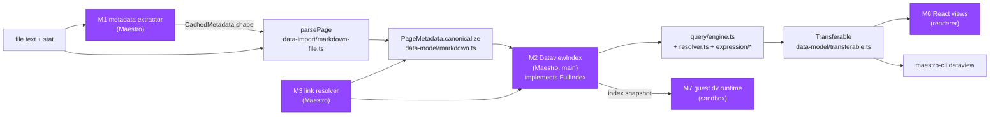
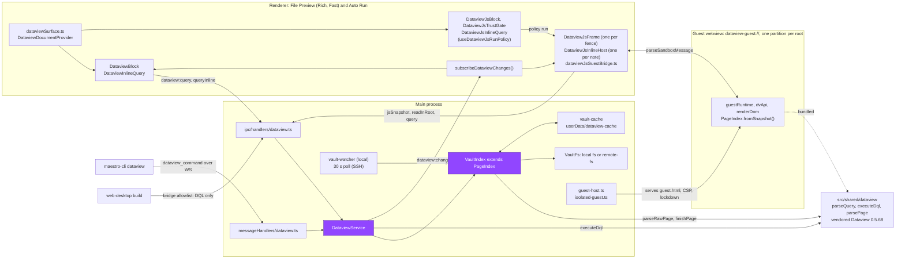

<!-- Verified 2026-10-18 against feat/dataview at 4a891368e2 (cut from origin/rc at c3cd1d2e1b) -->

# Dataview and DataviewJS

Maintainer guide for rendering Obsidian Dataview blocks in Maestro's document surfaces. Every DATAVIEW phase reads this before writing code. The spec (requirement IDs DV-n, decisions Dn) and the phase documents live outside the repository, in the Auto Run folder: `/Users/pedram/Projects/Maestro/.maestro/playbooks/2026-10-02-Dataview/` (`DATAVIEW-SPEC.md`, `DATAVIEW-01.md` to `DATAVIEW-08.md`).

How to read this guide:

- Paths are relative to the repository root. Symbols are the stable reference; line numbers are at `c3cd1d2e1b` and drift.
- Every repository path outside section 2 is checked by `npm run lint:doc-refs`. Section 2 stays inside a `doc-refs-ignore` region because its paths are upstream's, and two of its rows describe the plan, not the result (see DEV-17).
- In section 2, upstream paths are relative to upstream's `src/`, and `vendor/` means `src/shared/dataview/vendor/`. A kept upstream file lands at the same relative path under `vendor/`.
- Codes: Dn and DV-n come from the spec; M1 to M8 are the adapter roles from section 2; DEV-n are the deviations in section 4; R-n are the risks at the end of section 3.
- Start with section 3's "Architecture as built" for the picture, then section 5 before changing the parser, the cache, or the vendored code.

---

## 1. Summary

Dataview support renders Obsidian Dataview queries in Maestro's document surfaces (File Preview and the Auto Run preview) and never in chat. DQL (`dataview` fences and inline `` `= expr` ``) runs on Dataview 0.5.68's own parser, value model, functions, and engine, vendored as MIT source into the shared tree. It queries a per-vault-root index that the main process builds, caches on disk, and keeps fresh from a file watcher (or an mtime poller over SSH). The renderer, the web-desktop build, and `maestro-cli` all reach that index through one main-process service, so results cross IPC as serialized values and the index never leaves main. DataviewJS (`dataviewjs` fences and inline `` `$= expr` ``) runs in isolated `<webview>` guests that hold an index snapshot and a narrow message bridge. It is off by default and runs only in vault roots the user trusts. Everything sits behind the `dataview` Encore Feature.

### Requirements (copied from the spec)

| ID    | Requirement                                                                                                                                                                                                                                                                                                                                                                                                                                                          |
| ----- | -------------------------------------------------------------------------------------------------------------------------------------------------------------------------------------------------------------------------------------------------------------------------------------------------------------------------------------------------------------------------------------------------------------------------------------------------------------------- |
| DV-1  | A `dataview` fence in the document markdown preset renders `TABLE`, `LIST`, and `TASK` queries (with `WITHOUT ID`, `GROUP BY`, `FLATTEN`, `WHERE`, `SORT`, `LIMIT`). `CALENDAR` renders a "not supported" pill.                                                                                                                                                                                                                                                      |
| DV-2  | Query semantics match Dataview 0.5.68: parser, expression functions, value model, link resolution, and date handling come from Dataview's own MIT source, not a reimplementation.                                                                                                                                                                                                                                                                                    |
| DV-3  | The index covers, per page: frontmatter (YAML), inline fields (`Key:: value`, `[key:: value]`, `(key:: value)`), tags (frontmatter and inline), outlinks (wiki links and markdown links), inlinks, aliases, tasks and list items with their fields, and the implicit `file.*` fields (`name`, `path`, `folder`, `link`, `ctime`, `cday`, `mtime`, `mday`, `size`, `ext`, `tags`, `etags`, `outlinks`, `inlinks`, `aliases`, `tasks`, `lists`, `frontmatter`, `day`). |
| DV-4  | The vault root is the nearest ancestor folder of the open file that contains `.obsidian/`. Without one, the root is the owning agent's working directory.                                                                                                                                                                                                                                                                                                            |
| DV-5  | The index is built in the main process, cached on disk per root, and refreshed incrementally from a file watcher. A preview never blocks on a full rescan once a cache exists.                                                                                                                                                                                                                                                                                       |
| DV-6  | SSH-remote agents work. Remote roots are indexed through `src/main/utils/remote-fs.ts`, not local `fs`.                                                                                                                                                                                                                                                                                                                                                              |
| DV-7  | Results refresh live: when the index changes, every mounted block whose result could change re-runs (debounced).                                                                                                                                                                                                                                                                                                                                                     |
| DV-8  | Links in results open through the existing file-link path (same behavior as clicking a `[[wiki link]]` in the preview). Task checkboxes in a `TASK` view toggle the source line of the task's own file.                                                                                                                                                                                                                                                              |
| DV-9  | Errors (parse errors, unknown fields, unsupported features) render inline in the block with the Dataview error text. They never throw out of the preview.                                                                                                                                                                                                                                                                                                            |
| DV-10 | The chat markdown preset does NOT evaluate Dataview. An agent message that shows a query keeps rendering it as code.                                                                                                                                                                                                                                                                                                                                                 |
| DV-11 | `dataviewjs` fences and inline `$=` run in an isolated sandbox with the `dv` API (see D4). Scripts that reach for Obsidian's `app.*` API get a clear "Obsidian API not available" error.                                                                                                                                                                                                                                                                             |
| DV-12 | DataviewJS is OFF by default, and a vault root has to be trusted explicitly before any script in it runs. An untrusted block shows its source plus a "Run" control and an explanation.                                                                                                                                                                                                                                                                               |
| DV-13 | CLI parity: every DQL result the preview shows can be produced with `maestro-cli`. Index status and rebuild, and the trust list, have CLI verbs.                                                                                                                                                                                                                                                                                                                     |
| DV-14 | Works in the web-desktop (browser) build for DQL. DataviewJS is desktop-only in v1 and shows a "desktop only" pill in the browser.                                                                                                                                                                                                                                                                                                                                   |

### Decisions (one line each; the spec holds the full text)

| ID  | Decision                                                                                                                                             | Section 3 |
| --- | ---------------------------------------------------------------------------------------------------------------------------------------------------- | --------- |
| D1  | Vendor Dataview 0.5.68 source with its MIT license; no npm `obsidian-dataview`; `obsidian` imports become local types.                               | D1        |
| D2  | One index per vault root, owned by a main-process service; queries execute in main; results cross IPC as plain serialized values.                    | D2        |
| D3  | Encore Feature `dataview` (off) gates everything; `dataviewJsEnabled` (off) gates DataviewJS; `dataviewJsTrustedRoots` lists roots that run unasked. | D3        |
| D4  | DataviewJS runs in an isolated `<webview>` guest modeled on plugin panels, with a fixed CSP, a closed message set, and a 5 second watchdog.          | D4        |
| D5  | The `dv` API surface is a fixed list; `app`, `this.app`, `dv.app`, and plugin lookups throw `Obsidian API not available in Maestro`.                 | D5        |
| D6  | Markdown inside sandbox output is rendered and sanitized inside the guest; links send `open.link`.                                                   | D6        |
| D7  | Register `dataview` and `dataviewjs` through `customLanguageRenderers` in document surfaces only; inline forms by a hook; the Fast tier must match.  | D7        |
| D8  | `maestro-cli dataview` verbs for query, eval, index status and rebuild, and trust; the CLI never runs DataviewJS.                                    | D8        |

---

<!-- doc-refs-ignore:start -->

## 2. Vendoring map (D1)

Output of DATAVIEW-01 task 2, updated by the Maestro-side recon in task 3 (marked "Updated"). Every experiment ran in scratch folders under `/Users/pedram/Projects/Maestro/.maestro/playbooks/Working/` (gitignored by `.maestro/`; not part of the repository).

> [!IMPORTANT]
> Vendor 28 upstream files (about 6,600 lines) into `vendor/`, keeping upstream's directory layout. Only 52 line edits plus mechanical import rewrites are needed for them to type-check under all three Maestro tsconfig profiles. Upstream's own 395 tests pass on the result in a plain node environment. The Obsidian dependency reduces to one seam: Maestro produces an Obsidian-shaped `CachedMetadata` for each file (M1) and implements a 9-member `FullIndex` contract (M2, M3). Everything that renders (preact views, `MarkdownRenderer`, `dv` DOM helpers) is rewritten as Maestro code.

### Upstream pin

| Item                             | Value                                                                                                                                           |
| -------------------------------- | ----------------------------------------------------------------------------------------------------------------------------------------------- |
| Repository                       | https://github.com/blacksmithgu/obsidian-dataview                                                                                               |
| Tag                              | `0.5.68`                                                                                                                                        |
| Commit                           | `29b1ad87e1f2b964b4fa0c209f11d0622469bdb0` (2025-03-15, "Auto-release 0.5.68")                                                                  |
| License                          | MIT, "Copyright (c) 2021 Michael Brenan" (`LICENSE.txt`). `util/hash.ts` (cyrb53) is public domain by bryc; keep its header.                    |
| Existing clone                   | `/Users/pedram/Projects/Maestro/.maestro/playbooks/Working/dataview-src` (at the tag). A fresh clone to `/tmp/dataview-src` is equally valid.   |
| Obsidian API shapes for the shim | `obsidian@1.4.11` (MIT, the version in upstream's lockfile), unpacked at `.maestro/playbooks/Working/obsidian-api-1.4.11/package/obsidian.d.ts` |

### What was proven

| Check                                                                                                                                                                                 | Result                                                                                                         |
| ------------------------------------------------------------------------------------------------------------------------------------------------------------------------------------- | -------------------------------------------------------------------------------------------------------------- |
| Import closure of the 18 seed files named in DATAVIEW-01                                                                                                                              | 40 files, 9,570 lines (`Working/dataview-import-graph.cjs`, raw graph in `Working/dataview-import-graph.json`) |
| Kept set type-checked under three profiles that mirror `tsconfig.main.json`, `tsconfig.cli.json`, and `tsconfig.json` (TS 6.0.3, Maestro's `@types`), mechanical import rewrites only | 61 unique errors                                                                                               |
| Same, after the edit list below (`Working/dataview-vendor-trial-patch.cjs`, 52 line edits)                                                                                            | 0 errors in all three profiles                                                                                 |
| Upstream's own jest suite (18 files) under vitest 4.1.11 with `environment: 'node'` and `globals: true` (Maestro's node test project settings)                                        | 395 of 395 pass                                                                                                |
| Both motivating queries from the spec, plus a `TASK` query, through `executeTable` and `executeTask` over a fake index that implements only the contract below                        | 3 of 3 pass (`Working/dataview-vendor-trial/test/maestro-contract.test.ts`)                                    |
| Kept set emitted as CommonJS with the main profile, then loaded by plain `node`                                                                                                       | parsimmon, emoji-regex, luxon, papaparse, and remove-markdown all load. No dependency is ESM-only.             |

The trial tree is `Working/dataview-vendor-trial/` (29 files, 6,624 lines). Delete it when phase 02 lands.

### Data flow and seams



Purple nodes are new Maestro code. Every other node is vendored upstream code.

### Per-file decisions

Decision codes:

- **K**: keep as-is. Only the mechanical import rewrite (E1).
- **KE**: keep. Swap `obsidian` imports for the shim (E2) and apply the listed minimal edits.
- **S**: split. Keep the pure part verbatim and drop the Obsidian-bound part.
- **A**: Maestro adapter. Not vendored; Maestro code fills the role. Method bodies may be ported with attribution.
- **X**: not needed in v1.

#### Vendored (the keep set)

| Upstream file                       | Lines | Code | Obsidian or environment symbols                                                                                  | Edits and notes                                                                                                                                                                                                                                                                                                                                                      |
| ----------------------------------- | ----: | :--: | ---------------------------------------------------------------------------------------------------------------- | -------------------------------------------------------------------------------------------------------------------------------------------------------------------------------------------------------------------------------------------------------------------------------------------------------------------------------------------------------------------- |
| `settings.ts`                       |   111 |  K   | none                                                                                                             | Dataview defaults (the spec says to use them). `enableDataviewJs` and similar flags are ignored; the D3 settings gate instead.                                                                                                                                                                                                                                       |
| `api/result.ts`                     |   113 |  KE  | none                                                                                                             | E-unused x1                                                                                                                                                                                                                                                                                                                                                          |
| `api/data-array.ts`                 |   522 |  KE  | none                                                                                                             | E-unused x1 (`receiver`), E-generic x2 (`first()`, `last()`)                                                                                                                                                                                                                                                                                                         |
| `data-model/value.ts`               |   637 |  KE  | `HTMLElement` (type and runtime)                                                                                 | E-dom, E-lib x3, E-init x3                                                                                                                                                                                                                                                                                                                                           |
| `data-model/markdown.ts`            |   348 |  KE  | `Pos`; `DataObject` imported from `index.ts`; `FullIndex` type                                                   | E2. Import `DataObject` from `data-model/value`, because `index.ts` drags in `plugin-api`, preact, and `obsidian`. E-init x16. `serialize(index)` reads `index.links.getInverse()` and `index.starred.starred()`.                                                                                                                                                    |
| `data-model/serialized/markdown.ts` |   122 |  KE  | `Pos`                                                                                                            | E2                                                                                                                                                                                                                                                                                                                                                                   |
| `data-model/transferable.ts`        |    90 |  K   | none                                                                                                             | The wire codec for IPC results (D2) and the disk cache (DV-5). It maps `DateTime`, `Duration`, and `Link` to `___transfer-type` objects and back.                                                                                                                                                                                                                    |
| `data-import/common.ts`             |    19 |  K   | none                                                                                                             | Inline tag extraction for list items                                                                                                                                                                                                                                                                                                                                 |
| `data-import/inline-field.ts`       |   258 |  K   | none                                                                                                             | `[key:: v]`, `(key:: v)`, full-line `Key:: v`, emoji task dates, `setInlineField`                                                                                                                                                                                                                                                                                    |
| `data-import/markdown-file.ts`      |   427 |  KE  | `CachedMetadata`, `FileStats`, `FrontMatterCache`, `HeadingCache`                                                | E2. `parsePage(path, contents, stat, metadata)` is THE seam: Maestro supplies `metadata` (M1) and `stat`. It does not use `getAllTags` or `parseFrontMatterAliases`; it has its own `extractTags` and `extractAliases`.                                                                                                                                              |
| `data-import/csv.ts`                |    30 |  K   | none                                                                                                             | papaparse                                                                                                                                                                                                                                                                                                                                                            |
| `data-index/source.ts`              |   107 |  K   | none                                                                                                             | Source AST                                                                                                                                                                                                                                                                                                                                                           |
| `data-index/resolver.ts`            |   145 |  K   | `FullIndex` (through the contract)                                                                               | Reads `pages`, `tags`, `links`, `prefix`, `csv`, `metadataCache.getFirstLinkpathDest`, `metadataCache.resolvedLinks`, `vault.getMarkdownFiles()`. This is the source resolution main and the guest share (DATAVIEW-07 task 2).                                                                                                                                       |
| `data-index/index.ts`               |   570 |  S   | `App`, `Component`, `MetadataCache`, `TAbstractFile`, `TFile`, `TFolder`, `Vault`, `window.setInterval`, `fetch` | Keep `PathFilters` (L290-300), `StarredEntry` (L386-390), `IndexMap`, and `ValueCaseInsensitiveIndexMap` (L452-569) verbatim. Drop the `FullIndex` class, `PrefixIndex`, `CsvCache`, and `StarredCache`. Add the Maestro-authored `FullIndex` interface (next section).                                                                                              |
| `expression/field.ts`               |   142 |  K   | none                                                                                                             | Field AST                                                                                                                                                                                                                                                                                                                                                            |
| `expression/binaryop.ts`            |   143 |  K   | none                                                                                                             | Link `=` compares through `linkHandler.normalize`                                                                                                                                                                                                                                                                                                                    |
| `expression/context.ts`             |   242 |  KE  | none                                                                                                             | E-catch x1                                                                                                                                                                                                                                                                                                                                                           |
| `expression/functions.ts`           |   973 |  KE  | none                                                                                                             | E-unused x2. `link()`, `meta()`, and `date(link)` go through the link handler; `dateformat` and `currencyformat` use `currentLocale()`.                                                                                                                                                                                                                              |
| `expression/parse.ts`               |   596 |  KE  | none                                                                                                             | E-unused (7 names on 4 lines). `date(today)` and the other shorthands use `DateTime.local()`. Its `EXPRESSION.link` and `EXPRESSION.embedLink` parsers also turn `[[...]]` text into `Link` values for M1.                                                                                                                                                           |
| `query/query.ts`                    |   123 |  K   | none                                                                                                             | Query AST                                                                                                                                                                                                                                                                                                                                                            |
| `query/parse.ts`                    |   233 |  KE  | none                                                                                                             | E-unused (11 names on 10 lines)                                                                                                                                                                                                                                                                                                                                      |
| `query/engine.ts`                   |   508 |  K   | `FullIndex` (through the contract)                                                                               | `defaultLinkHandler` resolves through `metadataCache.getFirstLinkpathDest`                                                                                                                                                                                                                                                                                           |
| `util/normalize.ts`                 |   177 |  KE  | none                                                                                                             | E-catch x2. Imports remove-markdown.                                                                                                                                                                                                                                                                                                                                 |
| `util/locale.ts`                    |     6 |  KE  | `window.navigator`                                                                                               | E-env                                                                                                                                                                                                                                                                                                                                                                |
| `util/hash.ts`                      |    23 |  K   | none                                                                                                             | Keep the public-domain header                                                                                                                                                                                                                                                                                                                                        |
| `util/media.ts`                     |    45 |  KE  | `String.prototype.contains`                                                                                      | E-proto x1. Renderer only (image embeds in cells).                                                                                                                                                                                                                                                                                                                   |
| `ui/export/markdown.ts`             |   164 |  K   | none                                                                                                             | `dv.markdownTable`, `dv.markdownList`, `dv.markdownTaskList`, `dv.queryMarkdown` (D5). Candidate for a markdown output mode in the CLI (D8).                                                                                                                                                                                                                         |
| `ui/views/task-view.tsx`            |   406 |  S   | `Vault`, `String.prototype.contains`, `MarkdownRenderChild`, `Platform`, preact                                  | Keep L258-406 as `ui/views/task-view.ts`: `nestItems`, `nestGroups`, `setTaskCompletion`, `rewriteTask`, and their helpers. `Vault` becomes the shim's `{ adapter: { read, write } }`. E-proto x1. The preact components go to M6. Updated: v1's toggle path does not call `rewriteTask` (see M8); keep the block verbatim anyway so an upstream bump stays a patch. |

#### Adapters and files not needed

| Upstream file                                                                           | Lines | Code       | Obsidian or environment symbols                                                                                                                        | Notes                                                                                                                                                                                                                                                                                                                                                                                                                                                                                                              |
| --------------------------------------------------------------------------------------- | ----: | ---------- | ------------------------------------------------------------------------------------------------------------------------------------------------------ | ------------------------------------------------------------------------------------------------------------------------------------------------------------------------------------------------------------------------------------------------------------------------------------------------------------------------------------------------------------------------------------------------------------------------------------------------------------------------------------------------------------------ |
| `data-import/persister.ts`                                                              |    82 | A (M4)     | localforage (IndexedDB)                                                                                                                                | Keep the `Cached<T>` shape `{ version, time, data }` and the staleness rule                                                                                                                                                                                                                                                                                                                                                                                                                                        |
| `data-import/web-worker/import-manager.ts`                                              |   112 | A (M5)     | `Component`, `MetadataCache`, `TFile`, `Vault`, rollup `web-worker:` loader                                                                            | Per-path debounce and bounded concurrency carry over                                                                                                                                                                                                                                                                                                                                                                                                                                                               |
| `data-import/web-worker/import-entry.ts`, `import-impl.ts`                              |    42 | X          | `CachedMetadata`, `FileStats`, worker globals                                                                                                          | `runImport` is a pass-through to `parsePage`                                                                                                                                                                                                                                                                                                                                                                                                                                                                       |
| `api/plugin-api.ts`                                                                     |   618 | A (M7)     | `App`, `Component`, `MarkdownPostProcessorContext`, `TFile`, `String.prototype.contains`, `createEl`, compare-versions                                 | Index-local methods (`pagePaths`, `page`, `pages`, `array`, `isArray`, `fileLink`, `sectionLink`, `blockLink`, `date`, `duration`, `parse`, `literal`, `clone`, `compare`, `equal`, `evaluate`, `tryEvaluate`, markdown export) port to the guest `dv`. `query`, `tryQuery`, `queryMarkdown`, `tryQueryMarkdown` go to the `query.dql` message. `io.load` goes to the `io.load` message. `dv.version` (compare-versions) is dropped because D5 does not list it. `isDataviewDisabled` (`?no-dataview`) is dropped. |
| `api/inline-api.ts`                                                                     |   429 | A (M7)     | `App`, `Component`, global `DomElementInfo` type, `createEl`, `String.prototype.contains`, `app.vault.read`, `location.origin`, `eval`, `new Function` | See M7 for the CSP problem with `evalInContext`                                                                                                                                                                                                                                                                                                                                                                                                                                                                    |
| `ui/views/js-view.ts`                                                                   |    82 | A (M7)     | `MarkdownRenderChild` (through `refreshable-view`), `document`                                                                                         | Script preamble `const dataview = this;const dv = this;`, run with `this` bound to the `dv` object                                                                                                                                                                                                                                                                                                                                                                                                                 |
| `ui/render.ts`                                                                          |   254 | A (M6, M7) | `App`, `Component`, `MarkdownRenderer`, `createEl`, `createSpan`, `appendText`                                                                         | Value-to-DOM rules for `dv.el`, `dv.span`, `dv.paragraph`, and inline queries                                                                                                                                                                                                                                                                                                                                                                                                                                      |
| `ui/markdown.tsx`                                                                       |   296 | A (M6)     | `App`, `MarkdownRenderChild`, `MarkdownRenderer`, `Component`, `Vault.getResourcePath`, `isShown`, `onNodeInserted`, preact                            | `RawLit` is the canonical cell renderer for views; `useIndexBackedState` is the revision-driven refresh (DV-7)                                                                                                                                                                                                                                                                                                                                                                                                     |
| `ui/views/table-view.tsx`, `list-view.tsx`                                              |   203 | A (M6)     | `MarkdownRenderChild`, preact                                                                                                                          | Header cells render as markdown; result count on the first header                                                                                                                                                                                                                                                                                                                                                                                                                                                  |
| `ui/views/inline-view.ts`                                                               |    42 | A (M6)     | `App`, `addClasses`, `createEl`                                                                                                                        | Inline DQL                                                                                                                                                                                                                                                                                                                                                                                                                                                                                                         |
| `ui/refreshable-view.ts`                                                                |    39 | A (DV-7)   | `MarkdownRenderChild`, `workspace.on`, `isShown`, `onNodeInserted`                                                                                     |                                                                                                                                                                                                                                                                                                                                                                                                                                                                                                                    |
| `ui/views/calendar-view.ts`                                                             |   113 | X          | `App`, obsidian-calendar-ui, moment                                                                                                                    | `CALENDAR` renders a pill (DV-1)                                                                                                                                                                                                                                                                                                                                                                                                                                                                                   |
| `ui/lp-render.ts`, `ui/views/inline-field-live-preview.ts`, `ui/views/inline-field.tsx` |   795 | X          | CM6 `editorInfoField`, `editorLivePreviewField`, `MarkdownPostProcessorContext`                                                                        | Live Preview rendering and inline-field pills are not in the DV list                                                                                                                                                                                                                                                                                                                                                                                                                                               |
| `main.ts`                                                                               |   723 | A (D7)     | `Plugin`, `PluginSettingTab`, `Setting`, `MarkdownView`, `WorkspaceLeaf`, `debounce`, `createFragment`, `appendText`, `createEl`, `empty`              | Behaviors to carry are listed under "Upstream behaviors to carry"                                                                                                                                                                                                                                                                                                                                                                                                                                                  |
| `api/extensions.ts`                                                                     |    23 | X          | none                                                                                                                                                   | Plugin extension registry; not in D5                                                                                                                                                                                                                                                                                                                                                                                                                                                                               |
| `index.ts`                                                                              |    61 | X          | `App` (type)                                                                                                                                           | npm re-export surface. Never import it (see `data-model/markdown.ts`).                                                                                                                                                                                                                                                                                                                                                                                                                                             |
| `typings/obsidian-ex.d.ts`, `workers.d.ts`                                              |    44 | X          | `declare module "obsidian"` augmentation                                                                                                               | Replaced by the contract and Maestro IPC events                                                                                                                                                                                                                                                                                                                                                                                                                                                                    |
| `test/**` (18 files)                                                                    | 2,048 | K (tests)  | `FrontMatterCache` type in `markdown/parse.file.test.ts`                                                                                               | Vendor to `src/__tests__/shared/dataview/vendor/` with E1. Runs as-is in Maestro's vitest node project. This is the DV-2 regression suite.                                                                                                                                                                                                                                                                                                                                                                         |

### The `FullIndex` contract

The kept engine, resolver, and markdown model read only these members. M2 implements them in main; M7 implements the same interface over the index snapshot in the guest. Upstream's class also keeps `etags`, but no kept file reads it (`file.etags` comes from `PageMetadata`), so the contract omits it. Per DEV-3, this IS the `DataviewIndexReader` that DATAVIEW-05 asks for.

```ts
// MAESTRO: what vendored engine.ts, resolver.ts, and data-model/markdown.ts read. Implemented by M2 and M7.
export interface FullIndex {
	pages: Map<string, PageMetadata>;
	tags: ValueCaseInsensitiveIndexMap; // path -> tags plus parent tags (PageMetadata.fullTags())
	links: IndexMap; // path -> outlink paths, resolved where possible
	revision: number;
	prefix: {
		get(prefix: string, filter?: (path: string) => boolean): Set<string>;
		pathExists(path: string): boolean;
		nodeExists(prefix: string): boolean;
		resolveRelative(path: string, origin?: string): string;
	};
	csv: { get(path: string): Promise<Result<DataObject[], string>> };
	starred: { starred(path: string): boolean };
	metadataCache: {
		getFirstLinkpathDest(linkpath: string, sourcePath: string): { path: string } | null;
		resolvedLinks: Record<string, Record<string, number>>;
	};
	vault: { getMarkdownFiles(): { path: string }[] };
}
```

| Member                               | Read by                                                                                                         |
| ------------------------------------ | --------------------------------------------------------------------------------------------------------------- |
| `pages`                              | engine (rows, `this`, link resolve), resolver (`resolveMarkdownData`), guest `dv.page`                          |
| `tags`                               | resolver (`#tag` source)                                                                                        |
| `links`                              | resolver (unresolved `[[X]]` fallback), `PageMetadata.serialize` (`file.inlinks`)                               |
| `revision`                           | live refresh (DV-7)                                                                                             |
| `prefix`                             | resolver (folder source, `csv()` source), guest `dv.io.normalize`                                               |
| `csv`                                | resolver (`csv()` source), guest `dv.io.csv`                                                                    |
| `starred`                            | `PageMetadata.serialize` (`file.starred`)                                                                       |
| `metadataCache.getFirstLinkpathDest` | engine `defaultLinkHandler` (resolve, normalize, exists), resolver (`[[X]]` source), guest `dv.page`, `dv.view` |
| `metadataCache.resolvedLinks`        | resolver (`[[X]]` incoming and `outgoing([[X]])`)                                                               |
| `vault.getMarkdownFiles`             | resolver (negated source `-"folder"`)                                                                           |

### Obsidian symbol table

#### Imported from `obsidian`

| Symbol                                                                                                      | Kind                                   | Upstream users                                                                                                                                            | Replacement                                                                                                                                                                                   |
| ----------------------------------------------------------------------------------------------------------- | -------------------------------------- | --------------------------------------------------------------------------------------------------------------------------------------------------------- | --------------------------------------------------------------------------------------------------------------------------------------------------------------------------------------------- |
| `Pos` (and `Loc` through it)                                                                                | type                                   | `data-model/markdown.ts`, `data-model/serialized/markdown.ts`                                                                                             | Shim: `Pos { start: Loc; end: Loc }`, `Loc { line; col; offset }`                                                                                                                             |
| `CachedMetadata`                                                                                            | type                                   | `data-import/markdown-file.ts`, web-worker files                                                                                                          | Shim with the fields Dataview reads: `frontmatter`, `frontmatterLinks`, `links`, `embeds`, `tags`, `headings`, `sections`, `listItems` (plus optional `frontmatterPosition`). M1 produces it. |
| `FileStats`                                                                                                 | type                                   | `data-import/markdown-file.ts`                                                                                                                            | Shim `{ ctime; mtime; size }`. `ctime` is creation time per `obsidian.d.ts`, so M2 fills it from `birthtimeMs` (see traps).                                                                   |
| `FrontMatterCache`                                                                                          | type                                   | `data-import/markdown-file.ts`, one test                                                                                                                  | Shim `{ [key: string]: any }`                                                                                                                                                                 |
| `HeadingCache`                                                                                              | type                                   | `data-import/markdown-file.ts`                                                                                                                            | Shim `{ heading; level; position }`                                                                                                                                                           |
| `LinkCache`, `EmbedCache`, `TagCache`, `SectionCache`, `ListItemCache`, `FrontmatterLinkCache`, `Reference` | types reached through `CachedMetadata` | same                                                                                                                                                      | Shim, shapes copied from `obsidian.d.ts` 1.4.11                                                                                                                                               |
| `TFile`                                                                                                     | class                                  | `plugin-api.ts`, `data-index/index.ts`, `import-manager.ts`, `lp-render.ts`                                                                               | `{ path: string }` in the contract; stat travels separately                                                                                                                                   |
| `TAbstractFile`, `TFolder`                                                                                  | classes                                | `data-index/index.ts` (`PrefixIndex`, delete and rename handlers)                                                                                         | M2's in-memory path set behind `prefix`                                                                                                                                                       |
| `Vault`                                                                                                     | class                                  | `data-index/index.ts`, `import-manager.ts`, `task-view.tsx` (`rewriteTask`)                                                                               | Main: Maestro file access (local `fs` or remote-fs). `rewriteTask`: shim `{ adapter: { read(path), write(path, data) } }`.                                                                    |
| `MetadataCache`                                                                                             | class                                  | `data-index/index.ts`, `import-manager.ts`, engine and resolver through `index.metadataCache`                                                             | Contract `metadataCache` (M3)                                                                                                                                                                 |
| `App`                                                                                                       | class                                  | `plugin-api.ts`, `inline-api.ts`, `data-index/index.ts`, `render.ts`, `markdown.tsx`, `refreshable-view.ts`, views, `main.ts`, `lp-render.ts`, `index.ts` | Gone. In the guest, `app`, `this.app`, and `dv.app` are getters that throw `Obsidian API not available in Maestro` (D5).                                                                      |
| `Component`                                                                                                 | class                                  | `data-index/index.ts` (`addChild`, `registerEvent`, `registerInterval`), `inline-api.ts`, `plugin-api.ts`, `render.ts`, `markdown.tsx`                    | Main: the service lifecycle. Renderer: React effects. Guest: per-run teardown.                                                                                                                |
| `MarkdownPostProcessorContext`                                                                              | type                                   | `plugin-api.ts`, `inline-field.tsx`, `main.ts`                                                                                                            | The document-scope context (section 3, D7)                                                                                                                                                    |
| `MarkdownRenderChild`                                                                                       | class                                  | `markdown.tsx`, `refreshable-view.ts`, list, table, and task views, `inline-field.tsx`                                                                    | React component lifetime (renderer); block lifetime (guest)                                                                                                                                   |
| `MarkdownRenderer` (`render`, `renderMarkdown`)                                                             | class                                  | `render.ts`, `markdown.tsx`                                                                                                                               | Renderer: the surface's markdown components (D7). Guest: the D6 markdown-to-DOM step.                                                                                                         |
| `Platform` (`isMacOS`)                                                                                      | object                                 | `task-view.tsx` (Cmd/Ctrl-click opens a new leaf)                                                                                                         | Cmd/Ctrl-click maps to `openInNewTab` on the DV-8 path                                                                                                                                        |
| `debounce`                                                                                                  | function                               | `main.ts` (refresh debounce)                                                                                                                              | `useDebouncedCallback` (renderer) or a main-side timer (DV-7)                                                                                                                                 |
| `editorInfoField`, `editorLivePreviewField`                                                                 | CM6 fields                             | `lp-render.ts`, `inline-field-live-preview.ts`                                                                                                            | Not needed                                                                                                                                                                                    |
| `Plugin`, `PluginSettingTab`, `Setting`, `MarkdownView`, `WorkspaceLeaf`                                    | classes                                | `main.ts`                                                                                                                                                 | Not needed (Encore Feature and settings, D3)                                                                                                                                                  |

#### Implicit Obsidian dependencies (no import line, so an import scan misses them)

| Symbol                                                                                                                                                                                                         | Where                                                                                                                                                                              | Replacement                                                                                          |
| -------------------------------------------------------------------------------------------------------------------------------------------------------------------------------------------------------------- | ---------------------------------------------------------------------------------------------------------------------------------------------------------------------------------- | ---------------------------------------------------------------------------------------------------- |
| `String.prototype.contains` (declared in `obsidian.d.ts` L37-38)                                                                                                                                               | `util/media.ts:26`, `ui/views/task-view.tsx:379` (kept, E-proto); `api/inline-api.ts:348`, `api/plugin-api.ts:616` (adapters)                                                      | `.includes()`                                                                                        |
| `HTMLElement` prototype helpers `createEl`, `createSpan`, `createDiv`, `appendText`, `addClass`, `addClasses`, `removeClass`, `empty`, `isShown`, `onNodeInserted`; globals `createSpan()`, `createFragment()` | `ui/render.ts`, `api/inline-api.ts` (`dv.el`), `api/plugin-api.ts` (`list`, `table`, `taskList`), `refreshable-view.ts`, `markdown.tsx`, `inline-view.ts`, `js-view.ts`, `main.ts` | Plain DOM in the guest (`document.createElement`, `classList`, `textContent`); React in the renderer |
| `DomElementInfo` (global type `{ cls, text, attr, title, href, ... }`)                                                                                                                                         | `api/inline-api.ts` (`dv.el`, `dv.header`, `dv.paragraph`, `dv.span` options)                                                                                                      | Local guest type; support at least `cls`, `attr`, and `text`                                         |
| Globals `app` (`window.app`) and `moment` reachable from DataviewJS scripts                                                                                                                                    | user scripts                                                                                                                                                                       | `app` throws the D5 error; `moment` is not provided (`dv.luxon` is)                                  |
| `window.DataviewAPI`, `app.plugins.plugins.dataview.api` (`typings/obsidian-ex.d.ts`)                                                                                                                          | plugin lookups from scripts                                                                                                                                                        | Throw the D5 error                                                                                   |
| Events `dataview:index-ready`, `dataview:metadata-change` (`MetadataCache.trigger`), `dataview:refresh-views` (`Workspace.on`)                                                                                 | `data-index/index.ts`, `markdown.tsx`, `refreshable-view.ts`, `main.ts`                                                                                                            | The `dataview:changed` IPC event from the index service (DV-7)                                       |
| `Vault.getResourcePath(file)`                                                                                                                                                                                  | `markdown.tsx` (image embeds in cells)                                                                                                                                             | Renderer: the preview's image path (section 3, D7). Guest: `img-src data:` only.                     |
| `Workspace.openLinkText(linktext, sourcePath, newLeaf, state)`                                                                                                                                                 | `task-view.tsx` (click a task to open it at its line)                                                                                                                              | The DV-8 open path (section 3, D7)                                                                   |
| `window.setInterval`, `window.setTimeout`                                                                                                                                                                      | `StarredCache`                                                                                                                                                                     | M2 reads bookmarks on load and on change                                                             |
| `fetch` for `http://`, `https://`, `file://` CSV paths                                                                                                                                                         | `CsvCache.loadInternal`                                                                                                                                                            | Refused (see traps)                                                                                  |
| `location.origin`                                                                                                                                                                                              | `dv.view` CSS `sourceURL` comment                                                                                                                                                  | Drop or use a fixed string                                                                           |

### Edit classes (verified by the trial)

The exact edits, by file and line, are in `Working/dataview-vendor-trial-patch.cjs`. Mark every non-mechanical edit with an inline `// MAESTRO: <class>` comment so `grep -rn MAESTRO` over `vendor/` lists them.

| Code      |      Count | Where                                                                                                      | Change                                                                                                                                                                                                                                                                                     | Why                                                                                                                                                            |
| --------- | ---------: | ---------------------------------------------------------------------------------------------------------- | ------------------------------------------------------------------------------------------------------------------------------------------------------------------------------------------------------------------------------------------------------------------------------------------ | -------------------------------------------------------------------------------------------------------------------------------------------------------------- |
| E1        | every file | all                                                                                                        | Rewrite baseUrl specifiers (`"data-model/value"`) to relative paths. `"obsidian"` becomes the relative shim path. `"index"` becomes `"data-model/value"`. `"data-index"` becomes `"data-index/index"`.                                                                                     | Upstream compiles with `baseUrl: src`; Maestro does not map that root                                                                                          |
| E2        | 1 new file | `vendor/obsidian-shim.ts`                                                                                  | Maestro-authored local types: `Loc`, `Pos`, `FileStats`, `FrontMatterCache`, `CacheItem`, `HeadingCache`, `Reference`, `ReferenceCache`, `LinkCache`, `EmbedCache`, `TagCache`, `SectionCache`, `ListItemCache`, `FrontmatterLinkCache`, `CachedMetadata`, `DataAdapter`, `Vault` (subset) | D1                                                                                                                                                             |
| E-dom     |    3 lines | `value.ts`                                                                                                 | Module-local `type HTMLElement = { outerHTML: string }`; `isHtml` reads the constructor from `globalThis`                                                                                                                                                                                  | `tsconfig.main.json` (lib ES2024) and `tsconfig.cli.json` (lib ES2020) have no DOM lib. `/// <reference lib="dom" />` would leak DOM globals into all of main. |
| E-lib     |          3 | `value.ts` `Link.obsidianLink()`                                                                           | `replaceAll` with a string pattern becomes `replace` with an equivalent global regex (same output; exact text in the patch script)                                                                                                                                                         | `tsconfig.json` and `tsconfig.cli.json` use lib ES2020                                                                                                         |
| E-init    |         19 | `value.ts` (3), `markdown.ts` (16)                                                                         | Definite assignment `!` on fields that `Object.assign` fills in the constructor                                                                                                                                                                                                            | `strict` turns on `strictPropertyInitialization`; upstream does not use `strict`                                                                               |
| E-catch   |          3 | `context.ts` (1), `normalize.ts` (2)                                                                       | `catch (error: any)`                                                                                                                                                                                                                                                                       | `strict` turns on `useUnknownInCatchVariables`                                                                                                                 |
| E-generic |          2 | `data-array.ts` `first()`, `last()`                                                                        | `undefined as T`                                                                                                                                                                                                                                                                           | `undefined` is not assignable to an unconstrained `T` under `strict`                                                                                           |
| E-unused  |   22 names | `result.ts` (1), `data-array.ts` (1), `functions.ts` (2), `expression/parse.ts` (7), `query/parse.ts` (11) | Prefix unused parameters with `_`                                                                                                                                                                                                                                                          | `noUnusedParameters` is on in the main, cli, and renderer configs                                                                                              |
| E-proto   |          2 | `media.ts`, `task-view.ts`                                                                                 | `.contains(` becomes `.includes(`                                                                                                                                                                                                                                                          | Obsidian-only prototype method                                                                                                                                 |
| E-env     |          2 | `locale.ts`                                                                                                | Read `navigator` through `globalThis`; fall back to `Intl.DateTimeFormat().resolvedOptions().locale` instead of the hard-coded `"en-US"`                                                                                                                                                   | There is no `window` in main or the CLI. Upstream would format every `dateformat` and `currencyformat` result as `en-US` there.                                |
| Split     |    2 files | `data-index/index.ts`, `ui/views/task-view.tsx`                                                            | See the per-file table                                                                                                                                                                                                                                                                     | The Obsidian-bound halves cannot compile without `obsidian` and preact                                                                                         |

Header template for every vendored file (DATAVIEW-02 adds the "Modified for Maestro" line when anything changed):

```ts
// Vendored from blacksmithgu/obsidian-dataview@0.5.68 (29b1ad87e1f2b964b4fa0c209f11d0622469bdb0).
// Upstream path: src/expression/parse.ts. License: MIT, see ./LICENSE.
// Modified for Maestro: E1, E-unused. Search for "MAESTRO" for the non-mechanical ones.
```

### Formatting, lint, and placement (Updated)

- **Indentation: tabs.** DATAVIEW-02 says to keep upstream formatting where practical but convert indentation to tabs; that wins over the earlier "keep 4 spaces" idea. Keep everything else upstream (double quotes, line breaks, `let`), so a bump diffs cleanly after the same space-to-tab conversion is applied to the new tag.
- **Prettier.** CI runs `npx prettier --check .` and `.husky/pre-commit` runs lint-staged (`prettier --write`, then `eslint --fix`). Add `src/shared/dataview/vendor/` to `.prettierignore`, or Prettier rewrites every quote. Note: lint-staged is not in `devDependencies`, so `npx lint-staged` fetches an unpinned copy at commit time.
- **ESLint.** Add `'src/shared/dataview/vendor/**'` to the global `ignores` block of `eslint.config.mjs`. Upstream trips errors there (`@typescript-eslint/no-namespace` on `export namespace Values`, `Widgets`, `Sources`, `Result`, `Transferable`, `PathFilters`, `QueryFields`; `no-case-declarations`, `no-prototype-builtins`, `no-empty`, `ban-ts-comment`), and `eslint --fix` at commit would rewrite every `let` (`prefer-const`). Also add the folder to the `files` list of `eslint.dashes.config.mjs` AND to the `lint:eslint` script's path arguments (the script passes only `src/__tests__ scripts`), so the dash rule still covers it. The kept set and the upstream tests contain no U+2013 or U+2014 today.
- **Import boundary (landed in DATAVIEW-02 task 3).** `eslint.config.mjs` has a core `no-restricted-imports` block scoped to `src/**/*.{ts,tsx}` that ignores `src/shared/dataview/**` and rejects any specifier matching the regex `dataview/vendor(/|$)`. It is the first `no-restricted-imports` rule in the repo; the only earlier boundary precedent is the custom `shared-boundary/no-shared-to-main-imports` rule. Tests are outside ESLint (`src/__tests__/**` is globally ignored), so tests follow the same rule by convention: import from `src/shared/dataview`, never from `vendor/`. The vendored code imports nothing from main, so `no-shared-to-main-imports` is satisfied.
- **The guest runtime (M7) cannot live under `src/shared/`.** `tsconfig.main.json` and `tsconfig.cli.json` include `src/shared/**` without the DOM lib, and M7 needs DOM types. It lives under `src/renderer/` (section 3, D4).
- **`export namespace` compiles everywhere.** tsc, esbuild 0.28.1 (CLI, preload), and Oxc (Vite 8's Rolldown) all accept it; no runtime namespace exists in `src/` today, so these are the first.

### Third-party runtime dependencies (Updated)

All of them go in `dependencies`, not `devDependencies`: main is plain `tsc` output that `require()`s packages at runtime from the packaged app's `node_modules` (electron-builder copies production dependencies only). Their `@types` go in `devDependencies`. Installed by DATAVIEW-02 task 1; the lockfile resolves `luxon@3.7.2`, `parsimmon@1.18.1`, `emoji-regex@10.6.0` (8.0.0 moved under `string-width`), `papaparse@5.7.0`, `remove-markdown@0.5.5`, `@types/luxon@3.7.6`, `@types/parsimmon@1.10.9`, and `@types/papaparse@5.5.2`, all on the majors upstream locks.

No build config changed. The CLI esbuild bundle and an esbuild browser bundle both resolve all five packages, and plain `node` `require()`s each one. Every renderer import is static, so Vite needs no `optimizeDeps.include` entry. electron-builder packages them because they are in `dependencies`.

> [!WARNING]
> The main checkout's shared `node_modules` does not have these packages. After `feat/dataview` merges, run `npm install --engine-strict=false` (or `npm ci --engine-strict=false`) in `/Users/pedram/Projects/Maestro`, and in any worktree whose `node_modules` symlinks to it, before type-checking or running the app.

| Package                                                                                                                                                   | Upstream lock | License | Needed by                                                                     | Add to Maestro                                      | Notes                                                                                                                                                                                                                                                                                                                           |
| --------------------------------------------------------------------------------------------------------------------------------------------------------- | ------------- | ------- | ----------------------------------------------------------------------------- | --------------------------------------------------- | ------------------------------------------------------------------------------------------------------------------------------------------------------------------------------------------------------------------------------------------------------------------------------------------------------------------------------- |
| `luxon`                                                                                                                                                   | 3.4.3         | MIT     | everywhere                                                                    | `luxon@^3.4.3`, dev `@types/luxon@^3.3.2`           | CommonJS build available                                                                                                                                                                                                                                                                                                        |
| `parsimmon`                                                                                                                                               | 1.18.1        | MIT     | `expression/parse.ts`, `query/parse.ts`, `inline-field.ts`, `normalize.ts`    | `parsimmon@^1.18.1`, dev `@types/parsimmon@^1.10.6` |                                                                                                                                                                                                                                                                                                                                 |
| `emoji-regex`                                                                                                                                             | 10.2.1        | MIT     | `expression/parse.ts`, `inline-field.ts`, `normalize.ts`                      | `emoji-regex@^10.2.1` (ships its own types)         | The top-level `node_modules/emoji-regex` is 8.0.0 today (transitive through `string-width@4`; nothing in `src/` imports it), with 9.2.2 nested under `wrap-ansi` and `@isaacs/cliui`. A direct `^10` moves 8.x under its dependents. Tag and field-name rules depend on the v10 emoji table; confirm with `npm ls emoji-regex`. |
| `papaparse`                                                                                                                                               | 5.4.1         | MIT     | `data-import/csv.ts` (`FROM csv(...)`, `dv.io.csv`)                           | `papaparse@^5.4.1`, dev `@types/papaparse@^5.3.8`   | DEV-2. `@types/papaparse` depends on `@types/node`                                                                                                                                                                                                                                                                              |
| `remove-markdown`                                                                                                                                         | 0.5.5         | MIT     | `util/normalize.ts` `normalizeMarkdown`, which backs the `display()` function | `remove-markdown@0.5.5` (ships `index.d.ts`)        | DEV-2. Required: `normalize.ts` imports it and is on every path. Do not swap in Maestro's `stripMarkdown()`; `display()` output must match Dataview (DV-2).                                                                                                                                                                     |
| `localforage`, `preact`, `compare-versions`, `obsidian-calendar-ui`, `moment`, `@codemirror/*` (including the git-URL `@codemirror/language`), `obsidian` |               |         | only the dropped files                                                        | none                                                |                                                                                                                                                                                                                                                                                                                                 |

### Adapter boundary (Maestro-authored)

| ID  | Role                                                                            | Replaces upstream                                                       | Fidelity rules Dataview depends on                                                                                                                                                                                                                                                                                                                                                                                                                                                                                                                                                                       |
| --- | ------------------------------------------------------------------------------- | ----------------------------------------------------------------------- | -------------------------------------------------------------------------------------------------------------------------------------------------------------------------------------------------------------------------------------------------------------------------------------------------------------------------------------------------------------------------------------------------------------------------------------------------------------------------------------------------------------------------------------------------------------------------------------------------------- |
| M1  | Metadata extractor: file text to an Obsidian-shaped `CachedMetadata`            | Obsidian's closed-source metadata cache                                 | See "M1 rules". Updated: built on markdown-it tokens (DEV-4, Q1 below).                                                                                                                                                                                                                                                                                                                                                                                                                                                                                                                                  |
| M2  | `DataviewIndex` (main, one per vault root) implementing `FullIndex`             | `FullIndex`, `PrefixIndex`, `CsvCache`, `StarredCache`                  | Indexing mirrors `FullIndex.finish`: `parsePage`, then `PageMetadata.canonicalize(parsed, link => resolve(link.path, file.path))`, then update `pages`, `tags` (`fullTags()`), `links`, then `revision++`. `prefix` covers every vault file (any extension). `vault.getMarkdownFiles()` returns the indexed `.md` pages. `starred` reads `<root>/.obsidian/bookmarks.json` and flattens it exactly like `StarredCache.fetch` (empty when absent). `csv` uses vendored `parseCsv` over vault-local reads.                                                                                                 |
| M3  | Link resolver: `getFirstLinkpathDest(linkpath, sourcePath)` and `resolvedLinks` | Obsidian's resolver (not in Dataview's MIT source)                      | The one place DV-2's "link resolution" must be a reimplementation. Rules and the Maestro comparison are in section 3, D2 ("Link extraction and resolution"). It must resolve non-markdown targets too: `dv.view` looks up `<name>.js`, `<name>/view.js`, and `<name>/view.css`, and markdown links name files with their extension. `resolvedLinks` needs an entry for EVERY markdown page, `{}` when it has no links, because `resolver.ts` treats a missing key as "file not found" for `outgoing([[X]])`.                                                                                             |
| M4  | Per-root disk cache                                                             | `persister.ts` (localforage)                                            | Store `{ version, time, data: Transferable.transferable(data) }` per path. An entry is stale when `cached.time < stat.mtime` or `cached.version != indexVersion`. Drop entries for deleted paths on load. `indexVersion` is Maestro's own (`DATAVIEW_INDEX_CACHE_VERSION`) and bumps whenever M1 or `parsePage` output changes.                                                                                                                                                                                                                                                                          |
| M5  | Importer and watcher                                                            | `import-manager.ts`, web worker, Vault events                           | Debounce per path, bounded concurrency. A delete removes the page from `pages`, `tags`, and `links`. A rename moves the page and calls `IndexMap.rename`.                                                                                                                                                                                                                                                                                                                                                                                                                                                |
| M6  | Renderer views (React)                                                          | preact table, list, and task views; `ui/markdown.tsx`; `render.ts`      | Follow `RawLit`: null renders `renderNullAs` (`"\\-"`) as markdown; strings render as markdown; numbers and booleans as text; dates via `renderMinimalDate(value, settings, currentLocale())`; durations via `renderMinimalDuration`; links as `link.markdown()` (image embeds as ``); arrays as `<ul>` in blocks and comma spans inline; objects as `key: value`; depth cap `maxRecursiveRenderDepth` (4). Keep Dataview's message strings. Run `nestItems` before rendering task lists.                                                                                                           |
| M7  | Guest `dv` runtime (sandbox)                                                    | `plugin-api.ts`, `inline-api.ts`, `js-view.ts`, DOM half of `render.ts` | Bundle the vendored core into the guest and implement `FullIndex` over the snapshot, so `matchingSourcePaths`, `PageMetadata.serialize`, and `DataArray` run unchanged. `evalInContext` and `dv.view` use `eval` and `new Function`, which D4's CSP blocks (no `'unsafe-eval'`): run scripts by injecting an inline `<script>` element (DEV-6). Keep upstream's semantics: `this` is `dv`, the preamble defines `dataview` and `dv`, and a script whose source contains `await` is wrapped in an async arrow IIFE. External `<script src>` is also blocked, so the bundle itself must be inline (DEV-7). |
| M8  | Task toggle I/O (DV-8)                                                          | `Vault.adapter` inside `rewriteTask`                                    | Updated: superseded by the renderer toggle path DATAVIEW-06 prescribes (section 3, D7 "Task toggles"), which reuses `toggleTaskCheckboxAtLine` and the existing `fs` IPC. The fidelity rules carry over: checked writes `x`, unchecked writes a space; with `taskCompletionTracking` and `recursiveSubTaskCompletion` off (the defaults) exactly one line changes and no completion date is appended; refuse when the line no longer holds the task's text; keep `\r\n` endings.                                                                                                                         |

### M1 rules (what Dataview reads from `CachedMetadata`)

- **frontmatter**: the YAML block between the leading `---` lines. Parse it with js-yaml `CORE_SCHEMA` (js-yaml `^4.2.0` is already a dependency). Never use `DEFAULT_SCHEMA`, which every existing `yaml.load` call in `src/` uses implicitly: its timestamp type turns `created: 2026-09-01` into a UTC `Date`, and Dataview's `parseFrontmatter` converts that with `DateTime.fromJSDate`, which lands on the previous day west of UTC (CST). With a string, Dataview's own `EXPRESSION.date` parser applies and gives the documented local date.
- **frontmatterLinks**: one entry per `[[...]]` inside a frontmatter string value (a scalar or a list item), with `key`, `link`, `original`, and `displayText`. Dataview 0.5.68 adds these to `file.outlinks`. The spec's `Connection: "[[Pedram Amini]]"` depends on it, and on the value being quoted: an unquoted `[[X]]` is a YAML flow sequence.
- **links and embeds**: wiki links `[[target#sub|alias]]`, embeds `![[...]]`, and internal markdown links `[text](path.md)` (URL-decoded; external URLs excluded). Skip code spans, fenced code, and comments. `link` is the target text including `#subpath`. `displayText` is the alias, else the target. Only `position.start.line` is read.
- **tags**: inline body tags only. Frontmatter tags must NOT appear here; Dataview reads them from `frontmatter` itself. Each entry needs `tag`.
- **headings**: `heading` and `position.start.line`, in document order. Dataview uses them for `section` links on list items.
- **sections**: top-level blocks with a `type` and line range, including `code` and `yaml`. Upstream's full-line field scan (`markdown-file.ts`) skips only `list` and `ruling` sections, so by its code a `Key:: value` line inside a fenced code block IS indexed; reproduce that rather than "fixing" it. Dataview uses `list` ranges for `ListItem.list`. markdown-it's level-0 tokens map one to one: `fence` and `code_block` to `code`, `heading_open` to `heading`, `paragraph_open` to `paragraph`, `bullet_list_open` and `ordered_list_open` to `list`, `blockquote_open` to `blockquote` (`callout` when it opens with `[!`), `table_open` to `table`, `hr` to `thematicBreak`, `html_block` to `html`, and the stripped frontmatter to `yaml`.
- **listItems**: one per item. `position` covers the item's own lines (continuation lines, not children; markdown-it's `list_item_open.map` includes the children, so stop at the first nested list's start). `parent` is the parent item's start line, or the negative of the list's first line for root items (`obsidian.d.ts` documents this). `task` is the character between the brackets (a space when unchecked), read with the vendored `LIST_ITEM_REGEX` exactly as upstream `parseLists` does. `id` is a trailing `^blockid`.

### Upstream behaviors to carry (D7, DV-7, DV-9)

- Fences: `dataview` goes to `api.execute`; `dataviewjs` (setting `dataviewJsKeyword`, default `dataviewjs`) goes to `executeJs`. Both set `overflow-x: auto` on the container.
- Inline queries: a `<code>` whose trimmed text starts with `$=` (checked first) is JS; one that starts with `=` is DQL; an empty expression after the prefix is skipped. Upstream also evaluates code inside `<pre>` because `inlineQueriesInCodeblocks` defaults to true. D7 limits Maestro to code spans, which is narrower; not a conflict.
- Message strings:
  - Block parse error: `Dataview: <error>`. Execution error: `Dataview: <error>`.
  - Empty results (`warnOnEmptyResult`, default true): `Dataview: No results to show for table query.`, and the same sentence with `list` or `task` in place of `table`.
  - Inline DQL: `Dataview (inline field '<expr>'): <error>` (parse) and `Dataview (for inline query '<text>'): <error>` (evaluation).
  - DataviewJS: `Evaluation Error: <stack>` (block), `Dataview (for inline JS query '<script>'): <error>` (inline).
  - `dv.view`: `Dataview: custom view not found for '<v>.js' or '<v>/view.js'.` and `Dataview: Failed to execute view '<path>'.` followed by a blank line and the error.
- Refresh: a view re-runs when `index.revision` has changed, debounced by `refreshInterval` (2,500 ms), and only while it is visible.
- Table header: the first header cell carries the result count (`showResultCount`, default true).

### Semantics traps for the adapters (DV-2)

1. **YAML schema**: `CORE_SCHEMA`, as in M1.
2. **`file.ctime` and `file.cday`**: `FileStats.ctime` is creation time. Node's `Stats.ctimeMs` is the inode change time, which moves on every `chmod` or rename. Use `birthtimeMs`; fall back to `ctimeMs` only when it is 0. Over SSH, remote-fs returns no birthtime at all (section 3, D2), so a remote root needs `stat %W` (0 when unsupported, then fall back the same way).
3. **Markdown files**: index `.md` only, matching Obsidian's `getMarkdownFiles()`. `PathFilters.markdown` also accepts `.markdown`, but Obsidian never indexes those.
4. **Dot folders**: Obsidian never indexes dot-prefixed files or folders (`.obsidian`, `.trash`, `.git`, `.maestro`). The local tree walk always lists `.maestro` (section 3, D2), so filter dot segments after walking.
5. **`resolvedLinks` completeness**: an entry for every page, as in M3.
6. **Locale and time zone**: `DateTime.local()` and `localeCompare` run in main, which has the user's zone and full ICU. E-env makes `currentLocale()` return the system locale there instead of `en-US`.
7. **CSV sources**: vault-local paths only. Upstream fetches `http://`, `https://`, and `file://` CSVs; in Maestro that would be a main-process fetch of document-chosen URLs. Refuse them with an inline error.
8. **`file.starred`**: comes from `.obsidian/bookmarks.json` (upstream reads the Bookmarks core plugin). False when the file is absent.
9. **Link resolution**: the only reimplemented semantics (M3). Every other DV-2 surface (parser, functions, value model, date handling) is upstream code.
10. **Line bases**: Dataview and Obsidian lines are 0-based (`Loc.line`); Maestro's `data-source-line`, `TaskCheckbox.line`, and `toggleTaskCheckboxAtLine` are 1-based.

### The map's open questions, answered by the task 3 recon

| ID  | Question                                                 | Answer                                                                                                                                                                                                                                                                                                                                                                                                                                       |
| --- | -------------------------------------------------------- | -------------------------------------------------------------------------------------------------------------------------------------------------------------------------------------------------------------------------------------------------------------------------------------------------------------------------------------------------------------------------------------------------------------------------------------------- |
| Q1  | Which parser backs M1?                                   | markdown-it (DEV-4). It is already a direct dependency (`^14.3.2`, the Fast tier's parser), it loads through `require()` in plain node and main (its `exports.require` points at `dist/index.cjs.js`; types come from `@types/markdown-it`), the CLI bundles it, and it gives CommonMark fences, code spans, list nesting, and per-block line maps. The mdast stack (`mdast-util-from-markdown`, micromark) is transitive-only and ESM-only. |
| Q2  | Can M3 share Maestro's wiki-link resolution?             | No. `findClosestMatch` is pure but follows different rules (section 3, D2), and preview tests pin them. M3 is new; DV-8 shares the OPENER, not the resolver.                                                                                                                                                                                                                                                                                 |
| Q3  | Which markdown step for the guest (D6)?                  | markdown-it with `html: false`, walking its tokens into DOM nodes with `createElement` and `textContent`. Never `md.render()`, never an HTML string, so no sanitizer is needed (section 3, D6).                                                                                                                                                                                                                                              |
| Q4  | Where does the guest bundle live, and how is it inlined? | Source under `src/renderer/dataview-sandbox/`; built by an esbuild IIFE step next to the preloads; served inline by a main-process protocol handler (DEV-7, section 3, D4).                                                                                                                                                                                                                                                                  |
| Q5  | `.prettierignore` and `eslint.config.mjs` entries        | Confirmed above under "Formatting, lint, and placement".                                                                                                                                                                                                                                                                                                                                                                                     |

<!-- doc-refs-ignore:end -->

### What is vendored so far

| Phase 02 task | Landed under `src/shared/dataview/vendor/`                                                                                                                                                                                                                                                                      |
| ------------- | --------------------------------------------------------------------------------------------------------------------------------------------------------------------------------------------------------------------------------------------------------------------------------------------------------------- |
| 2             | `LICENSE`, `obsidian-shim.ts` (all E2 types), `settings.ts`, `api/result.ts`, `util/normalize.ts`, `data-model/value.ts`, `data-model/serialized/markdown.ts`                                                                                                                                                   |
| 3             | `expression/parse.ts`, `expression/field.ts`, `query/parse.ts`, `query/query.ts`, `data-index/source.ts` (the Source AST both parsers import; pure, K)                                                                                                                                                          |
| 4             | `expression/functions.ts`, `expression/binaryop.ts`, `expression/context.ts`, plus their import closure: `api/data-array.ts`, `util/hash.ts`, `util/locale.ts`                                                                                                                                                  |
| 03, task 2    | `data-model/markdown.ts` (E-init x16), `data-import/markdown-file.ts`, `data-import/inline-field.ts`, `data-import/common.ts`, and the split `data-index/index.ts` (the `FullIndex` contract plus `PathFilters`, `StarredEntry`, `IndexMap`, `ValueCaseInsensitiveIndexMap`)                                    |
| 04, task 2    | `data-index/resolver.ts` (`matchingSourcePaths`, the source resolution `VaultIndex.pagesForSource` runs) and `data-import/csv.ts` (`parseCsv`), both K with E1 only                                                                                                                                             |
| 04, task 3    | `data-model/transferable.ts` (`Transferable`, the codec of the disk cache and later of IPC results), K with E1 only                                                                                                                                                                                             |
| 05, task 1    | `query/engine.ts` (`executeTable`, `executeList`, `executeTask`, `executeInline`, `executeCore`), K with E1 only; the two multi-line error template literals keep their leading spaces, which are part of the message                                                                                           |
| 07, task 2    | `ui/views/task-view.ts` (the split: upstream lines 258-406, `nestItems`, `nestGroups`, `setTaskCompletion`, `rewriteTask`, verbatim; E1, E2, E-proto) and `ui/export/markdown.ts` (K, E1 only), for the guest's task lists and `dv.markdownTable`, `dv.markdownList`, `dv.markdownTaskList`, `dv.queryMarkdown` |

- `src/shared/dataview/index.ts` is the one import site. After task 3 it exports the value model, `Result`, `DEFAULT_QUERY_SETTINGS`, `parseQuery`, `parseField`, `EXPRESSION` (M1 reuses its `link` and `embedLink` parsers), the builders `Fields`, `QueryFields`, and `Sources`, and the `Query`, `Field`, and `Source` AST types with their variants. It deliberately does not re-export upstream's `DataviewSettings` type or `DEFAULT_SETTINGS`, so task 4's Maestro `DataviewSettings` constant has the name to itself.
- `parseQuery` attaches `DEFAULT_QUERY_SETTINGS` to every `Query` as an untyped `settings` property (upstream's `Query` interface omits it). A parse failure is a `Failure` whose message is parsimmon's `-- PARSING FAILED --` block with a caret and an `Expected ...` list; `src/__tests__/shared/dataview/parse.test.ts` pins that.
- Task 4 added the Maestro-side `src/shared/dataview/settings.ts` and `src/shared/dataview/evaluate.ts`. `DataviewSettings` is both the type (upstream's) and a frozen constant holding upstream's `DEFAULT_SETTINGS`; every evaluation and query passes it, never ad-hoc settings. `evaluateField(field, row, thisPage, linkHandler?)` builds a vendored `Context` with `{ this: thisPage }`, exactly as upstream's `executeInline` does, and returns a `Result`. Without a link handler it uses `UNRESOLVED_LINK_HANDLER` (links resolve to nothing, keep their written path, and do not exist); phase 04 passes the index-backed handler. `index.ts` also exports `Context`, `LinkHandler`, `DEFAULT_FUNCTIONS`, and `FunctionImpl`.
- `functions.ts` imports `DataArray`, so `api/data-array.ts` landed in task 4 with its E-unused and E-generic edits. Task 5 exported `DataArray` (the interface and the `wrap`, `from`, `isDataArray` namespace) plus the `ArrayFunc`, `ArrayComparator`, `LowestKey`, and `Ingrouped` types from `index.ts`, and pinned it in `src/__tests__/shared/dataview/data-array.test.ts`. No vendor ESLint override was needed: the folder is already in the global `ignores`. Importing it installs upstream's `Array.isArray` polyfill (data arrays report as arrays) in every process that loads the evaluator; the test pins that.
- `util/locale.ts` carries E-env: `currentLocale()` reads `globalThis.navigator.language` and falls back to the `Intl` system locale. Node 21+ defines `navigator`, so main and the CLI get the process locale either way.
- `.prettierignore`, the global `ignores` of `eslint.config.mjs`, the `files` of `eslint.dashes.config.mjs`, and the `lint:eslint` script all cover `src/shared/dataview/vendor/` now.
- Phase 03 task 2 added M1, M3, and the page wrapper. `src/shared/dataview/metadata.ts` (`extractMetadata`) builds the `CachedMetadata` from markdown-it tokens. `src/shared/dataview/resolve.ts` (`createLinkResolver(paths)`) is M3 over every vault file. `src/shared/dataview/page.ts` (`parsePage(input, resolver, { onWarning })`) runs M1, the vendored `parsePage` unchanged, and `PageMetadata.canonicalize` with M3, as upstream's `finish` does. `index.ts` exports all three plus `PageMetadata` and `ListItem`. Tests: `src/__tests__/shared/dataview/metadata.test.ts` and `resolve.test.ts`. Choices the M1 rules left open:
  - `displayText` is the alias, else the written target (`Note#Heading`), never Obsidian's `Note > Heading` form; markdown links use their link text. Markdown links and images to ANY internal target are recorded (not only `.md`), because Obsidian records them and M3 resolves non-markdown files. External targets are anything with a URL scheme or a leading `//`.
  - Inline tags need start-of-line or whitespace before the `#`, take the character class of the vendored `EXPRESSION.tag`, and skip all-digit tags. Code spans, inline HTML, and `%%comments%%` (within one paragraph) are blanked before scanning. Headings and table cells are scanned too.
  - `frontmatterLinks` keys are dotted paths (`Connection.0`); Dataview never reads them.
  - A root list item's `parent` is the negative of the list's first line, except a list on line 0, which gets `-1` (`-0` would read as "line 0 is my parent" in the vendored `parseLists`).
  - Invalid YAML, or YAML that is not a mapping, leaves `frontmatter` undefined (so `file.frontmatter` is `{}`) and reports a warning with the 0-based file line; the body still indexes. `parsePage` normalizes `\r\n` and lone `\r` to `\n` before both steps.
  - M3 skips the exact-path step for a bare name, so a same-folder `Note.md` beats a root-level one; folder-qualified links try the exact path, then source-relative, then the folder-bounded suffix. An empty path (`[[#Heading]]`) resolves to the source.
- Phase 03 task 3 added `src/__tests__/shared/dataview/page.test.ts`, which runs `parsePage` over every fixture-vault note (dot folders and the vault README skipped) and pins M3 on the vault. It added three notes: `Notes/Broken Frontmatter.md`, `Projects/Links.md`, and `Projects/Alpha/Other.md` (see the vault README). Behavior it pins: `file.frontmatter` keeps raw YAML strings (`created` is the string `2026-09-05`, `Connection` the string `[[Pedram Amini]]`) while `fields` holds the parsed date or link; the normalized key (`connection`, `review-date`) holds an equal but separate `Link` instance, so compare links with `Link.equals`, not identity.
- Upstream quirk pinned by `page.test.ts`: `PageMetadata.canonicalize` resolves list-item `fields` but not list-item `links`, so a task's own outlinks keep the path as written (`Rami Example`, not `People/Rami Example.md`), while the same link in the task's `owner` field is resolved. Kept for fidelity (DV-2).
- Upstream bug worked around (not edited): vendored `IndexMap.set` drops a key's old inverse entries only when `!values.has(key)` (it should test `value`), so a page with a self link (`[[#Heading]]`) keeps stale inlinks every time it is re-indexed. Upstream hides this because Obsidian rarely re-indexes a page whose links changed; Maestro's incremental updates hit it at once. `VaultIndex.indexPage` calls `delete(path)` before `set(path, ...)` on `links` and `tags`. Pinned by the "resolves links again" case in `src/__tests__/main/dataview/vault-index.test.ts` (`Projects/Links.md` links to itself).
- Upstream quirk pinned by `src/__tests__/shared/dataview/value.test.ts`: `Values.compareValue` compares durations with luxon's unit-by-unit `equals`, so `1 hour` versus `60 minutes` returns 1, not 0. Kept for fidelity (DV-2).
- Phase 05 task 1 added the query path. `src/shared/dataview/types.ts` holds the wire result (`DataviewResult`: `table`, `list`, `task`, `unsupported`, `error`; `DataviewInlineResult`: `value` or `error`) and `DataviewIndexReader`, which is the `FullIndex` contract (DEV-3); `VaultIndex` implements it and adds `resolveLink` next to `getPage` and `pagesForSource`. `src/shared/dataview/execute.ts` exports `executeDql(source, thisPath, index)` and `executeInlineDql(expr, thisPath, index)`; `thisPath` is vault-relative. `src/shared/dataview/wire.ts` holds the value codec (`toWireValue`, `fromWireValue`) and the revive helpers (`reviveDataviewResult`, `reviveDataviewInlineResult`). Tests: `src/__tests__/shared/dataview/wire.test.ts`. Choices:
  - Nothing throws. Block errors carry upstream's `Dataview: ` prefix and the inline ones upstream's inline prefixes (see "Upstream behaviors to carry"), so the preview and the CLI print the same text. A parse error also carries the 1-based line of the query source the parser stopped on (the line parsimmon marks with `>`, or the last line when it ran out of input).
  - `warnings` lists, per query step, the rows the engine dropped because an expression failed on them (upstream drops them silently). An unknown field is not an error; it evaluates to null.
  - A `TASK` result carries each task's own serialized fields only. The engine copies every page field (including all of `file`) onto each task for `WHERE` and `SORT`; the wire form keeps the keys the page's own serialization of that task has, and drops the deprecated aliases `subtasks`, `header`, and `real` (`subtasks` is `children` again, so keeping it doubles the payload at every nesting level).
  - The codec extends `Transferable` for values it has no case for (DEV-8).
- Phase 05 task 2 added `src/__tests__/shared/dataview/engine.test.ts`: both motivating blocks and every query type over a `VaultIndex` on a temp copy of the fixture vault, each result checked through `JSON.stringify` and the revive helpers. `src/__tests__/helpers/dataviewFixtureVault.ts` holds the vault path, `fixtureCreatedTime(content)`, and `withFixtureCreatedTimes(vaultFs)`, which stubs every page's `ctime` from its frontmatter `created` (birth time cannot be set on a copy); `page.test.ts` uses it too. Behavior it pins:
  - The Connections block returns Dana and Rami (the vault README's table), not Rami alone: Dana's list-valued `Connection` holds Pedram.
  - `TASK` without `GROUP BY` is a flat list; every task carries `path`, `line`, `status`, and `completed`. Grouping by file in the preview is the renderer's job (upstream's task view does it), and `GROUP BY file.link` groups in the engine. The test writes a second task note (`Inbox/Todo.md`) into the temp copy only, so the fixture vault and its README stay unchanged.

---

## 3. Maestro integration map

What each decision touches in the existing code, verified by reading it at `c3cd1d2e1b`. Each subsection lists the existing code first, then what was built ("Built" notes, in phase order). Every cited path is checked by `npm run lint:doc-refs`.

### Architecture as built



Three paths cross this picture:

| Path       | From                                                       | Through                                                                                                                                                                    | Answer                                                                                                                   |
| ---------- | ---------------------------------------------------------- | -------------------------------------------------------------------------------------------------------------------------------------------------------------------------- | ------------------------------------------------------------------------------------------------------------------------ |
| DQL        | A `dataview` fence or `` `= expr` `` span in a document    | `window.maestro.dataview.query` (desktop IPC, or the WS bridge in the browser build) to `DataviewService.query()`, which resolves the root and runs `executeDql()` in main | `DataviewQueryResponse` (`root`, `sshRemoteId`, `revision`, `path`, wire `result`), revived and drawn by `DataviewValue` |
| DataviewJS | A `dataviewjs` fence or `` `$= expr` `` span, policy `run` | The host fetches `jsSnapshot()` from main, mounts a locked `<webview>`, and sends `run` (or `eval`); the guest asks back with `query.dql` and `io.load`                    | `render.done` with a height (fences) or `eval.result` values the host draws with `DataviewValue` (inline)                |
| CLI        | `maestro-cli dataview query`, `eval`, `index`, `trust`     | `dataview_command` over the desktop's WS server to the same `DataviewService` methods (`queryFile()` reads the note in main, so SSH notes work)                            | Text tables (`formatTextTable()`) or `--json`; the CLI never runs DataviewJS                                             |

Rules the picture encodes:

- The index never leaves main (D2). The renderer, the browser build, and the CLI all reach it through `DataviewService`; only a guest holds a copy, the snapshot main sends it for one run.
- The service is the gate. The Encore check, the DataviewJS setting check, and the trust check all run there, so a new caller cannot skip them (D3).
- Every guest message passes `parseSandboxMessage(raw, 'guest')` before a host handler sees it, and every file read a guest asks for is re-checked in main on real paths (`readInRoot()`, D4).
- One `dataview:changed` listener per window fans out to every mounted block, span, and guest host; each re-runs only for its own root and host at a newer revision (DV-7).

### Layout as built

```text
src/shared/dataview/
  vendor/                  upstream files (section 2), LICENSE, obsidian-shim.ts
  index.ts                 the ONE import site for the rest of Maestro
  settings.ts              DataviewSettings constant (upstream defaults)
  evaluate.ts              evaluateField(field, row, thisPage, linkHandler?)
  metadata.ts              M1: markdown text to CachedMetadata (markdown-it); tokenizeMarkdownLines
  page.ts                  parsePage = finishPage(parseRawPage(input), resolver)
  resolve.ts               M3 Obsidian link resolver; linkTargetKeys, linkPathKey
  json.ts                  JSON replacer and reviver for Map and Set (disk cache)
  vault.ts                 VaultPaths, starred flattening, resolvedLinks (pure)
  pageIndex.ts             PageIndex: the in-memory FullIndex; VaultIndex extends it, the guest builds one
  display.ts               dataviewLinkLabel, mayContainMarkdown (preview and guest)
  types.ts                 wire requests and responses; DataviewResult; DataviewIndexReader (DEV-3)
  execute.ts               executeDql, executeInlineDql
  wire.ts                  toWireValue, fromWireValue, revive helpers (DEV-8)
  blocks.ts                extractDataviewBlocks(markdown)
  trust.ts                 dataviewJsRunPolicy, isTrustedDataviewRoot, list edits
  sandboxProtocol.ts       the bridge's closed message set; parseSandboxMessage(raw, from)
  sandboxHost.ts           guest scheme, URL, partition, CSP, attachment gate, run limits
src/shared/fileLinkPatterns.ts   moved from src/renderer/utils/fileLinks/patterns.ts (re-exported there)
src/shared/pathContainment.ts    normalizeRootRelativePath, isPathInsideRoot
src/shared/cspMeta.ts            withCspMetaTag (plugin panels and the guest)
src/main/dataview/
  agent-context.ts         resolveDataviewAgentContext(agentId): cwd and SSH target
  vault-root.ts            resolveVaultRoot(filePath, { agentCwd, sshRemoteId })
  vault-fs.ts              VaultFs: local fs or remote-fs behind list, read, stat, readTextInRoot
  vault-index.ts           VaultIndex: scan, reconcile, apply watcher batches, jsSnapshot
  vault-cache.ts           M4: the per-root cache file (DATAVIEW_INDEX_CACHE_VERSION)
  vault-watcher.ts         M5: chokidar over a local root, 250 ms batches
  dataview-service.ts      DataviewService: one VaultIndex per (root, sshRemoteId); the request methods
  guest-host.ts            serves the guest document; DataviewJS on/off for the attach gate
src/main/ipc/handlers/dataview.ts                          IPC handlers (one service method each)
src/main/preload/dataview.ts                               window.maestro.dataview
src/main/preload/dataview-guest.ts                         guest bridge preload (exposes nothing)
src/main/utils/isolated-guest.ts                           the isolated-guest lockdown (plugin panels too)
src/main/utils/real-path-containment.ts                    realpath containment (hoisted from the bridge guard)
src/main/web-server/handlers/messageHandlers/dataview.ts   the CLI's WS handler
src/cli/commands/dataview.ts                               maestro-cli dataview
src/renderer/components/Markdown/components/
  dataviewSurface.ts                 the opt-in for a document surface (renderers, inline option, flag)
  DataviewDocumentContext.tsx        document scope (D7)
  DataviewDocumentProvider.tsx       scope plus the inline JS host, one tree for every value
  DataviewBlock.tsx, DataviewValue.tsx, DataviewInlineQuery.tsx       DQL
  DataviewJsBlock.tsx, DataviewJsTrustGate.tsx, DataviewJsInlineQuery.tsx   DataviewJS policy and trust
  DataviewJsFrame.tsx, DataviewJsInlineHost.tsx, dataviewJsGuestBridge.ts   the two guest hosts
src/renderer/components/Markdown/remarkDataviewCell.ts     cell markdown plugins
src/renderer/hooks/file/useLiveDataviewResult.ts           cached result plus live refresh
src/renderer/hooks/file/useDataviewJsRunPolicy.ts          the policy in the renderer
src/renderer/services/dataviewChanges.ts                   one dataview:changed listener per window
src/renderer/services/dataviewJsGuestSlots.ts              guests per window (R-3)
src/renderer/services/dataviewTaskToggle.ts                task toggles in another file
src/renderer/services/dataviewTrust.ts                     trust edits through main
src/renderer/dataview-sandbox/                             guest page (M7), built into dist/main/dataview-guest.html
  guest.ts, guest.html, guestRuntime.ts, dvApi.ts, renderDom.ts, markdownDom.ts, inlineScript.ts
src/renderer/components/Settings/tabs/EncoreTab/components/DataviewSection.tsx  tile body
src/__tests__/fixtures/dataview-vault/                     shared test vault
docs/dataview.md                                           user docs
```

### D1. Vendor, do not depend

| Existing code                                                      | Fact that matters                                                                                                                                                                                                                                                                                                                                                                                                                                                                                                                                                                                                    |
| ------------------------------------------------------------------ | -------------------------------------------------------------------------------------------------------------------------------------------------------------------------------------------------------------------------------------------------------------------------------------------------------------------------------------------------------------------------------------------------------------------------------------------------------------------------------------------------------------------------------------------------------------------------------------------------------------------- |
| `package.json`                                                     | Runtime deps go in `dependencies` (section 2). `.npmrc` sets `engine-strict=true`.                                                                                                                                                                                                                                                                                                                                                                                                                                                                                                                                   |
| `.prettierignore`, `eslint.config.mjs`, `eslint.dashes.config.mjs` | Entries listed in section 2 ("Formatting, lint, and placement").                                                                                                                                                                                                                                                                                                                                                                                                                                                                                                                                                     |
| tsconfigs                                                          | All four root configs include `src/shared`. `tsconfig.main.json`: CommonJS, `lib: ["ES2024"]`, no DOM. `tsconfig.cli.json`: CommonJS, `lib: ["ES2020"]`, no DOM. `tsconfig.json`: ES2020 plus DOM, `isolatedModules`. `tsconfig.lint.json` extends it with `noUnusedLocals` and `noUnusedParameters` off. So vendored code must avoid ES2021+ APIs (`replaceAll`, `Array.at`, `Object.hasOwn`) and DOM globals.                                                                                                                                                                                                      |
| `vitest.config.mts`                                                | A `.ts` test under `src/__tests__/shared/` runs in the node project (no setup file); `.tsx` runs in jsdom. No tsconfig includes `src/__tests__/**`, so test files are never type-checked; vitest strips types.                                                                                                                                                                                                                                                                                                                                                                                                       |
| `scripts/build-cli.mjs`                                            | esbuild bundles every npm package into `maestro-cli.js` (only `fsevents` is external). Nothing extra is needed for the new deps.                                                                                                                                                                                                                                                                                                                                                                                                                                                                                     |
| `vite.config.mts`                                                  | Vite 8 (Rolldown) handles CommonJS deps. Add a dep to `optimizeDeps.include` only if it is reached solely through a lazy `import()` (the comment there explains the dev re-optimize failure).                                                                                                                                                                                                                                                                                                                                                                                                                        |
| `src/renderer/assets/file-explorer-rich-icons/ATTRIBUTION.md`      | The only third-party attribution precedent (upstream repo, pinned commit, MIT text). Maestro ships no NOTICE or third-party licenses file and has no licenses screen, so the MIT text goes in the vendor folder's `LICENSE` and nowhere else.                                                                                                                                                                                                                                                                                                                                                                        |
| `node_modules`                                                     | In this worktree it is a symlink to `/Users/pedram/Projects/Maestro/node_modules` (the main checkout). `npm install` through it writes into the main checkout's install, and that install may not match rc's lockfile. DATAVIEW-02 task 1 replaced the symlink with a real install (`npm ci --engine-strict=false`; node 26 trips `engine-strict` on `better-sqlite3`), so the worktree's `node_modules` is now its own directory and safe to delete with the worktree. Where a worktree still symlinks it, remove the symlink before any `git worktree remove` (a forced remove follows it and deletes the target). |

### D2. The index lives in main

#### Agent context (cwd and SSH from an agent id)

- The fs IPC handlers never resolve from an agent id: the renderer passes `sshRemoteId` and the handler calls `getSshRemoteById()` (`src/main/stores/getters.ts`), which does not check `enabled`.
- Dataview handlers take an `agentId` and resolve in main. Find the record with `getLiveSessions()` (`src/main/stores/getters.ts`; it excludes dormant agents), then resolve the target with `resolveSshLaunchTarget()` (`src/shared/maestro-lib/launch/ssh-remote-resolver.ts`, re-exported by `src/main/utils/ssh-remote-resolver.ts`), which returns `local`, `remote`, or `unresolved` and checks `enabled`. On `unresolved`, throw `sshUnresolvedRemoteMessage()` (`src/shared/maestro-lib/launch/ssh-spawn-wrapper.ts`); never fall back to local.
- Closest precedent for "agent id to SSH context": `resolveSessionGitContext` in `src/main/web-server/callbacks/gitCallbacks.ts` (a local closure; throws when SSH is enabled but the remote is missing).
- DV-4's fallback root is the agent's working directory: `session.cwd` locally. For SSH agents the precedents disagree: `src/main/utils/context-groomer.ts` uses `sessionSshRemoteConfig.workingDirOverride || projectRoot`, `gitCallbacks.ts` uses `session.cwd`. Use `workingDirOverride || cwd` and pin it with a test.
- The renderer's canonical SSH id is `getSessionSshRemoteId()` (`src/renderer/utils/sessionHelpers.ts`). File Preview computes its own with an extra `enabled` check (`filePreviewSshRemoteId` in `src/renderer/hooks/mainPanel/useFilePreviewHandlers.ts`); Auto Run uses the canonical one.

#### Vault root (DV-4)

- Locally: `fs.promises.stat` per ancestor is cheap.
- Over SSH, `src/main/utils/remote-fs.ts` exports no batch or arbitrary-command runner. Every function wraps one shell string in the private `execRemoteCommand()`, which adds a per-host limiter (4 in flight), a 30 s timeout, and retries on recoverable errors. Add one exported function there (one remote `sh` loop that tests `[ -d "$d/.obsidian" ]` up the ancestors) built on `execRemoteCommand()`. Do not use `execShellRemote()` from `src/main/utils/remote-git.ts`: it has no limiter, no retry, and no default timeout.
- Built (DATAVIEW-04 task 1): `resolveVaultRoot()` in `src/main/dataview/vault-root.ts` over `findAncestorWithDirRemote()` in `src/main/utils/remote-fs.ts`. The cache holds the found root or `null` per directory (keyed by SSH remote id too), so the cwd fallback is applied per call. A miss caches every directory it walked. Unknown remote ids and failed remote commands throw; nothing falls back to local `fs`.
- Invalidation: the vault watcher must pass the `.obsidian` folder's own `addDir` / `unlinkDir` path to `invalidateVaultRootCache(path, sshRemoteId)`. The index ignores everything INSIDE `.obsidian/`, so write the chokidar `ignored` rule to drop the folder's children, not the folder itself, or this event never arrives. A remote root gets no events; the 30 s poll should invalidate when the marker's presence changes.
- Built (DATAVIEW-04 task 3): `createVaultWatcher()` invalidates on the marker folder's `addDir` / `unlinkDir` (`isWatchedVaultPath()` lets `.obsidian` itself through, at any depth below an indexed folder). Known gap: the remote poll does NOT invalidate. `listFilesWithStatsRemote()` prunes every dot folder, so the poll cannot see a marker appear, and checking it would add one SSH round trip per poll (R-5). A remote vault created or removed while the app runs resolves with the old answer until restart.

#### Full scan

- Local: `walkLocalFileTree(rootPath, options)` (`src/main/utils/file-tree-walk.ts`) returns a name-only tree: no size, no mtime. `ignorePatterns` match entry NAMES and default to `node_modules` and `__pycache__` only (no `.git`). `.maestro` is always listed regardless of ignores (`ALWAYS_VISIBLE_FILES`). `maxEntries` is a soft cap on files with a `truncated` flag; there is no AbortSignal or timeout. Pass `ignorePatterns` explicitly and post-filter dot segments (section 2, trap 4); stat each `.md` afterwards with bounded concurrency (`mapWithConcurrency()` in `src/main/utils/concurrency.ts`).
- Remote: `listTreeRemote(rootPath, options, sshRemote)` (`src/main/utils/remote-fs.ts`) is one SSH round trip (`find -L`), paths only, with `maxFiles` and name-based prunes; `ignorePatterns: ['.*']` prunes dot folders (precedent: `scanDirectoryRemote` in `src/main/ipc/handlers/autorun.ts`). Stats: `listDirWithStatsRemote()` covers one directory (size and mtime in seconds, non-hidden regular files); `statRemote()` returns size, isDirectory, and mtime only, with no birthtime anywhere in the module. For the 30 s remote poll (DATAVIEW-04 task 3), add a recursive "md files with size and mtime" listing to remote-fs (GNU `find -printf` with a BSD `stat -f` fallback, the same dual form `statRemote()` uses) instead of N stat calls. `listAllFilesRemote()` and `incrementalScanRemote()` have no callers at all; do not build on them.
- Reads: `readFileRemote()` remotely, `fs.promises.readFile` locally. `fs:readFile` in `src/main/ipc/handlers/filesystem.ts` returns data URLs for image files, so do not route index reads through the IPC layer.
- Built (DATAVIEW-04 task 2):
  - `src/main/dataview/vault-fs.ts`: `VaultFs` (`list()`, `readText()`) with `createLocalVaultFs()` and `createRemoteVaultFs()`. Both prune `VAULT_PRUNED_NAMES` (`.*` and `node_modules`) during the walk and then apply `isIndexedVaultPath()` (no dot segment, no `node_modules`, not `WINDOWS_LOCKED_SYSTEM_FILES`), which also drops the `.maestro` subtree the local walk always lists. The listing carries every file (for `prefix` and M3) plus a stat for each `.md` page; `ctime` is `birthtime`, else the change time.
  - Remote listing: `listFilesWithStatsRemote()` in `src/main/utils/remote-fs.ts` is ONE round trip, `find -L ... -exec stat -L` with GNU `stat -c '%s %Y %W %Z %n'` tried first and BSD `stat -f '%z %m %B %c %N'` as the fallback. Fields are space-separated and the path is the remainder, so no ANSI-C quoting is needed. Task 3's 30 s poll can call it as is. Remote reads are still one `readFileRemote()` per page (capped at 4 in flight per host by `execRemoteCommand()`), so a cold remote scan of a large vault is slow until task 3's disk cache exists; a batched remote read is a candidate if R-1 measurements call for it.
  - `src/main/dataview/vault-index.ts`: `VaultIndex` implements the `FullIndex` contract over a `VaultFs`. `scan()` lists, builds M3 over the new file set, reads and parses `.md` pages in batches of `DATAVIEW_PARSE_BATCH_SIZE` (16) with `yieldToEventLoop()` between batches, then swaps the result in as ONE change (one `revision` bump, one `onChange` event listing every page set or removed and every page whose star flipped). Concurrent `scan()` calls share one run. Pages over `DATAVIEW_MAX_INDEXED_FILE_BYTES` (2 MB) are parsed from empty text, so they keep their `file.*` fields and are never read. A page whose read fails is skipped and counted in `lastScan.failedCount`; a root that cannot be listed throws.
  - `pagesForSource(source, originFile)` is the vendored `matchingSourcePaths` (no port needed: `resolver.ts` is K). `metadataCache.resolvedLinks` is rebuilt lazily after each change by `buildResolvedLinks()` (`src/shared/dataview/vault.ts`), with an entry for every page. `csv.get` refuses `http`, `https`, and `file` URLs and reads only a path the scan listed, so a query cannot read outside the root; parsed CSVs are reused for `DATAVIEW_CSV_CACHE_MS` (upstream's 5 minutes) and dropped on every scan. `starred` reads `.obsidian/bookmarks.json` once per scan through `starredPathsFromBookmarks()`.
  - The pure pieces (`VaultPaths`, `starredPathsFromBookmarks()`, `buildResolvedLinks()`, `isMarkdownPagePath()`) live in `src/shared/dataview/vault.ts` so the M7 guest can build the same `FullIndex` members over a snapshot.

#### Watching (DV-7)

- chokidar `^3.6.0`. There is no shared chokidar factory; every module calls `chokidar.watch` itself.
- Closest template: the Document Graph watcher in `src/main/ipc/handlers/documentGraph.ts` (a markdown root, `depth: 99`, `.md` only, one debounce per root, batched into one `safeSend` event). The Auto Run watcher in `src/main/ipc/handlers/autorun.ts` is the same shape with a 300 ms debounce.
- Ignore rules: `ignoreDotfilesUnder(root)` and `WINDOWS_LOCKED_SYSTEM_FILES` from `src/main/utils/watcher-ignore.ts`. chokidar 3 matches `ignored` against the ABSOLUTE path, so a bare dotfile regex or `/node_modules/` regex also matches the root's own ancestors (this silently killed the Auto Run watcher once). Test `node_modules` with a root-relative function, never an absolute-path regex.
- `src/main/cue/cue-file-watcher.ts` adds the extra checks worth copying: a per-file debounce map, and dropping events whose path resolves outside the root.
- `WatcherLeases` (`src/main/utils/watcher-leases.ts`) reference-counts watchers by renderer `webContents` and bridge client, and `WebServer.releaseWebClient` hard-codes which services it releases. Not needed if the service's idle timer owns the watcher's lifetime (DATAVIEW-04 task 4).
- Built (DATAVIEW-04 task 3): `createVaultWatcher({ root, onChange, onError })` in `src/main/dataview/vault-watcher.ts`. One chokidar watcher on the root (`ignoreInitial`, `depth: VAULT_MAX_DEPTH`), ignore rule `vaultWatchIgnored(root)` over the ROOT-RELATIVE path (`isWatchedVaultPath()`: every indexed path, the `.obsidian` folder itself, and `.obsidian/bookmarks.json`; never its other contents, never `node_modules`, never the Windows system files). Events outside the root are dropped. Every burst becomes ONE `onChange(relPaths)` call `DATAVIEW_WATCH_DEBOUNCE_MS` (250 ms) after the last event (trailing debounce over one set of paths, not per file). chokidar reports paths under the root as given even when the root sits behind a symlink (macOS `/var` to `/private/var` in the tests).
- `VaultIndex.applyChangedPaths(relPaths)` applies a batch: it stats each path (`VaultFs.stat`, local only), re-parses pages whose `mtime` or `size` changed, removes a gone file, removes every page under a gone folder, re-reads stars for `.obsidian/bookmarks.json` or `.obsidian`, and drops the batch's paths from the CSV cache. A remote root has no `stat`, so the call runs a full `scan()`.
- A remote root is reconciled by `scan()` every `DATAVIEW_REMOTE_POLL_MS` (30 s): one `listFilesWithStatsRemote()` round trip, one bookmarks read, and one read per changed page.

#### Disk cache (DV-5)

- Model: `SessionInfoCache` (`src/main/storage/session-info-cache.ts`): one file per scope under userData, a version constant, a per-file fingerprint `${mtimeMs}-${size}`, misses parsed with `mapWithConcurrency`, writes through `atomicWriteFile()` serialized by `createKeyedWriteQueue()` (`src/shared/keyedWriteQueue.ts`).
- `src/main/utils/atomic-json-store.ts` exports `atomicWriteJson()` (pretty-prints with 2-space indentation, then `assertSerializedJsonIsSafe()`, then writes) and `atomicWriteFile()` (fixed `<file>.tmp` name, then rename; concurrent writers to one path collide, so serialize). For a large index, call `assertSerializedJsonIsSafe()` (`src/shared/jsonUtils.ts`) on compact `JSON.stringify` output and write with `atomicWriteFile()`, as `SessionInfoCache` does. Above 1 MiB the guard only checks the outer brackets.
- userData: main calls `app.getPath('userData')` directly; dev builds redirect it to a sibling `maestro-dev` folder.
- Built (DATAVIEW-04 task 3): `src/main/dataview/vault-cache.ts`. One file per root at `dataviewCacheFilePath(cacheDir, root, sshRemoteId)` (SHA-1 of `root\0sshRemoteId`), where `cacheDir` is `<userData>/` + `DATAVIEW_CACHE_DIR_NAME` (`dataview-cache`); `VaultIndex` takes it as `options.cacheDir` and keeps nothing on disk without it (the service passes it, task 4). The file holds `{ version, root, sshRemoteId, savedAt, files, folders, stars, pages }`; `pages[path]` is `{ size, mtime, ctime, oversized, data }` with `data = Transferable.transferable(parseRawPage(...))`. `readVaultCache()` returns null for a missing file, another `DATAVIEW_INDEX_CACHE_VERSION`, another root or remote, or anything that does not parse; nothing throws. `writeVaultCache()` writes compact JSON with `dataviewJsonReplacer`, checks it with `assertSerializedJsonIsSafe()`, and writes with `atomicWriteFile()` behind a module-level `createKeyedWriteQueue()`; failures are logged and sent to Sentry, never thrown.
- Raw pages, not finished ones (M4 says so for upstream too): `parsePage` is now `finishPage(parseRawPage(input), resolver)`. The cache keeps the raw parse, so a cached page re-resolves its links against the CURRENT file set. `finishPage` mutates its input (`PageMetadata.canonicalize`), so the index encodes the raw page before finishing it and finishes cached pages from a fresh `Transferable.value(...)`.
- `Map` and `Set` in JSON: `Transferable` keeps them as they are (upstream only used structured clone), so `src/shared/dataview/json.ts` tags them (`___maestro-json`) in `dataviewJsonReplacer` and rebuilds them in `dataviewJsonReviver`. Phase 05's WS bridge needs the same pair.
- `VaultIndex.open()`: read the cache; start the watcher or poller (before the first scan, so a change made during it is applied after it); with a cache, install it (`cacheHit = true`) and run `scan()` in the background; without one, wait for `scan()`. `scan()` is now a reconcile: it lists the vault, re-parses only pages whose `mtime` or `size` differ from the cached entry, drops the pages that are gone, and reports `parsedCount` in `lastScan`. A scan that finds no difference is not a change (no revision bump, no event, no write).
- Every update (cache install, scan, watcher batch) runs one at a time on one promise chain and swaps in synchronously, so a query never sees half of one. When the file set changes, only the pages holding a link that could now resolve differently are finished again: `linkTargetKeys(file)` (lowercased last segment, with and without `.md`) against `linkPathKey(link.path)` of each page link (`src/shared/dataview/resolve.ts`). The change event lists every page set or removed, the old and new link targets of each (their inlinks moved), and every page whose star flipped.
- Writes: `DATAVIEW_CACHE_WRITE_DEBOUNCE_MS` (1 s) after the first change, then one compact stringify of the whole root. `dispose()` stops the watcher or poller, waits for the update in flight, and flushes a pending write; `flushCache()` is public for the service's shutdown path. Bump `DATAVIEW_INDEX_CACHE_VERSION` whenever M1, the vendored parser, `Transferable`, or the file layout changes.
- Task 4's "a warm cache does not re-parse unchanged files" test can spy on `VaultFs.readText` (as task 3's tests do) or on `parseRawPage`; the index no longer calls `parsePage`.

#### Main-thread budget

- The repo's rules: async file I/O only (`CLAUDE-PERFORMANCE.md`, "Main Process (Node.js)"), and synchronous JSON work on main is called out as the field-trace hot spot (`docs/agent-guides/CANONICAL-UTILITIES.md`). No doc covers yielding or workers for main-process compute.
- Precedents in code: `breathe()` in `src/main/parquet/parquet-query.ts` ("Yield to the event loop so a long scan cannot starve IPC") and `LOCAL_SESSION_PARSE_CONCURRENCY` in `src/main/utils/concurrency.ts` ("the parse itself is synchronous on the main thread").
- Parsing a page is synchronous CPU work. Yield between batches, debounce cache writes (one stringify of a large index can cost tens of ms), and measure a large vault (R-1).

#### IPC registration

- Register from `setupIpcHandlers()` in `src/main/ipc/bootstrap/index.ts`, which `src/main/index.ts` calls. `registerAllHandlers()` in `src/main/ipc/handlers/index.ts` is dead code; `src/__tests__/main/ipc/bootstrap/handler-wiring.test.ts` documents that and asserts every registrar is called by `setupIpcHandlers()`.
- Shape: export `registerDataviewHandlers(deps)` from the handler module, re-export it from `src/main/ipc/handlers/index.ts`, and call it from bootstrap with injected deps (examples there: `registerDocumentGraphHandlers` and `registerHistoryHandlers`).
- Gate every handler with `requireEncoreFeature(deps.settingsStore, 'dataview', 'DataviewDisabled')`, as `requireCue` does in `src/main/ipc/handlers/cue.ts`.
- One implementation (CLAUDE.md constitution): handler bodies call service methods; the WS message handler for the CLI (D8) calls the same methods. Model: `getMaestroRunService()` (`src/main/maestro-run/index.ts`), used by both `src/main/ipc/handlers/maestroRun.ts` and `src/main/web-server/handlers/messageHandlers/maestroRun.ts`.
- Built (DATAVIEW-05 task 3): `registerDataviewHandlers({ safeSend })` in `src/main/ipc/handlers/dataview.ts`, called from `setupIpcHandlers()`. Each handler is one `DataviewService` request method, and those methods ARE the handler bodies the CLI's WS handler must call: `query()`, `queryInline()`, `indexStatus()`, `rebuildIndex()`. They validate the wire request (absolute `filePath` and `root`, non-empty strings; a bad request throws), resolve the agent through `resolveDataviewAgentContext()` (`src/main/dataview/agent-context.ts`: `getLiveSessions()`, then `resolveSshLaunchTarget()`, throwing `sshUnresolvedRemoteMessage()` on `unresolved`; the remote cwd is `workingDirOverride || cwd`), and answer with `DataviewQueryResponse` (`src/shared/dataview/types.ts`): `{ root, sshRemoteId, revision, path, result }`. `revision` is read BEFORE the query runs, so a change landing mid-query carries a newer one. `path` is the note's vault-relative path (`toVaultRelativePath()`, which takes `path.posix` for a remote root); a note outside its root answers with an error result instead of throwing. Status and rebuild take `{ root, agentId? }`, where `agentId` names the SSH remote (a local root without one); status never opens a root. The wire request, status, and change types live in `src/shared/dataview/types.ts` so the preload and the CLI can name them.
- Gated (DATAVIEW-06 task 1): the gate lives in the SERVICE, not per handler. `DataviewService` takes `isEnabled` (default `isEncoreFeatureEnabled(getSettingsStore(), 'dataview')`), and every request method plus `getIndex()` and `rebuild()` throws `encoreDisabledMessage('dataview')` first, before validating the request, so the four IPC handlers and the WS handler refuse alike with readable text and no root opens. This replaces the `requireEncoreFeature(..., 'DataviewDisabled')` code plan: a code would show raw in File Preview and the CLI, and one check in the service cannot be missed by a new caller.

#### Broadcast and the web-desktop bridge (DV-7, DV-14)

- Send `dataview:changed` with `deps.safeSend`, the all-windows instance built in `src/main/index.ts` from `createSafeSend()` (`src/main/utils/safe-send.ts`). Many modules build `createSafeSend(getMainWindow)` instead, which reaches only the primary window; File Preview can sit in a secondary window. `safeSend` also calls `broadcastBridgeEvent()`, which is how pushes reach browser clients.
- The browser build runs the real preload (`src/web-desktop/bootstrap.ts`) with `electron` aliased to `src/web-desktop/electron-shim.ts`, but channels are default-deny: add `dataview` methods to `METHODS` and `changed` to `EVENTS` in `src/main/web-server/handlers/bridgeDenyList.ts` (an exact allowlist despite its name). Its method check applies to every client, `maestro-cli` included. The shim treats channels whose operation starts with `query`, `get`, `list`, `read`, and similar as reads; anything else gets a "submission uncertainty" notice if the socket drops.
- Built (DATAVIEW-05 task 3): `dataview: 'query queryInline rebuild status'` in `METHODS`, `dataview: 'changed'` in `EVENTS`, the `dataviewJs` prefix in the `isRemoteSettingWritable()` regex, and `dataview:status` in the shim's `READ_ONLY_CHANNELS` (`queryInline` already reads as a query). The preload is `createDataviewApi()` in `src/main/preload/dataview.ts` (`query`, `queryInline`, `status`, `rebuild`, `onChanged`), typed as `MaestroAPI.dataview` in `src/renderer/global.d.ts`. The change payload is `DataviewChangeEvent`: `{ root, sshRemoteId, revision, changedPaths }`.
- Do not allowlist trust or `readInRoot` channels (desktop and CLI only). `isRemoteSettingWritable()` in the same file lets a browser client write any setting not matched by its deny regex, and today that includes `dataviewJsEnabled` and `dataviewJsTrustedRoots`; add the `dataviewJs` prefix to that regex next to `encoreFeatures` (D3).

#### Preload (`window.maestro.dataview`)

- Follow `docs/agent-guides/IPC-PATTERNS.md`, except its Step 2 (`registerAllHandlers`, dead). Model: `createComputerHistoryApi()` in `src/main/preload/computerHistory.ts` (factory plus `ReturnType` type; event subscription returns an unsubscribe), composed into `contextBridge.exposeInMainWorld('maestro', ...)` in `src/main/preload/index.ts`, typed in `src/renderer/global.d.ts` (`MaestroAPI`).
- Channels named by the phases: `dataview:query`, `dataview:queryInline`, `dataview:status`, `dataview:rebuild`, and the event `dataview:changed` with `{ root, changedPaths, revision }` (phase 05); `dataview:readInRoot` and the trust service (phase 07). Return `root` and `revision` inside every query result, so a block knows which events concern it.

#### Lifecycle and shutdown

- There is no disposer registry. `createQuitHandler()` (`src/main/app-lifecycle/quit-handler.ts`) runs a synchronous `performCleanup()` and then force-exits after `FORCE_EXIT_GRACE_MS` (750 ms), so quit-time writes must be synchronous or safe to lose. The Document Graph and Auto Run watchers close on a module-level `app.on('before-quit')`.
- Encore lifecycle: `createEncoreFeatureLifecycle()` (`src/main/encore-feature-lifecycle.ts`) starts and stops a feature's background services from one listener; register `{ reconcile, stopAll }` hooks for `dataview` in the `firstPartySupervisors` map in `src/main/index.ts` (Cue and Computer History are the examples). `stopAll` disposes every index, watcher, poller, and idle timer, so turning the flag off leaves nothing running.
- Built (DATAVIEW-04 task 4): `src/main/dataview/dataview-service.ts`. `getDataviewService()` is a lazy singleton; `getIndex(filePath, { agentCwd, sshRemoteId })` resolves the root (`resolveVaultRoot`), keys it by `(normalizeVaultRoot(root), sshRemoteId)`, and returns the index once `open()` settles (concurrent callers share one open; a failed open is forgotten, so the next call retries). Only `getIndex` counts as a query: it restarts the `DATAVIEW_INDEX_IDLE_MS` (10 min) timer and moves the root to the back of the LRU; a ninth root (`DATAVIEW_MAX_OPEN_ROOTS` = 8) closes the least recently queried. A closed root is out of service at once and disposed in the background; a new index for the same root waits for that close (its last cache write lands first). Revisions never go back per root: a reopened index (idle, eviction, rebuild) starts from the last index's final revision, so `(root, revision)` is a safe cache key for phase 05. `status(root, sshRemoteId?)` and `statuses()` report page count, revision, last scan duration and time, cache hit, and watch mode; `rebuild(root, sshRemoteId?)` closes the root, deletes its cache through `deleteVaultCache()` (queued behind any pending write to that file), and opens it again with a full scan. `onChange(listener)` relays `{ root, sshRemoteId, revision, changedPaths }` from every open index; phase 05 forwards it as `dataview:changed`. Quit calls `shutdownDataviewService()` from `performCleanup()` (fire-and-forget; a lost cache write only costs a reconcile). The Encore `stopAll` hook (phase 06) should call `getDataviewService().disposeAll()`, which leaves the service usable.

#### Link extraction and resolution for the index (phase 03 inputs)

Verdict on moving the renderer's link code to `src/shared/` (DATAVIEW-03 task 1):

| Module                                                                                                     | Pure?                                                                                        | Usable by the index?                                                                                                                                                                                                                                                                                                                                                                                                                                                                      | Decision                                                                                                                                                                                                                                                                                    |
| ---------------------------------------------------------------------------------------------------------- | -------------------------------------------------------------------------------------------- | ----------------------------------------------------------------------------------------------------------------------------------------------------------------------------------------------------------------------------------------------------------------------------------------------------------------------------------------------------------------------------------------------------------------------------------------------------------------------------------------- | ------------------------------------------------------------------------------------------------------------------------------------------------------------------------------------------------------------------------------------------------------------------------------------------- |
| `parseMarkdownLinks()` in `src/renderer/utils/markdownLinkParser.ts`                                       | Almost: one renderer `logger` import (`window.maestro.logger`)                               | No. It returns deduplicated resolved paths only: no positions, no display text, no embed flag, no subpath (`[[Note#H]]` becomes a bogus `Note#H.md`), no code awareness (links inside fences are extracted), made-up paths for unresolved links (the Document Graph relies on that for broken-link detection), and a flat, lossy frontmatter parser. Importers: `src/renderer/utils/documentStats.ts` (frontmatter only) and `src/renderer/components/DocumentGraph/graphDataBuilder.ts`. | Not moved (DATAVIEW-03 task 1). Phase 03 builds M1 extraction on markdown-it tokens plus the vendored `EXPRESSION.link` parsers instead (below).                                                                                                                                            |
| `findClosestMatch()` in `src/renderer/utils/fileLinks/matcher.ts`                                          | Yes (one `FileNode` type import; `TreeNode` in `src/shared/treeUtils.ts` has the same shape) | No. Its rules differ from Obsidian's (table below), and `matcher.test.ts`, `remarkFileLinks.test.ts`, and `markdownItAdapter.test.ts` pin them for the preview, chat, Auto Run, and the Document Graph preview.                                                                                                                                                                                                                                                                           | Leave it. M3 is new.                                                                                                                                                                                                                                                                        |
| `src/renderer/utils/fileLinks/patterns.ts`                                                                 | Yes (no imports)                                                                             | Yes: `WIKI_LINK_PATTERN` (captures the alias) and `IMAGE_EMBED_PATTERN` define what the preview renders as a link.                                                                                                                                                                                                                                                                                                                                                                        | Done (DATAVIEW-03 task 1): moved to `src/shared/fileLinkPatterns.ts`; the renderer file re-exports it, so M1 and the preview agree on what counts as a wiki link. Patterns carry the `g` flag; reset `lastIndex`. `src/__tests__/shared/fileLinkPatterns.test.ts` pins the shared identity. |
| `src/renderer/utils/fileLinks/resolve.ts`, `markdownItAdapter.ts`, `src/renderer/utils/remarkFileLinks.ts` | Yes                                                                                          | No: they rewrite render output into `maestro-file://` links.                                                                                                                                                                                                                                                                                                                                                                                                                              | Leave them.                                                                                                                                                                                                                                                                                 |
| `analyzeMemoryLinks()` in `src/shared/maestro-lib/translation/memory.ts`                                   | Node-only (`node:fs/promises`)                                                               | No: a third resolver with its own rules (case-insensitive, `-` equals `_`) for memory folders.                                                                                                                                                                                                                                                                                                                                                                                            | Leave it.                                                                                                                                                                                                                                                                                   |

M1 extraction: walk markdown-it tokens (code spans and fences are separate tokens, so code is skipped for free), find `[[...]]` and `![[...]]` in `text` tokens with the shared wiki pattern, and turn each interior into a `Link` with the vendored `EXPRESSION.link` / `EXPRESSION.embedLink` parsers (they split path, `#subpath`, `^block`, and `|display`). Markdown links come from `link_open` tokens (`href`, decoded; internal targets only). Line numbers: the containing block's `map[0]` plus the soft and hard breaks before the link inside its inline token.

M3 rules, compared with what Maestro does today (`findClosestMatch`, verified by running it):

| Case                                                         | Obsidian (`getFirstLinkpathDest`)                                                                                                                       | `findClosestMatch` today                                                                                                                              | M3 must                                                                                                                                                                     |
| ------------------------------------------------------------ | ------------------------------------------------------------------------------------------------------------------------------------------------------- | ----------------------------------------------------------------------------------------------------------------------------------------------------- | --------------------------------------------------------------------------------------------------------------------------------------------------------------------------- |
| Subpath `[[Note#Heading]]`, `[[Note#^id]]`                   | Path and subpath are split (`parseLinktext`); resolves `Note`                                                                                           | Unresolved (the subpath stays in the reference)                                                                                                       | Resolve the path; Dataview keeps the subpath on the `Link`                                                                                                                  |
| Case (`[[note]]` vs `Note.md`)                               | Case-insensitive in practice (unverified in the API docs)                                                                                               | Case-sensitive miss                                                                                                                                   | Match case-insensitively; confirm against Obsidian                                                                                                                          |
| `./x` and `../x`                                             | Relative to the source's folder                                                                                                                         | `..` ignored; can pick an unrelated `x.md`                                                                                                            | Resolve against the source folder first                                                                                                                                     |
| Folder-qualified `[[A/Note]]`                                | The `obsidian.d.ts` example: from `baz/qux.md`, `foo/bar` may resolve to `baz/foo/bar.md` or to `some/other/path/foo/bar.md`; the order is undocumented | Exact path, else basename; the suffix test crosses folder boundaries (`er/Note` matches `Folder/Note`); a unique basename ignores the folder entirely | Exact vault path (plus `.md`), then source-relative, then a folder-bounded suffix; a folder that matches nothing stays unresolved. Confirm the order against Obsidian (R-2) |
| Duplicate basenames                                          | Same folder as the source first; otherwise undocumented (DATAVIEW-03 expects the shortest path)                                                         | A root-level file wins even over a same-folder one; then tree distance; ties by insertion order                                                       | Same folder, then fewest path segments, then shortest string, then lexical order (deterministic)                                                                            |
| Non-markdown targets (`dv.view` js and css, `[x](file.pdf)`) | Any `TFile`                                                                                                                                             | Any file in the tree                                                                                                                                  | Resolve against every vault file, not just `.md`                                                                                                                            |
| Unresolved                                                   | `null`; listed under `unresolvedLinks`                                                                                                                  | `null`                                                                                                                                                | `null`; Dataview keeps an unresolved `Link`                                                                                                                                 |

Known divergence: a `[[Note]]` in the note body opens whatever `findClosestMatch` picks, while the same text in a Dataview result opens what M3 picks. They differ only for duplicate basenames, case, and relative paths. Unifying them changes preview behavior and is out of scope.

Other inputs phase 03 will reach for:

- Frontmatter: no shared "markdown text to frontmatter object" utility exists. `parseYamlKeyValues()` (`src/renderer/utils/frontmatterYamlParser.ts`) is a display-only, top-level-keys parser used by `remarkFrontmatterTable` and the Fast tier; it drops lists and nested maps. The only js-yaml frontmatter use is `src/shared/maestro-lib/translation/resources.ts` (default schema).
- `forEachMarkdownLine()` (`src/shared/markdownTaskScan.ts`) passes `(line, index)` with a 0-based index over `\r\n`-normalized lines and skips fenced content AND the fence lines themselves, so it cannot find a `dataview` opener (DEV-4). It also visits 4-space indented code, does not mask inline code, visits frontmatter, closes a fence on a line that carries an info string, and has no direct tests.
- `hardBreakInlineFields()` (`src/renderer/components/Markdown/preprocess.ts`) already gives `Key:: value` runs hard breaks in both File Preview tiers (not in Auto Run). It skips fences, so it never touches a `dataview` block's source.

### D3. Gating

Checklist for the Encore Feature `dataview` and the settings `dataviewJsEnabled` and `dataviewJsTrustedRoots` (DATAVIEW-06 task 1). `CLAUDE-PATTERNS.md` section 12 has the general rules; it and the CLAUDE.md "Add Encore Feature" row are partly stale, and this list supersedes them where they differ.

1. **Default.** Add `dataview: false` to `ENCORE_FEATURE_DEFAULTS` in `src/shared/encoreFeatureDefaults.ts`. Everything derives from it: the renderer's `DEFAULT_ENCORE_FEATURES` (`src/renderer/stores/settingsStore.ts`), main's `SETTINGS_DEFAULTS.encoreFeatures` (`src/main/stores/defaults.ts`), the metadata in `src/shared/settingsMetadataFeatures.ts`, and the CLI `encore` list (`src/cli/commands/encore.ts`).
2. **Flag type.** Add `dataview?: boolean;` to `EncoreFeatureFlags` in `src/renderer/types/index.ts` (optional, like `throughputGauge`, so older fixtures and stored settings stay valid).
3. **Tile.** In `src/shared/plugins/first-party.ts`: add `'dataview'` to `FirstPartyEncoreFlag`, write a `FirstPartyPluginDefinition` (model: `THROUGHPUT_GAUGE_FIRST_PARTY_PLUGIN`; `releaseDate` and `usage` are required; tests require `settings:read` and forbid `agents:dispatch` in `permissions`, and background services must be of kind `supervised`), and append it to both `FIRST_PARTY_PLUGIN_DEFINITIONS` and `FIRST_PARTY_PLUGINS` (a `Record` over the flag, so a miss is a compile error).
4. **Tile settings body.** NOT in `first-party.ts` (the CLAUDE.md row is stale here): add `dataview: <DataviewSection ... />` to the `settingsBodies` map in `src/renderer/components/Settings/tabs/EncoreTab/EncoreTab.tsx`, with the component under `src/renderer/components/Settings/tabs/EncoreTab/components/`. The body renders only while the tile is enabled. Models: `src/renderer/components/Settings/CoworkingSetup.tsx` (a toggle plus a per-item list read straight from `useSettingsStore`), `src/renderer/components/Settings/tabs/EncoreTab/components/SymphonyRegistrySection.tsx` (a string list), and `ToggleSettingRow` (`src/renderer/components/Settings/tabs/DisplayTab/components/ToggleSettingRow.tsx`). Follow `CLAUDE-SETTINGS.md` for styling.
5. **Setting metadata.** Feature keys go in `src/shared/settingsMetadataFeatures.ts` (composed by `src/shared/settingsMetadata.ts`): `dataviewJsEnabled` as `type: 'boolean'`, `dataviewJsTrustedRoots` as `type: 'array'`, `default: []`. Models: `coworkingBackgroundBrowsers` and `coworkingBrowserInteraction`.
6. **Renderer store.** Five edits in `src/renderer/stores/settingsStore.ts`, as `coworkingBrowserInteraction` does: the state field, the setter's type, the initial value, the action (`set(...)` plus `window.maestro.settings.set(key, value)`), and hydration in `loadAllSettings` (for the list: `Array.isArray`, string filter, trim). Add both to `UseSettingsReturn` in `src/renderer/hooks/settings/useSettings.ts`.
7. **Main defaults.** Add both keys to `SETTINGS_DEFAULTS` in `src/main/stores/defaults.ts`. Main reads them: the `dataview:readInRoot` handler re-checks that DataviewJS is enabled and the root trusted before reading anything (D5).
8. **Search and parity.** Add a tile entry (`encoreTile: 'dataview'`) and one entry per setting (`requiresEncore: 'dataview'`) to `ENCORE_SETTINGS` in `src/renderer/components/Settings/searchableSettingsEncore.ts`; `CLAUDE-SETTINGS.md` section 9 says `searchableSettings.ts`, but Encore entries live in the Encore file. Each entry needs a literal `data-setting-id="..."` on its rendered control; `src/__tests__/renderer/components/Settings/searchableSettings.test.ts` scans `.tsx` files and checks both directions (it also keeps hand lists of tile ids and tiles with bodies).
9. **Main gate.** `requireEncoreFeature()` in every IPC handler; `isEncoreFeatureEnabled()` (both in `src/shared/encoreFeatureDefaults.ts`) in the WS handler; lifecycle hooks (D2). Precedent: `src/main/ipc/handlers/computerHistory.ts` and `src/main/web-server/handlers/messageHandlers/computerHistory.ts`.
10. **CLI gate.** Register with `encoreCommand(program, 'dataview', 'dataview', encoreFlags)` (`src/cli/utils/encore-gate.ts`; hidden and refused while off, refusal code `DATAVIEW_DISABLED`). `allowWhileEncoreOff()` only for a verb that removes a footprint (`untrust` is the candidate).
11. **Renderer gate.** Read `useSettingsStore((s) => s.encoreFeatures.dataview === true)`; there is no generic hook. Desktop-only precedent: `canOpenComputerHistory` in `src/renderer/utils/computerHistoryAvailability.ts` (flag and `!isWebDesktop()`).
12. **Shortcuts, menu, palette, prompts.** The spec adds none. If a later change adds one, gate it through `SHORTCUT_ENCORE_FLAGS` (`src/renderer/utils/encoreShortcuts.ts`), `MenuCommand.encoreFlag` (`src/main/app-menu.ts`), the palette builders, or a gated `systemPromptSection` on the tile definition. Never put feature text in the base system prompt.
13. **Tests that enumerate flags.** They fail when the flag is added without updates: `src/__tests__/shared/pianola/pianola-first-party-plugin.test.ts` (exact flag and id list), `src/__tests__/renderer/components/Settings/Extensions/extensionModel.test.ts` (exact `BUILTIN_FEATURES` list). Compile-time: `ENCORE_FEATURE_LABELS` in `src/shared/maestro-lib/settings/snapshot.ts`.
14. **Docs.** Add a row to the table in `docs/encore-features.md`.
15. **Zero footprint.** With the flag off, nothing of Dataview may run or show: no renderer, no watcher or poller, no IPC side effect, no CLI verb in help. A `dataview` fence renders as ordinary highlighted code, exactly as today.

Built (DATAVIEW-06 task 1):

- Flag `dataview: false` in `ENCORE_FEATURE_DEFAULTS`, `dataview?: boolean` on `EncoreFeatureFlags`, label in `ENCORE_FEATURE_LABELS`. Tile `DATAVIEW_FIRST_PARTY_PLUGIN` (`com.maestro.dataview`, category `data`, permissions `settings:read`, `fs:read`, `fs:watch`, `background:service`; one supervised service `dataview.index`; `docsSlug: 'dataview'`, whose page arrives in phase 08). The `docs/encore-features.md` row has no link until then.
- Settings `dataviewJsEnabled` and `dataviewJsTrustedRoots`: metadata in `src/shared/settingsMetadataFeatures.ts`, main defaults, the five store edits (hydration trims and drops non-strings), and `UseSettingsReturn`. The tile body is `DataviewSection` (`src/renderer/components/Settings/tabs/EncoreTab/components/DataviewSection.tsx`): the warning above the DataviewJS toggle, and the trusted list with a remove control per root. There is no "add a root" field: a root is added from a block's "Always trust this vault" (phase 07) or `maestro-cli dataview trust`. Since DATAVIEW-07 task 4 the remove control and both of those go through main's trust service (D4, "Built (DATAVIEW-07 task 4)").
- Search: `encore-dataview` (tile), `encore-dataview-js`, `encore-dataview-trusted-roots` (both `requiresEncore: 'dataview'`), each on its rendered control.
- Lifecycle: `createDataviewSupervisorHooks()` in `src/main/dataview/dataview-service.ts` is the `dataview` entry of `firstPartySupervisors` in `src/main/index.ts`. `reconcile` does nothing (indexes open on demand); `stopAll` calls `disposeAll()` and never creates the service.
- Shared message: `encoreFeatureName()`, `encoreFeatureCliName()`, and `encoreDisabledMessage()` moved from `src/cli/utils/encore-gate.ts` to `src/shared/encoreFeatureDefaults.ts` (the CLI file re-exports them), so main and the CLI refuse with one string.

Security notes:

- A browser client can write `dataviewJsEnabled` and `dataviewJsTrustedRoots` today (D2, bridge). Close that in `isRemoteSettingWritable()`; DataviewJS is desktop-only anyway (DV-14).
- `maestro-cli settings set` writes any key straight to the settings file with no flag gate (`src/cli/commands/settings-set.ts`). That is the local user and acceptable; the `dataview trust` verbs are the documented path (D8).

### D4. The DataviewJS sandbox is an isolated `<webview>` guest

How the plugin panel guest works today, and what Dataview takes from it:

| Piece           | Plugin panel (existing)                                                                                                                                                                                                                                                                                                                                                                                                                               | Dataview guest                                                                                                                                                                                                                              |
| --------------- | ----------------------------------------------------------------------------------------------------------------------------------------------------------------------------------------------------------------------------------------------------------------------------------------------------------------------------------------------------------------------------------------------------------------------------------------------------- | ------------------------------------------------------------------------------------------------------------------------------------------------------------------------------------------------------------------------------------------- |
| Element         | `PluginPanelFrame` (`src/renderer/components/plugins/PluginPanelFrame.tsx`) renders `<webview>` with only `partition` and `src`. No `preload`, `nodeintegration`, `webpreferences`, or `allowpopups` attribute; tests pin that.                                                                                                                                                                                                                       | Same: the renderer sets only `partition` and `src`; main forces everything else.                                                                                                                                                            |
| Partition       | `pluginPanelPartition()` in `src/shared/plugins/panel-host.ts`: `plugin:<id>`, deliberately not `persist:` (in-memory session).                                                                                                                                                                                                                                                                                                                       | One in-memory partition per vault root. Its prefix must not start with `plugin:` (the plugin branch would reject it) or match the browser-tab patterns. Electron never frees sessions; bounded by the number of roots (R-4).                |
| Content         | Main serves the plugin's HTML from a per-session `ses.protocol.handle` (`hardenPluginPanelSession()` in `src/main/plugins/plugin-panel-host.ts`) on the non-privileged `plugin-panel` scheme (opaque origin). Nothing is built.                                                                                                                                                                                                                       | Main serves the guest document from a per-session protocol handler, with the IIFE bundle inline (DEV-7). Escape `</script` in the bundle (precedent: `inlineScript()` in `src/main/codex-visualization.ts`).                                |
| CSP             | `PANEL_CSP_CONTENT` in `src/shared/plugins/panel-host.ts`, sent as a header AND inserted as a meta tag by `withPanelCsp()`.                                                                                                                                                                                                                                                                                                                           | D4's four directives plus the ones that do not fall back to `default-src` (below). Header and meta, like the panel.                                                                                                                         |
| Web preferences | `hardenPluginPanelWebPreferences()`: forced preload, no Node in any frame or worker, `contextIsolation`, `sandbox`, `webSecurity`, no insecure content, `webviewTag: false`.                                                                                                                                                                                                                                                                          | Same function, generalized (below).                                                                                                                                                                                                         |
| Session         | `webRequest.onBeforeRequest` cancels every URL outside the scheme; permission request and check handlers deny everything.                                                                                                                                                                                                                                                                                                                             | Same.                                                                                                                                                                                                                                       |
| Navigation      | `attachPluginPanelGuestSecurity()`: `setWindowOpenHandler` denies; `will-navigate`, `will-redirect`, and `will-frame-navigate` are prevented.                                                                                                                                                                                                                                                                                                         | Same.                                                                                                                                                                                                                                       |
| Bridge          | The page calls `window.postMessage(...)`; the isolated-world preload `src/main/preload/plugin-panel.ts` (exposes NOTHING on `window`) checks `event.source === window` and the shape, then `ipcRenderer.sendToHost(...)`. The host listens for `ipc-message` and validates again. Host to guest: `webview.send(channel, data)`, which the preload re-posts with `window.postMessage`. The embedder cannot `postMessage` into an out-of-process guest. | Same transport. D4's "no preload exposing `window.maestro`" means a preload that exposes nothing, which is what the panel already has. Validate inbound messages on the host with the planned `parseSandboxMessage` (phase 07).             |
| Registration    | `attachGuestWebviewSecurity()` in `src/main/app-lifecycle/guest-webview-security.ts` (called per window): `will-attach-webview` has a plugin branch and a browser-tab branch and blocks everything else; `did-attach-webview` applies the panel lockdown or the browser-tab rules.                                                                                                                                                                    | Add a Dataview branch to BOTH handlers, before the browser-tab fallthrough. Without the first, the attach is blocked; without the second, the guest gets browser-tab rules (http and file navigation, JS injection, paste, console bridge). |
| Preload build   | `scripts/build-preload.mjs` builds `plugin-panel-preload.js` into `dist/main`; main forces it in `will-attach-webview`; the renderer never names it.                                                                                                                                                                                                                                                                                                  | Add the Dataview guest preload and the guest IIFE bundle (`platform: 'browser'`, `format: 'iife'`; no precedent yet) next to it. `build:main` and `dev:main` both run this script.                                                          |
| Lifecycle       | `did-fail-load` sets a permanent failed state. No crash, reload, or timeout handling.                                                                                                                                                                                                                                                                                                                                                                 | Needs the D4 watchdog and crash handling (below).                                                                                                                                                                                           |
| Sizing          | Container-sized; no height sync.                                                                                                                                                                                                                                                                                                                                                                                                                      | Height-synced per block (below).                                                                                                                                                                                                            |

Decisions for phase 07:

- **Share, do not copy.** Pull the generic parts of `src/main/plugins/plugin-panel-host.ts` (web-preference hardening, session egress and permission denial, guest navigation denial) into one isolated-guest module that takes the scheme, preload path, and document provider, and make plugin panels call it too. The plugin tests (`src/__tests__/main/plugins/plugin-panel-host.test.ts`, `src/__tests__/main/app-lifecycle/window-manager.test.ts`, `src/__tests__/main/preload/plugin-panel.test.ts`, `src/__tests__/shared/plugins/panel-host.test.ts`, `src/__tests__/renderer/components/plugins/PluginPanelFrame.test.ts`) must keep passing; they are also the model for Dataview's security tests.
- **CSP.** D4's string is `default-src 'none'; script-src 'unsafe-inline'; style-src 'unsafe-inline'; img-src data:`. `form-action`, `base-uri`, and `webrtc` do not fall back to `default-src`, so append `connect-src 'none'; child-src 'none'; frame-src 'none'; object-src 'none'; form-action 'none'; base-uri 'none'; webrtc 'block'`. That is tighter, not looser: the panel policy without its `font-src data:`, plus `webrtc 'block'`. Chromium does not apply `connect-src` to `RTCPeerConnection`; `src/main/concerto-html.ts` therefore also nulls `RTCPeerConnection` and `webkitRTCPeerConnection` before any page script runs. Do the same in the guest. Never add a nonce, hash, or `'strict-dynamic'` to `script-src` (any of them disables `'unsafe-inline'` and breaks DEV-6), and never `'unsafe-eval'`.
- **One guest per `dataviewjs` fence** (DEV-5), mounted only when the block nears the viewport and capped per window. Inline `$=` spans share one hidden guest per document that returns values. `<webview>` does nothing in web-desktop (DV-14 pill), and the Quick Chat and HUD windows have `webviewTag` off.
- **Watchdog.** One timer per run, 5 s of wall clock (`createIdleWatchdog()` in `src/shared/maestro-lib/control/idle-watchdog.ts` has a wall-clock `maxMs`, and it is pure timers, so it works in the renderer). On expiry: unmount the `<webview>` (a key bump destroys the guest and creates a new one) and show the timeout error on that block. Also handle `render-process-gone`. Whether guests on one partition share a renderer process is Chromium's choice; if they do, one runaway script stalls its siblings until the watchdog fires (R-3).
- **Height.** `render.done` carries the content height; the host sets the frame height, clamped, and asks for a re-measure when the width changes. Model: `src/renderer/components/Markdown/components/CodexVisualizationFrame.tsx` (`INITIAL_HEIGHT`, the `measure` and `height` messages, `MAX_CODEX_VISUALIZATION_HEIGHT` in `src/shared/codexVisualization.ts`). Its iframe on the privileged concerto scheme is NOT the isolation model; only `PluginPanelFrame` meets D4.
- **Known webview traps** (from `BrowserTabView` and the pane-drag code): a webview keeps keyboard focus after it is hidden, and it swallows pointer events during drags.
- **No AST guard covers webview flags today.** `src/__tests__/main/plugins/plugin-host-deps-wiring.test.ts` (TypeScript compiler API over `src/main/index.ts`) is the only AST-style wiring test; DATAVIEW-07's security test can follow its approach.

#### Built (DATAVIEW-07 task 1)

The bridge protocol is `src/shared/dataview/sandboxProtocol.ts`, exported from `src/shared/dataview/index.ts`: the closed union `SandboxMessage` (`SandboxGuestMessage | SandboxHostMessage`) and `parseSandboxMessage(raw, from)`. The phase text wrote `parseSandboxMessage(raw)`. The second argument names the SENDER, so the host's call (`'guest'`) can never accept `run` or a reply from a guest, and the 1 MB cap applies to guest messages only (DEV-11).

| Message            | Sent by | Fields                                                                                                    | Answer                                 |
| ------------------ | ------- | --------------------------------------------------------------------------------------------------------- | -------------------------------------- |
| `query.dql`        | guest   | `requestId`, `source`, `originPath?` (the page `this` binds to; the note when absent)                     | `query.dql.result` or `request.failed` |
| `io.load`          | guest   | `requestId`, `path`                                                                                       | `io.load.result` or `request.failed`   |
| `open.link`        | guest   | `kind: 'file'` with `path`, or `kind: 'url'` with `url` (http or https, returned as `URL.href`); `newTab` | none                                   |
| `toggle.task`      | guest   | `path`, `line` (1-based), `text` (the drift check `toggleDataviewTaskInFile()` makes)                     | none                                   |
| `render.done`      | guest   | `blockId`, `runId`, `height` (sent after a run and again when the height changes)                         | none                                   |
| `render.error`     | guest   | `blockId`, `runId`, `message`                                                                             | none                                   |
| `run`              | host    | `runId`, `blockId`, `source`, `thisPath`, `snapshot`                                                      | `render.done` or `render.error`        |
| `query.dql.result` | host    | `requestId`, `result` (the wire `DataviewResult`; a failed query is `kind: 'error'`)                      | none                                   |
| `io.load.result`   | host    | `requestId`, `text` (null when no such file, as upstream returns `undefined`)                             | none                                   |
| `request.failed`   | host    | `requestId`, `message`                                                                                    | none                                   |
| `eval`             | host    | `runId`, `thisPath`, `snapshot`, `expressions` (`{ id, source }[]`; added by DATAVIEW-08 task 1, DEV-12)  | one `eval.result` per expression       |
| `eval.result`      | guest   | `runId`, `id`, `outcome` (`value` with a wire value, `empty`, or `error` with `message`; DEV-12)          | none                                   |

- D4's `index.snapshot` travels inside `run`, as the phase text asks. `runId` is not in the phase text: it lets the host ignore a late `render.done` from an earlier run, which would otherwise clear the watchdog of the run after it.
- Snapshot: `{ revision, files, folders, stars, pages: { path, data }[] }`. `data` is the disk cache's `CachedPage.data` (the raw parse, `Transferable`-encoded, links as written), so main sends cached entries without encoding them again. The guest rebuilds the index the way `VaultIndex` loads its cache (`finishPage()` with `createLinkResolver()` over `files`); task 2 moves that build into `src/shared/dataview/`.
- A guest message passes only if its JSON is at most 1 MB (`SANDBOX_MAX_GUEST_MESSAGE_BYTES`, measured by `serializedJsonByteLength()`, now in `src/shared/jsonUtils.ts` and re-exported from `src/shared/plugins/contributions.ts` for the plugin SDK drift test); it is a plain object with exactly its type's fields (an own `__proto__` or `constructor` key is an unexpected field), all data properties; ids match `^[\w.:-]{1,128}$`; paths pass `normalizeRootRelativePath()` and come back normalized (the root itself is refused); `line` is an integer of at least 1 and `height` a finite number of at least 0. The result is a fresh object. A refusal is `{ ok: false, reason }` and never a throw.
- Host messages are checked for shape only: no size cap (the snapshot of a large vault is over 1 MB), `thisPath` as a vault path, snapshot paths as plain strings (the guest never touches the file system, and one odd vault name must not break every run), and page `data` and `result` passed by reference.
- For task 3: drop (and log) whatever `parseSandboxMessage(raw, 'guest')` refuses.

#### Built (DATAVIEW-07 task 2)

The guest page lives in `src/renderer/dataview-sandbox/`: `guest.ts` (the entry), `guest.html` (the template), `guestRuntime.ts`, `dvApi.ts` (D5), `renderDom.ts`, `markdownDom.ts` (D6), and `inlineScript.ts` (DEV-6). It imports only `src/shared/` and npm packages, never renderer code.

- **Build.** `scripts/build-preload.mjs` bundles `guest.ts` with esbuild (`platform: 'browser'`, `format: 'iife'`, `target: 'es2022'`, not minified, like the preloads), escapes `</script` and `<!--`, and puts it at the `<!-- @dataview-guest-runtime -->` marker of `guest.html`: `dist/main/dataview-guest.html`, about 860 KB. luxon (242 KB, `dv.luxon`) and markdown-it (207 KB, D6) are most of it; js-yaml (108 KB) rides in through the barrel because its package declares no `sideEffects`, so esbuild cannot drop M1. The bundle holds no `eval` and no `new Function`. The page has NO CSP meta tag: task 3 adds the header and the meta from one constant, as `withPanelCsp()` does.
- **Transport.** `SANDBOX_TO_HOST_CHANNEL` and `SANDBOX_TO_GUEST_CHANNEL` (`src/shared/dataview/sandboxProtocol.ts`) are both the `<webview>` IPC channels and the `channel` of the in-page envelope `{ channel, message }` (`sandboxEnvelope()`, `openSandboxEnvelope()`). The guest posts `to-host` envelopes on its own window and acts only on `to-guest` ones. Task 3's preload forwards a `to-host` envelope's `message` with `ipcRenderer.sendToHost(SANDBOX_TO_HOST_CHANNEL, message)` and re-posts what arrives on `SANDBOX_TO_GUEST_CHANNEL` as `window.postMessage(sandboxEnvelope(SANDBOX_TO_GUEST_CHANNEL, message), '*')`. The guest does not check `event.source`: only the page and its preload can post there, and a host message a note script forges misleads only its own page.
- **Index.** `PageIndex` (`src/shared/dataview/pageIndex.ts`) is the in-memory half of the `FullIndex` contract, moved out of `VaultIndex`, which now extends it: pages, tags, links, `prefix`, M3, stars, `resolvedLinks`, and the vault-local CSV loader (`DATAVIEW_CSV_CACHE_MS` moved with it). `PageIndex.fromSnapshot(snapshot, readText)` builds the guest's index as `VaultIndex` installs its cache. `src/__tests__/shared/dataview/pageIndex.test.ts` checks that ten sources match the same pages, and links resolve to the same files, in both. The index is rebuilt on every run: caching it by revision would serve a stale CSV, since a CSV edit does not bump the revision.
- **Runs.** A `run` gets a fresh container (a superseded run's late writes land in a detached node, and its answer is dropped), a fresh `dv`, and the script. `render.done` goes out once the script and every `dv.view` and `dv.execute` it started have settled, then again whenever the block's height changes (`ResizeObserver` on `.dataview-block`, which is `display: flow-root` so child margins count). A failure clears the output and sends `render.error` with upstream's `Evaluation Error: <stack>`, capped at 64 KB. A snapshot that cannot be read fails the run the same way.
- **Scripts (DEV-6 as built).** `compileInlineScript()` injects `document.currentScript.<slot> = function (<params>) {"use strict";<body>\n};` as an inline `<script>`, reads the function back from the element, and removes it. A compile error arrives as the window's `error` event and is thrown. A block body is upstream's preamble plus the source, inside `return (async () => { ... })()` when the source mentions `await`; it is strict (upstream's direct `eval` sits in a strict bundle) and called with `this` = `dv`. A view is sloppy with parameters `dv` and `input`, as upstream's `new Function` is. The body starts on line 1, so stack line numbers match the script. Parameter names must be identifiers, and a `sourceURL` is kept to one line.
- **Globals.** `lockDownScriptGlobal()` makes `app` and `DataviewAPI` non-configurable getters that throw `Obsidian API not available in Maestro`, and sets `RTCPeerConnection` and `webkitRTCPeerConnection` to `undefined` (non-configurable), before any script runs. `moment` is absent (`dv.luxon` is the D5 date library).
- **The `dv` object.** `Object.keys(dv)` is exactly D5 (`io` holds `load`, `csv`, `normalize`); `app` is a non-enumerable getter that throws, which also covers `this.app`. Upstream members D5 leaves out are not provided: `literal`, `isDataArray`, `value`, `widget`, `index`, `component`, `settings`, `currentFilePath`, `evaluationContext`, `executeJs`, `renderValue`, `api`, `version`. Behavior that differs from upstream, all because DQL runs in the host:
  - `dv.query` takes DQL text only and ignores its third argument (`forceId`). A failure carries upstream's own text, with the `Dataview: ` prefix the host adds for blocks stripped (`Error: \n-- PARSING FAILED --...`); `CALENDAR` fails with `CALENDAR queries are not supported in Maestro.`. A `TASK` result's tasks carry their own fields only (the wire form, DATAVIEW-05).
  - `dv.execute` and `dv.view` return promises that settle once their output is drawn, and the run waits for them; upstream's do not wait. A view that awaits is wrapped and returned for the same reason. `dv.execute` of anything but text shows `Dataview: DQL must be text, ...` without asking the host, which would drop the request and leave the run waiting.
  - `dv.table`, `dv.list`, and `dv.taskList` still return promises, but draw and throw synchronously, so bad rows fail the run with their error even when the script does not await them (upstream's async versions leave an unhandled rejection).
  - `dv.io.load` answers undefined without asking the host for a path the snapshot does not list (dot folders, `node_modules`, `../`), as upstream reads only through Obsidian's vault. `dv.io.csv` reads through `PageIndex`'s loader, so URL sources fail as they do in DQL.
  - A view's CSS is a `<style scope=" ">` element without upstream's `sourceURL` comment.
- **Rendering.** `renderDom.ts` ports upstream's `renderValue` and its table, list, and task views to DOM with upstream's class names (`table-view-table`, `list-view-ul`, `contains-task-list`, `task-list-item`, `dataview-error`, `dataview-error-box`, `small-text`, `dataview-result-list-*`), so a vault's `view.css` still applies. Values read as the preview's `DataviewValue` reads them: `<Empty List>`, `<Empty Object>`, and link labels from `dataviewLinkLabel()`, which moved with `mayContainMarkdown()` to `src/shared/dataview/display.ts` so both renderers share them. Task lists run the vendored `nestItems`.
- **Links and tasks.** A vault link is `a.internal-link[data-dataview-path]`, resolved with M3 from the note, or from the task's own file for task text. An unresolved one keeps its written path and gets `is-unresolved`; only a path `normalizeRootRelativePath()` accepts becomes a target. A URL is `a.external-link[data-dataview-url]`. One document click handler sends `open.link` (Cmd or Ctrl sets `newTab`) and blocks every other navigating click. A task checkbox sends `toggle.task` with the 1-based line and the task's `text`, and flips `data-task` at once; the host's re-run after the file change shows the truth.
- **Verified in Chromium.** A throwaway harness ran `dist/main/dataview-guest.html` in a hidden Electron 41 window under the exact D4 CSP, with a preload shaped as above. Scripts ran, `new Function` failed with Chromium's CSP `EvalError` (the reason for DEV-6), heights were real, `dv.view`, `dv.io.csv`, and `dv.execute` rendered, `app` threw the D5 error, an `` payload stayed text, and a link click sent `open.link`. Chromium logged `Unrecognized Content-Security-Policy directive 'webrtc'` for the `webrtc 'block'` planned above: harmless, since the global lockdown blocks WebRTC either way. Task 3 may keep or drop it.
- **Theme.** `guest.html` styles read the plugin-panel theme tokens (`--maestro-text-main`, `--maestro-text-dim`, `--maestro-accent`, `--maestro-border`, `--maestro-error`) with system-color fallbacks, so task 3 can push the theme the way the panel preload applies `PANEL_THEME_CHANNEL`.
- **Tests.** `src/__tests__/renderer/dataview-sandbox/guest.test.ts` (jsdom) drives the runtime with a fake host that answers `query.dql` with `executeDql()` over the same snapshot and `io.load` from the fixture vault. Under vitest, inline scripts run in jsdom's own realm, not the test's `globalThis`; `scriptRealm()` reaches it. `fixtureSnapshot()` and `fixtureText()` in `src/__tests__/helpers/dataviewFixtureVault.ts` build the snapshot. `dataview:readInRoot` should also refuse paths the index would not hold (`isIndexedVaultPath()` in `src/main/dataview/vault-fs.ts`: dot segments such as `.obsidian/`, and `node_modules`); upstream `dv.io.load` reads through Obsidian's vault, which never lists them, and plugin `data.json` files under `.obsidian/` can hold API tokens. `open.link` and `toggle.task` carry no proof of a click (a script can post them itself); consider relaying them from the preload only under transient user activation.

#### Built (DATAVIEW-07 task 3)

The host side, verified end to end in Electron 41 with a throwaway harness (deleted): exact-URL load, CSP header and meta, audio muted, `fetch`, `eval`, `window.open`, and navigation all denied, no `require`, `process`, or `module` in the page, a forged `open.link` dropped while a real click goes through, `io.load` answered over the bridge, and a busy-looping guest's renderer process gone once its `<webview>` is removed.

- **One lockdown, two surfaces.** `src/main/utils/isolated-guest.ts` holds the generic parts of the plugin panel host, as decided above: forced web preferences, per-session hardening (the host's scheme served through a `serve` function, every other request cancelled, every permission denied, once per session, keyed by scheme), and the guest lockdown (popups denied, every navigation prevented). `plugin-panel-host.ts` now runs through it and keeps its exported names; the plugin tests pass unchanged. The CSP meta injection is `withCspMetaTag()` (`src/shared/cspMeta.ts`, `withPanelCsp()` calls it), the theme application `applyPanelThemePayload()` (`src/shared/plugins/panel-theme.ts`, both guest preloads call it), and the realpath helpers moved out of the web bridge's guard into `src/main/utils/real-path-containment.ts`. All indexed in CLAUDE.md.
- **Naming contract.** `src/shared/dataview/sandboxHost.ts`: scheme `dataview-guest`; the one document `dataview-guest://sandbox/guest.html` (exact string match; Chromium keeps a non-standard URL as written); partition `dataview-guest:` plus 16 hex digits of FNV-1a 64 over `sshRemoteId` and the root (in memory; R-4); `isAllowedDataviewGuestAttachment()`; `DATAVIEW_GUEST_CSP` (D4 plus the directives above, `webrtc 'block'` kept); `DATAVIEW_JS_RUN_TIMEOUT_MS` (5000), `DATAVIEW_JS_MAX_FRAME_HEIGHT` (10000), `DATAVIEW_JS_MAX_GUESTS_PER_WINDOW` (8).
- **Main host.** `src/main/dataview/guest-host.ts` serves `dist/main/dataview-guest.html`, read on every load, for the exact URL only and only while `isDataviewJsServing()` (Encore Feature and `dataviewJsEnabled` both on; default deny until `registerDataviewHandlers()` wires `DataviewService.jsServing()`, so the window manager never imports the store). `guest-webview-security.ts` has a Dataview branch in both handlers: `will-attach-webview` blocks any `dataview-guest:` partition unless the attachment gate passes AND DataviewJS is serving, then forces `dataview-guest-preload.js` and the locked flags and hardens the session; `did-attach-webview` applies the lockdown, mutes the guest, and forwards app shortcuts with `forwardGuestShortcuts(..., { privilegedPaste: false })`, extracted from the browser-tab path (which now calls it with `true`), so a focused guest does not swallow app shortcuts. No JS injection, console bridge, context menu, or privileged paste in a guest.
- **Preload.** `src/main/preload/dataview-guest.ts` (built by `scripts/build-preload.mjs`) exposes nothing. It forwards the message of a to-host envelope posted on the page's own window, relays to-guest messages and the theme, and lets `open.link` and `toggle.task` through only for a real click: a capture-phase listener notes a trusted click, one action spends it, and only while `navigator.userActivation.isActive`. This is the click proof task 2 asked for.
- **Snapshot and file reads.** Two IPC channels, desktop only (not on the web bridge allowlist), each a `DataviewService` method: `dataview:jsSnapshot` (`jsSnapshot()` over `VaultIndex.jsSnapshot()`: every cache entry's raw parse plus files, folders, and stars, taken synchronously at one revision; `path` is the note `dv.current()` binds to) and `dataview:readInRoot` (`readInRoot()`). Main resolves the root from the note and agent itself; the renderer never names it. Both refuse unless the Encore Feature is on, `dataviewJsEnabled` is on, and the root is in `dataviewJsTrustedRoots` (`isTrustedDataviewRoot()` in `src/shared/dataview/trust.ts`: whitespace and trailing separators dropped, otherwise exact), all read live. `readInRoot` normalizes the path again (`normalizeRootRelativePath()`), refuses the root itself and anything `isIndexedVaultPath()` refuses (dot segments such as `.obsidian/`, `node_modules`), then reads through the new `VaultFs.readTextInRoot()`: locally `resolvePathInRealRoot()` (realpath of root and file, containment on the real paths, `isIndexedVaultPath()` again on the real relative path since task 5, the resolved file read), over SSH `readFileInRootRemote()` (one remote script: `realpath`, the same containment, the same dot-segment and `node_modules` refusal, `cat` of the resolved file; a remote without `realpath` is refused). Files over `DATAVIEW_JS_MAX_READ_BYTES` (16 MB) are refused.
- **Renderer host.** `DataviewJsFrame({ code, theme, doc })`, keyed by note, one guest per fence (DEV-5). It asks `dataviewJsGuestSlots` for a slot while near the viewport (past the cap, the holder that left the viewport longest ago yields, or the newcomer waits); with a slot it fetches the snapshot, mounts `<webview partition src>` and nothing else, and on `dom-ready` pushes the theme and `run`. Every `ipc-message` on `SANDBOX_TO_HOST_CHANNEL` goes through `parseSandboxMessage(raw, 'guest')`; a refused one is logged and dropped. `query.dql` goes to `window.maestro.dataview.query` (the note, or `joinPath(root, originPath)`), `io.load` to `readInRoot`; both only while a run is in flight, at most `DATAVIEW_JS_MAX_REQUESTS_IN_FLIGHT` (4) at once, the rest queued and refused when the run ends. `open.link` goes to `doc.openLink(joinPath(root, path))` or `openUrl()`, `toggle.task` to `toggleDataviewResultTask()` (new in `src/renderer/services/dataviewTaskToggle.ts`; `DataviewBlock` routes through it too), and a toggle that wrote nothing runs the script again so the box shows the truth. `render.done` and `render.error` count only for the current run, from the guest it was sent to, for this block.
- **Watchdog and failures.** One `createIdleWatchdog({ idleMs: DATAVIEW_JS_RUN_TIMEOUT_MS })` per run, never touched, so wall clock. On expiry or `render-process-gone` the run is settled and dropped, a key bump destroys the guest and mounts a new one, the block shows the error with Run again, and nothing runs until the source changes or the user clicks Run again, so a runaway script does not burn five seconds on every save. `did-fail-load` (other than `ERR_ABORTED`) halts the same way. A refused snapshot (DataviewJS off, untrusted, outside the root) shows main's text and unmounts the guest.
- **Live refresh.** One `subscribeDataviewChanges()` subscription; a change for the snapshot's root and host at a newer revision fetches a new snapshot after `DATAVIEW_REFRESH_DEBOUNCE_MS` and runs again. The old output stays until the new `render.done`.
- **Theme.** The guest paints `--maestro-bg-main`, File Preview's background, as plugin panels do. Whether a transparent guest shows its embedder through could not be checked headlessly (`capturePage()` of a hidden guest fails), so in Auto Run the block sits on `bgMain`.
- **For task 4 (trust gate).** Main refuses the snapshot and every read in an untrusted root, so "Run once" needs a grant main itself holds: for example an in-memory, per-session set of roots, added by an IPC the Run once button calls and consulted by `requireTrustedRoot()` in `dataview-service.ts` next to `dataviewJsTrustedRoots`. `isTrustedDataviewRoot()` is the comparison the policy and the CLI verbs should share. Mount `DataviewJsFrame` under the policy; it does not read the settings itself.
- **For task 5 (security tests).** What to pin: `isAllowedDataviewGuestAttachment()` and `DATAVIEW_GUEST_CSP` (`sandboxHost.test.ts` covers both), the `will-attach-webview` and `did-attach-webview` Dataview branches (`window-manager.test.ts`, "DataviewJS guests (D4)"), `hardenDataviewGuestSession()` and `serveDataviewGuestDocument()` (`guest-host.test.ts`), the preload's click gate (`src/__tests__/main/preload/dataview-guest.test.ts`), `readInRoot` with real temp symlinks (`real-path-containment.test.ts`, `vault-fs.test.ts`, and the service suite), and the watchdog (`DataviewJsFrame.test.tsx`).

#### Built (DATAVIEW-07 task 5)

`src/__tests__/main/dataview/sandbox-security.test.ts` pins the D4 hardening in one file, in the style of `plugin-host-deps-wiring.test.ts` (AST where the wiring lives in a file, the live functions everywhere else). A change that weakens any item fails it; a mutation check (`webSecurity` flipped in `isolated-guest.ts`) did.

- **Tag** (AST of `DataviewJsFrame.tsx`): exactly one `<webview>`, attributes exactly `key`, `partition`, `ref`, `src`, `style`, `title` (no spread), `src={DATAVIEW_GUEST_URL}`, `partition` from `dataviewGuestPartition(snapshot.root, snapshot.sshRemoteId)`, `key` carrying `guestKey`.
- **Partitions and CSP**: per root and per host, never `persist:`, no other surface's partition or document passes the gate; the CSP directive map exactly, `script-src` with no eval, host, nonce, hash, or `strict-dynamic`; the document carries it as header and meta, and anything else gets a 404.
- **Live wiring** (`attachGuestWebviewSecurity()` with a fake window): renderer-supplied preferences replaced by the locked set and `dataview-guest-preload.js`; other documents, a forged partition, and a switched-off feature refused with no preload; every permission request and check denied; every request off `dataview-guest://` cancelled; the attached guest denied popups and navigation, muted, with only the lockdown and shortcut listeners and no privileged paste.
- **Preload** (AST): `electron` import is `ipcRenderer` alone, no `contextBridge`, `exposeInMainWorld`, or `require`; `ipcRenderer` used only for `on` and `sendToHost`; nothing assigned to `window`.
- **`readInRoot`** through a real `DataviewService` over the real disk: traversal, absolute, drive, UNC, the root, and dot folders refused; real temp symlinks out of the root refused, one inside followed.
- **Watchdog** (AST): one `createIdleWatchdog({ idleMs: DATAVIEW_JS_RUN_TIMEOUT_MS })`, no `maxMs`, no `.touch` anywhere (wall clock), `onIdle` calls `stopGuest({ kind: 'timeout' })`, `stopGuest` bumps `setGuestKey` and halts, and `render-process-gone` calls `stopGuest`. Behavior stays in `DataviewJsFrame.test.tsx`.

**Fixed while writing it.** The dot-folder refusal in `readInRoot` was lexical only, so a symlink inside the vault such as `settings -> .obsidian` let `dv.io.load('settings/app.json')` read plugin settings (API tokens) in a trusted vault. `resolvePathInRealRoot()` now also answers `realRelativePath`, and the local `readTextInRoot()` runs `isIndexedVaultPath()` on it; the SSH script refuses a real path with a `.` segment or `node_modules` (exit 7). `remote-fs.test.ts` runs the generated script under a real `sh` against temp symlinks.

#### Built (DATAVIEW-07 task 4)

The trust gate (D3, DV-12) and its CLI parity (D8, DV-13).

- **Policy.** `dataviewJsRunPolicy({ encoreOn, jsEnabled, trustedRoots, root, isWebDesktop })` in `src/shared/dataview/trust.ts`: `disabled` while the Encore Feature or `dataviewJsEnabled` is off (checked first, so an off feature leaves no pill in the browser either), then `desktop-only` in the browser build, then `run` when `isTrustedDataviewRoot(root)`, else `ask` (also while `root` is null). The same file holds the list edits every writer shares: `isTrustableDataviewRoot()` (absolute once normalized), `cleanTrustedRoots()`, `withTrustedRoot()`, `withoutTrustedRoot()`.
- **Main.** `DataviewService` gained `jsRoot()` (the note's root as `normalizeVaultRoot()` spells it, resolved without opening the index; DataviewJS must be on), `grantJsRunOnce()`, `trustedRootList()`, `trustRoot()`, `untrustRoot()`, and `onTrustedRootsChange()`. The trust edits need only the Encore Feature (a vault can be trusted before DataviewJS is switched on), store the normalized list through `setTrustedRoots` (default: the settings store), and write only when the list changes. "Run once" is an in-memory set keyed by `(sshRemoteId, root)`, consulted by `requireTrustedRoot()` next to the setting; `untrustRoot()` revokes a root's grants on every host and `disposeAll()` (the Encore Feature turning off) revokes them all. A new app session starts with none.
- **IPC.** `dataview:jsRoot`, `dataview:jsRunOnce`, `dataview:trustedRoots`, `dataview:trust`, `dataview:untrust` (preload `window.maestro.dataview.*`), desktop only like the other DataviewJS channels. A trust edit is a settings write main made itself, which the settings watcher ignores, so `registerDataviewHandlers()` sends `settings:externalChange` to every window on each edit.
- **CLI.** `maestro-cli dataview trust <root>`, `untrust <root>`, `trusted [--json]`: the root goes through `resolveCliPath()` then `normalizeTrustedRoot()` (`resolveTrustRoot()` in `src/cli/commands/dataview.ts`), and rides `dataview_command` with the actions `trust`, `untrust`, `trusted`. The WS handler answers them to `client.cli` connections only. Not `allowWhileEncoreOff()`: the service refuses every trust edit while the feature is off, and trust has no effect then.
- **Renderer.** `useDataviewJsRunPolicy(note)` (`src/renderer/hooks/file/useDataviewJsRunPolicy.ts`) reads the settings store and `isWebDesktop()`, and asks `dataview:jsRoot` through `useCachedResource` (only while the policy could be `ask` or `run`), so a remounted block in a trusted vault repaints its guest instead of flashing the prompt; `resolving` is true until the root arrives. `DataviewJsTrustGate({ code, theme, doc, run })` (`src/renderer/components/Markdown/components/DataviewJsTrustGate.tsx`, keyed by note) handles `ask` and `run`: `run` mounts `DataviewJsFrame`; `ask` shows the source through `PrismHighlightedCode` (language `javascript`), a warning callout naming the vault, and "Run once" (calls `jsRunOnce`, then mounts the frame for this block until its source changes) and "Always trust this vault" (disabled until the root is known; `trustDataviewRoot()`). `src/renderer/services/dataviewTrust.ts` (`trustDataviewRoot()`, `untrustDataviewRoot()`) calls main and applies the answered list to the store with `setState`, never writing the setting back. `DataviewSection`'s remove control uses `untrustDataviewRoot()` and toasts a refusal.
- **For DATAVIEW-08 task 1.** The `dataviewjs` renderer: `const run = useDataviewJsRunPolicy(doc)`; `disabled` renders the fence as code, `desktop-only` the code plus the pill, and anything else `<DataviewJsTrustGate code theme doc run />`. Inline `$=` spans need the same policy; a "Run once" there should reuse `jsRunOnce`.

### D5. The `dv` API surface

The `dv` object lives in the guest (M7, section 2). Maestro-side touchpoints:

- `dv.query`, `dv.tryQuery`, `dv.queryMarkdown`, `dv.tryQueryMarkdown`: `query.dql` message, answered by the host through `window.maestro.dataview.query` (the same executor as DQL blocks).
- `dv.io.load`, `dv.io.csv`, `dv.view`: `io.load` messages, answered by a main handler (`dataview:readInRoot`) that re-checks containment in MAIN with `realpath` and refuses when DataviewJS is off or the root untrusted. Never trust the renderer's check alone.
- `dv.el`, `dv.table`, `dv.list`, `dv.taskList`, and the rest render into the block's container inside the guest. Links inside them send `open.link`; checkboxes send `toggle.task`; the host handles both with the functions `DataviewBlock` uses (D7).
- `app`, `this.app`, `dv.app`, `window.DataviewAPI`, and plugin lookups throw exactly `Obsidian API not available in Maestro`. `moment` is not provided (`dv.luxon` is). `dv.version` is dropped.

Path containment helper (DATAVIEW-07 task 1): the phase text says `isPathInside` in `src/cli/utils/owning-agent.ts` is the only helper. The recon found more, and none fits as-is:

| Helper                                                                                               | Behavior                                                                                                                           | Fit                                                                     |
| ---------------------------------------------------------------------------------------------------- | ---------------------------------------------------------------------------------------------------------------------------------- | ----------------------------------------------------------------------- |
| `isPathAtOrUnderRoot()` in `src/shared/worktreePaths.ts`                                             | No `..` collapse (`/vault/../etc/passwd` under `/vault` is TRUE), case-sensitive, an empty or `/` root contains everything         | Unsafe for untrusted input; do not use it here                          |
| `isPathInside()` in `src/cli/utils/owning-agent.ts`                                                  | `path.resolve` collapses `..`, but relative input resolves against `cwd`; no realpath; case-sensitive; a `/` root contains nothing | CLI-only; close but not enough                                          |
| Private `isInside`, `realpathLoose`, `caseFold` in `src/main/web-server/handlers/bridgePathGuard.ts` | resolve, realpath of the nearest existing ancestor, case fold on darwin and win32, `path.relative`                                 | The robust pattern. Hoist it (main-only, it needs `fs`); do not copy it |
| `assertNoSymlinkOnPath()` in `src/main/utils/zip-archive.ts`                                         | Refuses any symlink on the path; the caller realpaths the root first                                                               | A building block for the main check                                     |

Plan: a pure, lexical `isPathInsideRoot` in `src/shared/` for `parseSandboxMessage` (it rejects absolute paths, drive letters, and `..` escapes after normalization), plus the hoisted realpath check in main for `dataview:readInRoot`. Index both in CLAUDE.md and `docs/agent-guides/CANONICAL-UTILITIES.md`.

Built (task 1): `normalizeRootRelativePath()` and `isPathInsideRoot()` in `src/shared/pathContainment.ts`, indexed in both files. Both take a root-relative path; the normalizer also returns the normalized form, which is what `parseSandboxMessage()` uses. The realpath check in main is still task 3's.

### D6. Markdown inside sandbox output

- Use markdown-it (`^14.3.2`, already a dependency; `createParser()` in `src/renderer/components/FilePreview/markdownFast/parser.ts` shows the setup) with `html: false`, and walk its tokens into DOM nodes with `document.createElement` and `textContent`. Never call `md.render()`, never assign `innerHTML`; raw HTML in a cell then arrives as text. The Fast tier's own parser uses `html: true`; the guest must not.
- Wiki links: Dataview's `Link.markdown()` produces `[[path|display]]` text, so the guest needs the same wiki-link detection as M1 (the shared pattern, D2). Each becomes an anchor whose click sends `open.link`; markdown links to http(s) send `open.link` too, and the host routes them as external links.
- Images: `img-src data:` only, so vault images in cells do not load inside the guest in v1.
- DOMPurify (`^3.4.16`, used by the Fast tier's `sanitizeBlock()` in `src/renderer/components/FilePreview/markdownFast/sanitize.ts`) is not needed when no HTML string exists.
- Built (DATAVIEW-07 task 2): `src/renderer/dataview-sandbox/markdownDom.ts`. markdown-it runs with `html: false`, `linkify: true`, and `breaks: false` (the Fast tier's options, minus raw HTML). An inline rule reads `[[...]]` and `![[...]]` with the shared `WIKI_LINK_PATTERN` before markdown-it's link and emphasis rules, so `[[a*b*]]` stays one link. Tokens become DOM nodes: tight-list paragraphs are unwrapped, table alignment is set through `style.textAlign` (left, center, right only), and fences become `pre > code` with no language class. Wiki links, embeds, relative markdown links, and images that are not `data:image/` become vault links; http and https links become URL links; other schemes stay text (markdown-it never makes a `javascript:` link). `renderCompactMarkdown()` is upstream's: a span, its lone paragraph unwrapped, and plain text without a parse. `guest.test.ts` checks that a `<script>` or an `onerror` attribute in a value, a cell, or a link label renders as text, and that no guest source assigns HTML.

### D7. Surfaces

#### How `customLanguageRenderers` flows (verified)

1. The type is declared three times, with no shared alias: `MarkdownProps` (`src/renderer/components/Markdown/Markdown.tsx`), `MarkdownComponentsOptions` (`src/renderer/utils/markdownConfig.ts`), and `PrismCodeBlockOptions` (`src/renderer/components/Markdown/components/PrismCodeBlock.tsx`): `Record<string, React.ComponentType<{ code: string; theme: Theme }>>`.
2. `createMarkdownComponents()` sets `pre: createPrismCodeBlock({ theme, customLanguageRenderers, codeBlockStyle })`.
3. `PrismCodeBlock` finds the `code` child, matches `/language-(\w+)/` (case-sensitive exact key; `dataviewjs` is its own key; `dataview-js` would hit `dataview`), computes `code = String(children)` minus the trailing newline, and returns `createElement(CustomRenderer, { code, theme })`.
4. The custom element REPLACES the `<pre>`: no wrapper, no margin, no copy button, outside `SyntaxHighlightBoundary` (so a throwing renderer reaches the app-level boundary), and the `pre`'s `data-source-line` is dropped.

Traps in that path (all verified):

- The lookup runs on a plain object, so inherited keys match: a `constructor` fence throws during render and `toString` renders `[object Undefined]`, on every document surface today. Use an own-property check when touching the lookup (`Object.hasOwn` is unavailable under the ES2020 lib; use `Object.prototype.hasOwnProperty.call`).
- With search highlighting on (Auto Run search), a fence nested in a list item or callout reaches its renderer as `[object Object]`, because the highlighter has already wrapped the children and `String(children)` flattens them. Mermaid has the same bug. Read the code from the hast node instead of `children` when fixing it.

#### Which surfaces (DEV-1)

- Agent chat renders through `<Markdown preset="chat">` (`MarkdownRenderer` in `src/renderer/components/MarkdownRenderer.tsx`), whose branch uses `createChatMarkdownComponents()` (`src/renderer/components/Markdown/chatComponents.tsx`) and `createShikiCodeBlock()` (`src/renderer/components/Markdown/components/ShikiCodeBlock.tsx`, mermaid hard-coded, no custom renderers). DV-10 holds structurally.
- The two document surfaces do NOT use `<Markdown preset="document">`. They call `createMarkdownComponents()` themselves, and both already register mermaid there:
  - File Preview, Rich tier: `src/renderer/components/FilePreview/FilePreview.tsx` (its own `ReactMarkdown`, the `markdownComponents` memo; `rehypePlugins` is `[rehypeSourceLine, rehypeRaw, rehypeSlug]` with no sanitizer).
  - Auto Run preview: `src/renderer/hooks/batch/useAutoRunMarkdown.ts` (a base map, plus a search map built only while search has matches), rendered by `src/renderer/components/AutoRun/AutoRun.tsx`.
  - Also registering mermaid: the Wizard document editor (`src/renderer/components/Wizard/shared/DocumentEditor/hooks/useMarkdownPreview.tsx`). Not a Dataview surface.
- `<Markdown preset="document">` renders agent output (`src/renderer/components/ThoughtStreamPanel.tsx`, `src/renderer/components/ComputerHistory/DigestsPanel.tsx`, `src/renderer/components/InlineWizard/StreamingDocumentPreview.tsx`), memory and prompt viewers (`src/renderer/components/MemoryViewer.tsx`), and third-party repository docs (Marketplace and Symphony panes). No production call site passes `customLanguageRenderers` to it. Register Dataview at the File Preview and Auto Run sites only.

#### Document scope: a React context, not a closure (decided)

DATAVIEW-06 lets the guide choose between a context and a per-document closure. Choose the context:

- Register module-level, identity-stable components (`dataview`, later `dataviewjs`) in `customLanguageRenderers` at the two sites. They keep the `{ code, theme }` contract, so none of the three type declarations change.
- A `DataviewDocumentContext` provider wraps the rendered markdown at each site. Suggested value: `{ filePath, agentId, sshRemoteId, openLink(absolutePath, { openInNewTab }), toggleOwnTask(sourceLine) }`. The renderer reads it; with no provider (any other surface), it renders the fence as ordinary code. That is a second, structural DV-10 guard.
- Why not a closure: `useAutoRunMarkdown`'s params have neither `sessionId` nor `selectedFile`, and nothing in its base map's deps changes on a same-folder document switch, so a closed-over path would go stale; adding the path to the deps remounts the whole document on every switch. A context value change re-renders consumers in place.
- What each site has in scope:
  - File Preview: `file.path` (absolute; `''` for an untitled buffer), `sshRemoteId` (prop), `onFileClick` (prop), `onSave`. It has NO agent id prop: add `sessionId`, which both callers (`src/renderer/components/MainPanel/MainPanelContent.tsx`, `src/renderer/components/MainPanel/TiledLayout.tsx`) can pass because they hold the Session. The `cwd` prop is the file's folder relative to the agent root, not the agent cwd.
  - Auto Run: `sessionId`, `sshRemoteId`, `folderPath` (absolute), `selectedFile` (relative, no `.md`), so the document is `${folderPath}/${selectedFile}.md`. There is no absolute-path prop (`src/renderer/components/AutoRun/types.ts`).
- Remounts happen anyway when a map rebuilds (theme, Bionify, the Auto Run lock flipping `taskToggle`, every Auto Run search keystroke), because `pre` is a fresh closure per build. Keep query results outside component state, keyed by agent, path, block source, and revision (`useCachedResource()` in `src/renderer/hooks/utils/useCachedResource.ts`), so a remount repaints instantly.

#### File Preview tiers and the Fast-tier approach (D7, decided)

- Tiers: `PreviewTier = 'rich' | 'fast' | 'giant'` (`src/renderer/components/FilePreview/filePreviewUtils.ts`, `pickPreviewTier()`): Fast above 256 KB (counted in characters) or 5,000 lines, Giant above 8 MB or 500,000 lines. A per-tab override (`previewTierOverride`) is set from `PreviewTierChip` (`src/renderer/components/FilePreview/PreviewTierChip.tsx`); no global setting or CLI verb exists.
- The Fast tier (`src/renderer/components/FilePreview/markdownFast/`) parses with markdown-it, splits level-0 tokens into blocks (`tokensToBlocks()` in `blocks.ts`), and renders each block as one react-virtuoso item whose HTML goes through `sanitizeBlock()` and `dangerouslySetInnerHTML` (`renderBlock` in `MarkdownPreviewFast.tsx`). A level-0 fence is always its own block. Mermaid mounts nothing React: an IntersectionObserver swaps the `pre` for an SVG in place.

Decision: render top-level `dataview` and `dataviewjs` fences in the Fast tier as React items.

1. `tokensToBlocks()` tags a level-0 `fence` token whose first info word is `dataview` or `dataviewjs`: `MarkdownBlock` (`markdownFast/types.ts`) gains an optional fence descriptor (language, content, and `tok.map[0]` plus the frontmatter's line count, because `pipeline.ts` strips frontmatter before parsing).
2. `renderBlock` returns the same Dataview component the Rich tier registers, inside the usual `.markdown-fast-block[data-block-index]` wrapper (scroll-to-match and the TOC find blocks by it). The same `DataviewDocumentContext` provider wraps `MarkdownPreviewFast`.
3. Fences nested in a list or callout, and inline `` `= expr` `` and `` `$= expr` `` spans, stay ordinary code in the Fast tier (they live inside a block's HTML string). The tier chip already offers Rich.
4. Not chosen: forcing Rich when a document contains a `dataview` fence. It brings back the slow path the Fast tier exists for, cannot cover a user-forced tier, and flips the tier on save when a fence appears.

Costs to handle:

- Virtuoso unmounts items about 600 px outside the viewport, and every content change above 64 KB swaps in a skeleton, which unmounts every item. Hence the result cache above, a stable `key` per block (Virtuoso keys by index), and a stable-height placeholder while loading.
- `renderBlock` is a `useCallback` with no deps, so data reaches the block through the context, not props. `MarkdownPreviewFast` declares a `filePath` prop it never reads, and has no `sshRemoteId` or task-toggle prop.
- The container's delegated `onClick` (`resolveLinkAction()` in `markdownFast/linkRouter.ts`) also receives clicks bubbling out of React children. Either render result links as `<a data-maestro-file="...">` and let it route them, or stop propagation; not both (`createMarkdownLink` calls `preventDefault` but not `stopPropagation`, so using it here would open the file twice).
- The lazy Shiki observer selects `pre > code[class*="language-"]`, so Dataview output must not render code elements with a `language-*` class.
- Fast-tier search counts hits in the source text, not in rendered results; highlighted-but-uncounted matches inside results are expected.
- The Giant tier (CodeMirror, read-only) and edit mode show source only. No Dataview there.

#### Inline `` `= expr` `` and `` `$= expr` ``

- In the document map, the `code` override renders `InlineCode` (`src/renderer/components/Markdown/components/InlineCode.tsx`; click-to-copy plus a hex swatch). Block code never reaches it, because `PrismCodeBlock` reads the child's props without rendering it, so the override sees inline spans only.
- Add an opt-in option to `createMarkdownComponents()` that the two Dataview sites pass and every other caller omits (the same pattern as `onTaskToggle`). Inside the override, read the raw text from the hast `node`, not from `children`: search highlighting injects `<mark>` elements into inline code children.
- `remarkFileLinks` turns an inline code span that is exactly a wiki link into a link, but never one that starts with `=`; no other plugin touches inline code in these stacks.

#### Line sync and `data-source-line`

- `rehypeSourceLine` (`src/renderer/components/Markdown/rehypeSourceLine.ts`) stamps a 1-based `data-source-line` on block elements, including `pre`, in File Preview and Auto Run. `domGetTopLineByAttr()` and `domScrollToLineByAttr()` (`src/renderer/components/FilePreview/lineSync.ts`) walk tagged elements in DOM order and assume ascending lines; only File Preview's Rich tier uses them (Auto Run's sync is percent-based).
- The rule (`docs/agent-guides/CANONICAL-UTILITIES.md`): every component override in `createMarkdownComponents()` forwards its props. `createPrismCodeBlock()` breaks it today: code blocks, mermaid, and any custom renderer are invisible to line sync.
- Fix once in `createPrismCodeBlock()`: wrap custom renderer output in an element that carries the `pre`'s `data-source-line` (and `node`-derived props as needed). That keeps the `{ code, theme }` contract and repairs mermaid too. Never put `data-source-line` inside Dataview output: rows that come from other files would break the ascending-order walk.

#### Results: tables, lists, tasks, errors

- **Tables.** The document map has no `table` override; styling is surface CSS: `.file-preview-content.prose table`, `th`, and `td` rules in `FilePreview.tsx`, and `generateAutoRunProseStyles()` in `src/renderer/utils/markdownConfig.ts` for Auto Run. Plain `table`, `thead`, `tr`, `th`, and `td` elements rendered inside those containers inherit the GFM look; do not hand-roll a second style. (The `td` and `th` overrides drop GFM column alignment today, an existing bug.) Sortable headers exist if wanted: `SortableTh` plus `useTableSort()`.
- **Tasks.** Use `TaskCheckbox` (`src/renderer/components/Markdown/components/TaskCheckbox.tsx`; props `line`, `checked`, `theme`, `onToggle: (line) => Promise<boolean>`; optimistic flip, reverts on `false`). Do NOT emit react-markdown checkbox inputs: the document map's `input` override wires any checkbox with a finite `data-source-line` to `onTaskToggle(line)` of the CURRENT document. Auto Run's auto-follow scrolls to the first unchecked `input[type="checkbox"]` in the preview, so mark Dataview checkboxes and exclude them from that selector.
- **Errors and "not supported".** Use `AlertCallout` (`src/renderer/components/Markdown/components/AlertCallout.tsx`; `type` `warning` or `caution`, theme-aware, already in the document map). `MarkerPill` is Auto Run marker-specific (glyphs and tooltips about runs) and would mislabel the problem. `AlertCallout` is a block `div`, so an inline `` `= expr` `` error needs an inline chip instead: `MiniBadge` (`src/renderer/components/ui/MiniBadge.tsx`) exists, but its fixed text size ignores font zoom; a themed `span` is fine.
- **Cell markdown.** There is no inline or compact markdown component; `<Markdown preset="document">` emits a block `<p>` that the surface CSS gives margins. Options for DATAVIEW-06: the surface's own components with `p` mapped to a `span`, or `generateProseStyles({ compactSpacing: true, scopeSelector })` scoped to cells. A string cell holding `[[link]]` needs link resolution: resolve it through main (M3, consistent with `Link` cells) rather than the preview's `remarkFileLinks` indices.
- **Images in cells.** `MarkdownImage` (`src/renderer/components/FilePreview/MarkdownImage.tsx`) resolves relative sources against the markdown file and loads through `fs.readFile` (data URLs, SSH-aware). `LocalImage` needs an absolute path. The Fast tier rewrites `![[img]]` to a `maestro-file://` source, and main registers no `maestro-file` protocol, so those images most likely do not load today (inferred, not run).

#### Links in results (DV-8)

- File Preview: the `onFileClick` prop (both tiers) is `handleMainPanelFileClick()` in `src/renderer/hooks/git/useFileExplorerEffects.ts`. It resolves a relative path against the ACTIVE session's `fullPath` (`resolveFileReference()`), derives the SSH id from the active session, opens externally for types like PDF (local only), reveals folders, and otherwise calls `handleOpenFileTab()` (`src/renderer/hooks/tabs/internal/useFilePreviewTabHandlers.ts`): an existing tab for the path is focused, a plain click replaces the active file tab and records a breadcrumb, Cmd or Ctrl opens a new tab. A stale target fails silently.
- Auto Run: `handleFileClick()` in `useAutoRunMarkdown.ts`. Paths in the Auto Run folder's index select that document; anything else goes to `onOpenProjectFile`, which is the same `handleMainPanelFileClick()`.
- So the context's `openLink(absolutePath, { openInNewTab: metaKey || ctrlKey })` is supplied per surface: File Preview passes `onFileClick`; Auto Run maps paths inside `folderPath` to its document selection and passes the rest on. Pass ABSOLUTE paths: the file tree is rooted at `projectRoot || cwd` while the click handler joins relative paths onto `fullPath`.

#### Task toggles (DV-8)

- File Preview's own toggle, `handleToggleTask()` in `FilePreview.tsx`: refuses with a toast while the editor buffer has unsaved changes, toggles against pending content so rapid clicks stack, calls `toggleTaskCheckboxAtLine()`, queues writes on a chain, writes through `onSave`, and adopts its own write's mtime so the 3 s change poller stays quiet. It does NOT call `requestFileTreeRefresh()` (only a path change does).
- `onSave` is `handleFilePreviewSave()` in `src/renderer/hooks/mainPanel/useFilePreviewHandlers.ts`: it writes with `window.maestro.fs.writeFile(path, content, sshRemoteId)` and then pushes the content into the ACTIVE file tab, and it can open a Save dialog. Never call it for another file.
- `toggleTaskCheckboxAtLine(content, line)` (`src/renderer/utils/markdownTasks.ts`) takes a 1-based line, keeps CRLF, and toggles only ` `, `x`, and `X`; a custom status such as `[/]` returns `null`. Dataview's `task.line` is 0-based.
- Path for a Dataview task:
  - In the document on screen: call the context's `toggleOwnTask(task.line + 1)`, which is the surface's own toggle (File Preview's guards; Auto Run's draft-aware `handleToggleTask` in `AutoRun.tsx`).
  - In another file: refuse while any open file tab for that path has unsaved `editContent` (`FilePreviewTab` in `src/renderer/types/index.ts`); read with `window.maestro.fs.readFile(path, sshRemoteId)`; refuse if the line no longer holds the task's text; toggle with `toggleTaskCheckboxAtLine()`; write with `window.maestro.fs.writeFile(path, content, sshRemoteId)`; serialize per path with `createKeyedWriteQueue()`. The watcher then emits `dataview:changed`, and an open tab of that file picks the change up through File Preview's poller.
- CLI parity: File Preview's own checkbox toggle has no row in `docs/agent-guides/CLI-UI-PARITY.md` either. Record both in phase 06, as a file edit an agent makes directly, or add a verb.

#### Live refresh (DV-7)

- Subscribe once per window to `dataview:changed` and fan out to mounted blocks (one IPC listener, not one per block). A block re-runs when the event's root equals the root in its last result, debounced with `useDebouncedCallback()` (`src/renderer/hooks/utils/useThrottle.ts`), and keeps the previous result on screen until the new one arrives.

#### Built (DATAVIEW-06 task 2)

- `DataviewDocumentContext` (`src/renderer/components/Markdown/components/DataviewDocumentContext.tsx`): `{ filePath, agentId, sshRemoteId?, openLink(absolutePath, { openInNewTab }), toggleOwnTask?(sourceLine) }`, read with `useDataviewDocument()`. No provider is mounted yet; task 4 adds them at the File Preview (both tiers) and Auto Run sites.
- `DataviewBlock` (`src/renderer/components/Markdown/components/DataviewBlock.tsx`) keeps the `{ code, theme }` contract. Without a provider, with the flag off, or with an empty `filePath` (untitled buffer) it renders `PrismHighlightedCode`, the standard highlighted block now exported from `src/renderer/components/Markdown/components/PrismCodeBlock.tsx` (`createPrismCodeBlock()` uses it too). Results go through `useCachedResource()` keyed by `dataviewBlockCacheKey(agentId, filePath, source)`; task 3's refresh calls the hook's `refresh()`, which keeps the old result on screen. IPC failures show `ipcErrorMessage()` text. The placeholder is a fixed 2.5em box (`data-dataview-placeholder`).
- Errors and `CALENDAR` use `AlertCallout` (`caution` and `warning`), as decided above. The block also shows Dataview's empty-result notice (`warnOnEmptyResult`), a count footer (`showResultCount`), and the engine's skipped-row warnings in a `warning` callout.
- `DataviewValue` (`src/renderer/components/Markdown/components/DataviewValue.tsx`) mirrors upstream `renderValue`: `renderMinimalDate` with `currentLocale()`, `renderMinimalDuration`, `renderNullAs`, lists inline or expanded (table cells and list items expand), objects, list-pair and external-link widgets, and the recursion cap. Those vendored helpers and `getFileTitle` are now exported from `src/shared/dataview/index.ts`. A `DataviewValueProvider` per block builds ONE `createMarkdownLink()` leaf (document behavior) bound to the scope, so a `Link` renders and routes exactly like a preview `[[link]]` (`maestro-file://<root>/<path>` into `openLink`).
- Cell markdown: strings that contain markdown syntax render through `<Markdown preset="document" frontmatter={false}>` with `DATAVIEW_CELL_REMARK_PLUGINS` (`src/renderer/components/Markdown/remarkDataviewCell.ts`): `remarkUnwrapSoleParagraph` drops the paragraph of a one-paragraph string (inline output, no new preset), and `remarkDataviewWikiLinks` turns a `[[target]]` left as text into a `maestro-file://` link with the RAW target. Clicking one resolves it with Dataview's own resolver in main by running the inline expression `link("target")` through `dataview:queryInline` (no new channel), then opens `<root>/<resolved path>`. Plain strings skip the parse.
- Tasks: `TaskCheckbox` inside `li.task-list-item` (the surface's task CSS applies), children nested, a child that is also in the result shown once under its parent, `GROUP BY` levels as a bold key plus count. The block root carries `data-dataview-block` and each task `li` carries `data-dataview-task`, for task 4's Auto Run auto-follow exclusion. Toggling routes to `toggleOwnTask(line + 1)` for a task of the note on screen; task 3 added the path for every other file (below).
- The block root stops propagation of clicks on anchors, so the Fast tier's delegated link router cannot open a result link a second time.

#### Built (DATAVIEW-06 task 3)

- Live refresh (DV-7): `subscribeDataviewChanges()` in `src/renderer/services/dataviewChanges.ts` holds ONE `window.maestro.dataview.onChanged` listener per window (installed by the first subscriber, removed with the last) and fans events out. `isDataviewChangeFor(event, response)` is the staleness rule: same `root`, same `sshRemoteId`, newer `revision`. `useLiveDataviewResult(key, fetcher)` (`src/renderer/hooks/file/useLiveDataviewResult.ts`) is `useCachedResource()` plus that subscription, debounced `DATAVIEW_REFRESH_DEBOUNCE_MS` (300 ms) with `useDebouncedCallback()`. A burst of saves costs one query, and the cache keeps the old result on screen until the new one lands. Both `DataviewBlock` and the inline span use it.
- Task toggles in another file (DV-8): `toggleDataviewTaskInFile({ filePath, line, text, sshRemoteId })` in `src/renderer/services/dataviewTaskToggle.ts`, as planned under "Task toggles": refuse (yellow toast) while any agent's open file tab for the path has unsaved `editContent`; read with `fs.readFile`; refuse when `taskTextAtLine()` (new in `src/renderer/utils/markdownTasks.ts`, same regex as the toggle) differs from the first line of the task's `text` (upstream `rewriteTask` makes the same check); toggle with `toggleTaskCheckboxAtLine()`; write with `fs.writeFile`; one `createKeyedWriteQueue()` chain per path. No `requestFileTreeRefresh()`, since File Preview's own toggle sends none. The path is `joinPath(response.root, task.path)` and the host is the response's `sshRemoteId`. A blockquoted task (`> - [ ] x`) is refused: the toggle regex, shared with File Preview, has no `>` prefix.
- Inline `` `= expr` `` (DV-10): `createMarkdownComponents()` takes `renderInlineCode(code, fallback)` (raw text read from the hast node; return null to keep `InlineCode`). `createDataviewInlineCodeRenderer(theme)` (`src/renderer/components/Markdown/components/DataviewInlineQuery.tsx`) claims spans that `parseDataviewInlineQuery()` accepts (`DataviewSettings.inlineQueryPrefix`, non-empty rest; `$=` is not claimed) and renders `DataviewInlineQuery`: the plain span outside a provider, with the flag off, or in an untitled buffer; otherwise the value through `DataviewValue` in a `span[data-dataview-inline]`, an error as upstream's `Dataview (for inline query '...'): ...` text in a themed span, and the source dimmed while loading. Cache key `dataviewInlineCacheKey()`. No site passes the option yet; task 4 registers it next to the fence renderer.
- CLI parity: a row in `docs/agent-guides/CLI-UI-PARITY.md` records the toggle as a direct file edit, located with `dataview query --json` (each task carries `path` and its 0-based `line`).

#### Built (DATAVIEW-06 task 4)

- One opt-in module for surfaces: `src/renderer/components/Markdown/components/dataviewSurface.ts`. `useDataviewEnabled()` reads the flag; `withDataviewLanguageRenderers(renderers, enabled)` adds `DATAVIEW_LANGUAGE_RENDERERS` (`{ dataview: DataviewBlock }`) and returns the surface's own map unchanged while off; `dataviewInlineCodeRenderer(theme, enabled)` is the `renderInlineCode` option, or undefined while off. A new Dataview surface uses these three plus a `DataviewDocumentContext.Provider`; it never names `DataviewBlock` itself.
- File Preview: new `sessionId` prop (`FilePreviewProps`), passed by `MainPanelContent` and `TiledLayout`. The scope memo (`filePath`, `agentId`, `sshRemoteId`, `openLink` = `onFileClick`, `toggleOwnTask` = the preview's own stable toggle) is null while the flag is off, without an agent, or for an untitled buffer, and one provider value wraps both the Rich `ReactMarkdown` and `MarkdownPreviewFast`.
- Auto Run: `useAutoRunMarkdown` reads the flag and registers the renderers in both its base and search maps (module-level renderer maps, so neither rebuilds the mermaid entry per memo). `AutoRun.tsx` builds the scope: `filePath` is `joinPath(folderPath, selectedFile + '.md')`; `openLink` selects a `.md` under `folderPath` as a document and sends anything else to `onOpenProjectFile`; `toggleOwnTask` is `handleToggleTask` unless the document is locked. Auto-follow skips checkboxes inside `[data-dataview-block]`.
- Fast tier: `MarkdownPreviewFastProps.fenceRenderers` (same type as `customLanguageRenderers`; File Preview passes `DATAVIEW_LANGUAGE_RENDERERS` only while its scope is set). `buildBlocks(..., { reactFenceLanguages })` and `tokensToBlocks()` tag a level-0 fence whose first info word matches exactly with `MarkdownBlock.fence` (`language`, `content` without the trailing newline, 1-based `line` counting the frontmatter). The block keeps its `html` as the fallback. `renderBlock` (deps now `[fenceRenderers, theme]`) renders the component inside the usual `.markdown-fast-block[data-block-index]` wrapper. Exact first-word matching differs from the Rich tier's `/language-(\w+)/` only for names like `dataview-js`, which the Fast tier leaves as code.
- Line sync: `createPrismCodeBlock()` now reads the `pre`'s `data-source-line` and puts it on a plain block `div` around a custom renderer's output (mermaid included), on `PrismHighlightedCode`'s outer element (new `sourceLine` prop), and on the raw `pre` fallback. Nothing inside Dataview output carries one. The renderer lookup is an own-property check, so `constructor` and `toString` fences render as code.
- DV-10: the chat preset builds code blocks with `createShikiCodeBlock()` and no custom renderers; `<Markdown preset="document">` passes none either. `src/__tests__/renderer/components/Markdown/dataviewSurface.test.tsx` asserts both stay plain code inside a provider with the flag on.

#### Built (DATAVIEW-08 task 1)

DataviewJS in the document surfaces (D7, DV-11, DV-12, DV-14) and inline `$=` (DEV-5, DEV-12).

- **Fence.** `DATAVIEW_LANGUAGE_RENDERERS` is `{ dataview: DataviewBlock, dataviewjs: DataviewJsBlock }`, so File Preview (Rich and Fast tiers) and Auto Run pick it up through `withDataviewLanguageRenderers()` with no site change. `DataviewJsBlock` (`src/renderer/components/Markdown/components/DataviewJsBlock.tsx`) is plain code (language `dataviewjs`, as before) outside a provider, with the flag off, or in an untitled buffer; otherwise `useDataviewJsRunPolicy(doc)` decides: `disabled` plain code, `desktop-only` the script (`javascript`) plus `DataviewJsDesktopOnlyPill` ("DataviewJS runs in the desktop app", `DATAVIEW_JS_DESKTOP_ONLY_TEXT`), `ask` and `run` `DataviewJsTrustGate`. The browser build is detected with `isWebDesktop()` inside the policy hook.
- **Provider.** The three sites now wrap their markdown in `DataviewDocumentProvider` (`DataviewDocumentProvider.tsx`): `DataviewDocumentContext` plus `DataviewJsInlineHost`, the same tree whether the value is null or not, so the markdown never remounts when it changes.
- **Inline `$=`.** `dataviewInlineCodeRenderer()` composes `createDataviewJsInlineCodeRenderer()` (`$=` spans, `DataviewSettings.inlineJsQueryPrefix`) with the DQL one. `DataviewJsInlineQuery` (`DataviewJsInlineQuery.tsx`) follows the same policy: plain code, the code plus the pill, the code plus a Run button (calls `jsRunOnce`, then evaluates this span until its expression changes), or the value. In `run` it registers its expression with the note's `DataviewJsInlineStore` (one entry per distinct expression, dropped with its last span) and renders the outcome: the value through `DataviewValueProvider` (root from the snapshot) and `DataviewValue`, nothing for `undefined`, upstream's `Dataview (for inline JS query '<expr>'): <error>`, or the host's own text. The error chip is `DataviewInlineError`, shared with the DQL span.
- **Inline host.** `DataviewJsInlineHost` (`DataviewJsInlineHost.tsx`) mounts one hidden 1px guest (`aria-hidden`, opacity 0, no pointer events) per note while any span is registered, holding a guest slot that is always near. It sends the pending expressions as ONE `eval` run and takes `eval.result` answers in order only. Each expression gets its own 5 s of wall clock (the watchdog is armed at the start and armed afresh after each answer, never touched); the expression that runs out, or that runs when the process dies, shows the failure and is halted until its span registers afresh, the guest is remounted under a new key, and the rest of the run goes to the new guest. A refused snapshot answers every pending span with main's text; a failed load halts what waits. Entries carry tickets (`wanted` and `done`), so an index change during a run evaluates again instead of being settled by the stale answer.
- **Guest.** `guestRuntime.ts` handles `eval`: one index per run, a fresh `dv` per expression whose container no one sees, the body `inlineScriptBody()` (`return <expr>`, or upstream's async wrapper with `await`), sloppy with parameters `dv` and `dataview`, as upstream's `new Function`. Data arrays become lists, a DOM node anywhere in the value is refused with `INLINE_ELEMENT_MESSAGE`, nesting past 64 levels (a cycle) is refused, and an answer over the 1 MB cap becomes an error instead of a dropped message. Errors are `String(error)`, as upstream prints them.
- **Shared host bridge.** `dataviewJsGuestBridge.ts` holds what both hosts share, moved out of `DataviewJsFrame`: the webview event types, `pushToGuest()`, `createGuestRequestQueue()` (`query.dql` and `io.load` only within the asking run, at most `DATAVIEW_JS_MAX_REQUESTS_IN_FLIGHT`), `answerGuestRequest()`, `useDataviewJsSnapshot()` (fetch while holding a slot, debounced refetch on `dataview:changed`), and `dataviewJsGuestFailureText()`. Each host keeps its own `<webview>` tag and `createIdleWatchdog()` call, and `sandbox-security.test.ts` now runs its tag and watchdog checks over both (`GUEST_HOSTS`), plus a check that no other renderer file loads the guest document.
- **Refresh.** Blocks re-run on `dataview:changed` as before (now through `useDataviewJsSnapshot()`); inline spans re-evaluate on every new snapshot, debounced the same way, keeping old values until the new ones arrive.
- **DV-10.** `dataviewSurface.test.tsx` asserts the chat preset mounts no guest and asks main nothing for a `dataviewjs` fence or a `$=` span, with DataviewJS on and the vault trusted.

#### Built (DATAVIEW-08 task 2)

- **End-to-end test.** `src/__tests__/renderer/dataview-sandbox/jsDemo.test.tsx` mounts one `DataviewJsFrame` per `dataviewjs` block of the fixture's `Scripts/JS Demo.md` (from `extractDataviewBlocks()`), plus a `while (true) {}` block placed second, and backs every `<webview>` with the real `createDataviewGuest()` under jsdom: `webview.send()` reaches `guest.receive()`, and the guest's messages come back as `ipc-message` events. Main is mocked over the fixture vault (`jsSnapshot` from `fixtureSnapshot()`, `query` through `executeDql()`, `readInRoot` from the fixture files). It asserts the `dv.table` rows from `dv.pages('#meeting')`, `dv.view('views/sample')` loading `view.js` and `view.css` through `readInRoot` with the CSS inside the guest page only, the `app.vault` block's `Obsidian API not available in Maestro` error, the CSV table, the 5 s watchdog replacing the looping guest, the other blocks keeping their output and re-running on a `dataview:changed` event while the stopped block stays stopped, and a fixed script running in the recreated guest (R-3).
- **The loop is modelled.** jsdom runs guest scripts on the test's own thread, so a real spin would hang the test. The test's guest takes a `while (true) {}` run and never answers, which is what the host sees of a spinning guest process; the watchdog and the guest replacement are the real ones.
- **Helper.** `dataviewGuestRealm()` (`src/__tests__/helpers/dataviewGuestRealm.ts`) is the jsdom realm inline scripts run in, shared by `guest.test.ts` and the new test.

### D8. CLI

#### How an existing command reaches main (picked: `open-file`, plus `maestro-run` for the service half)

- `maestro-cli open-file` (`src/cli/commands/open-file.ts`): resolves the path, picks the owning agent with `resolveOwningAgent()` (`src/cli/utils/owning-agent.ts`: every live agent whose `cwd` contains the path; the deepest cwd wins; a tie goes to the most recently active), then `withMaestroClient()` (`src/cli/services/maestro-client.ts`, an alias of `withBridgeConnection()` in `src/shared/maestro-lib/client/bridge-connection.ts`) sends `{ type: 'open_file_tab', sessionId, filePath, ... }` with `sendCommand(message, 'open_file_tab_result')`. Main dispatches it in the switch in `src/main/web-server/handlers/messageHandlers/WebSocketMessageHandler.ts` to `handleOpenFileTab()` in `src/main/web-server/handlers/messageHandlers/tabs.ts`. Errors run through `exitIfMaestroNotRunning()` first.
- `maestro-cli maestro-run status` is the model for a verb backed by a main service: `src/cli/commands/maestro-run.ts` sends `{ type: 'maestro_run_command', action }` expecting `maestro_run_result`; `handleMaestroRunCommand()` (`src/main/web-server/handlers/messageHandlers/maestroRun.ts`) calls `getMaestroRunService()`, the same instance the IPC handlers in `src/main/ipc/handlers/maestroRun.ts` use. Caveat: `maestro-run` exits 1 when the app is not running instead of following the convention, so copy conventions from `src/cli/commands/support-package.ts` (`resolveCliPath()`, `failFromError()`, `exitWith()`).
- `sendCommand()` adds a `requestId`, defaults to a 10 s timeout, and throws `MaestroNotRunningError` when the discovery file is missing. An unknown message type is echoed back and becomes `UnsupportedCommandError` (exit 4).

#### The `dataview` command

- Register with `encoreCommand(program, 'dataview', 'dataview', encoreFlags)` in `src/cli/index.ts` (the `maestro-run` registration is the example; `computer-history rules list|mode|add` shows nested groups).
- One WS message type with an `action` (for example `dataview_command` and `dataview_result`, in the style of `maestro_run_command`), handled in a new messageHandlers module that calls the SAME service methods as the IPC handlers. The CLI never indexes anything itself, and the plain-Node guard (`src/__tests__/cli/plain-node-imports.test.ts`) forbids importing main code.
- `query` and `eval` resolve the file with `resolveCliPath()` (`src/cli/utils/parse.ts`) and the agent with `--agent` or `resolveOwningAgent()`, and send `{ agentId, filePath }`; main then resolves the root, SSH, and index exactly as the IPC path does. DV-13 covers inline results too, so let `eval` treat input that starts with `=` as an inline expression.
- Trust verbs are CLI-only on the WS side: handlers can refuse non-CLI sockets with `client.cli` (`src/main/web-server/types.ts`; precedent in the Computer History handler).
- Output: `{ success: true, ... }` and `{ success: false, error, code }` under `--json`; exit codes from `src/cli/exit-codes.ts` (`InvalidUsage` 2, `NotRunning` 3, `Unsupported` 4). A `dataviewjs` block prints `DataviewJS renders in the desktop app only` and exits 2. Add a row to `src/__tests__/cli/app-not-running.test.ts`.
- Tables: the CLI has no shared table formatter. `src/cli/commands/cue-schedule.ts` pads columns by hand; lift that into `src/cli/output/formatter.ts` with terminal-width capping instead of writing a third copy. The vendored `ui/export/markdown.ts` produces Dataview's own markdown table if a markdown mode is wanted.
- Docs: add rows to the "Covered" table in `docs/agent-guides/CLI-UI-PARITY.md` (format `| Point-and-click action | CLI |`); hand-edit `docs/cli.md`; hand-edit the matching lines of `docs/cli-reference.md`. Never run `npm run gen:cli-reference` (`scripts/gen-cli-reference.mjs`) for this feature: it rewrites the whole generated file, deletes hand-written prose elsewhere in it, and drags in unrelated drift. `src/__tests__/cli/command-tree.test.ts` checks that every documented command is registered.
- Built (DATAVIEW-05 task 4): `src/cli/commands/dataview.ts` (`dataviewQuery`, `dataviewEval`, `dataviewIndexStatus`, `dataviewIndexRebuild`), registered in `src/cli/index.ts` with `encoreCommand(program, 'dataview', 'dataview', encoreFlags)` since DATAVIEW-06 task 1 (hidden and refused with `DATAVIEW_DISABLED` while off; a reply carrying the service's turned-off text gets the same `--json` code). The WS message is `dataview_command` with `action` one of `DataviewCommandAction` (`src/shared/dataview/types.ts`: `query`, `queryInline`, `queryFile`, `status`, `rebuild`), answered as `dataview_result` `{ success, response | error }` by `handleDataviewCommand()` in `src/main/web-server/handlers/messageHandlers/dataview.ts`, which calls the service method of the same name and nothing else (the Encore check is the service's own). `query` uses `queryFile` (DEV-10); `eval` sends input starting with `=` as `queryInline`, anything else as `query`. Exit codes: 2 for a `dataviewjs` block, a bad `--block`, a block past the last, or a note no agent owns; 1 for an error result or a failed reply; the app-not-running path through `failFromError()`. `--json` prints `{ success, root, path, revision, blockCount, blocks }` (query) or `{ success, root, path, revision, result }` (eval) with results revived by `reviveDataviewResult()`, so links print as objects and dates as ISO strings. Human tables use `formatTextTable()` in `src/cli/output/formatter.ts` (the `cue-schedule` padding lifted there, with `maxWidth` capping to `process.stdout.columns` on a TTY); cells are `Values.toString()` with `renderNullAs: '-'`. Fences come from `extractDataviewBlocks()` in `src/shared/dataview/blocks.ts`, over `tokenizeMarkdownLines()` exported from `src/shared/dataview/metadata.ts` (the M1 parser, frontmatter blanked).
- Policy note: `CLI-UI-PARITY.md` keeps host-consent controls (plugin consent, LAN access) off the CLI on purpose. D8 still gives `dataview trust` a verb, and the ground rules forbid re-opening a decision. The justification for the parity doc (phase 07): trusting a root lets scripts run only inside the sandbox, with no Maestro API and read-only vault access. Recorded in the Covered rows (DATAVIEW-07 task 4); "Run once" stays UI-only, in open gap 17.

### Risks

| ID  | Risk                                                                                                                                               | Mitigation                                                                                                                                                   |
| --- | -------------------------------------------------------------------------------------------------------------------------------------------------- | ------------------------------------------------------------------------------------------------------------------------------------------------------------ |
| R-1 | A first scan of a large vault is seconds of synchronous parse CPU on Electron's main thread, the thread that answers every IPC call.               | Batches with yields, a warm disk cache after the first scan, and a measurement in phase 04; move parsing to a `worker_threads` Worker if the numbers say so. |
| R-2 | M3 picks a different file than Obsidian for duplicate names, case, or relative links, and the tables differ from Obsidian's.                       | The rule table in D2, fixture tests in phase 03, and the manual Obsidian comparison in the phase 06 and 08 follow-ups.                                       |
| R-3 | Guests that share a renderer process stall each other on a runaway script until the watchdog fires; the watchdog's kill may take siblings with it. | Lazy mounting, a per-window cap, and a watchdog test that checks the other blocks render after a recreate (`jsDemo.test.tsx`, phase 08).                     |
| R-4 | One in-memory session per vault root is never freed by Electron.                                                                                   | Bounded by the number of distinct roots; hash the root so names stay short.                                                                                  |
| R-5 | A remote root polled every 30 s costs one SSH command per poll per open root.                                                                      | One recursive listing per poll (D2), stopped by the service's idle disposal.                                                                                 |

---

## 4. Deviations

Each entry names the spec decision or phase text, what the code forces, and the path taken. Later phases add entries here; never delete one.

| ID     | Spec or phase text                                                                                                                              | What the code shows                                                                                                                                                                                                                                               | Chosen path                                                                                                                                                                                                                                                                                                                                                                                                                                                                                                               |
| ------ | ----------------------------------------------------------------------------------------------------------------------------------------------- | ----------------------------------------------------------------------------------------------------------------------------------------------------------------------------------------------------------------------------------------------------------------- | ------------------------------------------------------------------------------------------------------------------------------------------------------------------------------------------------------------------------------------------------------------------------------------------------------------------------------------------------------------------------------------------------------------------------------------------------------------------------------------------------------------------------- |
| DEV-1  | D7 and DV-1 say "the document preset"; DATAVIEW-06 task 4 says to register "in the document preset only".                                       | File Preview and the Auto Run preview never use `<Markdown preset="document">`; they call `createMarkdownComponents()` directly. The preset itself renders agent output (Thought Stream, digests, the streaming wizard document) and third-party repository docs. | Register the renderers at the File Preview (Rich and Fast tiers) and Auto Run call sites only, behind `DataviewDocumentContext`; never in `createMarkdownComponents()` defaults or the preset. "Document preset" in the phase docs means these surfaces.                                                                                                                                                                                                                                                                  |
| DEV-2  | D1 names `luxon`, `parsimmon`, and `emoji-regex` (plus types); DATAVIEW-02 task 1 expects the same list.                                        | The vendored code also imports `remove-markdown` (`util/normalize.ts`, on every path) and `papaparse` (`data-import/csv.ts`). Main `require()`s runtime deps from the packaged app.                                                                               | Add `remove-markdown` and `papaparse` (plus `@types/papaparse`); every runtime dep goes in `dependencies`.                                                                                                                                                                                                                                                                                                                                                                                                                |
| DEV-3  | DATAVIEW-05 task 1 asks for a narrow `DataviewIndexReader` with `getPage`, `pagesForSource`, and `resolveLink`.                                 | The vendored engine, resolver, and `PageMetadata.serialize` read the 9 members of the `FullIndex` contract (section 2). Narrowing it means rewriting vendored semantics (DV-2).                                                                                   | `DataviewIndexReader` is the 9-member contract. `VaultIndex` may add the three methods as conveniences on top.                                                                                                                                                                                                                                                                                                                                                                                                            |
| DEV-4  | DATAVIEW-03 task 2 and DATAVIEW-05 task 4 say to use `forEachMarkdownLine` for fence awareness.                                                 | It skips fence lines as well as their contents (it cannot report a `dataview` opener), does not mask inline code, visits indented code, and has no list structure.                                                                                                | M1 and `extractDataviewBlocks` use markdown-it tokens (already a dependency; the Fast tier's parser). `forEachMarkdownLine` stays for line scans where its limits do not matter.                                                                                                                                                                                                                                                                                                                                          |
| DEV-5  | D4 says one guest per open document hosts every `dataviewjs` block; DATAVIEW-08 evaluates inline `$=` in "the same document guest".             | A `<webview>` is one rectangle. It cannot place output at several points between host markdown blocks, and an overlay guest would capture the host's pointer events. DATAVIEW-07 task 3 anticipated this.                                                         | One visible guest per `dataviewjs` fence, mounted near the viewport and capped per window. Inline `$=` spans share one hidden guest per document and return values (Transferable) that the host renders with the DQL value renderer; an inline `$=` that returns a DOM element shows an inline error.                                                                                                                                                                                                                     |
| DEV-6  | DATAVIEW-07 task 2: "The script runs as `new AsyncFunction('dv', 'input', source)` INSIDE the guest only."                                      | D4's CSP has no `'unsafe-eval'`, so `eval`, `new Function`, and `AsyncFunction` all throw. Upstream's `evalInContext` and `dv.view` hit the same wall.                                                                                                            | Run each script by injecting an inline `<script>` element (allowed by `'unsafe-inline'`), keeping upstream's preamble (`this` is `dv`) and its async wrapper for scripts that contain `await`, and reporting results and errors over the bridge. D4 is not loosened.                                                                                                                                                                                                                                                      |
| DEV-7  | DATAVIEW-07 task 2: the guest is "built as its own Vite entry".                                                                                 | Each Vite config has one HTML entry and no inlining plugin; secondary windows reuse `index.html` with a query flag; the CSP blocks an external `<script src>`; plugin panels already serve their HTML from main through a per-session protocol handler.           | An esbuild IIFE bundle (`platform: 'browser'`) built next to the preloads in `scripts/build-preload.mjs`; main serves the guest document with the bundle inline and the CSP as header and meta.                                                                                                                                                                                                                                                                                                                           |
| DEV-8  | DATAVIEW-05 task 1: every cell value is serialized with the vendored transferable format.                                                       | `Transferable.transferable` returns `undefined` for widgets (`LIST` with a format makes list-pair widgets; `elink()` makes external-link widgets), functions, and HTML, and JSON turns `NaN` and the infinities into null.                                        | Dates, durations, and links use `Transferable` unchanged. `toWireValue` adds a `___maestro-wire` tag for list-pair and external-link widgets and non-finite numbers; any other widget becomes its `markdown()` text, a function `<function>` (as upstream renders it), and HTML null.                                                                                                                                                                                                                                     |
| DEV-9  | DATAVIEW-05 task 3: `dataview:query` returns a `DataviewResult`.                                                                                | A block needs to know which `dataview:changed` events concern it (the guide, D2 Preload: "Return `root` and `revision` inside every query result"), and the result union has no place for them.                                                                   | `dataview:query` and `dataview:queryInline` return `DataviewQueryResponse`: `{ root, sshRemoteId, revision, path, result }`, where `result` is the `DataviewResult` (or `DataviewInlineResult`). The CLI's `--json` prints `result`.                                                                                                                                                                                                                                                                                      |
| DEV-10 | DATAVIEW-05 task 4: the CLI calls "the SAME service functions the IPC handlers call", and `--block n` picks a fence of the note.                | The CLI cannot read a note that lives on an SSH agent's remote, and splitting the note on the CLI side would make `query` local-only.                                                                                                                             | `DataviewService.queryFile({ filePath, agentId, block? })` reads the note through the vault's own `VaultFs` (local or remote), runs `extractDataviewBlocks()`, and runs each `dataview` fence through `executeDql()` inside the same `runForNote()` path `query()` uses. It answers `DataviewQueryResponse<DataviewFileQueryResult>` (`{ kind: 'blocks', blockCount, blocks }` or the outside-root error). It is a CLI-only action on the WS handler; no IPC channel needs it, since the renderer already holds the note. |
| DEV-11 | DATAVIEW-07 task 1: `parseSandboxMessage(raw)` refuses any payload over 1 MB, and `run` carries the index snapshot.                             | The snapshot of a vault with a few thousand notes is several MB (each page carries its lists, tasks, and links), so a cap on every message would stop DataviewJS in any large vault.                                                                              | The 1 MB cap (`SANDBOX_MAX_GUEST_MESSAGE_BYTES`) applies to messages the guest sends, the untrusted direction. Host messages are checked for shape only. The validator is `parseSandboxMessage(raw, from)`: the second argument names the sender, so the host's `'guest'` call can never accept `run` or a reply from a guest.                                                                                                                                                                                            |
| DEV-12 | D4 lists the bridge's closed message set (`index.snapshot`, `query.dql`, `io.load`, `open.link`, `toggle.task`, `render.done`, `render.error`). | DEV-5 evaluates inline `$=` spans in a hidden guest and renders their VALUES in the host, which none of those messages can carry: `render.done` reports a height, `query.dql` runs DQL.                                                                           | Two messages join the closed union, validated like the rest: host `eval` (`runId`, `thisPath`, `snapshot`, `expressions`) and guest `eval.result` (`runId`, `id`, `outcome`). The outcome value is copied as plain JSON with every `__proto__` key dropped (`readJsonValue()`), inside the 1 MB guest cap. No sandbox restriction changes.                                                                                                                                                                                |
| DEV-13 | D2 names the per-root index `DataviewIndex`.                                                                                                    | The in-memory half of the `FullIndex` contract also has to run in the DataviewJS guest, which has no file system, no cache, and no watcher.                                                                                                                       | `PageIndex` (`src/shared/dataview/pageIndex.ts`) is the in-memory index; `VaultIndex` (`src/main/dataview/vault-index.ts`) extends it with the scan, cache, and watcher. No type is named `DataviewIndex`; `DataviewService` owns one `VaultIndex` per `(root, sshRemoteId)`.                                                                                                                                                                                                                                             |
| DEV-14 | D4: `index.snapshot` is its own message, "sent once per run".                                                                                   | A separate message can arrive out of step with the run it belongs to, and the host would have to pair them.                                                                                                                                                       | The snapshot is the `snapshot` field of `run` and `eval`, so every run carries exactly the index it runs against. Same data, same direction, one message fewer in the closed set.                                                                                                                                                                                                                                                                                                                                         |
| DEV-15 | D3: clicking "Run" on an untrusted block offers "Run once" and "Always trust this vault".                                                       | DATAVIEW-07 task 4 asks for the source, an explanation, and the two buttons directly. An inline `$=` span sits inside a line of text, with no room for a prompt.                                                                                                  | An untrusted fence shows "Run once" and "Always trust this vault" at once (no intermediate "Run" click). An untrusted `$=` span shows its code and one "Run" button, which is "Run once" for that span; the vault is trusted from a fence's "Always trust this vault" or `maestro-cli dataview trust`.                                                                                                                                                                                                                    |
| DEV-16 | DV-4 and the D2 plan: when `.obsidian/` appears or disappears, the root changes; the 30 s remote poll should notice.                            | `listFilesWithStatsRemote()` prunes every dot folder, so the poll cannot see the marker, and testing it would add one SSH round trip per poll per open root (R-5).                                                                                                | Local roots re-resolve on the marker folder's `addDir` and `unlinkDir` events. A remote root does not: a vault created or removed on an SSH host while the app runs keeps its old root until the app restarts. Known gap, not a sandbox or correctness risk for an unchanged vault.                                                                                                                                                                                                                                       |
| DEV-17 | Section 2's per-file table: vendor upstream's 18 test files to a `vendor/` folder under the Dataview tests as the DV-2 regression suite.        | No phase task vendored them; DATAVIEW-02 to 05 asked for Maestro tests per module instead. Upstream's suite passed 395 of 395 on the vendored set in the DATAVIEW-01 trial, outside the repository.                                                               | DV-2 is pinned by Maestro's own tests under `src/__tests__/shared/dataview/` (value, functions, parse, data-array, engine, page, and the rest) over the fixture vault. Upstream's suite is run from the trial harness when the vendored code is updated (section 5).                                                                                                                                                                                                                                                      |

---

## 5. Maintenance

### Cache version rule

Bump `DATAVIEW_INDEX_CACHE_VERSION` in `src/main/dataview/vault-cache.ts` by one whenever the output of `parsePage` changes for an unchanged file.

The cache keeps, per page, the raw parse (`Transferable.transferable(parseRawPage(...))`) behind a `mtime` and `size` fingerprint. A warm cache re-parses a page only when that fingerprint changes, so a code change that alters what a page parses to is invisible to every unchanged file until the version changes. `readVaultCache()` returns null for any other version, the root is scanned in full once, and the next write replaces the file (same name, a hash of root and host). The cost of a needless bump is one cold scan per root; the cost of a missed bump is stale fields that no save of the user's own fixes.

| Change                                                                                                                                        | Bump?                                                                                                      |
| --------------------------------------------------------------------------------------------------------------------------------------------- | ---------------------------------------------------------------------------------------------------------- |
| M1: `extractMetadata()` and its helpers in `src/shared/dataview/metadata.ts` (links, tags, lists, frontmatter, line numbers, what is blanked) | Yes                                                                                                        |
| `parseRawPage()` in `src/shared/dataview/page.ts`, or the `PageInput` it reads                                                                | Yes                                                                                                        |
| Vendored `data-import/` (`markdown-file.ts`, `inline-field.ts`, `common.ts`) or `data-model/` (`markdown.ts`, `value.ts`, `transferable.ts`)  | Yes                                                                                                        |
| The `VaultCacheFile` or `CachedPage` layout, or `dataviewJsonReplacer` / `dataviewJsonReviver` in `src/shared/dataview/json.ts`               | Yes                                                                                                        |
| What the index skips or how it reads a file (`isIndexedVaultPath()`, `DATAVIEW_MAX_INDEXED_FILE_BYTES`, the `ctime` source)                   | Yes: an unchanged file's cached entry would keep the old answer                                            |
| M3 (`src/shared/dataview/resolve.ts`) or `finishPage()`                                                                                       | No. A cached page is finished afresh against the current file set every time the cache is installed        |
| The engine, the wire codec (`wire.ts`), the IPC shapes, the renderer, the guest                                                               | No. None of them is cached. Check that the guest still reads the snapshot's raw pages, which ARE the cache |

The signal in review: a change that alters an expectation in `src/__tests__/shared/dataview/metadata.test.ts` or `page.test.ts` needs a bump in the same commit, and `src/__tests__/main/dataview/vault-cache.test.ts` should keep passing with the new number (it reads the constant, never a literal).

### Updating the vendored code from a newer upstream tag

The vendored set is pinned to `0.5.68` at `29b1ad87e1f2b964b4fa0c209f11d0622469bdb0` (section 2). The helper scripts named below are throwaway recon tools kept in the Auto Run Working folder (`/Users/pedram/Projects/Maestro/.maestro/playbooks/Working/`), not in the repository; every step also says how to do it without them.

1. **Fetch.** Clone `https://github.com/blacksmithgu/obsidian-dataview` and check out the new tag. Record its commit SHA.
2. **Read the upstream diff for the keep set.** `git diff 0.5.68 <tag> -- <path>` for each file in the section 2 keep set (paths under upstream's `src/`). New imports grow the closure: rerun `dataview-import-graph.cjs <src> <seeds...>`, or follow every new relative import by hand and classify each new file with the section 2 codes (K, KE, S, A).
3. **Copy.** `dataview-vendor.cjs <dataview-src> <worktree> <paths...>` writes each file with the header (tag, SHA, upstream path, the edit classes), the E1 import rewrite, tab indentation, and the per-line edits, each keyed by its 1-based upstream line and the text that must sit there. Update its `SHA` constant and move every `EDITS` line number to the new tag; a drifted line fails loudly instead of patching the wrong line. Without the script: copy the file, write the header from the template in section 2, rewrite imports per E1, convert leading spaces to tabs (keep spaces inside template literals, as `query/engine.ts` does), and reapply every Maestro edit (`grep -rn MAESTRO src/shared/dataview/vendor/` lists them; the edit table in section 2 lists the mechanical classes).
4. **Re-cut the splits.** `data-index/index.ts` and `ui/views/task-view.ts` keep only part of their upstream file (section 2, "Per-file decisions"). Copy the same functions from the new tag by hand and keep the split comment.
5. **Dependencies.** A new runtime import goes in `dependencies` with its `@types` in `devDependencies` (D1, DEV-2). Stay on the majors the new tag's lockfile uses.
6. **Type-check and lint.** `./node_modules/.bin/tsc -p tsconfig.main.json --noEmit`, `-p tsconfig.cli.json`, and `-p tsconfig.lint.json`: vendored code must stay inside lib ES2020 with no DOM globals (section 3, D1). `npx eslint` on the Maestro files that import from `src/shared/dataview/index.ts`; the vendor folder itself is ignored by ESLint and Prettier.
7. **Upstream's own suite.** Copy upstream's `test/` next to a scratch copy of the new vendored tree with `dataview-vendor-trial-tests.cjs <dataview-src> <trial-root>` and run it with vitest in a node environment (the DATAVIEW-01 trial ran 395 of 395). This suite is not in the repository (DEV-17).
8. **Maestro's suites.** `npx vitest run src/__tests__/shared/dataview src/__tests__/main/dataview src/__tests__/renderer/dataview-sandbox` and the renderer Dataview component tests. A changed expectation is either an upstream behavior change (keep it for DV-2 and say so in the commit) or a broken edit (fix the edit).
9. **Cache.** Any change under `data-import/` or `data-model/` bumps `DATAVIEW_INDEX_CACHE_VERSION` (rule above).
10. **The `dv` surface.** D5 is a fixed list. A new upstream `dv` member is not exposed in the guest without a new decision; check `Object.keys(dv)` in `src/__tests__/renderer/dataview-sandbox/guest.test.ts` still matches D5.
11. **Record it.** Update the "Upstream pin" table, the header of every vendored file, the `LICENSE` if its text changed, and add a deviation row for anything the new tag forces.

---

## 6. Phases

| Phase       | Scope                                                                                                                                                                                          |
| ----------- | ---------------------------------------------------------------------------------------------------------------------------------------------------------------------------------------------- |
| DATAVIEW-01 | Worktree, upstream and Maestro recon, this guide, and the shared fixture vault.                                                                                                                |
| DATAVIEW-02 | Vendor the value model, parsers, evaluator, and `DataArray` behind one import site, with runtime deps, the license, and the vendored regression suite.                                         |
| DATAVIEW-03 | Page parsing: M1 over markdown-it, the `parsePage` wrapper, the M3 link resolver, the shared wiki-link patterns, and tests over the fixture vault.                                             |
| DATAVIEW-04 | The main-process vault index: root resolution, scan, disk cache, watcher and SSH poller, and the `DataviewService` with idle disposal.                                                         |
| DATAVIEW-05 | The vendored engine and the wire result, IPC, preload, bridge allowlist, and the CLI `query`, `eval`, and `index` verbs on the same service, plus parity docs.                                 |
| DATAVIEW-06 | The Encore flag and settings, then DQL rendering in File Preview (Rich and Fast) and Auto Run: the document context, values, tables, lists, tasks, live refresh, toggles, and inline `= expr`. |
| DATAVIEW-07 | The DataviewJS sandbox: the message validator, the guest runtime and `dv` API, the hardened webview host, the trust gate with CLI verbs, and security tests.                                   |
| DATAVIEW-08 | DataviewJS in the preview with inline `$=`, the fixture integration test, user docs, the index entries in CLAUDE.md, finishing this guide, and the final checks with a Status section.         |

## 7. Status

Final checks over the whole branch, run 2026-10-18 at `9d6798c0db` against `origin/rc` at `c3cd1d2e1b` (also the merge base). The branch changes 257 files (170 added, 87 modified, 216 of them `.ts`/`.tsx`).

### Requirements

| ID    | Status | Evidence or reason                                                                                                                                                                                                                                        |
| ----- | ------ | --------------------------------------------------------------------------------------------------------------------------------------------------------------------------------------------------------------------------------------------------------- |
| DV-1  | Done   | `TABLE`, `LIST`, `TASK` with every listed clause, `CALENDAR` pill: `src/__tests__/shared/dataview/engine.test.ts`, `src/__tests__/renderer/components/Markdown/DataviewBlock.test.tsx`. Rendered in File Preview (Rich and Fast) and Auto Run (DEV-1).    |
| DV-2  | Done   | Parser, functions, value model, resolver, and dates are vendored from 0.5.68 (section 2). Upstream's jest suite was not vendored (DEV-17), so the regression net is Maestro's own `src/__tests__/shared/dataview/` tests.                                 |
| DV-3  | Done   | Every listed page field: `src/__tests__/shared/dataview/page.test.ts`, `metadata.test.ts`, `pageIndex.test.ts`, over the fixture vault.                                                                                                                   |
| DV-4  | Done   | `src/__tests__/main/dataview/vault-root.test.ts`. Known gap: a remote root does not re-resolve when `.obsidian/` appears or disappears while the app runs (DEV-16).                                                                                       |
| DV-5  | Done   | Main-process index, disk cache, watcher: `vault-index.test.ts`, `vault-cache.test.ts`, `vault-watcher.test.ts`, `dataview-service.test.ts` under `src/__tests__/main/dataview/`.                                                                          |
| DV-6  | Done   | Remote roots go through `src/main/utils/remote-fs.ts`: `src/__tests__/main/dataview/vault-fs.test.ts`, `src/__tests__/main/utils/remote-fs.test.ts`. Not run against a live SSH host.                                                                     |
| DV-7  | Done   | Debounced re-run on `dataview:changed` for DQL and DataviewJS blocks: `src/__tests__/renderer/services/dataviewChanges.test.ts`, `DataviewBlock.test.tsx`, `DataviewJsBlock.test.tsx`, `src/__tests__/renderer/dataview-sandbox/jsDemo.test.tsx`.         |
| DV-8  | Done   | Links through the file-link path, task toggles on the source line: `src/__tests__/renderer/services/dataviewTaskToggle.test.ts`, `src/__tests__/renderer/utils/markdownTasks.test.ts`, `DataviewBlock.test.tsx`.                                          |
| DV-9  | Done   | Inline error text, never thrown out of the preview: `DataviewBlock.test.tsx`, `DataviewInlineQuery.test.tsx`, `src/__tests__/shared/dataview/wire.test.ts`.                                                                                               |
| DV-10 | Done   | The chat preset renders fences as code and never mounts a guest: `src/__tests__/renderer/components/Markdown/dataviewSurface.test.tsx`.                                                                                                                   |
| DV-11 | Done   | Isolated `<webview>` guest with the `dv` API and the `app` error: `src/__tests__/renderer/dataview-sandbox/guest.test.ts`, `jsDemo.test.tsx`, `src/__tests__/main/dataview/sandbox-security.test.ts`, `guest-host.test.ts`. Inline `$=` per DEV-5/DEV-12. |
| DV-12 | Done   | Off by default, per-root trust with the Run control: `src/__tests__/shared/dataview/trust.test.ts`, `src/__tests__/renderer/components/Markdown/DataviewJsTrustGate.test.tsx` (trust choices per DEV-15).                                                 |
| DV-13 | Done   | `maestro-cli dataview query`, `eval`, `index status`, `index rebuild`, `trust`, `untrust`, `trusted`: `src/__tests__/cli/commands/dataview.test.ts`. Reads files the CLI cannot reach through the app (DEV-10).                                           |
| DV-14 | Done   | DQL over the web-desktop bridge: `src/__tests__/main/web-server/handlers/dataviewHandler.test.ts`; the "DataviewJS runs in the desktop app" pill: `DataviewJsBlock.test.tsx`, `DataviewJsInlineQuery.test.tsx`. Not run in a real browser build.          |

Not checked by any command here: the comparison against the real Obsidian vault and personal `dataviewjs` blocks (the Manual Follow-Up in `DATAVIEW-08.md`).

### Commands

| Command                                                                                                                    | Result                                                                                                                                       |
| -------------------------------------------------------------------------------------------------------------------------- | -------------------------------------------------------------------------------------------------------------------------------------------- |
| `git diff --name-only origin/rc...HEAD`                                                                                    | 257 files                                                                                                                                    |
| `./node_modules/.bin/tsc -p tsconfig.json --noEmit`                                                                        | Pass                                                                                                                                         |
| `./node_modules/.bin/tsc -p tsconfig.main.json --noEmit`                                                                   | Pass                                                                                                                                         |
| `./node_modules/.bin/tsc -p tsconfig.cli.json --noEmit`                                                                    | Pass                                                                                                                                         |
| `./node_modules/.bin/tsc -p tsconfig.lint.json --noEmit`                                                                   | Pass                                                                                                                                         |
| `npx eslint <216 changed .ts/.tsx files>`                                                                                  | Pass: 0 errors, 99 warnings, every one "File ignored because of a matching ignore pattern" (the vendored tree)                               |
| `rg -n '[U+2013 U+2014]' <257 changed files>`                                                                              | Pass: no hits, nothing to replace                                                                                                            |
| `npx vitest run <166 files>`: the 68 test files the branch adds or changes plus the existing tests of the modified modules | Pass: 166 files, 4817 tests passed, 13 skipped                                                                                               |
| `npx vitest run --config vitest.integration.config.ts <3 AutoRun*.test.tsx>`                                               | Fail, pre-existing: 2 of 3 files fail (a duplicate `Session` import, a missing `InlineWizardProvider`). The same failure set on `origin/rc`. |
| `npx vitest run --config vitest.performance.config.mts <4 AutoRun*.test.tsx>`                                              | Fail, pre-existing: 4 of 4 files, 38 tests (imports of removed modules, a stale `lucide-react` mock). The same failure set on `origin/rc`.   |
| `npm run docs:verify`, `npm run lint:doc-refs`                                                                             | Pass                                                                                                                                         |

How the related tests were picked: for each modified (not added) source file outside `src/shared/dataview/`, `src/main/dataview/`, and the new components, every test file that imports the module or is named after it. Pure type modules (`src/renderer/types/index.ts`, `src/renderer/global.d.ts`, the two FilePreview `types.ts`) are covered by `tsc` instead. For hub modules with more than 20 importing tests (`settingsStore`, `formatter`, `remote-fs`, `contributions`) only the module's own test file ran. Files under the integration and performance folders only run under their own configs, so they ran there. The two pre-existing failure sets were proven by running the same seven files in a throwaway `origin/rc` worktree (created through `maestro-cli create-worktree`, removed afterwards) and diffing the `FAIL` lines: identical.
