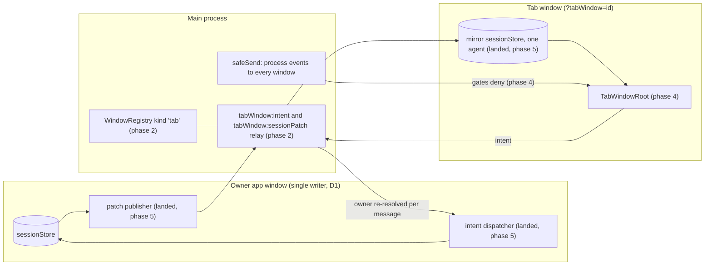
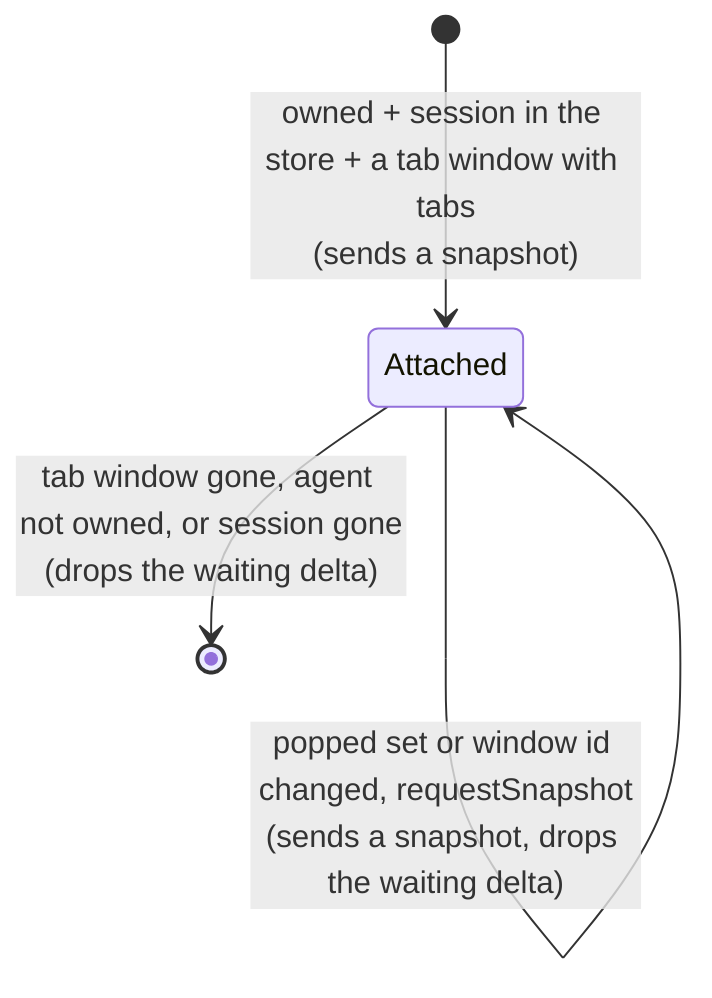
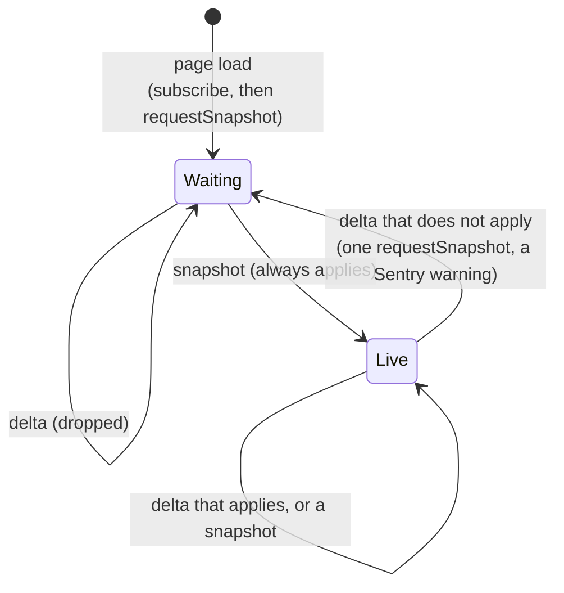
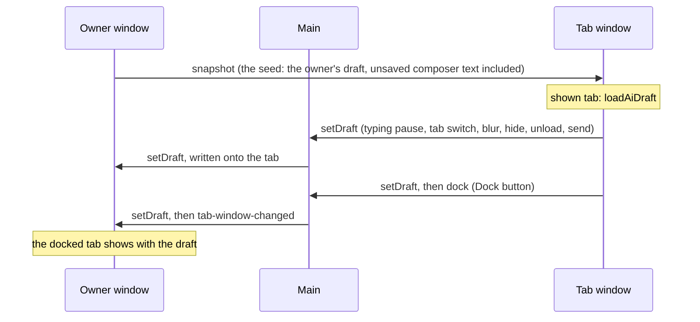
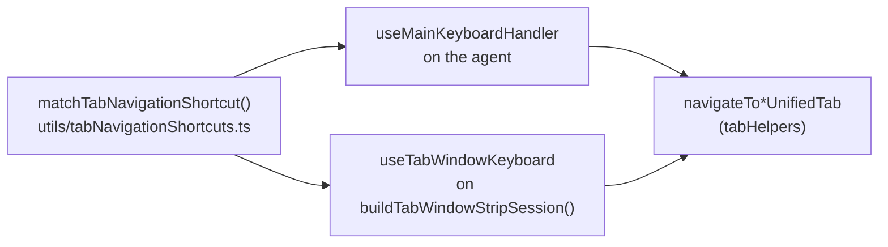

# Tab Windows (maintainer guide)

A tab window is an ordinary OS window that holds one agent's popped-out tabs and nothing else: a slim header with the agent name, a tab strip, and the active tab's content. It is a view. The app window that owns the agent (the primary, or the secondary it was moved to) stays the only writer of that agent's `Session` and the only runner of its one-time side effects. The owner streams the agent's state to the tab window as patches, and the tab window sends every user action back as an intent that the owner runs through the same function its own UI calls. The main-process `WindowRegistry` holds the truth of which tab is popped into which window (a new `'tab'` window kind, one per agent). The owner keeps a popped tab in its tab arrays and in `unifiedTabOrder`, hides it from its own strip and tab-picking math, and sends any navigation that targets it to the tab window. Closing a tab window docks its tabs. Tab windows survive a restart. The feature exists only in the Electron desktop build.

Status: phases 2 to 7 landed (all four tab kinds, the entry points, the CLI verbs, and the user docs); phase 8 (verification) is next. The spec is `TAB-WINDOWS-SPEC.md` in the `2026-09-30-Tab-Windows` playbook folder. Requirement IDs (TW-n) and decisions (Dn) below refer to it. Line numbers are as of `c3cd1d2e1b` (`origin/rc`, 2026-10-18). When they drift, search by symbol.



## Requirements

Copied from the spec.

| ID    | Requirement                                                                                                                                                                                                                       |
| ----- | --------------------------------------------------------------------------------------------------------------------------------------------------------------------------------------------------------------------------------- |
| TW-1  | A "tab window" is an ordinary OS window (resizable, movable to any display, normal z-order). No always-on-top, no frameless HUD.                                                                                                  |
| TW-2  | A tab window has NO Left Bar and NO Right Bar. It shows a slim header, a tab strip, and the active tab's content.                                                                                                                 |
| TW-3  | The header and the OS window title contain the agent's name (for example `Maestro Marketing - Tab Window`). The title follows a rename of the agent.                                                                              |
| TW-4  | One tab window per agent. When a second tab of the SAME agent is popped out, it joins that agent's existing tab window.                                                                                                           |
| TW-5  | Tabs of DIFFERENT agents never share a tab window. Each agent gets its own.                                                                                                                                                       |
| TW-6  | Inside a tab window, the user switches tabs exactly as anywhere else: click a chip, `Cmd+Shift+[` / `Cmd+Shift+]`, `Cmd+1..9`, the same tab shortcuts and chip menus.                                                             |
| TW-7  | AI tabs are the primary target and must work fully (transcript streaming, composer, queue, Stop, thinking pill, model/effort/thinking controls, permission prompts). Terminal, file preview, and browser tabs are also supported. |
| TW-8  | A popped-out tab leaves the main window's tab strip. Docking it returns it to its previous position in the agent's tab order.                                                                                                     |
| TW-9  | Closing a tab window DOCKS its tabs back into the main window. It never closes or destroys a tab or its transcript.                                                                                                               |
| TW-10 | Tab windows persist across an app restart: same agent, same tabs, same bounds and display (clamped on screen if that display is gone).                                                                                            |
| TW-11 | Three ways in (shortcut, Cmd+K command, tab chip menu item) and two ways out (Dock button in the tab window, closing the window).                                                                                                 |
| TW-12 | CLI parity: `maestro-cli tab pop-out <tab-id>`, `maestro-cli tab dock <tab-id>`, and a read verb that lists tab windows and their tabs. Same code path as the UI.                                                                 |
| TW-13 | Not offered in the web-desktop (browser) build: a browser client has no OS windows.                                                                                                                                               |
| TW-14 | Hidden consult tabs (`isAiTabHidden`) cannot be popped out.                                                                                                                                                                       |

## D1. The agent keeps one owner

### Where ownership lives today

| Layer              | Symbol                                                                                                                                                                                                                                              | File                                                       |
| ------------------ | --------------------------------------------------------------------------------------------------------------------------------------------------------------------------------------------------------------------------------------------------- | ---------------------------------------------------------- |
| Main truth         | `RegisteredWindow.sessionIds`, `getWindowForSession()` (:171), `registerSession()` (:308), `moveSession()` / `applyMove()` (:247 / :267), `reclaimSessionsToPrimary()` (:334)                                                                       | `src/main/window-registry.ts`                              |
| Renderer predicate | `WindowContext.ownsSession` (:403): the primary owns every agent no secondary claims (`!sessionsOwnedElsewhere.has(id)`), a secondary owns its `scope.sessionIds`                                                                                   | `src/renderer/contexts/WindowContext.tsx`                  |
| Event broadcast    | `safeSend = createSafeSend(() => BrowserWindow.getAllWindows())` (:540). Every `process:*` event reaches every window, tab windows included. The rule is the MULTI-WINDOW INVARIANT in `src/main/utils/safe-send.ts`.                               | `src/main/index.ts`                                        |
| Render gate        | `useOwnedSessionGate()` (:60), keyed by `agentIdFromProcessSessionId()` (:44)                                                                                                                                                                       | `src/renderer/hooks/agent/internal/useOwnedSessionGate.ts` |
| Side-effect gate   | `useOwnedSideEffectGate()` (:95)                                                                                                                                                                                                                    | same file                                                  |
| Persistence        | `useDebouncedPersistence(initialLoadComplete)` mounted once in `App.tsx` (:2202) writes `sessions:setMany`. Main tells every other window through `broadcastSessionLifecycle()` (`sessions:lifecycleSync`, `src/main/ipc/handlers/persistence.ts`). |                                                            |

The one-time side effects D1 protects run behind `useOwnedSideEffectGate`: `useAgentExitListener` (History entry, synopsis, stats row, git refresh, queue dequeue), `useAgentErrorListener`, `useAgentDataListener`, `useAgentSessionIdListener`, `useAgentStderrListener`, `useAgentToolExecutionListener`, `useAgentThinkingListener`, `useAgentClaudeModeResolvedListener`, `useAgentCommandExitListener` (all in `src/renderer/hooks/agent/internal/`), `useQueueProcessing`, and `useSessionTranscriptSync`. The render gate guards `useAgentUsageListener`, `useAgentUserInputListener`, `useAgentSshRemoteListener`, `useAgentSlashCommandsListener`, `useSteeringVerdictListener`, `useThoughtStreamToolListener`, `useThoughtStreamCaptureListener`, `useSessionRestoration`, and `useThroughputCapture` (the throughput gauge).

### How a tab window could become a second writer, and the guard for each

> [!WARNING]
> Each of these is live in the code today. A tab window built without the guard breaks D1 silently.

| #   | Trap                                                                                                                                                                                                                                                                                                                                                | Guard (phase)                                                                                                                                                                                                                                                                                                                                                                                  |
| --- | --------------------------------------------------------------------------------------------------------------------------------------------------------------------------------------------------------------------------------------------------------------------------------------------------------------------------------------------------- | ---------------------------------------------------------------------------------------------------------------------------------------------------------------------------------------------------------------------------------------------------------------------------------------------------------------------------------------------------------------------------------------------- |
| 1   | `windows:registerSession` resolves the CALLING window with `resolveCallingWindow()` (`src/main/ipc/handlers/windows.ts:99`, uses `getAll()`). A tab window that calls it claims the agent.                                                                                                                                                          | Refuse non-`app` kinds in the handler and in `WindowRegistry.registerSession` (2).                                                                                                                                                                                                                                                                                                             |
| 2   | `windows:moveSession(sessionId, from, to)` accepts any window id, and `applyMove` pushes the agent into the destination's `sessionIds`. A tab window id as destination makes it an owner.                                                                                                                                                           | Refuse non-`app` destinations in `moveSession` / `applyMove` and `setSessionsForWindow` (2).                                                                                                                                                                                                                                                                                                   |
| 3   | `WindowProvider` decides `isMainWindow` from the ABSENCE of `?windowId=` (`readWindowIdParam()`, WindowContext.tsx:52 and :242). A tab window loaded with `?tabWindow=<id>` that mounts `WindowProvider` believes it is the primary catch-all owner.                                                                                                | `TabWindowRoot` does not mount `WindowProvider`. Read window identity through `isTabWindow()` (4).                                                                                                                                                                                                                                                                                             |
| 4   | Both gates permit everything outside a `WindowProvider`, and their ref starts as `() => true` before the effect commits.                                                                                                                                                                                                                            | In a tab window both gates answer false from the first event, the initial ref value included (4).                                                                                                                                                                                                                                                                                              |
| 5   | The tab window's `sessionStore` is a mirror whose non-popped tabs have `logs: []`. Any persistence there writes emptied transcripts to disk.                                                                                                                                                                                                        | Never mount `useDebouncedPersistence`, `useSessionRestoration`, `useSessionLifecycleSync`, `useSessionTranscriptSync`, or the `useAgentListeners` family in a tab window. The other direct `window.maestro.sessions.setMany` callers (`useHostBrowserRelayResponder`, `useAppRemoteEventListeners`, `services/cueBundle.ts`, `services/providerTranslation.ts`) must not run there either (4). |
| 6   | `broadcastSessionLifecycle()` sends `sessions:lifecycleSync` to every `BrowserWindow`.                                                                                                                                                                                                                                                              | The tab window ignores it. Its only state source is the owner's patches (4, 5).                                                                                                                                                                                                                                                                                                                |
| 7   | Reused components that write the store directly (`updateSessionWith`, `updateAiTab`, `setSessions`, `useTabStore` actions) write the mirror, which then diverges from the owner. Example: `MainPanelContent` runs `normalizeTabGroups` against the active session (MainPanelContent.tsx:540-551). It is harmless only while the result is identity. | Audit every reused component for direct store writes and route each one through an intent (4, 5).                                                                                                                                                                                                                                                                                              |

## D2. The tab window is a view plus an intent sender

### Precedent: Quick Chat

Quick Chat already renders a view in one window while the conversation runs in the owner app window. The tab window relay copies its shape.

| Piece                    | Quick Chat                                                                                                                                                                                                                                          | Tab window equivalent                                                                 |
| ------------------------ | --------------------------------------------------------------------------------------------------------------------------------------------------------------------------------------------------------------------------------------------------- | ------------------------------------------------------------------------------------- |
| Owner lookup per message | `resolveEngineWindow()` in `createQuickChatController` (`src/main/quick-chat/quick-chat-controller.ts`) calls `getWindowForSession(agentId)` on every command                                                                                       | `tabWindow:intent` resolves the current owner from the registry on every message (D7) |
| Request and reply        | `requestFromRenderer(win, 'quickChat:command', { args, timeoutMs, fallback })` (`src/main/web-server/callbacks/remoteRequest.ts`)                                                                                                                   | same helper, channel `tabWindow:intent`                                               |
| Owner listener           | preload `quickChat.onCommand()` (`src/main/preload/quickChat.ts`) replies on the per-request channel. `useQuickChatEngine()` is mounted once in `App.tsx` (:2099) and starts `startQuickChatEngine()` (`src/renderer/services/quickChatEngine.ts`). | an intent handler hook mounted once in `App.tsx`                                      |
| State to the view        | the engine sends `quickChat:snapshot`; main forwards it to the floating window (`pushSnapshotToWindow`)                                                                                                                                             | owner sends `tabWindow:sessionPatch`; main forwards it to the agent's tab window      |

### How a reduced window boots today (`src/renderer/main.tsx`)

Every window loads the same `index.html` and bundle, and the URL query picks what mounts. The `?tabWindow=<id>` branch (phase 4) is a third reduced branch beside these two.

1. Before the body parses, `src/renderer/public/window-mode.js` (a classic script in `<head>`, kept external because the CSP allows no inline scripts) reads the query. It tags `<html>` with `quick-chat-window` or `cadenza-hud`, so the inline CSS in `index.html` hides `#initial-splash` from the first paint.
2. `main.tsx` runs the parts every window shares: Sentry init and the global `error` / `unhandledrejection` handlers (:18-109).
3. It reads `isCadenzaHud = new URLSearchParams(window.location.search).has('cadenzaHud')` (:114) and `isQuickChat` the same way (:118).
4. It mounts one of three roots, each in `React.StrictMode` and an `ErrorBoundary`:

   | Query         | Lines    | What `main.tsx` does                                                                                                                              |
   | ------------- | -------- | ------------------------------------------------------------------------------------------------------------------------------------------------- |
   | `?quickChat`  | :120-130 | Tags `html` and `body`, removes `#initial-splash`, renders `<QuickChatRoot />`                                                                    |
   | `?cadenzaHud` | :131-143 | The same, with `<CadenzaHudRoot />` (`src/renderer/cadenzaHud.tsx`)                                                                               |
   | anything else | :144-156 | The full app: `<LayerStackProvider><WizardProvider><MaestroConsole /></WizardProvider></LayerStackProvider>`, where `MaestroConsole` is `App.tsx` |

A reduced root never mounts `App.tsx`, so none of the app-wide hooks run in it: the `process:*` listeners, persistence, remote integration, the main keyboard handler, and `WindowProvider`. That absence is what keeps a reduced window from becoming a writer (D1).

Each reduced root brings its own basics instead. `QuickChatRoot` (`src/renderer/quickChat/QuickChatRoot.tsx`) mounts its own `LayerStackProvider`, calls `useWindowSettingsSync()` (`src/renderer/hooks/settings/useWindowSettingsSync.ts`: settings, theme, and typography for a renderer that does not run `useSettings`), and hosts `ZoomViewerHost`. Phase 4 adds `isTabWindow()` beside `isWebDesktop()` in `src/renderer/utils/runtimeContext.ts`, so window identity is never parsed from the URL a second time.

### Patch rules, checked against the code

- Log entries are replaced, never mutated. A streamed chunk becomes `{ ...lastLog, text: lastLog.text + data }` inside a new array (`useBatchedSessionUpdates.ts`, the `aiTabLogs` flush around :262-330). Comparing entry identity finds the splice.
- The same flush also DROPS earlier `thinking` and `tool` entries when assistant text arrives, unless `showThinking === 'sticky'` (:271-276). `useTranscriptBackfill` prepends older history. So the first changed index `i` can be anywhere, including 0. Applying a patch means: keep `[0, i)`, then replace everything after it with the sent `next.slice(i)`. It never just appends.
- Tool output is capped at parser ingestion (Claude's `MAX_TOOL_OUTPUT_CHARS`, `cleanToolOutputText()` for the others) and at persistence (`compactSessionToolOutputs()`, `src/shared/toolOutput.ts`). The live store can still hold an uncapped result from a provider that does not cap, so the patch caps again at this boundary with `compactLogToolOutputs()`. An entry that is already capped goes unchanged.
- Per-window fields: `clientFields` in `src/shared/sessionPersistenceMerge.ts` (`activeTabId`, `activeFileTabId`, `activeBrowserTabId`, `activeTerminalTabId`, `activeGroupId`, `inputMode`, `inputValue`, `commandMode`, `stagedImages`, `terminalDraftInput`, `ptyInitialized`) are per client by design.
  - The tab window owns its own values for these. Owner deltas never overwrite them.
  - Its active pointers come from the registry's `activeTabRef`. Components read `getActiveTab(session)`, so the mirror's `activeTabId` must always be the tab window's active AI tab. Never the owner's: that tab's logs are emptied in the mirror.
  - The draft fields follow the draft rule below.
- `liveFields` in the same file (`state`, `busySource`, `thinkingStartTime`, `currentCycleTokens`, `agentError`, ...) ride every patch along with `name` and the model settings.

### Patch logic (landed, phase 5)

The pure functions are in `src/shared/tabWindowPatch.ts`. The publisher (owner) and the consumer (tab window) add only transport, timing, and the store write.

| Function                                       | Side       | Does                                                                                                                                                                                                                                                                                                                                                                                                                                                          |
| ---------------------------------------------- | ---------- | ------------------------------------------------------------------------------------------------------------------------------------------------------------------------------------------------------------------------------------------------------------------------------------------------------------------------------------------------------------------------------------------------------------------------------------------------------------- |
| `buildTabWindowSnapshot(session, poppedRefs)`  | owner      | The whole session. Popped AI tabs keep their transcript, tool output capped. Every other AI tab, and every tab held in `closedTabHistory`, `unifiedClosedTabHistory`, `orphanedThinkingTabs`, and `snoozedTabs`, has `logs: []`. Per-window fields go as the owner has them.                                                                                                                                                                                  |
| `diffTabWindowSession(prev, next, poppedRefs)` | owner      | The body of a delta, or null when nothing changed. `session`: every session-level field that changed by identity (a superset of the fields the spec lists), except the four tab lists and the per-window fields. `tabs`: one entry per popped tab that changed: its changed fields (never `logs`, never a per-window field) and, for an AI tab, the splice from the first `i` where `prev.logs[i] !== next.logs[i]`. A tab that is not popped is never named. |
| `applyTabWindowPatch(mirror, patch)`           | tab window | The next `TabWindowMirror` (`{ session, tabRefs, seq }`), or null for a delta that cannot apply: no snapshot yet, another agent, `seq` not `mirror.seq + 1`, a splice that starts past the end of the held transcript, a change to a tab the window does not hold, or a malformed body (main checks only the envelope). Null means: ask for a snapshot.                                                                                                       |

- **Per-window fields.** `isClientSessionField()` (`src/shared/sessionPersistenceMerge.ts`) is the predicate over the same `clientFields` persistence uses. A delta never carries one, and the apply ignores one if it does.
- **Draft ownership.** A snapshot of the agent the window already holds keeps the window's session-level per-window fields, and a tab's draft (`inputValue`, `commandMode`, `stagedImages`) when that tab is in both the previous and the new `tabRefs`. A newly popped tab takes the owner's draft (the seed), and so does a docked one (the owner holds it again). The rule needs the popped set on the wire, so the snapshot envelope carries `tabRefs`, and `isTabWindowSessionPatch()` now requires `tabRefs` and `session.id === agentId`.
- **Removal and return.** A popped tab that leaves the owner's tab lists before the registry drops its ref (a close or a snooze run by the owner) comes as `{ ref, removed: true }`, and the mirror drops it at once. One that comes back carries all its fields, `id` and draft included, and a splice from 0. A change never carries `id`, which is how the apply tells a whole tab from a partial change to a tab it lost.
- **`undefined` removes.** A field set to `undefined` in a delta is deleted in the mirror. Electron IPC (structured clone) keeps such keys; a JSON hop would drop them.
- **Publisher.** `prev` is the state the previous patch was built from, not the last state seen, so coalescing must keep it. Send a new snapshot whenever the popped set changes. A registry change that only moves `activeTabRef` needs none: the tab window derives its view from the registry. Envelopes: `{ form: 'snapshot', agentId, seq, tabRefs, session }` and `{ form: 'delta', agentId, seq, ...changes }`.
- **Consumer.** Build the mirror from the store's current session plus the `tabRefs` and `seq` kept beside it, so local writes to per-window fields (the composer flushing a draft) survive the next patch. On null, request one snapshot and drop deltas until it arrives.
- **Frozen tabs.** A tab that is not popped is frozen in the mirror at the last snapshot, with no transcript. Anything the tab window draws across all of the agent's tabs (the thinking pill) reads popped tabs only, or shows stale state for the others.
- Tests: `tabWindowPatch.test.ts` (snapshot, append, stream coalescing, flush and truncation, per-window fields, a tab that is not popped, removal and return, draft ownership across snapshots, round trip), `tabWindowTypes.test.ts` (the snapshot guard).

### Publisher (landed, phase 5)

`startTabWindowPublisher(ownsSession)` (`src/renderer/services/tabWindowPublisher.ts`) streams each agent to its tab window. `useTabWindowPublisher(windowCtx?.ownsSession)` (`hooks/tabs/useTabWindowPublisher.ts`) runs it in `App.tsx`, after `useTabWindowDockReconcile`, and calls `sync()` again when `ownsSession` changes. Same shape as `startQuickChatEngine`: store subscriptions, no React state, a stop function.



- **Channel.** One per attached agent: the window id and popped refs of the last snapshot, `prev` (the session the last patch was built from), and `seq`. A pass (`sync`) runs on every `sessions` change, every `tabWindowStore.windows` change, and every ownership change. It reads the owner's `tabWindowStore` (the mirror of the registry), so it makes no IPC call of its own.
- **When a snapshot goes out.** On attach, when the popped SET changes (compared as sorted ref keys), when the agent's tab window id changes (a closed and reopened window with the same tabs), and on the `requestSnapshot` intent. A registry change that only moves `activeTabRef` or reorders the strip sends nothing. This narrows the task text ("on every `tab-window-changed`"): a snapshot re-sends every popped transcript, and the tab window re-renders all of it, so a snapshot per chip click would be the most expensive thing the stream does.
- **Deltas.** The first change after a send starts two waits at once, an animation frame and `TAB_WINDOW_PATCH_INTERVAL_MS` (50 ms), and the delta goes when both are done. The diff reads the store at that moment, so a burst rides one delta. A diff that finds nothing the tab window receives (a per-window field, a tab that is not popped) sends nothing but still moves `prev`.
- **A window that paints no frames.** rAF is paused while a window is hidden or minimized. A hidden window skips the frame wait, and a frame that has not come `TAB_WINDOW_FRAME_WAIT_MS` (250 ms) after the interval is not waited for. Without this, minimizing the owner mid-stream would freeze the tab window.
- **`seq`.** Counts per channel; a snapshot and a delta each take the next number. A new channel (attach, or the agent came back to this window) starts at 0, which applies because a snapshot always applies.
- **Errors.** A pass can run inside another store write, so it never throws into it: a failed send (an uncloneable value) and a failed pass are logged and sent to Sentry.
- **Draft seed.** A snapshot carries this window's live composer draft on the popped AI tab the composer holds (`withLiveComposerDraft`). The composer writes its draft back to the tab only after a typing pause, and lets go of a popped tab only after the snapshot has gone out, so without it a tab popped out mid-typing would seed the tab window with older text. The store is not written, and `prev` stays the stored session.
- **`requestSnapshot`.** A new intent kind (F below). The tab window sends it once its record names the agent, once per agent for the page load (`useTabWindowMirror`, over `requestTabWindowSnapshot()` in `components/TabWindow/requestTabWindowSnapshot.ts`; see "Consumer" below). The publisher answers it through its own `onIntent` subscription. A request for an agent not attached here is dropped: the attach snapshot follows once this window owns the agent, holds its session, and sees its tab window, so every arrival order converges.
- **Risk to verify in phase 8: background throttling.** App windows keep Electron's default `backgroundThrottling`. While the owner window is hidden, minimized, or (on macOS) fully covered, Chromium throttles its timers to about one wake-up per second. That covers the owner's own `useBatchedSessionUpdates` flush (200 ms interval) as well as this publisher, so a tab window would stream at about 1 Hz while its owner is out of sight. Candidate fix: `webContents.setBackgroundThrottling(false)` on an app window while it owns an agent that has a tab window.
- Tests: `src/__tests__/renderer/services/tabWindowPublisher.test.ts` (fake timers and hand-painted frames: attach, ownership, the web-desktop no-op, coalescing in both orders of frame and interval, stream rewrite, fields the tab window does not receive, a round trip through `applyTabWindowPatch`, a hidden window, the frame fallback, popped-set changes against tab switches and reorders, a new window id, `requestSnapshot`, the draft seed, detach, stop, a failing send, and the hook).

### Consumer (landed, phase 5)

`startTabWindowMirror(getInfo)` (`src/renderer/services/tabWindowMirror.ts`) applies the owner's patches in the tab window. `useTabWindowMirror(info)` (`components/TabWindow/useTabWindowMirror.ts`) runs it in `TabWindowShell`: it subscribes to `onSessionPatch` on mount, then sends the load-time `requestSnapshot` once the record names the agent, once per agent for the page load. Same shape as the publisher: no React state, a stop function.



- **The store.** `sessions` holds this one agent and nothing else, and `activeSessionId` is the agent, set with `hydrateActiveSessionId`. Never `setActiveSessionId`: it persists the app's active agent through `sessions.setActiveSessionId`. So the existing AI tab components read the mirror as they read the store in an app window: `TiledAiPane` and `TerminalOutput` through props, `ImageContextMenuHost` through `useActiveSession()`. The tabStore's active-only setters (`setAiTabScrollTop`, `setAiTabAtBottom`) write the mirror too, so each tab keeps its scroll position when the user switches tabs here.
- **Local writes survive.** The mirror handed to `applyTabWindowPatch` is the store's current session plus the `tabRefs` and `seq` the stream keeps. A field the tab window wrote itself survives every delta that does not name it. A per-window field (the draft) also survives a snapshot of the same tabs. Any other field (`scrollTop`, `isAtBottom`, `hasUnread`) takes the owner's value from a snapshot, or from a delta that changes it. `setViewState` (table E) is what keeps the two in step.
- **Resync.** A delta that does not apply (no snapshot yet, a gap in `seq`, a splice past the held end, a tab the window does not hold) sends one `requestSnapshot`, and every delta is dropped until a snapshot lands. Deltas before the first snapshot are dropped without a request, because the load-time request is already out. A failure after a snapshot is logged and sent to Sentry as a warning (`Tab window patch did not apply`): main relays one owner's patches in order, so it means a bug.
- **No local transcript writes.** `useTranscriptBackfill` does nothing in a tab window: a page prepended into the mirror would shift every later splice. The owner side is the `loadEarlierTranscript` intent (table E).
- **Thinking pill.** The composer's own pill (`InputArea` renders `ThinkingStatusPill`), fed through its `thinkingItems` prop with `buildTabWindowThinkingItems(session, tabRefs)` (`utils/thinkingItems.ts`): the busy tabs of the strip and the agent's busy closed tabs (a session-level field, so live). It never lists a tab outside the strip (frozen), and never the legacy agent-level item, which here would mean that a tab outside the strip is busy (the header's status dot shows that). Without the prop, `InputArea` self-sources with `useThinkingItems()`, which reads every tab in the store, frozen ones included. No Auto Run row: a reduced view, because `batchStore` is empty here. Stop sends `interrupt`; a name in it selects the strip tab, or sends `focusInOwner` (table C). The separate `TabWindowThinkingPill` of the consumer task is gone.
- Tests: `src/__tests__/renderer/services/tabWindowMirror.test.ts` (a snapshot into the store, deltas in order, flush and truncation, deltas before the first snapshot, a gap and the resync, a failure before the record loads, local writes kept, a newly popped tab's draft, stop, the web-desktop no-op; the hook: subscribe before asking, once per agent, unmount), `src/__tests__/renderer/components/TabWindow/TabWindowRoot.mirror.test.tsx` (a real patch stream rendered by the real `TiledAiPane`: the transcript through an append and a stream rewrite, the thinking pill on and off, a frozen tab never shown as thinking, the shown tab's queued items as they are queued and dispatched, a window that missed the attach snapshot), `thinkingItems.test.ts` (`buildTabWindowThinkingItems`), `useTranscriptBackfill.test.tsx` (no read in a tab window). The stream double is `createOwnerPatchStream()` in `src/__tests__/helpers/tabWindows.ts`, delivered through `installTabWindowsApi().emitPatch`, which clones each patch as IPC does.

### Side channels the AI tab view needs besides `Session`

The AI tab components also read per-window stores, which are empty in a fresh tab window. Phase 5 picks one of three for each: mirror it in the patch, recompute it in the tab window, or accept a reduced view (and write it down).

| Source                                                                                                                                                    | What renders from it                                      | Notes                                                                                                                                                                                                                                                                                |
| --------------------------------------------------------------------------------------------------------------------------------------------------------- | --------------------------------------------------------- | ------------------------------------------------------------------------------------------------------------------------------------------------------------------------------------------------------------------------------------------------------------------------------------ |
| Permission requests: `permissionRequestStore` + `PermissionPrompt` (mounted once in `AppShell`)                                                           | allow/deny prompt, AskUserQuestion picker                 | Landed (phase 5), see "Permission prompts" below. A `PermissionRequest` carries `sessionId` and `tabId`; the answer goes straight to main by `requestId` (`permission:respond`) and writes no `Session`, so it is not an intent. `respond` clears only the answering window's queue. |
| `retryStore` (`useRetryStatus`, `useIsHeldRetryItem`)                                                                                                     | outage card, compaction card, held badge, chip outage dot | Reduced view: empty in a tab window, so no outage or compaction card. The owner still retries; `retryNow` / `cancelRetry` (table E) reach its store.                                                                                                                                 |
| `aiCommandStore`                                                                                                                                          | AI command proposal card                                  | Landed: `requestAiCommand()` runs in the tab window (it writes no `Session`, see table A)                                                                                                                                                                                            |
| `autoRunSteeringStore`, `useBackgroundAutoRuns`, batch run state                                                                                          | Auto Run rows in `ThinkingStatusPill`                     | Reduced view for now ("Consumer" above): `batchStore` is empty in a tab window, so its pill shows no Auto Run row and no Auto Run Stop. `stopAutoRun` (table C) needs the run state mirrored first.                                                                                  |
| App state in `useSessionRecovery` / `useSummarizeAndContinue` / `useMergeSession`, `operationStore`                                                       | recovery card, summarize and merge progress overlays      | Reduced view: no summarize or merge overlay and no recovery progress here. Compact flashes "Compacting in the main window" and the result arrives by patch.                                                                                                                          |
| `crossAgentInFlightStore`                                                                                                                                 | consult indicators                                        | Reduced view: empty here.                                                                                                                                                                                                                                                            |
| `throughputGaugeStore` (filled by `useThroughputCapture`, render-gated)                                                                                   | throughput gauge                                          | Shows nothing once the gate denies (phase 4) unless mirrored                                                                                                                                                                                                                         |
| `composerInputStore`, `liveDraftStore`, `messageGistStore`, `uiStore.editingQueuedItemId`, `contextTimelineStore`, `modalStore`, `useImageAnnotatorStore` | per-window UI                                             | Local to the tab window by design                                                                                                                                                                                                                                                    |

### Unread marking (trap)

`useAgentDataListener` marks a tab unread when it is not the owner's active tab: `shouldMarkUnread = !isTargetTabActive || !isThisSessionActive || !isUserAtBottom` (`src/renderer/hooks/agent/internal/useAgentDataListener.ts`, around :160-166). `useSessionTranscriptSync` repeats the same rule. A popped tab is never the owner's active tab (D4), so every chunk would set `hasUnread` while the user is watching it in the tab window.

The owner needs a "viewed in its tab window" signal for each popped tab: active in its tab window, window visible, and `isAtBottom`. The tab window reports it by intent (`setViewState` below), and both unread rules must honor it.

Landed (phase 5): `useTabWindowViewState` (`components/TabWindow/useTabWindowViewState.ts`) sends `setViewState` for the shown AI tab after `TAB_WINDOW_VIEW_STATE_DELAY_MS` (300 ms) of quiet, and `viewed: false` at once when the window hides, the shown tab changes, or the view unmounts. The owner records it with `tabWindowStore.setTabViewed(agentId, tabId, viewed && isAtBottom)`, writes `scrollTop` / `isAtBottom` to the tab, and clears `hasUnread` while the tab is watched. Both rules skip the unread mark when `isTabViewedInTabWindow(agentId, tabId)` is true; it also requires the tab to still be popped, so a docked tab falls back to the owner's own rule.

### Target threading (trap)

Most owner handlers decide which agent and tab to act on at call time, from the owner's ACTIVE session and tab, not from arguments. A popped tab is never the owner's active tab, so calling them unchanged acts on the wrong tab. The fix is always the same function with an explicit target added (the default stays the active one), never a copy. Verified active-bound code:

- `processInput` (`src/renderer/hooks/input/useInputProcessing.ts`). `ProcessInputOptions` (:228) already takes `sessionId`, `tabId`, `images`, `forceParallel`, `hold`, and `steer`. However:
  - Text, command mode, and images default to the owner's `composerInputStore` and active tab.
  - The command-mode branch uses `getActiveTab(activeSession)` and `syncAiInputToSession('')` without a target.
  - `clearComposer` (:695) clears the owner's composer.
  - Passing `overrideInputValue` skips the repeat-submit guard, the early composer clear, and `@mention` planning.
- The model, effort, and scroll setters `useTabStore.setTabModel` / `setTabEffort` / `setAiTabScrollTop` / `setAiTabAtBottom` all go through the private `updateAiTab(tabId, updates)` (`src/renderer/stores/tabStore.ts:460`). It writes only when the tab is in the ACTIVE session, so for any other agent it silently does nothing. The file-tab setters share the same problem through the private `updateFileTab`. The explicit alternatives are `updateAiTab(sessionId, tabId, fn)` and `updateFileTab(sessionId, tabId, fn)` in `src/renderer/stores/sessionStore.ts`.
- `handleInterrupt()` (`src/renderer/hooks/agent/useInterruptHandler.ts`) takes no arguments.
- `useAITabHandlers` (`src/renderer/hooks/tabs/internal/useAITabHandlers.ts`): `handleTabSelect`, `handleTabClose` / `performTabClose`, `handleTabStar`, `handleTabMarkUnread`, `handleToggleTabSaveToHistory`, `handleToggleTabShowThinking`, `handleToggleTabEnterToSend`.
- `useScrollLogHandlers`: `handleDeleteLog`, `handleScrollPositionChange`, `handleAtBottomChange`.
- The `useForkConversation()` callback, `handleSummarizeAndContinue(tabId?)`, `handleRenameTab(newName)` (active session plus the modal's `renameTabId`), `handleAutoNameTab()`, and `useTabExportHandlers`.
- `useMergeTransferHandlers.handleMergeWith` / `handleOpenSendToAgentModal` also focus the tab in the owner first, which breaks D4 for a popped tab.
- The App.tsx inline queue handlers pin `activeSessionIdRef.current`: `handleRemoveQueuedItem`, `handleToggleQueuedItemPause`, `handleMergeQueuedItem`, `handleEditQueuedItem`, `handleReorderQueuedItem`, `handleForceSendQueuedItem`, `handleSteerQueuedItem` (App.tsx :1814-1850 and :2636-2658). The services under them already take `sessionId`.
- Some actions are window events that only the window that raised them hears: `HOLD_SEND_EVENT`, `FORCED_PARALLEL_SEND_EVENT` and `STEER_SEND_EVENT` (`useInputKeyDown`), `maestro:triggerForceSendQueued`, `maestro:codexFollowup`, `maestro:in-app-deep-link`, `maestro:refreshFileTree`.
- Some module state exists only in the window that started the work: the shell `activeRuns` map (`services/shellCommand.ts`, needed by `cancelShellCommand`), `steersInFlight` (`services/chatSteering.ts`), `composerSubmitsInFlight` (`useInputProcessing.ts:109`), and the retry timers in `retryStore`.

`PaneChatActions` and `PaneTabActions` in `src/renderer/components/MainPanel/TiledLayout.tsx` are the existing bundles of AI chat and tab handlers for a tiled pane. Their doc comment states the same limit: each handler is "addressed by id ... or keyed to the session's ACTIVE AI tab".

Landed (phase 5). Each function above now takes an explicit target and keeps the active one as its default:

| Function                       | Explicit target                                                                                                                                                                                                                                                                                                                                                                                                  |
| ------------------------------ | ---------------------------------------------------------------------------------------------------------------------------------------------------------------------------------------------------------------------------------------------------------------------------------------------------------------------------------------------------------------------------------------------------------------- |
| `processInput`                 | `ProcessInputOptions.fromTabWindow: { composer?: { commandMode, mentionRoutingOverride } }`. Text and images come from the call, never the owner's composer; the command-mode branch resolves the target tab; the owner's composer is never cleared; `@mentions` are planned from the sent text with the sent routing override; the wizard branch is skipped.                                                    |
| Stop                           | `useInterruptHandler` returns `interruptAgent({ sessionId, tabId?, mode? })` beside `handleInterrupt()`, which is `interruptAgent` on the active agent.                                                                                                                                                                                                                                                          |
| Per-tab settings and marks     | `services/aiTabActions.ts`: `setAiTabModel`, `setAiTabEffort`, `setAiTabPermissionMode`, `toggleAiTabReadOnlyMode`, `cycleAiTabShowThinking`, `setAiTabShowThinking`, `toggleAiTabSaveToHistory`, `toggleAiTabEnterToSend`, `setAiTabStarred`, `markAiTabUnread`, each over `{ sessionId, tabId }`. The `useAITabHandlers` toggles, `ToolbarControls`, and `useTabStore.setTabModel` / `setTabEffort` call them. |
| Close                          | `performTabClose(tabId, sessionId?)`; `closeTabRefs(sessionId, refs)` in `useUnifiedTabHandlers` for the other kinds and for Close Others / Left / Right. The confirms are `services/tabCloseConfirm.ts`, shared by both windows.                                                                                                                                                                                |
| Transcript                     | `handleDeleteLog(logId, target?)`, the fork callback `(logId, target?)`, `handleSummarizeAndContinue(tabId?, sessionId?)` (an explicit agent skips the input-mode check), `loadEarlierTranscriptForTab(sessionId, tabId)` (`services/transcriptBackfill.ts`, shared with `useTranscriptBackfill`).                                                                                                               |
| Rename                         | `renameTabInSession(sessionId, tabId, name)` (`services/tabRename.ts`), the body `handleRenameTab` now calls; `requestManualTabAutoName(sessionId, tabId)` (`services/tabAutoNaming.ts`).                                                                                                                                                                                                                        |
| Queue                          | `editQueuedItem(sessionId, itemId, patch)` and `reorderQueuedItems(sessionId, fromIndex, toIndex, tabId?)` (`services/queuedPrompt.ts`). The App inline queue handlers call them, so both windows apply one rule (the inline edit path no longer re-derives the mention flags; neither did it before).                                                                                                           |
| Window events and module state | `cancelShellCommand`, `openMaestroLink`, and `openInMaestroBrowser` send `cancelShellCommand` / `navigate` / `openUrlInMaestro` when they run in a tab window (`sendShownTabIntent` in `services/tabWindowIntentSender.ts`), so the owner's `activeRuns` and listeners handle them.                                                                                                                              |

### The intent union

Rules for `TabWindowIntent` (`src/shared/tabWindowTypes.ts`, phase 2):

- Every intent carries `agentId` and the target tab ref.
- The owner dispatcher re-resolves the session from its own store. If the agent is no longer its own, it refuses (the next message goes to the new owner, D7).
- Confirmations run in the tab window, which hosts its own modals. The intent carries only the confirmed action.
- Rows marked "local" need no intent: they write no `Session` field and start no process.
- The owner-side function is what the owner's own UI reaches today. "Explicit target" means the target-threading refactor above.
- The `kind` names are final as of phase 2 (`TabWindowIntentPayloads` holds each payload). The table C "navigation" row is `focusInOwner { targetTabRef }`. `UnifiedTabRef` now lives in `src/shared/unifiedTabRef.ts` (with `SingleTabRef`, `isSingleTabRef`, `isSameTabRef`); the renderer re-exports it.

#### A. Composer (`InputArea` and its subcomponents)

| `kind`                                                  | UI                                                                                                                                                                                                                                                                                                                                  | Payload                                                                                        | Owner-side function                                                                                                                                                                                | Notes                                                                                                                                                                                                                                                                                                                                                                                                                                                                                                                      |
| ------------------------------------------------------- | ----------------------------------------------------------------------------------------------------------------------------------------------------------------------------------------------------------------------------------------------------------------------------------------------------------------------------------- | ---------------------------------------------------------------------------------------------- | -------------------------------------------------------------------------------------------------------------------------------------------------------------------------------------------------- | -------------------------------------------------------------------------------------------------------------------------------------------------------------------------------------------------------------------------------------------------------------------------------------------------------------------------------------------------------------------------------------------------------------------------------------------------------------------------------------------------------------------------- |
| `send`                                                  | Enter (`InputTextarea` then `useInputKeyDown`), send button (`NotificationSendControls`; phone `ToolbarControls`), Send menu Queue and Queue Held (`SendMenuPopover`), Prompt Composer send (`handlePromptComposerSend`), wizard send (`WizardInputPanel`), Force Send with a draft (`forceParallel`), Steer with a draft (`steer`) | `text`, `images`, `commandMode`, `mentionRoutingOverride`, `forceParallel?`, `hold?`, `steer?` | `processInput(text, { sessionId, tabId, images, forceParallel, hold, steer })`, explicit target, extended to take `commandMode` and `mentionRoutingOverride` and to plan `@mentions` for this text | One path covers idle dispatch, busy queueing, `!` shell (`dispatchShellCommand`), slash commands (custom, agent, `/history`, `/wizard`, `/skills`), the `@mention` plan, tab auto-naming, and the wizard branch. See DV1. Landed with `fromTabWindow` ("Target threading"). Refused, in the tab window and again in the owner (`tabWindowSendRefusal`, `utils/tabWindowSend.ts`): a tab whose inline wizard is active, and `/history`, `/wizard`, `/skills` (Q2). The tab window leaves those three out of its slash list. |
| local                                                   | AI command mode send                                                                                                                                                                                                                                                                                                                |                                                                                                | `requestAiCommand({ session, tabId, request })` (`services/aiCommand.ts:31`) runs IN the tab window                                                                                                | Writes only `aiCommandStore` and calls `window.maestro.aiCommand.suggest`. It reads the tab's transcript from the mirror.                                                                                                                                                                                                                                                                                                                                                                                                  |
| `runShellCommand`                                       | AI command proposal Run, `Y`, Enter on Run (`AiCommandProposal`)                                                                                                                                                                                                                                                                    | `command`, `request`                                                                           | `acceptAiCommand` then `dispatchShellCommand({ session, tabId, command, request })` (`services/shellCommand.ts:293`)                                                                               | The tab window clears its own proposal.                                                                                                                                                                                                                                                                                                                                                                                                                                                                                    |
| local                                                   | proposal Cancel, Esc, `N`                                                                                                                                                                                                                                                                                                           |                                                                                                | `dismissAiCommand(entry)` (`aiCommand.ts:124`) returns the request to the local composer                                                                                                           |                                                                                                                                                                                                                                                                                                                                                                                                                                                                                                                            |
| `setDraft`                                              | typing; paste, drop, and attach images; `@` and slash accept; tab completion; voice dictation; staged image remove, annotate, and reorder (with `Screenshot N` renumbering); transcript "Quote in Message"                                                                                                                          | `inputValue`, `commandMode`, `stagedImages`                                                    | `updateAiTab(sessionId, tabId, fn)` (sessionStore) writing the fields `writeDraftToTab` (`hooks/input/useInputSync.ts:131`) writes. `commandMode` goes through `normalizeComposerCommandMode`.     | Debounce like `DRAFT_FLUSH_DELAY_MS` (300 ms). Flush on dock, on blur, and when the window hides. `handlePaste` / `handleDrop` take DOM events and read files with FileReader, so they run in the tab window. Skip `syncFileTreeToTabCompletion` (no Files panel). Landed (phase 5): see "Composer draft".                                                                                                                                                                                                                 |
| `setModel`                                              | model pill and typed model id (`ModelEffortPills`), phone sheet (`ComposerOptionsSheet`), `ModelEffortModal` (Alt+Cmd+.)                                                                                                                                                                                                            | `model?`                                                                                       | `useTabStore.setTabModel(tabId, model)`, explicit target                                                                                                                                           |                                                                                                                                                                                                                                                                                                                                                                                                                                                                                                                            |
| `setEffort`                                             | effort pill, phone sheet, `ModelEffortModal`                                                                                                                                                                                                                                                                                        | `effort?`                                                                                      | `useTabStore.setTabEffort(tabId, effort)`, explicit target                                                                                                                                         |                                                                                                                                                                                                                                                                                                                                                                                                                                                                                                                            |
| `setPermissionMode`                                     | permission pill (desktop cycles with `nextPermissionMode`), phone sheet                                                                                                                                                                                                                                                             | `mode`                                                                                         | `updateSessionWith` with `permissionModeFields(mode)` (`utils/tabHelpers/focusFields.ts:70`), as `ToolbarControls.handlePermissionModeChange` does                                                 | Writes `permissionMode` and `readOnlyMode`.                                                                                                                                                                                                                                                                                                                                                                                                                                                                                |
| `toggleReadOnly`                                        | Cmd+R, Prompt Composer                                                                                                                                                                                                                                                                                                              |                                                                                                | `toggleReadOnlyModeFields(tab)` (`focusFields.ts:50`)                                                                                                                                              |                                                                                                                                                                                                                                                                                                                                                                                                                                                                                                                            |
| `setThinkingMode`                                       | thinking pill (`cycleShowThinkingFields`, `focusFields.ts:112`), phone sheet (`setShowThinkingFields`, :128), Cmd+Shift+K, Prompt Composer                                                                                                                                                                                          | `mode` or `cycle`                                                                              | the same field helpers, via `handleToggleTabShowThinking` (`useAITabHandlers.ts:341`)                                                                                                              | Turning thinking off also drops thinking logs. On a wizard tab, Cmd+Shift+K toggles `wizardState.showWizardThinking` instead.                                                                                                                                                                                                                                                                                                                                                                                              |
| `toggleSaveToHistory`                                   | toolbar, phone sheet, Cmd+S, Prompt Composer                                                                                                                                                                                                                                                                                        |                                                                                                | `handleToggleTabSaveToHistory` (`useAITabHandlers.ts:330`), explicit target                                                                                                                        |                                                                                                                                                                                                                                                                                                                                                                                                                                                                                                                            |
| `toggleEnterToSend`                                     | toolbar (desktop)                                                                                                                                                                                                                                                                                                                   |                                                                                                | `handleToggleTabEnterToSend` (:352), explicit target                                                                                                                                               | The Prompt Composer's own Enter-to-send is a global setting (`setEnterToSendAIExpanded`): local.                                                                                                                                                                                                                                                                                                                                                                                                                           |
| `steerNewest`                                           | Alt+Cmd+Enter with an empty draft                                                                                                                                                                                                                                                                                                   |                                                                                                | `steerNewestQueuedMessage(sessionId, tabId)` (`services/chatSteering.ts:451`)                                                                                                                      | With a draft it is `send` with `steer: true`.                                                                                                                                                                                                                                                                                                                                                                                                                                                                              |
| `interrupt`                                             | `StopTurnButton` in `ThinkingStatusPill` and `CrossAgentResponseIndicator`                                                                                                                                                                                                                                                          |                                                                                                | `handleInterrupt()`, explicit target                                                                                                                                                               | Same scope as the owner's Stop. It stops every busy tab of the agent; cancels compaction, retries, and pending synopses; drops mention hand-offs and calls `crossAgent.cancel`; then starts the next runnable queued item.                                                                                                                                                                                                                                                                                                 |
| `stopWizardTurn`                                        | wizard Stop, Esc while busy                                                                                                                                                                                                                                                                                                         |                                                                                                | `cancelTurn(tabId)` (`hooks/batch/inlineWizard/conversationActions.ts`)                                                                                                                            |                                                                                                                                                                                                                                                                                                                                                                                                                                                                                                                            |
| `exitWizard`, `toggleWizardThinking`, `toggleInputMode` | `WizardInputPanel`                                                                                                                                                                                                                                                                                                                  |                                                                                                | `handleExitWizard(tabId)`, `handleToggleWizardShowThinking` (`hooks/wizard/useWizardHandlers.ts`), `toggleInputMode` (`hooks/input/useInputMode.ts`)                                               | Refused by the owner (Q2): the inline wizard runs in the app window only, and a tab window has no terminal mode to switch to. The tab window's composer draws no wizard panel.                                                                                                                                                                                                                                                                                                                                             |
| `summarizeAndContinue`                                  | `ContextWarningSash` Compact, chip "Context: Compact"                                                                                                                                                                                                                                                                               |                                                                                                | `handleSummarizeAndContinue(tabId)` (`hooks/agent/useSummarizeAndContinue.ts`)                                                                                                                     | Opens the new tab in the OWNER (Q1). The tab window flashes "Compacting in the main window".                                                                                                                                                                                                                                                                                                                                                                                                                               |
| `cancelSummarize`, `cancelMerge`                        | progress overlays                                                                                                                                                                                                                                                                                                                   |                                                                                                | `cancelTab(tabId)` in `useSummarizeAndContinue` / `useMergeSession`                                                                                                                                |                                                                                                                                                                                                                                                                                                                                                                                                                                                                                                                            |
| local                                                   | slash, `@`, and tab-completion popovers; Send menu; model and effort menus; mention routing menus; phone sheets; lightbox; image organizer and annotator; Prompt Composer open; queue browser open; voice capture; Cmd+F; focus                                                                                                     |                                                                                                |                                                                                                                                                                                                    | The tab window hosts its own modals.                                                                                                                                                                                                                                                                                                                                                                                                                                                                                       |

#### B. Queue (`QueuedItemsList`, rendered inside `TerminalOutput`)

| `kind`                   | UI                                                                                                             | Payload                                                 | Owner-side function                                                                                                                                                       | Notes                                                                                                                                                                                                                                                                              |
| ------------------------ | -------------------------------------------------------------------------------------------------------------- | ------------------------------------------------------- | ------------------------------------------------------------------------------------------------------------------------------------------------------------------------- | ---------------------------------------------------------------------------------------------------------------------------------------------------------------------------------------------------------------------------------------------------------------------------------- |
| `removeQueuedItem`       | X, then confirm                                                                                                | `itemId`                                                | `removeQueuedItem(sessionId, itemId)` (`services/queuedPrompt.ts:179`)                                                                                                    | The App inline handler applies the same filter.                                                                                                                                                                                                                                    |
| `toggleQueuedItemPaused` | Hold / Resume                                                                                                  | `itemId`                                                | `toggleQueuedItemPaused(sessionId, itemId)` (:206)                                                                                                                        |                                                                                                                                                                                                                                                                                    |
| `mergeQueuedItem`        | Merge, then confirm                                                                                            | `itemId`                                                | `mergeQueuedItemIntoAbove(sessionId, itemId)` (:239)                                                                                                                      |                                                                                                                                                                                                                                                                                    |
| `editQueuedItem`         | Pencil, then `QueuedItemEditModal` save. Cmd+Shift+E (`requestEditLastQueuedMessage`) opens the modal locally. | `itemId`, `patch`                                       | `applyQueuedItemEdit(queue, itemId, patch)` (`utils/executionQueue.ts:59`) through `updateSessionWith`, as the App inline handler does                                    | Settled in phase 5: `editQueuedItem(sessionId, itemId, patch)` (`services/queuedPrompt.ts`) writes the patch and plans the consult again from the edited text. The inline cards, the Execution Queue browser (`useQueueHandlers.handleEditQueueItem`), and the intent all call it. |
| `reorderQueuedItem`      | drag (`useQueueReorder`)                                                                                       | `fromIndex`, `toIndex` (indices among THIS tab's items) | `reorderQueueItem(queue, from, to, tabId)` (`executionQueue.ts:426`)                                                                                                      | Not interchangeable with the whole-queue indices in `useQueueHandlers`.                                                                                                                                                                                                            |
| `forceSendQueuedItem`    | Force Send, then confirm; Cmd+Shift+Enter with an empty draft (local `maestro:triggerForceSendQueued`)         | `itemId`                                                | `handleForceSendQueueItem(sessionId, itemId)` (`hooks/agent/useQueueHandlers.ts`), then `sendQueuedItemNow(sessionId, itemId, processQueuedItem)` (`queuedPrompt.ts:276`) | `getForceSendEligibility` / `shouldOfferForceSend` are pure: compute in the tab window.                                                                                                                                                                                            |
| `steerQueuedItem`        | Steer                                                                                                          | `itemId`                                                | `handleSteerQueueItem(sessionId, itemId)`, then `steerQueuedItem` (`chatSteering.ts:221`)                                                                                 | `getSteerEligibility` is pure: compute locally.                                                                                                                                                                                                                                    |

#### C. Thinking pill (`ThinkingStatusPill`)

| `kind`        | UI                                    | Payload  | Owner-side function                                                                                                                                                                                          | Notes                                                                                                                                                                                                                                                                         |
| ------------- | ------------------------------------- | -------- | ------------------------------------------------------------------------------------------------------------------------------------------------------------------------------------------------------------ | ----------------------------------------------------------------------------------------------------------------------------------------------------------------------------------------------------------------------------------------------------------------------------- |
| `interrupt`   | Stop                                  |          | as in table A                                                                                                                                                                                                |                                                                                                                                                                                                                                                                               |
| `stopAutoRun` | Auto Run Stop (pill and demoted rows) |          | `stopBatchRun`                                                                                                                                                                                               | `handleStopBatchRun(sessionId)` (`hooks/batch/useBatchHandlers.ts`) opens its confirm in the CALLING window. For a tab window, confirm locally, then send. The owner runs `stopBatchRun` without a confirm; nothing sends it yet, because a tab window shows no Auto Run row. |
| navigation    | agent name, tab name, dropdown rows   | `tabRef` | A tab in this tab window: select it locally. Anything else: `focusInOwner { targetTabRef }`, which the owner runs as `jumpToAgent(agentId, { tabRef })` (`services/agentNavigation.ts`), then raises itself. | The mirror holds one agent, so the pill lists only that agent's busy tabs.                                                                                                                                                                                                    |
| local         | "+N" dropdown                         |          |                                                                                                                                                                                                              |                                                                                                                                                                                                                                                                               |

#### D. AI tab chip and menu (`AITab.tsx`, `AITabOverlayMenu.tsx`)

| `kind`                     | UI                                                                                                                                                                          | Payload            | Owner-side function                                                                                                                                                                             | Notes                                                                                                                                                                            |
| -------------------------- | --------------------------------------------------------------------------------------------------------------------------------------------------------------------------- | ------------------ | ----------------------------------------------------------------------------------------------------------------------------------------------------------------------------------------------- | -------------------------------------------------------------------------------------------------------------------------------------------------------------------------------- |
| local                      | chip click, Enter / Space                                                                                                                                                   |                    | The tab window's own active tab. Persist it with `setTabWindowActiveTab` (phase 2).                                                                                                             | Never touches the owner's `activeTabId`.                                                                                                                                         |
| `closeTab`                 | X, middle click, "Close Tab"                                                                                                                                                |                    | `performTabClose(tabId)` (`useAITabHandlers.ts:128`), explicit target, after a LOCAL draft or wizard confirm                                                                                    | `handleTabClose` would open its confirm in the owner. `dockStaleTabWindowRefs` drops the ref afterwards (D7).                                                                    |
| `renameTab`                | "Rename Tab", then the rename modal (local)                                                                                                                                 | `name`             | `renameTabInSession(sessionId, tabId, name)` (`services/tabRename.ts`), the body of `handleRenameTab`                                                                                           | One function covers AI, file, terminal, and group tabs. Also calls IPC `claude.updateSessionName`.                                                                               |
| `autoNameTab`              | rename modal "Auto"                                                                                                                                                         |                    | `requestManualTabAutoName(sessionId, tabId)`, then `requestTabAutoName` (`services/tabAutoNaming.ts`)                                                                                           |                                                                                                                                                                                  |
| `starTab`                  | "Star / Unstar Session"                                                                                                                                                     | `starred`          | `handleTabStar(tabId, starred)` (:304), then `persistTabStarred` (`utils/starredSessions.ts`)                                                                                                   |                                                                                                                                                                                  |
| `markUnread`               | "Mark as Unread"                                                                                                                                                            |                    | `handleTabMarkUnread(tabId)` (:314)                                                                                                                                                             |                                                                                                                                                                                  |
| `snoozeTab`                | "Snooze Tab", then the snooze modal (local)                                                                                                                                 | snooze options     | `snoozeTabWithMirror(..., { sessionId })` (`services/snoozeActions.ts:65`)                                                                                                                      | Removes the tab from `aiTabs`, so the ref leaves the tab window (D7).                                                                                                            |
| `summarizeAndContinue`     | "Context: Compact"                                                                                                                                                          |                    | as in table A                                                                                                                                                                                   |                                                                                                                                                                                  |
| `mergeInto`, `sendToAgent` | "Context: Merge Into", "Context: Send to Agent"                                                                                                                             | target and options | `handleMerge` / `handleSendToAgent` (`hooks/agent/useMergeTransferHandlers.ts`), after a LOCAL modal                                                                                            | Never call `handleMergeWith` / `handleOpenSendToAgentModal` for a popped tab (they focus it in the owner). v1: the tab window hides both items and the owner refuses both kinds. |
| `reorderTabs`              | "Move to First / Last Position", chip drag                                                                                                                                  | refs               | `tabWindows.reorder(agentId, tabRefs)` (`tabWindows:reorder`), which calls `reorderTabWindow` then `WindowRegistry.setTabWindowTabOrder`: the tab window's own `tabRefs`, not `unifiedTabOrder` | The `unifiedTabOrder` slot is the dock position (TW-8).                                                                                                                          |
| `closeTabs`                | Close Other / Left / Right                                                                                                                                                  | refs               | `closeRefs` (`hooks/tabs/internal/useUnifiedTabHandlers.ts`), then `applyUnifiedTabClosures` with `excludePreservedRefs`                                                                        | Scope is the tab window's strip, not the agent's.                                                                                                                                |
| local                      | Copy Session ID, Copy Deep Link, Export as HTML, Context: Copy (with or without reasoning), Publish Gist (`GistPublishModal`, IPC `createGist`), hover and long-press menus |                    | `useTabExportHandlers` reads the owner's active session today: point it at the mirror tab                                                                                                       | No `Session` writes. Reduced view for now: Copy Session ID and Copy Deep Link work; Export as HTML, Context: Copy, and Publish Gist are not offered.                             |
| none                       | drag to tile                                                                                                                                                                |                    |                                                                                                                                                                                                 | Disabled in a tab window (no tiling inside it in v1).                                                                                                                            |

#### D'. File tab (added in phase 6)

- `setFileTabState { fields, refreshFileTree? }`: the file tab write-back. `fields` holds only what changed since the last write, from `TabWindowFileTabState` (`src/shared/tabWindowTypes.ts`); `undefined` clears a field. The owner writes them with sessionStore `updateFileTab` (`writeTabWindowFileTab` in `services/tabWindowIntents.ts`), drops any other key, and calls `requestFileTreeRefresh(agentId)` when `refreshFileTree` is set. It accepts a write for a docked tab too, because a closed tab window's last write lands after the dock. See "File preview (landed, phase 6)".

#### D''. Browser tab (added in phase 6)

- `setBrowserTabState { fields }`: the browser tab write-back, sent at once on each change. `fields` holds only what changed since the last write, from `TabWindowBrowserTabWriteBack` (`url`, `title`, `favicon`, `hiddenFromAgent`). The owner writes them with sessionStore `updateBrowserTab` (`writeTabWindowBrowserTab` in `services/tabWindowIntents.ts`), drops any other key and its own guest state, and refuses a tab that is no longer popped out. See "Browser (landed, phase 6)".

#### E. Transcript (`TerminalOutput`; prop names as in `PaneChatActions`)

| `kind`                            | UI                                                                                                                                                                                         | Payload                             | Owner-side function                                                                                                                            | Notes                                                                                                                                                                                                                                             |
| --------------------------------- | ------------------------------------------------------------------------------------------------------------------------------------------------------------------------------------------ | ----------------------------------- | ---------------------------------------------------------------------------------------------------------------------------------------------- | ------------------------------------------------------------------------------------------------------------------------------------------------------------------------------------------------------------------------------------------------- |
| `deleteLog`                       | trash, then confirm; shell card delete                                                                                                                                                     | `logId`                             | `handleDeleteLog(logId)` (`hooks/tabs/internal/useScrollLogHandlers.ts:11`), explicit target                                                   | Also calls IPC `claude.deleteMessagePair`.                                                                                                                                                                                                        |
| `replayMessage`                   | Replay                                                                                                                                                                                     | `text`, `images`                    | `handleReplayMessage`, then `processInput(text, { sessionId, tabId })`                                                                         | Already explicit.                                                                                                                                                                                                                                 |
| `forkConversation`                | Fork                                                                                                                                                                                       | `logId`                             | the `useForkConversation()` callback, explicit target                                                                                          | Creates and focuses a new tab in the OWNER. See Q1.                                                                                                                                                                                               |
| `cancelShellCommand`              | shell card Stop                                                                                                                                                                            | `logId`                             | `cancelShellCommand(logId)` (`shellCommand.ts:94`)                                                                                             | Needs the owner's `activeRuns`.                                                                                                                                                                                                                   |
| `retryNow`, `cancelRetry`         | `RetryStatusCard`                                                                                                                                                                          |                                     | `retryNow(sessionId, tabId)` (`stores/retryStore.ts:1260`) / cancel                                                                            |                                                                                                                                                                                                                                                   |
| `recoverSession`                  | `SessionRecoveryCard` Send                                                                                                                                                                 | options                             | `startRecovery({ sessionId, tabId, ... })` (`hooks/agent/useSessionRecovery.ts`)                                                               | `isRecovering` and `recoveryError` live in App: mirror them.                                                                                                                                                                                      |
| `loadEarlierTranscript`           | automatic near the top, Retry                                                                                                                                                              |                                     | The owner runs the `useTranscriptBackfill` fetch and prepends. The next patch carries the result.                                              | The tab window must NOT run `useTranscriptBackfill` (`TerminalOutput.tsx:277`) against its mirror. A local prepend plus an owner splice corrupts the log indices. Guarded since the consumer landed: the hook returns at once in a tab window.    |
| `setViewState`                    | scroll, window focus                                                                                                                                                                       | `scrollTop`, `isAtBottom`, `viewed` | `updateAiTab(sessionId, tabId, fn)` on dock and on a debounce, never the tabStore active-only setters                                          | Local while popped. Also feeds the unread rule. An echoed `initialScrollTop` cancels a scroll restore in progress (`useTerminalOutputScroll`).                                                                                                    |
| `codexFollowup`                   | `FollowupChip`, `CodexVisualizationFrame`                                                                                                                                                  | chip                                | The App handler around `App.tsx:2485`, using `resolveCodexFollowup` (`services/codexFollowup.ts:93`), with the popped tab counted as on screen | Landed: the tab window resolves the chip itself (`resolveCodexFollowup` with its shown tab as active). A prefill stays in its own composer; a send goes as `codexFollowup { prompt, mode: 'send' }`, which the owner runs through `processInput`. |
| `openFileLink`                    | file links, `@file` chips, citations, `FileContextMenu` Preview, `SaveMarkdownModal` "open in tab"                                                                                         | `path`                              | the `onFileClick` path (`hooks/git/useFileExplorerEffects.ts`), then `handleOpenFileTab` in the owner                                          | Opens the file tab in the owner (Q3), shows the agent there, and raises the owner window.                                                                                                                                                         |
| `navigate`                        | delegation cards, cross-agent header, `maestro:` links, `@agent` chips, Concerto links                                                                                                     | deep link                           | `handleDeepLink` (`hooks/session/useSessionSwitchCallbacks.ts:191`) in the owner, then raise the owner                                         | `openMaestroLink` is a window event, and the tab window has no listener for it: in a tab window it sends this intent instead (`sendShownTabIntent`).                                                                                              |
| `openUrlInMaestro`                | web link routed to Maestro's browser                                                                                                                                                       | `url`                               | the `openUrl` path in the owner (creates a browser tab there)                                                                                  | The system browser case is local (`shell.openExternal`).                                                                                                                                                                                          |
| `clearAgentError`, error recovery | `AgentErrorBanner` dismiss, error modal actions                                                                                                                                            |                                     | `clearAgentError(sessionId, tabId)` (`stores/agentStore.ts`) and the error modal's agentStore actions                                          |                                                                                                                                                                                                                                                   |
| `coworkingApproval`               | `CoworkingApprovalHost`                                                                                                                                                                    | decision                            | `coworkingApprovalStore.settle`                                                                                                                | Resolves a promise held in the OWNER's memory.                                                                                                                                                                                                    |
| local                             | copy message, code copy, mermaid, image zoom, lightbox, find bar, expand and collapse, raw markdown toggle (global setting), save to file (fs IPC), publish message gist, git action cards |                                     |                                                                                                                                                |                                                                                                                                                                                                                                                   |

#### F. Patch stream (added in phase 5)

| `kind`            | UI                                                                                 | Payload | Owner-side function                                                                        | Notes                                                                                                                                                                         |
| ----------------- | ---------------------------------------------------------------------------------- | ------- | ------------------------------------------------------------------------------------------ | ----------------------------------------------------------------------------------------------------------------------------------------------------------------------------- |
| `requestSnapshot` | none: the tab window sends it on load, and when `applyTabWindowPatch` answers null | -       | the publisher's own `onIntent` subscription (`startTabWindowPublisher`) resends a snapshot | The tab ref is any tab of the window (`requestTabWindowSnapshot` uses the shown one). The intent dispatcher's `switch` must treat this kind as handled there (an empty case). |

Permission prompt answers are not intents. See "Permission prompts" below.

### Intent dispatcher (landed, phase 5)

`dispatchTabWindowIntent(intent, handlers, ownsSession)` (`src/renderer/services/tabWindowIntents.ts`) runs one intent in the owner. Its `switch` covers the closed union, and the `never` default makes a new kind a type error until it has a case. `startTabWindowIntentDispatcher(getHandlers, ownsSession)` subscribes to `tabWindows.onIntent` (a no-op in the web-desktop build). `useTabWindowIntents(ownsSession, handlers)` (`hooks/tabs/useTabWindowIntents.ts`) mounts it once in `App.tsx`, after the queue handlers, and reads the handlers through a ref, so the subscription never restarts.

- **Two kinds of owner function.** Services that take a target are called directly: `services/aiTabActions.ts`, the queue services, `renameTabInSession`, `requestManualTabAutoName`, `snoozeTabWithMirror`, `steerNewestQueuedMessage`, `dispatchShellCommand`, `cancelShellCommand`, `retryNow` / `cancelRetry`, `loadEarlierTranscriptForTab`, `openMaestroLink`, `openInMaestroBrowser`, `jumpToAgent`, and the coworking approval store. Functions that live in App-level hook instances arrive as `TabWindowOwnerHandlers`: `processInput`, `interruptAgent`, `performTabClose`, `closeTabRefs`, `forceSendQueuedItem`, `steerQueuedItem`, `deleteLog`, `forkConversation`, `recoverSession`, `summarizeAndContinue`, `cancelSummarize`, `cancelMerge`, `stopBatchRun`, `cancelWizardTurn`, `clearAgentError`, `openFileLink`, `showAgent`, and `raiseWindow`.
- **Checks.** This window must own the agent (`ownsSession`), its store must hold it, and the tab a tab-scoped intent names must still exist. A refused intent is logged and dropped; the tab window learns the outcome from the next patch.
- **Errors.** A handler that throws, or whose promise rejects, goes to Sentry (`captureException`, `extra.operation` = `tabWindowIntents.<kind>`), and the dispatcher keeps running.
- **Settings codified at send.** `send`, `replayMessage`, and a sent `codexFollowup` run through `processInput`, which stamps the TARGET tab's model, effort, and thinking settings (`codifyTurnSettings`, `captureQueuedTurnSettings`) exactly as a local send does.
- **Raising the owner.** `openFileLink`, `openUrlInMaestro`, `navigate`, and `focusInOwner` (for a tab outside the strip) show their result in the owner, so the owner raises its own window (`raiseOwnWindow`: `windows.getState`, then `focusWindow`).
- **Refused kinds.** `exitWizard`, `toggleWizardThinking`, and `toggleInputMode` (Q2); `mergeInto` and `sendToAgent` (table D). `requestSnapshot` is the publisher's, so it is a no-op here.
- **Per-window fields.** `setDraft` writes `inputValue`, `commandMode`, and `stagedImages`, and only when they differ. When this window's composer still shows the copy it loaded for that tab (the tab docked before the write arrived), the composer takes the new draft too. `setViewState`: see "Unread marking".
- Tests: `src/__tests__/renderer/services/tabWindowIntents.test.ts` (per kind: the owner function and its arguments; the refusals; every kind dispatched once with a valid payload; ownership; throw and rejection reporting; the subscription and the web-desktop no-op; `setDraft` and this window's composer). The hook-bound handlers are mocked by `createTabWindowOwnerHandlers()` in `src/__tests__/helpers/tabWindows.ts`. The UI half: `TabWindowRoot.test.tsx` (a send, a refused send, Stop, a close confirmed for its draft, rename, snooze, the chip menus) and `TabWindowRoot.mirror.test.tsx` (a queued item removed from the real transcript).

### Tab window composer and transcript actions (landed, phase 5)

- **Composer.** `TabWindowComposer` mounts the shared `InputArea` in its own `InputProvider`, with the app window's keyboard handler (`useInputKeyDown`, whose AI command accept and empty-draft steer are injectable), completions (`useComposerCompletions`, shared with `useInputHandlers`), and slash list (`buildSlashCommandList` in `slashCommands.ts`, shared with `App.tsx`). A send checks `tabWindowSendRefusal`, sends `send`, clears the local draft, and writes the cleared draft back at once ("Composer draft" below). AI command mode asks for its proposal here (`requestAiCommand`); an accepted proposal sends `runShellCommand`. Paste and drop read images here (`imageFilesIn`, `readBlobAsDataUrl`, `addStagedImageIfUnique`, `pasteTrimmedText`). Each pill and toggle sends its intent: `InputArea` and `ToolbarControls` take `onPermissionModeChange`, `onThinkingModeChange`, `onAcceptAiCommand`, and `thinkingItems` for this.
- **Reduced composer.** No Prompt Composer, no queue browser, no Auto Run row, and no summarize or merge overlay. The `@` picker sees only this agent (the mirror holds one), so another agent is mentioned by typing its name; the owner plans the mention from the sent text against its full roster. Methodology slash commands (SpecKit, OpenSpec, BMAD) are not offered in its autocomplete.
- **Transcript.** `useTabWindowChatActions` builds the `PaneChatActions` for `TiledAiPane`. Every action that writes a `Session` is an intent. Eligibility (`getForceSendEligibility`, `getSteerEligibility`), the lightbox, raw-text mode, and copy stay local.
- **Modals.** `TabWindowModals` draws what the shared openers open in this renderer: `confirm`, `renameTab`, `snoozeTab`, and `lightbox`. A close confirms first through `services/tabCloseConfirm.ts`, the rules the owner's chips use.
- **Focus pointers.** `useShownTabInStore` writes the shown tab's focus fields (`activeTabId`, `activeFileTabId`, `activeBrowserTabId`, `activeTerminalTabId`, `activeGroupId`, `inputMode`) into this window's copy of the agent, so code that reads the store's active tab (the keyboard handler, the send menu, the lightbox) reads the shown tab. They are per-window fields, so no patch overwrites them.

### Permission prompts (landed, phase 5)

- **Routing.** `initPermissionRelay(getMainWindow, processManager, { resolveTabWindow })` delivers each request through `createPermissionRequestRouter` (`src/main/permission-relay/request-router.ts`). A request whose AI tab is popped goes to that tab window (`findTabWindowHoldingAiTab` in `src/main/tab-window-service.ts`, which matches the tab id and the `${agentId}-` process prefix). Any other request goes to the primary, as before. A request no window can show is denied.
- **Re-routing.** `wireTabWindowPermissionRerouting(registry)` (`src/main/ipc/handlers/tab-windows.ts`) calls `reroutePermissionRequests()` on every `tab-window-changed`. An open request that went to a tab window moves to the window that shows its tab now (the primary after a dock); one with nowhere to go is denied. A request delivered to the primary never moves.
- **Tab window side.** `TabWindowRoot` mounts `PermissionPrompt`, and `usePermissionPromptsForStrip` forgets (`permissionRequestStore.forget`) a request whose tab left the strip without answering it, because main delivered it again elsewhere.
- Tests: `src/__tests__/main/permission-relay/request-router.test.ts`, `src/__tests__/main/ipc/handlers/tab-windows.test.ts` (`findTabWindowHoldingAiTab`, the re-routing wire), `permissionRequestStore.test.ts` (`forget`).

### Composer draft (landed, phase 5)

The draft lives in the tab window while the tab is popped out (D2). `useTabWindowDraft(agentId, shownAiTabId)` (`components/TabWindow/useTabWindowDraft.ts`, mounted in `TabWindowBody`) holds it and returns `flushDraft` for the Dock button and the composer's send.



- **Fields.** Stored on the tab as `AITab.inputValue`, `AITab.commandMode` (`'off' | 'shell' | 'ai'`, legacy `true` means shell), and `AITab.stagedImages` (`src/renderer/types/index.ts`). In the tab window the text and mode sit in its `composerInputStore`, the staged images on its copy of the tab (the composer's `setStagedImages` is `updateAiTab` there). `mentionRoutingOverride` and the `aiCommandStore` entries are never saved: they ride the `send` intent or stay local.
- **Seed.** A tab new to the tab window arrives in the owner's snapshot with the owner's draft, text still in the owner's composer included (the publisher's "Draft seed"). Showing a tab loads its draft into the composer (`loadAiDraft`). For a tab the window already holds, a snapshot keeps the window's own draft (`applyTabWindowPatch`), and no patch reloads the composer.
- **Write-back.** Every edit of the shown tab's draft (the composer's text or mode, the tab's staged images) queues one `setDraft` through `useDraftPersistence`, on the app window's `DRAFT_FLUSH_DELAY_MS` (300 ms). What is queued goes at once when another tab shows (the outgoing tab's draft, also kept on this window's copy of its tab), on window `blur`, on `visibilitychange` to hidden, on `pagehide`, on unmount, before a Dock, and after a send (the cleared draft, so the owner never holds sent text as a draft). Showing or switching tabs without an edit sends nothing.
- **Dock.** The Dock button sends the draft, then calls `tabWindows.dock`. Main handles one window's messages in order (`sendIntent` is `ipcRenderer.send`, `dock` is `invoke`, and the relay forwards synchronously), so the owner writes the draft before it hears of the dock, and its composer loads it when the docked tab shows (`useInputHandlers`).
- **Window close.** Main docks every tab on `close`, before the page unloads, so the `pagehide` write lands after the dock. While the owner's composer still shows the copy it loaded on the dock, `writeTabWindowDraft` loads the newer draft into it too; text typed in the owner since then stays. Main relays the write only while the registry entry exists, which is until `closed`.
- **Phase 8 check.** A draft typed in a tab window just before Cmd+Q should survive the restart with its tab (TW-10).
- Tests: `src/__tests__/renderer/components/TabWindow/TabWindowRoot.draft.test.tsx` (the seed with text, command mode, and images; one write per typing pause; command mode and staged images ride along; a tab switch sends the outgoing draft and keeps each tab's own; blur, hide, and unload; a send clears the owner's copy; a new snapshot keeps the typed draft; and both windows' real code in turn: a draft typed in the owner before pop-out appears in the tab window, unsaved text included; a draft typed in the tab window reaches the owner before the dock; a closed window's late draft reaches the owner's composer), `tabWindowPublisher.test.ts` (the draft seed), `tabWindowIntents.test.ts` (`setDraft` and this window's composer), `TabWindowRoot.test.tsx` (a send clears the owner's copy).

### Phase 5 questions, as decided

- Q1. Fork, Compact, and Merge create a new tab in the owner and focus it there. Should that tab join the tab window instead? Decided for v1: it lands in the owner, and the tab window flashes "Forked in the main window" or "Compacting in the main window". Merge is not offered in a tab window.
- Q2. Inline wizard tabs: route the wizard intents, or refuse to pop out a tab whose wizard is active? Decided: the inline wizard runs in the app window only. A tab with an active wizard can still pop out, but a send to it, `/wizard`, and the wizard intents are refused with "Dock this tab" messages. `/history` and `/skills` work on the app window's active tab, so they are refused the same way.
- Q3. File links clicked in a tab window open a file tab in the owner. Should that tab pop into the same tab window? Decided for v1: it opens in the owner, which raises itself.

## D3. The main process holds the truth of which tab is where

### Types

- `WindowKind = 'app' | 'cadenza-hud' | 'quick-chat'` (`src/main/window-registry.ts:15`), `RegisteredWindow` (:28), `WindowRegistryChangeType` (:42), `WindowRegistryChange` (:55).
- `WindowState`, `MultiWindowState`, `WindowInfo`, and `WindowSessionMovedPayload` (whose `type` union needs `'tab-window-changed'`) live in `src/shared/window-types.ts`.
- `UnifiedTabRef` is defined in `src/renderer/types/index.ts:1032`. That module type-imports renderer-only files (`utils/shellCommandInput`, `components/DocumentGraph/layoutTypes`, `hooks/batch/batchStateMachine`), and `tsconfig.main.json` only includes `src/main`, `src/shared`, and `src/types`.
  - Hoist the type into `src/shared` and re-export it from the old location. Precedent: `src/shared/snoozeCommands.ts:88` already redeclares the union.
  - A tab window never holds a `'group'` ref (popping out a whole group is out of scope), so `TabWindowInfo.tabRefs` can use the narrowed kind.

### Every registry consumer, and what a `'tab'` kind needs there

| Consumer                                                               | File                                                                                                                                                                                                              | Reads                                              | Tab window effect today                                                                                                                                                                                                                                                                                                                                              | Phase 2 action                                                                                                |
| ---------------------------------------------------------------------- | ----------------------------------------------------------------------------------------------------------------------------------------------------------------------------------------------------------------- | -------------------------------------------------- | -------------------------------------------------------------------------------------------------------------------------------------------------------------------------------------------------------------------------------------------------------------------------------------------------------------------------------------------------------------------- | ------------------------------------------------------------------------------------------------------------- |
| `getWindowForSession`                                                  | `window-registry.ts:171`                                                                                                                                                                                          | `sessionIds` of every window                       | never returned, since a tab window owns nothing                                                                                                                                                                                                                                                                                                                      | Keep `sessionIds: []` on tab windows. Store `agentId` separately.                                             |
| `registerSession`, `moveSession` / `applyMove`, `setSessionsForWindow` | `window-registry.ts`; `windows:registerSession`, `windows:moveSession`                                                                                                                                            | `getAll()`, any id                                 | A tab window can be made an owner.                                                                                                                                                                                                                                                                                                                                   | Refuse non-`app` (D1 traps 1 and 2).                                                                          |
| `reclaimSessionsToPrimary`                                             | `window-registry.ts:334`, from the `closed` handler in `createSecondaryWindow`                                                                                                                                    |                                                    | n/a                                                                                                                                                                                                                                                                                                                                                                  | A tab window's `closed` handler docks instead.                                                                |
| `findWindowAtPoint` (INERT)                                            | `window-registry.ts:353`, `windows:findWindowAtPoint`                                                                                                                                                             | every window, HUD and Quick Chat included          | would return tab windows                                                                                                                                                                                                                                                                                                                                             | Filter to app windows if drag-out is ever revived.                                                            |
| `wireWindowRegistryBroadcast`                                          | `ipc/handlers/windows.ts:139`                                                                                                                                                                                     | change-type allow-list; sends to `getAppWindows()` | A tab window never receives `windows:sessionMoved`.                                                                                                                                                                                                                                                                                                                  | Add `'tab-window-changed'` to the allow-list, AND send it to tab windows, which `getAppWindows()` leaves out. |
| `wireEmptySecondaryWindowAutoClose`                                    | `windows.ts:179`                                                                                                                                                                                                  | `getAppWindows()`                                  | excluded                                                                                                                                                                                                                                                                                                                                                             | none                                                                                                          |
| `windows:list`                                                         | `windows.ts`                                                                                                                                                                                                      | `getAppWindows()`                                  | Excluded. This feeds the Move to Window targets (`buildWindowMoveTargets` in `src/renderer/utils/windowTargets.ts`, `buildWindowCommands` in `QuickActionsModal/commands/windowCommands.ts`), window numbering and titles (`WindowContext`, `formatWindowTitle`), and `maestro-cli window list` (a round trip to the primary renderer, `windowCommandCallbacks.ts`). | none                                                                                                          |
| `windows:getState`                                                     | `windows.ts:344`                                                                                                                                                                                                  | `resolveCallingWindow(allowBridge)`                | answers with the tab window's own record                                                                                                                                                                                                                                                                                                                             | Phase 2 adds `tabWindows:getState`. Keep `WindowProvider` away from tab windows.                              |
| `windows:close`, `windows:focusWindow`                                 | `windows.ts`                                                                                                                                                                                                      | any id                                             | would close (and dock) or focus a tab window                                                                                                                                                                                                                                                                                                                         | Reuse `focusWindow` for redirects.                                                                            |
| `windows:setName`, `windows:setPanelState`                             | `windows.ts`                                                                                                                                                                                                      | any id / calling window                            | meaningless for a tab window                                                                                                                                                                                                                                                                                                                                         | Refuse or ignore non-`app`.                                                                                   |
| `buildMultiWindowState`, `saveAllWindowStates`, `saveWindowState`      | `src/main/window-state-persistence.ts`                                                                                                                                                                            | `getAppWindows()`                                  | saved in `tabWindows`                                                                                                                                                                                                                                                                                                                                                | Landed (phase 2).                                                                                             |
| save on `name-changed` / `panel-changed`                               | `wireWindowStateSaveOnChange` (`window-state-persistence.ts`)                                                                                                                                                     |                                                    |                                                                                                                                                                                                                                                                                                                                                                      | Landed: also saves on `tab-window-changed`.                                                                   |
| `wireMultiWindowTelemetry`                                             | `src/main/stats/multi-window-telemetry.ts`                                                                                                                                                                        | skips `kind !== 'app'`                             | excluded                                                                                                                                                                                                                                                                                                                                                             | none                                                                                                          |
| `registerCotExportHandlers` `isAppWindow`                              | `ipc/bootstrap/index.ts`                                                                                                                                                                                          | `kind === 'app'`                                   | refused                                                                                                                                                                                                                                                                                                                                                              | none                                                                                                          |
| `resolveNotificationClickWindow`                                       | `ipc/handlers/notifications.ts`                                                                                                                                                                                   | `getWindowForSession`                              | raises the owner                                                                                                                                                                                                                                                                                                                                                     | D4: raise the tab window when the click targets a popped tab.                                                 |
| `getWindowForSession` closures                                         | `src/main/index.ts` (:618, :730, :1500). Used by the browser relay, Quick Chat, the web-server callbacks (`commandCallbacks`, `tabCallbacks`, `queueCallbacks`, `autoRunControlCallbacks`), and Computer History. |                                                    | the owner                                                                                                                                                                                                                                                                                                                                                            | Intents and CLI keep going to the owner (D1).                                                                 |
| primary `closed` handler                                               | `src/main/index.ts` (`createWindow`)                                                                                                                                                                              | `BrowserWindow.getAllWindows()`                    | counts tab windows                                                                                                                                                                                                                                                                                                                                                   | none: closing the primary quits whenever anything else is open                                                |
| `render-process-gone` then `killAll()`                                 | `src/main/index.ts` (primary only)                                                                                                                                                                                |                                                    | A primary crash kills the PTYs a tab window shows.                                                                                                                                                                                                                                                                                                                   | The tab window shows exited terminals (D5).                                                                   |
| `initPermissionRelay`                                                  | `src/main/permission-relay/integration.ts`                                                                                                                                                                        | `getMainWindow()`                                  | never prompted                                                                                                                                                                                                                                                                                                                                                       | Route by tab (D2 side channels).                                                                              |

### Window factory

- `createWindowManager()` (`src/main/app-lifecycle/window-manager.ts`) builds every app window through the inner `createBrowserWindow({ windowId, sessionIds, bounds, isMain })` (:154). That factory:
  - attaches `attachGuestWebviewSecurity`, `attachMainWindowNavigationGuards`, `attachSpellCheckContextMenu`, and `attachWindowCrashHandlers`;
  - sets `webviewTag: true`, which browser tabs need;
  - wires the debounced `saveWindowState` on move and resize;
  - clamps size and position with `resolveWindowSizeConstraints` and `resolveVisibleWindowPosition` (`window-position.ts`);
  - loads `buildEntryUrl(windowId, isMain)` (:140), which appends `?windowId=`.
- `createSecondaryWindow` (:454) registers the window and, on `closed`, reclaims its agents unless `getIsQuitting()`. The tab window factory follows the same pattern, except that close docks its tabs and must also skip docking while quitting, so TW-10 can restore them.
- `resolveWindowSizeConstraints` enforces a minimum of `DESIGN_MIN_WINDOW_WIDTH` x `DESIGN_MIN_WINDOW_HEIGHT` = 1000 x 600 (`window-position.ts:11`), capped by the display work area. `reclampMinimumSize` re-asserts it on `moved`. So a 900-wide tab window is impossible without a per-kind minimum. Phase 2 needs a `minSize` option on the factory, or must accept 1000 wide.
- Windows use `titleBarStyle: 'hiddenInset'` unless `useNativeTitleBar`, so the slim header must leave room for the macOS traffic lights. `document.title` is still the OS title (TW-3).
- A crashed renderer reloads (`attachWindowCrashHandlers`). A reloaded tab window must request a fresh snapshot.
- Landed (phase 2): `WindowManager.createTabWindow({ agentId, tabRefs, activeTabRef?, bounds?, background? })`.
  - Builds through `createBrowserWindow` with `mode: 'tab'` (loads `?tabWindow=<id>`), `minSize` 480 x 360 (`TAB_WINDOW_MIN_*` in `window-position.ts`, also used by the live re-clamp), and `background` (`show: false` plus `showInactive()`).
  - A new window opens at 900 x 700 through `resolveTabWindowPlacement`: beside the owner (right, else left, else flush right), or centered on the cursor's display when that is not the owner's. A restore passes saved `bounds`.
  - Throws with no registry, with no tabs, or when the agent already has a tab window (checked before any `BrowserWindow` exists).
  - `close` docks every tab (`removeTabFromTabWindow`, one `tab-window-changed` each); `closed` docks again (for `destroy()`) and removes the entry. While quitting it does neither, so the final snapshot keeps the tabs for TW-10.
  - A `tab-window-changed` that leaves the window empty closes it.

### IPC surface (landed, phase 2)

- Logic lives in `src/main/tab-window-service.ts` (`popOutTab`, `dockTab`, `listTabWindows`, `relayTabWindowPatch`, `relayTabWindowIntent`, `isStoredAiTabHidden`). The handlers in `src/main/ipc/handlers/tab-windows.ts` (registered from `setupIpcHandlers()`) are a thin transport, and the CLI verbs of phase 7 must call the same service functions.
- Preload: `window.maestro.tabWindows` (`createTabWindowsApi` in `src/main/preload/windows.ts`, type `TabWindowsApi` in `global.d.ts`).
- `popOut(agentId, tabRef, { background? })` reuses the agent's window (adds the tab, shows it, raises the window with `summonAppWindow`) or opens one. With `background` the tab joins the strip, the shown tab does not change, and nothing is raised. A stored AI tab with `hidden: true` is refused (TW-14); the store can lag one debounced write, so the renderer must also not offer it.
- `dock` removes the ref; the window manager closes an emptied window. `getState` answers only a tab window (null elsewhere).
- Relay (`ipcRenderer.send`, fire-and-forget): a patch is accepted only from `registry.getOwnerWindowForAgent(agentId)` (the owning app window, else the primary), read fresh per message, so the old owner is refused right after a Move to Window. An intent is accepted only from that agent's own tab window and goes to the current owner. The intent's `tabRef` is NOT checked against the strip, because a draft flush can arrive after its tab docked.
- `tab-window-changed` now rides `windows:sessionMoved` with `agentId`, to app windows AND tab windows (the only type tab windows receive). `WindowContext` ignores it (no ownership change).
- None of these channels is on the web bridge allow-list (`bridgeDenyList.ts`), so a browser client is refused by default (TW-13). That includes `maestro-cli`, which is a bridge client: phase 7 needs its own route to the service.

### Renderer pop-out service (landed, phase 7)

- `popOutTab(agentId, ref, { background? })` and `dockTab(agentId, ref)` in `src/renderer/services/tabWindowActions.ts` are the only renderer callers of `tabWindows.popOut` / `tabWindows.dock`. The chip menu items, the Cmd+K commands, the shortcut, the tab window's Dock button, and the CLI handlers all go through them.
- `popOutTab` refuses in web-desktop and inside a tab window (`canUseTabWindows()`, TW-13, D1), and refuses a hidden consult tab or a tab the agent lacks (`popOutRefusal(session, ref)`, TW-14). Entry points hide their item with the same two predicates.
- A tiled tab is detached first with `promotePaneToStandalone`, inserted right after its group's ref (D6), and the `Session` write lands before the IPC call. The tab stays standalone when main refuses.
- Neither function shows a toast: refusals and IPC rejections come back as the result's `error` (rejections also go to Sentry), so the CLI can report the same words. UI callers show it (the Dock button through `runTabWindowCall`).
- Tests: `src/__tests__/renderer/services/tabWindowActions.test.ts`. `installTabWindowsApi` now fakes `popOut` too (third argument).

### UI entry points (landed, phase 7)

Every entry point calls `tabWindowActions` and nothing else. The UI forms are `popOutTabFromUi` / `dockTabFromUi`, which show a refusal as a toast; `resolvePopOutTarget(session)` picks the tab the shortcut and Cmd+K act on (the shown tab, or the focused pane of a shown tiled group, via `resolveActiveTabRef`) and answers null in web-desktop, in a tab window, and for a hidden consult tab.

| Entry point                                                                                                                           | App window                                                                                                             | Tab window                                                                                              | Hidden when                                                                                                                                                              |
| ------------------------------------------------------------------------------------------------------------------------------------- | ---------------------------------------------------------------------------------------------------------------------- | ------------------------------------------------------------------------------------------------------- | ------------------------------------------------------------------------------------------------------------------------------------------------------------------------ |
| Chip menu, all four kinds (`TabWindowMenuItem`, one component for `AITabOverlayMenu`, `FileTab`, `TerminalTabItem`, `BrowserTabItem`) | "Move to Tab Window": `MainPanel` passes `onTabWindowMove` = `popOutTabFromUi`                                         | "Dock to Main Window": `TabWindowRoot` passes its `dockTabRef` (flushes the draft and file edits first) | `onTabWindowMove` absent (`MainPanel` omits it when `canUseTabWindows()` is false), or the AI tab is `isAiTabHidden` (`TabBar` guard). Pianola's strip does not pass it. |
| Shortcut `moveTabToTabWindow`, `Opt+Cmd+O` (`DEFAULT_SHORTCUTS`)                                                                      | `useMainKeyboardHandler`: `resolvePopOutTarget`, then `popOutTabFromUi`; inert while a group chat owns the view        | `useTabWindowKeyboard`: docks the shown tab                                                             | `resolvePopOutTarget` answers null                                                                                                                                       |
| Cmd+K (`tabCommands.ts`)                                                                                                              | "Move Tab to Tab Window" for the shown tab; one "Dock Tab: <name>" per popped tab of the agent (`getTabWindowTabRefs`) | none (DV3)                                                                                              | web-desktop, group chat in view, no target / no popped tab                                                                                                               |

The chip item's `ShortcutHint` reads `shortcuts.moveTabToTabWindow` live, so a rebinding shows at once and an unbound chord shows no hint. `Opt+Cmd+O` was unbound and is not in `RESERVED_SHORTCUT_COMBOS`; no binding moved.

Tests: `TabBar/TabBar.tabWindow.test.tsx` (all four chips, labels, hidden cases), `QuickActionsModal/commands/__tests__/tabCommands.tabWindows.test.ts`, `useMainKeyboardHandler.test.ts` ("moveTabToTabWindow"), `TabWindowRoot.test.tsx` (chip dock, chord dock), `tabWindowActions.test.ts`, `tabWindowStore.test.ts` (`getTabWindowTabRefs`).

### CLI verbs (landed, phase 7)

`maestro-cli tab pop-out <tab-id> [--agent] [--background]`, `tab dock <tab-id> [--agent]`, and `tab windows [--json]` (`src/cli/commands/tab.ts`) ride one WS message, `tab_window_command` (`action: 'pop-out' | 'dock' | 'list'`). The wire shape, the request parser, the result narrowing, and the tab id resolver are in `src/shared/tabWindowCommands.ts`.

- **Tab ids.** Any kind (AI, file, terminal, browser), exact or a unique prefix: `resolveTabIdInSessions(sessions, tabId)`. The other `tab` verbs resolve AI tabs only, through `list_desktop_sessions`; these do not use that path.
- **Main** (`web-server/handlers/messageHandlers/tabWindows.ts`, then `callbacks/tabWindowCommandCallbacks.ts`). `list` is answered in main from `listTabWindows(registry)` (factory dep `getTabWindows`), with each agent's name from the sessions store. For `pop-out` / `dock` without `--agent`, the owner comes from the tab id in the sessions store: popped tabs stay in their agent's arrays. The request then goes to `getWindowForSession(agentId)` on `remote:tabWindowCommand`.
- **Owner window.** `useRemoteIntegration` subscribes through `tabWindows.onRemoteCommand` and answers with `runRemoteTabWindowCommand(request)` in `tabWindowActions.ts`, which re-resolves the id against the live session (so a tab the store has not caught up with resolves when `--agent` is passed) and calls `popOutTab` / `dockTab`. The answer carries the agent, the tab ref, the window id, `created`, and the tabs left in the window (`tabWindows.list()` after the verb; empty after a dock that closed it).
- **Placement.** `tab-pop-out` is in `CLI_BACKGROUND_DEFAULTS` (focuses by default, like every UI entry point). `tab dock` takes no `--background`: a dock makes the docked tab the owner's active tab, and there is no channel for a placement bit yet (gap 17 in `CLI-UI-PARITY.md`).
- Tests: `src/__tests__/shared/tabWindowCommands.test.ts`, `src/__tests__/main/web-server/handlers/tabWindowHandler.test.ts`, `src/__tests__/main/web-server/callbacks/tabWindowCommandCallbacks.test.ts`, `src/__tests__/cli/commands/tab.test.ts` ("tab windows verbs"), `tabWindowActions.test.ts` ("runRemoteTabWindowCommand"), `useRemoteIntegration.test.ts`, `preload/windows.test.ts`. `installTabWindowsApi` now fakes `list` and the remote command pair, with `emitRemoteCommand`.

### User docs (landed, phase 7)

- `docs/multi-window.md`, "Tab Windows": what a tab window is, one per agent, the three ways in and the ways out, restart, what changes per tab kind (the browser history sentence lives here, as a Warning), what still happens in the app window, the CLI verbs, and the web-desktop note. Its intro no longer says tabs are never split across windows.
- `docs/keyboard-shortcuts.md`: `Opt+Cmd+O` in "Tab Management Shortcuts", with a note that it docks inside a tab window and which tab shortcuts work there.
- `docs/cli-reference.md` and `CLI-UI-PARITY.md`: the CLI task above.
- The canonical index (`CLAUDE.md` and `CANONICAL-UTILITIES.md`, group Tabs): "Popping a tab out into a tab window, or docking it" (this service) and "Whether a tab is popped out into a tab window" (`tabWindowStore` and the strip filters).

### Persistence and restore (landed, phase 2)

- `MultiWindowState.tabWindows` holds the tab windows; `windows` stays app windows only, so the primary pointer rule holds and an older build ignores them. Each record is a `WindowState` with `kind: 'tab'`, `agentId`, `tabRefs`, `activeTabRef`, bounds, and empty `sessionIds`.
- Save: `buildMultiWindowState` adds every live tab window that still holds a tab. `wireWindowStateSaveOnChange` saves on every `tab-window-changed` with `saveAllWindowStates` (no per-window guard, so a dock after `destroy()` still drops the window). Move and resize save through the factory's debounced `saveWindowState`, and the quit snapshot keeps the tabs because close skips docking while quitting.
- Restore: `restoreWindows()` (`src/main/index.ts`) calls `restoreTabWindows` after the app windows exist and before the focus pick. `planTabWindowRestore(state, readExistingAgentTabs(sessionsStore))` drops a deleted agent's record, refs whose tab the sessions store no longer holds (hidden consult tabs count as gone, TW-14), duplicate refs, a second record for one agent (TW-4), and a record left empty. Each window opens with `background: true`; a failure is logged and sent to Sentry, and startup goes on.
- Bounds clamp in `createBrowserWindow` through `resolveVisibleWindowPosition`, the same as app windows.
- Main cannot know which stored tabs the owner renderer drops on load (a terminal tab with no startup command). Those refs are restored, and the owner docks them after load (phase 3).
- `tabRefKey` moved to `src/shared/unifiedTabRef.ts`; `panelLayout.ts` re-exports it.

### Precedent feature windows

- The cadenza HUD (`ensureCadenzaHudWindow` in `src/main/app-lifecycle/cadenza-hud-window.ts`):
  - builds its own `BrowserWindow` (transparent, frameless, always on top);
  - registers `kind: 'cadenza-hud'` with `sessionIds: []` and removes itself from the registry on `closed`;
  - loads `withHudFlag(url)` (`?cadenzaHud`);
  - buffers payloads until the renderer reports ready (`hudReady`, `pendingPayloads`).
- Quick Chat (`src/main/quick-chat/quick-chat-window.ts`, `withQuickChatFlag`) follows the same pattern.
- Neither one uses `createBrowserWindow`, so neither has the webview hardening. A tab window must use the shared factory instead (TW-1, browser tabs).

## D4. Owner-side hiding and navigation

The invariant: in the owner, no active pointer (`activeTabId`, `activeFileTabId`, `activeTerminalTabId`, `activeBrowserTabId`) ever names a popped tab, and the popped tab keeps its `unifiedTabOrder` ref.

Popped state lives in main and in a renderer store (phase 3), not on the `Session`. The tab helpers are pure functions of `session`, and their callers memoize on `session` identity. A popped-state change does NOT change `session`, so the consumers (`useTabDerivedState`, which feeds `buildUnifiedTabs` to the strip at :50, and the memoized lists) must also depend on the popped-set version. Reading a store from these helpers has precedent: `unifiedTabOrderUtils.ts` already calls `useSettingsStore.getState()`.

### Every caller of the hidden-tab predicates, with a verdict

Verdicts:

- **Hide**: treat a popped tab like a hidden consult tab in the owner.
- **Keep**: the popped tab still counts, because it is real and reachable.
- **Change**: needs a different rule.

| Site                                                                                                                                                                            | File                                              | Verdict          | Why                                                                                                                                                                                                                                                                                                                                                                                                                                                             |
| ------------------------------------------------------------------------------------------------------------------------------------------------------------------------------- | ------------------------------------------------- | ---------------- | --------------------------------------------------------------------------------------------------------------------------------------------------------------------------------------------------------------------------------------------------------------------------------------------------------------------------------------------------------------------------------------------------------------------------------------------------------------- |
| `buildUnifiedTabs` (:99)                                                                                                                                                        | `utils/tabHelpers/index.ts`                       | Hide             | The owner strip. Cover all four tab arrays and the orphan fallback.                                                                                                                                                                                                                                                                                                                                                                                             |
| `getNavigableUnifiedTabOrder` (:72)                                                                                                                                             | `utils/unifiedTabOrderUtils.ts`                   | Hide             | Every keyboard index and every neighbor fallback reads it: `closeTab` (:1380), `closeFileTab` (:1770), `closeBrowserTab` (:1909), terminal close (`terminalTabHelpers.ts:283`), `navigateToUnifiedTabByIndex` (:2829, Cmd+1..9), `navigateToUnifiedTabById` (:3047, breadcrumbs), `navigateToLastUnifiedTab` (:3069), the active index (:3096), `navigateToNextUnifiedTab` (:3117), `navigateToPrevUnifiedTab` (:3164), `navigateToClosestTerminalTab` (:3203). |
| `findActiveUnifiedTabIndex` (:90)                                                                                                                                               | `unifiedTabOrderUtils.ts`                         | Keep (test it)   | It reads the active pointers, which the invariant keeps off popped tabs.                                                                                                                                                                                                                                                                                                                                                                                        |
| `getNavigableTabs` (:774)                                                                                                                                                       | tabHelpers                                        | Hide             | AI navigation list.                                                                                                                                                                                                                                                                                                                                                                                                                                             |
| `getActiveTab` (:808) fallback                                                                                                                                                  | tabHelpers                                        | Hide             | Never fall back onto a popped tab.                                                                                                                                                                                                                                                                                                                                                                                                                              |
| `closeTab` (:1285): `visibleUpdatedTabs`, `visibleTabIndex`, and `otherTabCount`                                                                                                | tabHelpers                                        | Hide             | `otherTabCount` must count only tabs the owner shows. Otherwise an agent whose remaining tabs are all popped shows an empty panel instead of getting a fresh AI tab.                                                                                                                                                                                                                                                                                            |
| `excludePreservedRefs` (:127), via `excludeHiddenAiRefs`                                                                                                                        | `hooks/tabs/internal/unifiedCloseHelpers.ts`      | Hide             | Close Other / Left / Right never closes a popped tab.                                                                                                                                                                                                                                                                                                                                                                                                           |
| `performCloseAllTabs` / `handleCloseAllTabs` (around :196-250)                                                                                                                  | `useAITabHandlers.ts`                             | Hide             | "Close all" means the tabs the owner shows. Same for its draft check.                                                                                                                                                                                                                                                                                                                                                                                           |
| `closableTabCount` (:269)                                                                                                                                                       | `QuickActionsModal/commands/tabCommands.ts`       | Hide             | The "Close all N tabs" copy.                                                                                                                                                                                                                                                                                                                                                                                                                                    |
| `canSearchAllTabs` (:470)                                                                                                                                                       | `QuickActionsModal/QuickActionsModal.tsx`         | Hide             |                                                                                                                                                                                                                                                                                                                                                                                                                                                                 |
| legacy `displayedTabs` (:250) and the unread bell dot (:729)                                                                                                                    | `components/TabBar/TabBar.tsx`                    | Hide             | The bell advertises the owner strip's own unread filter.                                                                                                                                                                                                                                                                                                                                                                                                        |
| tab switcher (:351), cross-tab search (:114)                                                                                                                                    | `TabSwitcherModal.tsx`, `CrossTabSearchModal.tsx` | Hide             | As phase 3 directs. A tab window lists its own tabs.                                                                                                                                                                                                                                                                                                                                                                                                            |
| `applyPersistence` fallback (:558)                                                                                                                                              | `services/quickChatEngine.ts`                     | Hide             | When a chat tab is hidden, the owner view must not move onto a popped tab.                                                                                                                                                                                                                                                                                                                                                                                      |
| `findUnreadSessionInDirection` `isActionable` (:3488)                                                                                                                           | tabHelpers                                        | Change: redirect | An unread popped tab is a valid stop. `goToUnreadTab` (`App.tsx:2301`) must focus the tab window instead of writing `activeTabId`.                                                                                                                                                                                                                                                                                                                              |
| `hasUnreadVisibleTab`: `sessionNeedsAttention` (`utils/sessionAttention.ts:49`), `SessionItem.tsx:731`, `CollapsedSessionPill.tsx:103`, `SkinnySidebar.tsx:84`                  |                                                   | Keep             | Left Bar attention. The tab is reachable and navigation redirects.                                                                                                                                                                                                                                                                                                                                                                                              |
| unread SET rule: `useBatchedSessionUpdates.ts:565`, `useSessionTranscriptSync.ts:125`, `useAgentDataListener`                                                                   |                                                   | Change           | Honor the "viewed in its tab window" signal (D2).                                                                                                                                                                                                                                                                                                                                                                                                               |
| `sidebarMembership.ts:44` (tab names in the Left Bar filter)                                                                                                                    |                                                   | Keep             | The tab exists.                                                                                                                                                                                                                                                                                                                                                                                                                                                 |
| Usage Dashboard counts (`SummaryCards.tsx:829`, `agentOverviewUtils.ts:127`, `AgentOverviewCards.tsx:131`)                                                                      |                                                   | Keep             | Agent statistics, not the strip.                                                                                                                                                                                                                                                                                                                                                                                                                                |
| `MergeSessionModal.tsx:221` (merge targets)                                                                                                                                     |                                                   | Keep             | The merge runs in the owner. Its post-merge focus is a redirect site.                                                                                                                                                                                                                                                                                                                                                                                           |
| `useRemoteIntegration.ts:654` (web inventory fallback)                                                                                                                          |                                                   | Keep             | Web-desktop has no popped state (TW-13).                                                                                                                                                                                                                                                                                                                                                                                                                        |
| `quickChatRouter.ts:121`, `quickChatEngine.ts:308 / :598 / :1012`                                                                                                               |                                                   | Keep             | Routing a Quick Chat message into a popped tab is fine: the owner sends and the tab window shows it. `reveal()` (:1004) calls `jumpToAgent`, a redirect choke point.                                                                                                                                                                                                                                                                                            |
| `revealAiTab` (:83), `filterUnifiedTabOrderForUnread` (:645), `moveActiveUnifiedTabToEdge` (:328), `moveUnifiedTabToTarget` (:375), `insertAfterActiveInUnifiedTabOrder` (:150) |                                                   | Keep             | They work on stored refs by identity. A popped chip is not drawn, so the owner cannot drag it.                                                                                                                                                                                                                                                                                                                                                                  |

### Owner hiding (landed, phase 3)

- **Helpers** (`utils/unifiedTabOrderUtils.ts`): `filterPoppedOutRefs` for refs, `withoutPoppedOutTabs(agentId, type, tabs)` for a tab array, `ownerVisibleAiTabs(agentId, tabs)` for AI tabs (hidden and popped dropped). All three return the input by reference when nothing is dropped. `getNavigableUnifiedTabOrder` applies `filterPoppedOutRefs`, so every neighbor and index caller in the "Hide" row above is covered by that one change.
- **Applied** at `buildUnifiedTabs`, `getNavigableTabs`, the `getActiveTab` fallback, `closeTab` (survivors, `visibleTabIndex`, `otherTabCount`, and the unread-filter fallback), `excludePreservedRefs`, close-all and its draft check, the palette count, `canSearchAllTabs`, the legacy `displayedTabs` and bell dot in `TabBar`, the tab switcher (all four kinds), cross-tab search, and the Quick Chat hide fallback. `findActiveUnifiedTabIndex` is unchanged (Keep): over a navigable order it answers -1 for a popped active tab, and over the stored order it still finds the slot.
- **Memo dependency.** `MainPanel`, `useTabDerivedState`, `TabBar`, `TabSwitcherModal`, and `CrossTabSearchModal` add `usePoppedOutTabKeys(agentId)` to the memo that filters. The two modals take a new `sessionId` prop for it.
- **Re-pick.** `repickPoppedOutActiveTab(session)` (tabHelpers) enforces the invariant at the top of this section. The tab on screen moves to `leftNeighborRef()` of its slot, the one rule it shares with `closeTab`, or to a fresh AI tab (`buildReplacementAiTab`, also `closeTab`'s) when nothing visible survives. A remembered pointer that is not on screen (the AI tab behind a file tab, the terminal behind AI mode) moves to a visible tab of its kind or clears. The ref stays in `unifiedTabOrder` (TW-8). `usePoppedOutTabGuard(ownsSession)` (`hooks/tabs/usePoppedOutTabGuard.ts`, mounted in `App.tsx`) runs it for owned agents after every popped-set change and every session-store write. That second trigger is the safety net the recommendation below asks for, so a missed bypass cannot render a popped tab in the owner.
- **Trap for phase 4.** Every helper above reads `tabWindowStore`. In a tab window the popped tabs are exactly the ones to SHOW, so the tab window must not run its strip through these owner filters (and must not mount `usePoppedOutTabGuard`). Either keep the store empty there or give the tab window its own list.

### Navigation that can target a tab by id

Choke points. One redirect check in each covers many entries.

| #   | Function                                                                                                         | File                                                                                                                         | Entries it covers                                                                                                                                                                                                                                                                                                                                                                                                                                                                                                                                                                                                                                                                                                         |
| --- | ---------------------------------------------------------------------------------------------------------------- | ---------------------------------------------------------------------------------------------------------------------------- | ------------------------------------------------------------------------------------------------------------------------------------------------------------------------------------------------------------------------------------------------------------------------------------------------------------------------------------------------------------------------------------------------------------------------------------------------------------------------------------------------------------------------------------------------------------------------------------------------------------------------------------------------------------------------------------------------------------------------- |
| N1  | `jumpToAgent(sessionId, { tabId })` (:73). AI tab ids only today; extend it to file, terminal, and browser refs. | `services/agentNavigation.ts`                                                                                                | Notification Center activation (`useRemoteIntegration` `onActivateAction`, then `dispatchToastClickAction` with `onSessionClick: jumpToAgent`; main `notification:navigateToSource`), `jumpToNotificationSource` (`services/notificationInbox.ts:27`), Quick Chat `reveal()` (`quickChatEngine.ts:1004`)                                                                                                                                                                                                                                                                                                                                                                                                                  |
| N2  | `focusAiTabInSession(session, tabId)` (:2391). Pure; redirect in its imperative callers.                         | tabHelpers                                                                                                                   | `handleToastSessionClick` (`useSessionSwitchCallbacks.ts`: toast clicks, native notification clicks via `notification:clickAction`, the session case of `handleDeepLink`, the App LogViewer agent pill); the AI branch of `handleProcessMonitorNavigateToSession`; `MainPanel.handleSessionClick` (thinking pill, cross-agent indicator, queue indicator); remote `onRemoteSelectSession` / `onRemoteSelectTab` (`useRemoteIntegration.ts:547 / :572`, which serve CLI `focus-agent --tab` and the phone's tab select); the existing-tab branch of `handleResumeSession` (`useAgentSessionManagement.ts`: History panel, Director's Notes, Agent Sessions browser, Tab Switcher closed sessions, starred closed sessions) |
| N3  | `setActiveTab(session, tabId)` (:2454)                                                                           | tabHelpers                                                                                                                   | `handleTabSelect` (`useAITabHandlers.ts:104`) and programmatic callers (the owner never draws a popped chip)                                                                                                                                                                                                                                                                                                                                                                                                                                                                                                                                                                                                              |
| N4  | `handleOpenFileTab`, existing-tab branch                                                                         | `hooks/tabs/internal/useFilePreviewTabHandlers.ts:31` (its comment calls it the choke point every open path funnels through) | file tree, chat file links, fuzzy file search, Document Graph, the `maestro:openFileTab` listener (CLI `open-file`, `maestro://file` deep links, toast open-file, Cadenza)                                                                                                                                                                                                                                                                                                                                                                                                                                                                                                                                                |
| N5  | `dispatchToastClickAction` (:63), open-terminal and open-browser branches                                        | `services/toastClickActions.ts`                                                                                              | toast and inbox clicks that name a terminal or browser tab                                                                                                                                                                                                                                                                                                                                                                                                                                                                                                                                                                                                                                                                |
| N6  | `getNavigableUnifiedTabOrder`                                                                                    | `unifiedTabOrderUtils.ts`                                                                                                    | Cmd+1..9, last tab, next and previous, Opt+Cmd+J, breadcrumbs (`useSessionNavigation` then `navigateToUnifiedTabById`). Hide covers these: a popped tab is reachable only through its own tab window's navigation.                                                                                                                                                                                                                                                                                                                                                                                                                                                                                                        |
| N7  | `wakeSnoozedTab` (:439) duplicate branch (`focusFieldsForKind`, :206), `wakeSnoozedTabGroup` (:932)              | `utils/snoozeHelpers.ts`                                                                                                     | snooze scheduler, `wakeSnoozeNow`, CLI `snooze wake`                                                                                                                                                                                                                                                                                                                                                                                                                                                                                                                                                                                                                                                                      |

Bypasses. These set active pointers directly, so each needs its own check:

- **Starred rows:** `sidebarNavStore.activateStarredItem` writes `activeTabId: item.tabId` (`stores/sidebarNavStore.ts:91-97`). Callers: Left Bar row click, Enter, and Cmd+[ / ] cycling.
- **Unread jump:** `App.tsx goToUnreadTab` writes `activeTabId` (:2338).
- **`useSessionSwitchCallbacks`:** `handleUtilityTabSelect` (Tab Switcher AI pick), `handleCrossTabSearchJump`, `handleUtilityFileTabSelect` (Tab Switcher file pick), and the terminal branch of the Process Monitor.
- **`useQueueHandlers.handleSwitchQueueSession`:** Execution Queue browser, SnoozedTabsModal Unsnooze, SnoozeHistoryModal.
- **Other direct writers:**
  - `MainPanel.handleLogSessionClick`
  - `useModalHandlers.handleJumpToFailingAgent`
  - `useGroupChatHandlers.handleOpenModeratorSession`
  - `usePluginFocusRequestListener` (plugin `sessions.focus`)
  - `unreadFilters.toggleTabUnreadFilter` (restores the pre-filter tab)
  - `editQueuedMessage.requestEditLastQueuedMessage`
  - `useMergeTransferHandlers` (`onMergeComplete`, `handleMergeWith`, `handleOpenSendToAgentModal`)
- **Chip selection for the other kinds:** `handleSelectFileTab`, `handleSelectBrowserTab`, and `useTabStore.selectTerminalTab`. Only programmatic callers can name a popped tab here (Tab Switcher, CLI).
- **Queue drain brings the target into view:** `spawnAgentForSession` (`useAgentExecution.ts:495`) and `onProcessQueueAfterCompletion` (`useBatchHandlers.ts:696`) both write `activeTabId: target.tabId`. A message queued from a tab window would pull the popped tab into the owner, so skip the focus write when the target is popped.
- **Reopen-closed (Cmd+Shift+T):** `reopenClosedTab`, `reopenClosedAiTabById`, and `reopenUnifiedClosedTab` focus an already-open duplicate (tabHelpers :1669, :2058, and the file branch around :2235).
- **Input mode:** `toggleInputMode` (`useInputMode.ts`) shows the stored terminal tab, and CLI `switch-mode` writes only `inputMode`.
- **Tiled-group focus:** the group branch of `setActiveTab`, the group branch of `handleOpenFileTab`, `MainPanel.handleGroupSelect` (`groupFocusFields`), `focusPaneInSession`, and `standaloneFocusPatch` (`panelLayout.ts:1406`). D6 detaches a tab from its group before pop-out, so none of these can reach a popped tab.
- **Agent switch alone:** `setActiveSessionId` shows the agent's stored pointers. It is safe only while the invariant holds.

CLI and remote verbs that take a tab id:

| Verb                                                                                          | Path                                                                                                                                                          | Effect on a popped tab                                                                       |
| --------------------------------------------------------------------------------------------- | ------------------------------------------------------------------------------------------------------------------------------------------------------------- | -------------------------------------------------------------------------------------------- |
| `focus-agent <agent> --tab <id>`                                                              | `src/cli/commands/agent-control.ts`, WS `select_session`, `commandCallbacks` (raises the owner), renderer `onRemoteSelectSession`, then `focusAiTabInSession` | Redirect (N2, plus a main-side raise). Non-AI ids are silently ignored today.                |
| `dispatch --tab <id>`                                                                         | `src/cli/commands/dispatch.ts`, `send_command`, owner, `useRemoteHandlers`                                                                                    | Writes into the tab without focusing it. `--focus` switches agents only.                     |
| `dispatch --queue --tab <id>`                                                                 | `enqueue_command`, owner                                                                                                                                      | No focus when sent. The later drain focus is a bypass (above).                               |
| `tab close / rename / star / unstar / move`                                                   | `src/cli/commands/tab.ts`, `tabCallbacks` (owner)                                                                                                             | Acts without focus. `move` reorders `unifiedTabOrder` (the dock slot).                       |
| `tab unread / read / save-to-history / thinking / read-only / model / effort / enter-to-send` | `update_session_config`, `sessionCrudCallbacks` (MAIN window only)                                                                                            | Acts without focus.                                                                          |
| `snooze tab / wake`                                                                           | `snooze_command`, owner, `snoozeActions`                                                                                                                      | Wake may focus a duplicate (N7).                                                             |
| `send-terminal --tab`, `read-terminal --tab`, `list-terminals`                                | `browserTabCallbacks` (MAIN window only), `useRemoteTerminalBufferResponder`                                                                                  | No focus, but `read-terminal` must read the TAB WINDOW's xterm while the tab is popped (D5). |
| `open-file`                                                                                   | `open_file_tab`, owner, `handleOpenFileTab`                                                                                                                   | Refocuses an existing tab with the same path (N4) unless `--background`.                     |
| `notify toast --tab / --open-terminal / --open-browser / --open-file`                         | `notificationCallbacks` (main window)                                                                                                                         | The click later goes through N1, N2, N4, or N5.                                              |
| `notify inbox activate`                                                                       | `navigateToSource` (`notifications.ts`) raises the owner, then `jumpToAgent`                                                                                  | N1 plus a main-side raise                                                                    |
| `quick-chat reveal`                                                                           | `quick-chat-controller.ts` `summonAppWindow(win)`, then `reveal()`, then `jumpToAgent`                                                                        | N1 plus a main-side raise                                                                    |

Main also raises a window BEFORE the renderer can redirect, at five points:

- `resolveNotificationClickWindow` (`notifications.ts`)
- the `select_session` raise in `commandCallbacks`
- `summonAppWindow` in the Quick Chat controller
- `deep-links.ts` (always the main window)
- the HUD open-file path (`cadenza-hud-window.ts`)

With a popped target, each of these raises the owner first and the tab window second. A cleaner fix asks the registry first: if `{ agentId, tabRef }` sits in a tab window, raise that window instead.

### Navigation redirect (landed, phase 3)

- **Main.** `focusTabWindowTab(registry, agentId, tabRef)` in `tab-window-service.ts`, on channel `tabWindows:focus` (preload `window.maestro.tabWindows.focus`). It sets the tab window's shown tab (`setTabWindowActiveTab`) and raises the window with `summonAppWindow`. It refuses an agent with no tab window and a tab the window does not hold.
- **Renderer.** `focusTabWindowIfPoppedOut(agentId, ref)` in `services/tabWindowNavigation.ts` answers from `tabWindowStore` synchronously. When the tab is popped, it fires the focus call and returns true, and the caller does not touch the owner's view (no agent switch, no pointer write, no group chat dismiss). It returns false with no tab windows API (web-desktop). `findSessionTabRef(session, id)` resolves a bare id across the four arrays; `sessionHasTab(session, ref)` checks one kind.
- **Wired at:**
  - N1 `jumpToAgent`, which also gained `tabRef` (any kind; wins over `tabId`) and lands on a live file, terminal, or browser tab with the matching focus helper;
  - N5 `dispatchToastClickAction` (`jump-session` with a tab, `open-terminal`, `open-browser` with an existing tab);
  - starred rows in both `sidebarNavStore.activateStarredItem` and `useStarredItems.activateStarredItem` (two copies of one path; both redirect);
  - `onRemoteSelectSession` (`focus-agent --tab`, any kind through `findSessionTabRef`);
  - the non-background branches of `onRemoteCommand` (`dispatch --focus --tab`) and of the idle `onRemoteEnqueueCommand` path (`dispatch --queue --focus --tab`).
- **Not yet wired** (the guard keeps them from showing a popped tab, but the click looks dead): N2 `handleToastSessionClick` when called directly (not through `dispatchToastClickAction`), N4 `handleOpenFileTab` (toast `open-file`, CLI `open-file`), N7 snooze wake, `goToUnreadTab`, and the bypass list above. The main-side raise in `select_session` still raises the owner first, then the tab window comes up on top.

Recommendation for phase 3: put the `focusTabWindowIfPoppedOut(agentId, ref)` helper at N1 to N7 and at each bypass that a user action can reach. Add one safety net in the owner as well: after a session write, if an owned agent's active pointer names a popped tab, re-pick the owner's tab with the `closeTab` neighbor rule. `setSessions` and `updateSession` (`stores/sessionStore.ts`) are the one funnel every renderer write passes through. The helper produces the visible redirect, and the guard keeps a missed bypass from rendering a popped tab in the owner.

### Dock-back and restart reconciliation (landed, phase 3)

- **Module.** `hooks/tabs/useTabWindowDockReconcile.ts`, mounted in `App.tsx` right after `usePoppedOutTabGuard(windowCtx?.ownsSession)`. Same trap for phase 4: a tab window must not mount it.
- **Dock-back (TW-8).** On every `tabWindowStore` change, `findDockedTabsToFocus(prev, next)` names, per agent, the ref that left its tab window: the one the tab window was showing when several dock at once (a closed tab window), else the last in its strip. `focusDockedTabs` then makes it the owner's active tab with `focusFieldsForRef` (now exported from `tabHelpers`, the same patch the re-pick uses). The tab needs no move: its `unifiedTabOrder` ref never left. It skips an agent this window does not own, a tab the session no longer has (closed from the tab window), and a ref popped out again. It does not switch the active agent.
- **Stale refs: restart (TW-10) and closes while popped (D7).** `dockStaleTabWindowRefs(pending, ownsSession)` waits for `sessionsLoaded && sessionsReadOk`, then calls `tabWindows.dock` for every ref whose tab the owned session lacks: a terminal tab dropped on load, and (since phase 5) a popped tab the owner closed or snoozed, from the tab window, the CLI, or a PTY exit. It runs on every store change and session write, so a tab window main restores after the renderer's first `list()` is still checked. `pending` holds `agentId` plus ref key for each dock asked for, so a ref is docked once; a key is forgotten when the registry no longer lists its ref, so a tab popped out again and lost again docks again. An agent this window does not own yet is left until it is owned. Phase 3 ran this once per agent; phase 5 made it continuous so the D7 single rule lives here, next to dock-back, and not in the publisher (two modules docking the same ref raced at every startup).
- **Accepted risk.** An agent moved into a window whose copy of that agent lags a tab the old owner just created and popped out could have that ref docked wrongly while the copy lags. The window is narrow (move plus pop-out before the copy syncs), and the dock only returns the tab to the strip.
- Tests: `src/__tests__/renderer/hooks/tabs/useTabWindowDockReconcile.test.ts`. `installTabWindowsApi` in `src/__tests__/helpers/tabWindows.ts` now fakes `dock` too, and (phase 5) the relay: `sendSessionPatch`, `sendIntent`, and `onIntent`, with `emitIntent` to deliver an intent as main would.

## D5. Per tab type

### Terminal

- **Type and id:** `TerminalTab` (`src/renderer/types/index.ts`). The process id is `getTerminalSessionId(sessionId, tabId)`, which is `` `${sessionId}-terminal-${tabId}` `` (`utils/terminalTabHelpers.ts:134`). `parseTerminalSessionId` (:142) reverses it.
- **Spawn:** `spawnPtyForTab` (`services/terminalSpawn.ts:79`) returns early when the tab has `ptyInitialized`, a non-zero `pid`, or `state === 'exited'`. Otherwise it calls `process:spawnTerminalTab`, which reaches `ProcessManager.spawn` with `reuseTerminal: true`. That returns `{ attached: true }` for a live PTY (`src/main/process-manager/ProcessManager.ts`, around :120-132), and the startup command is skipped when attached. A second view therefore attaches and never respawns.
- **Output path:** PTY output goes through `safeSend('process:data', id, data)` to every window. `XTerminal` writes it only `if (sid === sessionId)` (`XTerminal.tsx`, around :878-886), and only while it is mounted. There is no window gate. Note that `agentIdFromProcessSessionId` cannot parse `-terminal-<tabId>`, so the agent gates do not apply to terminals. Scope by process id instead.
- **Keystrokes and resize:** both carry only the id (`process:write`, `process:resize`; main does not check the sender).
- **Unmount and remount:** unmounting `XTerminal` disposes the xterm but never kills the PTY. A remount starts with an empty screen; there is no replay anywhere today.
- **Where the scrollback lives:** only inside a mounted xterm. `getBuffer()` (`XTerminal.tsx`, around :396) walks `term.buffer.active` with `translateToString(true)`. That is trimmed plain text with no colors, and the alternate screen is returned when a TUI is running. `@xterm/addon-serialize` is not installed. Replay is therefore plain text unless phase 6 adds that dependency (a fidelity choice, not a decision change).
- **Owner side while popped:**
  - `TerminalView` (`components/TerminalView.tsx`) renders an `XTerminal` for EVERY tab in `session.terminalTabs`, hiding the inactive ones with `invisible`. `useTerminalMounting` keeps a session's view mounted once shown.
  - The owner must skip popped ids in that render loop and in its spawn effect. A hidden view keeps its `ResizeObserver` and would push its own grid size to the shared PTY.
  - Its exit handler (it filters by `parseTerminalSessionId(id).sessionId === session.id`) stays the owner's job (D1).
- **Tab window side:**
  - Mount `XTerminal` on the same process id, without `TerminalView`'s exit handler. That handler calls `tabStore.closeTerminalTab`, which acts on the ACTIVE session and calls `process.kill`.
  - Do not spawn. Show the exited state the owner patches in.
  - A primary renderer crash calls `killAll()`.
- **Reads:** `maestro-cli read-terminal` and coworking reads go to the PRIMARY window only. They look up `terminalViewRefs` by agent (`useRemoteTerminalBufferResponder`, `useCoworkingBufferResponder`). While the tab is popped, the buffer lives in the tab window. Phase 6 makes `read-terminal` refuse a popped tab with a clear error (see below); routing the read to the tab window, and the coworking read, are still open.

### Terminal (landed, phase 6)

The PTY never moves; its view does. The owner drops its xterm for a popped tab, the tab window mounts its own on the same process id, and the scrollback crosses through a handoff that main sequences, so nothing is lost or written twice.

```mermaid
sequenceDiagram
    participant R as Releasing window (owner on pop, tab window on dock)
    participant M as Main (terminal-handoff.ts)
    participant C as Claiming window (tab window on pop, owner on dock)
    Note over M: popOutTab / dockTab / tab window close: expect(processId)
    R->>M: terminalRelease (xterm unmounted: buffer read, later chunks kept)
    M->>R: terminalReleaseBegun (after every chunk sent before it)
    Note over M: holds process:data for the PTY from here
    R->>M: terminalCommit(buffer + unparsed writes + chunks before the answer)
    C->>M: terminalClaim (on mount; live chunks held back)
    M->>C: terminalReplay(scrollback + held output), or null
    Note over C: chunks that came before the replay are inside it: drop them, write the replay, go live
```

- **Why it is exact.** Every window gets every `process:data` chunk, at slightly different times. Main is the one place that can cut the stream: it taps output in `flushData` (`process-listeners/data-listener.ts`) at the moment it sends it, and answers a release or a claim on the asking window's own `webContents`, the channel its `process:data` arrives on. So a chunk a window receives before main's answer was sent before the cut. The releaser keeps those for its commit; the claimer drops them because they are inside the replay. xterm parses writes on a timer, so `XTerminal` also tracks writes not parsed yet and hands those over.
- **Main** (`src/main/terminal-handoff.ts`): one record per PTY, `expected` (a move was announced, the old view still writes), `holding` (released, output held), `committed` (scrollback arrived, output still held). `expectTerminalHandoff()` is called by `popOutTab` (not for a terminal already in the window), `dockTab`, and the tab window's `dockAllTabs` on close, because the claimer can mount before the releaser unmounts: a claim waits for the commit, up to `TERMINAL_HANDOFF_WAIT_MS` (3 s). A claim with nothing announced answers null at once, which is every ordinary mount. An unclaimed scrollback is dropped after `TERMINAL_HANDOFF_UNCLAIMED_TTL_MS` (60 s). A new announcement drops what an older move held. Output past `TERMINAL_HANDOFF_MAX_CHARS` drops its oldest text. Channels: `TAB_WINDOW_CHANNELS.terminal*`, preload `tabWindows.beginTerminalRelease` and siblings, not on the web-desktop bridge.
- **Renderer** (`services/terminalHandoff.ts`): `claimTerminalReplay` (one claim per PTY per window, shared by every mount, so React StrictMode's second mount gets the first mount's answer; a 5 s fallback goes live if main never answers), `releaseTerminalView` (two phases), and `registerTerminalViewForUnload` / `releaseRegisteredTerminalViews` (one phase, bound to `beforeunload`).
- **`XTerminal`** takes a `handoff` prop (`releaseOnUnmount()`, `releaseOnUnload`). With it, the view claims on mount and holds live output until the answer, and releases from its unmount cleanup, before `term.dispose()`, when `releaseOnUnmount()` says the tab is moving. Without it (the login terminal) nothing changes.
- **`TerminalView`, owner:** drops popped tabs from its render loop (`usePoppedOutTabKeys`), so the owner never writes that PTY's output and its hidden xterm never pushes a size to the shared PTY. Every view gets a handoff whose `releaseOnUnmount` is "this tab is popped out now". The spawn effect counts a popped tab as on screen: the tab window never spawns (D1), so the owner spawns it at the default size. Its exit handling stays the owner's (D1).
- **`TerminalView`, tab window (`attachOnly`):** no spawn, no `onExit` subscription, no close, no "Starting terminal..." line; it writes a dim `[process exited]` notice when the patched tab state turns `exited` and leaves keep-or-close to the owner. It pushes its size again whenever a PTY's `pid` or `state` changes, since a size pushed before the owner spawned is dropped. `releaseTabOnUnmount` is the tab window's rule: the tab has left this strip.
- **`TabWindowTerminals`** (`components/TabWindow/`) mounts that `TerminalView` over the content area with only this strip's terminal tabs, all kept mounted (the scrollback exists only in a mounted view), the shown one visible. `TabWindowContent` renders nothing for a terminal tab. It binds `releaseRegisteredTerminalViews` to `beforeunload`: closing a tab window docks its tabs without unmounting anything.
- **Fidelity.** The replay is `getBuffer()` text (no colors, the alternate screen while a TUI runs) joined with CRLF, then raw output. A TUI repaints on its next resize. A tab window that closes releases in one phase, so output main sent but the window had not received yet (a few ms) is lost. An owner that never mounted the agent's terminals (an agent not shown since launch) has nothing to release: the tab window goes live after the 3 s wait with an empty screen.
- **Reads.** `useRemoteTerminalBufferResponder` refuses a popped tab ("popped out into its tab window. Dock it to read it.") instead of returning the owner's empty buffer. Open: route `read-terminal` and `useCoworkingBufferResponder` to the tab window.
- The PTY id helpers moved to `src/shared/terminalSessionId.ts` so main names the same id; `utils/terminalTabHelpers.ts` re-exports them.
- Tests: `src/__tests__/main/terminal-handoff.test.ts` (the record, expiry, cap, IPC), `src/__tests__/renderer/components/XTerminal.handoff.test.tsx` (routing by process id, held output, the replay call, release on unmount and unload, StrictMode), `src/__tests__/renderer/services/terminalHandoff.test.ts`, `TerminalView.test.tsx` ("Tab Windows terminal handoff"), `TabWindowRoot.test.tsx` (terminal tabs), `useRemoteTerminalBufferResponder.test.ts`, `data-listener.test.ts`, `tab-windows.test.ts` and `window-manager.test.ts` (the announcements), `terminalReplay.test.ts`.

### File preview (landed, phase 6)

A file tab moves by value. The tab window renders the file itself, from its own copy of the tab, and does every disk read and write for it through the same SSH-aware `fs` IPC (`fs:readFile`, `fs:stat`, `fs:writeFile`, all window-agnostic) and the same functions the owner uses.

- **Who owns what.** While a file tab is popped out, its tab window owns `TabWindowFileTabState` (`src/shared/tabWindowTypes.ts`): `content`, `editContent`, `editMode`, `scrollTop`, `searchQuery`, `lastModified`, `path`, `name`, `extension`, `navigationHistory`, `navigationIndex`, `previewTierOverride`, `htmlRenderMode`, `pendingScrollToLine`. In `src/shared/tabWindowPatch.ts` they count as per-window fields of a popped file tab (`isOwnTabField`): the owner's snapshot seeds them, a delta never carries them, and a snapshot keeps the window's values for a tab that stayed popped. Reason: an owner echo of an older write (save twice, or reload then edit) would undo a newer local change. Everything else on the tab (`customName`, `isLoading`, `sshRemoteId`) still follows the owner.
- **Actions.** The file tab actions live once in `services/fileTabActions.ts` with an explicit agent and tab: `setFileTabEditMode`, `setFileTabEditContent`, `setFileTabScrollTop`, `setFileTabSearchQuery`, `reloadFileTab`, `refreshFileTabIfChanged`, `navigateFileTabToIndex`. The owner's `useFilePreviewTabHandlers` calls them with the active agent; the tab window calls them with its own agent, on its own copy. The preview tier and HTML render mode setters in `tabStore` stay active-session-bound, which is right in a tab window (its store's active agent is its own).
- **Rendering.** `TabWindowContent` renders `TiledFilePane` with `fileActions` from `useTabWindowFileTabs` (`components/TabWindow/`). The pane runs `useFilePreviewHandlers` against its own tab id, so the save is the owner's own function.
- **Write-back.** `useTabWindowFileTabs` keeps, per strip tab, what the owner holds (the seed plus every write since) and sends `setFileTabState` with only the fields that differ: after a pause (`DRAFT_FLUSH_DELAY_MS`, through `useDraftPersistence`), at once after a save (`onFileTabSaved`, a new `useFilePreviewHandlers` callback), when the tab leaves the strip, on blur, hide, and `pagehide`, and from `flushFileTabs()` before a Dock (after `flushDraft()`; main relays in order).
- **Save and the Files panel.** `requestFileTreeRefresh` is a DOM event inside one window. The save asks for a refresh only when the file went to a new path (untitled save, or a redirect after it moved or vanished); from a tab window that request rides the same write as `refreshFileTree: true`, and the owner raises it. An in-place save refreshes nothing, as in the owner.
- **Disk on show.** Showing a file tab runs `refreshFileTabIfChanged` (the owner's tab-select auto refresh). A tab popped out while its SSH read was in flight is read here with `reloadFileTab` (which now also clears `isLoading`), because the owner's read lands on the owner's copy only.
- **Font scale** is not tab state (DV2).
- **Close.** The strip's close runs `closeFileTabWithConfirm` on this window's copy, so the unsaved-edits confirm sees the edits made here.
- **Open.** File and wiki links resolve without a file tree in a tab window (none is mounted); a link click sends `openFileLink`, as from a transcript (Q3).
- Tests: `TabWindowRoot.file.test.tsx` (seed, write-back, an owner patch that leaves an edit alone, edit then dock, close then late write, save in place, save to a new path with the owner refresh, a tab that popped out mid-load, owner refusals), `tabWindowPatch.test.ts` (owned file fields in deltas and snapshots), `useFilePreviewHandlers.test.ts` (`onFileTabSaved`), `useFontScale.test.tsx` (another window's change), `tabWindowTypes.test.ts`, `tabWindowIntents.test.ts`.

### Browser

- **Type and render:** `BrowserTab` (`src/shared/browserPage.ts`) mirrors only `canGoBack` / `canGoForward`; the history list lives in the webview. `NativeBrowserTabView` (`components/MainPanel/BrowserTabView.tsx:234`) captures `src` once from `toWebviewSrc(tab.url)`.
- **Persistence:** `browserTabPersistence.ts` keeps `url`, `title`, `partition`, and `favicon`. It resets the navigation flags and drops `webContentsId` and `remotePage`. Ephemeral tabs are never persisted.
- **Write-back:** URL and title changes return through `handleUpdateBrowserTab(sessionId, tabId, updates)` (`useBrowserTabHandlers.ts`), then `updateBrowserTab`. That path takes an explicit session.
- **Owner mounting:** `useBrowserTabMounting` (`hooks/browser/useBrowserTabMounting.ts`) keeps the active agent's tabs mounted per `browserTabKeepAlive`, plus coworking pins and group panes. The owner must not mount a popped tab's webview, or two webviews will write `url`, `title`, and `webContentsId`.
- **Shortcuts:** `attachGuestWebviewSecurity` / `attachBrowserPageSecurity` (`guest-webview-security.ts`) send `browser-tab:shortcutKey` to the window that HOSTS the webview, so a tab window built by the shared factory receives them. Its handler (`useMainKeyboardHandler` around :1750-1800) assumes the active session and `mainPanelRef`.
- **Agent automation:** the agent browser relay and coworking assume the owner hosts the webview.
  - `useHostBrowserRelayResponder` searches only its own document.
  - `HostBrowserPages.ensure` (`src/main/browser/browser-pages.ts`) requires `hostWebContents === owner.webContents`.
  - `browser:relayReady` is accepted only from the primary.
  - Coworking browser operations go to the primary window.
  - So agent automation of a popped browser tab breaks. Phase 6 refuses it with a clear message (see below).
- **History loss:** back and forward history is lost across a move (D5). Phase 6 adds the user-facing sentence.

### Browser (landed, phase 6)

A browser tab moves by URL. Back and forward history is lost across a move: the history list lives inside the old `<webview>`, which cannot change windows, so the page reopens with an empty history in the tab window on pop-out and in the owner on dock.

- **Owner.** `useBrowserTabMounting` never mounts a popped tab, whatever `browserTabKeepAlive` or a coworking pin says, so the owner holds no guest for it; docking mounts it again at `tab.url`. `CoworkingBackgroundBrowsers` skips popped tabs for the same reason (two guests would both write `url`, `title`, and `webContentsId`).
- **Tab window.** `TabWindowBrowsers` (`components/TabWindow/`) renders the main panel's own `BrowserTabView` over the content area for this strip's browser tabs, through the same `useBrowserTabMounting` run on the strip (the keep-alive policy applies here too; a kept tab is hidden, not unmounted). The tab keeps its `partition`, so cookies and logins carry over. It is always a native webview: a `remotePage` flag is dropped, because a streamed page is the owner's offscreen guest in main. `TabWindowContent` renders nothing for a browser tab.
- **Who owns what.** While popped, the tab window owns what its webview reports, `TabWindowBrowserTabState` (`src/shared/tabWindowTypes.ts`): `url`, `title`, `favicon`, `canGoBack`, `canGoForward`, `isLoading`, `webContentsId`, `remotePage`. In `src/shared/tabWindowPatch.ts` they count as per-window fields of a popped browser tab (`isOwnTabField`), on the same terms as a file tab's: the snapshot seeds them, a delta never carries them. Reason: the owner's echo of an older write-back would move the address bar back. `customTitle`, `hiddenFromAgent`, and `partition` still follow the owner.
- **Seed.** On first sight of a tab, `useTabWindowBrowserTabs` drops the old guest's state from this window's copy with `withoutGuestState` (`utils/browserTabPersistence.ts`, also the runtime half of `sanitizeBrowserTabForPersistence`): no history flags, not loading, no guest id, no streamed page.
- **Write-back.** `BrowserTabView`'s `onUpdateTab` applies the event here, then sends `setBrowserTabState` with the write-back fields that changed (`TabWindowBrowserTabWriteBack`: `url`, `title`, `favicon`, `hiddenFromAgent`) at once, no pause: navigations are rare, so nothing waits for a Dock. The owner (`writeTabWindowBrowserTab` in `services/tabWindowIntents.ts`) takes only those fields, applies them with `normalizeBrowserTabUpdates`, and drops its own guest state with `withoutGuestState`, so its next webview starts clean at the latest page. It refuses a write for a tab that is not popped: a docked tab has the owner's own webview again, and a URL written over it would move its address bar away from the page it shows. Not `sanitizeBrowserTabForPersistence`: that would move an incognito tab onto the persistent partition.
- **Keys.** Main sends a key pressed inside a page to the window hosting the guest (`browser-tab:shortcutKey`). `TabWindowBrowsers` runs Cmd+F (find), Cmd+Left / Cmd+Right (page history) on the shown page and replays every other key on its window, where `useTabWindowKeyboard` handles the tab shortcuts (TW-6). Cmd+L (address bar) and the breadcrumb keys stay inert, like the rest of the app window's shortcuts.
- **Agent automation is refused, not routed.** The relay (`useHostBrowserRelayResponder`) answers "Browser tab is popped out into its tab window. Dock it to drive it." instead of reserving an offscreen page, which would also make the owner's view a streamed one when the tab docks. The coworking tools (`resolveAndRun` in `useCoworkingBrowserResponder`) answer "... Dock it to read or drive it." before the approval prompt, the pin, or a background mount; `newTab` and `closeTab` still work (store updates). Open: route both to the tab window's webview.
- Tests: `TabWindowRoot.browser.test.tsx` (a new webview at the tab URL with no guest state, URL write-back with only what changed, an owner patch that leaves the page alone, the visibility toggle, navigate then dock with the owner's copy and remount, page keys), `tabWindowIntents.test.ts` (the write, the field filter, an incognito partition kept, a docked tab refused), `tabWindowPatch.test.ts` and `tabWindowTypes.test.ts` (owned browser fields), `useBrowserTabMounting.test.ts` (popped tabs never mount, again on dock), `useHostBrowserRelayResponder.test.tsx` and `applyBrowserOp.test.ts` (the refusals), `browserTabPersistence.test.ts` (`withoutGuestState`).

## D6. Tiled groups

- **Model:** a group is a `'group'` ref in `unifiedTabOrder` pointing at `Session.tabGroups` (`TabGroup`: `layout`, `focusedPaneId`). Leaves reference tabs by `UnifiedTabRef`, and member tabs have no standalone ref.
- **Pop-out of a member** (pure helpers in `src/renderer/utils/panelLayout.ts`):
  1. `findGroupPaneForTab(session, type, tabId)` (`utils/tabHelpers/groupFocus.ts:100`) returns the group and leaf.
  2. `promotePaneToStandalone(session, groupId, leafId, insertIndex)` (:1238) removes the leaf, puts the tab's ref into `unifiedTabOrder` at `insertIndex` (use the group ref's index + 1), rebalances, and dissolves the group through `dissolveGroup` (:626) when fewer than two panes remain.
  3. Pop the now-standalone tab out. Its new ref is its dock slot (TW-8). Docking returns it as a standalone tab, not back into the group.
- `breakApartGroup` (:668) dissolves a whole group and is not needed for a single tab. Popping out a whole group is out of scope. `snoozeTabGroup` (`utils/snoozeHelpers.ts:874`) is the precedent for parking one later.
- `normalizeTabGroups` (:1471) drops leaves whose tab left the four arrays. A popped tab stays in the arrays, so normalization never touches it.
- Native HTML5 drag fails inside child Electron windows on scaled macOS displays, which is why pane drags use pointer events (`hooks/tabs/usePaneDrag.ts`). Chip drag in the tab window's strip uses native drag-and-drop (`TabBar.tsx`), so verify it on a scaled display in phase 8.

## D7. Lifecycle edges

| Edge                              | Hook in the code today                                                                                                                                                                                    | Rule                                                                                                                                                                                                                                                                                                                                                                             |
| --------------------------------- | --------------------------------------------------------------------------------------------------------------------------------------------------------------------------------------------------------- | -------------------------------------------------------------------------------------------------------------------------------------------------------------------------------------------------------------------------------------------------------------------------------------------------------------------------------------------------------------------------------- |
| Agent removed                     | `sessions:setMany` computes `removedIds` and calls `onSessionsPersisted(added, current, removedIds)` (`ipc/handlers/persistence.ts`, wired in `ipc/bootstrap/index.ts`), then `broadcastSessionLifecycle` | Close the agent's tab window in main from `removedIds`.                                                                                                                                                                                                                                                                                                                          |
| Agent moved to another app window | `windows:moveSession`, then `session-moved`, which `WindowContext` re-hydrates on                                                                                                                         | The relay re-resolves the owner per message. The NEW owner's publisher must notice that it owns an agent with a tab window and send a snapshot.                                                                                                                                                                                                                                  |
| Owner window closes               | `createSecondaryWindow` `closed`, then `reclaimSessionsToPrimary`, then `session-moved`                                                                                                                   | The same as a move: the primary publishes.                                                                                                                                                                                                                                                                                                                                       |
| Agent renamed                     | the owner's `Session.name` changes (UI, `rename-agent` through the main window, `sessions:lifecycleSync`)                                                                                                 | `name` rides the patch. The tab window sets `document.title` and its header (TW-3).                                                                                                                                                                                                                                                                                              |
| Tab closed from the tab window    | the `closeTab` intent, then the owner's `performTabClose`                                                                                                                                                 | Single rule: the owner docks any popped ref whose tab no longer exists in its `Session` (`dockStaleTabWindowRefs` in `useTabWindowDockReconcile`, landed in phase 5), and the publisher sends `{ ref, removed: true }` so the tab window drops the tab before the registry catches up. That one rule also covers CLI `tab close`, snooze, close-all, merge, and PTY-exit closes. |
| Last tab leaves                   | registry `removeTabFromTabWindow`                                                                                                                                                                         | Close the window.                                                                                                                                                                                                                                                                                                                                                                |
| App quit                          | quit handler `saveAllWindowStates` before windows close; secondary `closed` skips work when `getIsQuitting()`                                                                                             | A tab window's close must not dock while quitting, or TW-10 has nothing to restore.                                                                                                                                                                                                                                                                                              |
| Restart with a stale ref          | main can read the stored tabs, but restore drops some on load (terminal tabs survive only with a startup command or as group panes, `useSessionRestoration.ts`; ephemeral browser tabs are never saved)   | The owner reconciles after load and docks refs it cannot find (phase 3).                                                                                                                                                                                                                                                                                                         |

## Tab window providers and hosts

Phase 4 boots the tab window. `src/renderer/main.tsx` reads `getTabWindowId()` (`src/renderer/utils/runtimeContext.ts`) and, when it answers an id, tags `<html>` and `<body>` with `tab-window`, removes `#initial-splash`, and mounts `<TabWindowRoot windowId={id} />` (`src/renderer/components/TabWindow/TabWindowRoot.tsx`) inside `React.StrictMode` and an `ErrorBoundary`. The branch is checked before `?quickChat` and `?cadenzaHud`.

- **Window identity.** `getTabWindowId()` is the one renderer parse of `?tabWindow=<id>`, memoized for the page load. `isTabWindow()` is `getTabWindowId() !== null`. Both answer null / false in the web-desktop build (TW-13) and for an empty value. The only other reader is `src/renderer/public/window-mode.js`, a classic `<head>` script that cannot import a module; it tags `<html>` with `tab-window` before the first paint so the `index.html` CSS hides the splash. Unlike Quick Chat and the HUD, a tab window keeps an opaque body.

| Included                               | Where               | Why                                                                                                                                                                                                                      |
| -------------------------------------- | ------------------- | ------------------------------------------------------------------------------------------------------------------------------------------------------------------------------------------------------------------------ |
| `ErrorBoundary`                        | `main.tsx`          | Same as every root: a render crash shows the recovery screen, not a blank window.                                                                                                                                        |
| `LayerStackProvider`                   | `TabWindowRoot`     | The modal layer system. `useModalLayer` (chip menus, rename, zoom viewer, image save modal) needs it, and it owns the global Escape handler. Modals are rendered by the surface that opens them; there is no other host. |
| `useWindowSettingsSync()`              | `TabWindowShell`    | This renderer does not run `useSettings`: load settings, follow changes made in other windows, publish the typography CSS variables. Same as Quick Chat.                                                                 |
| `useResolvedTheme()`                   | `TabWindowShell`    | The one theme resolver (built-in, custom, plugin themes). The root paints `bgMain` / `textMain` and passes the theme to every host.                                                                                      |
| `ToastContainer` (no `onSessionClick`) | `TabWindowShell`    | `notifyToast()` writes this window's own `notificationStore`, so a toast raised here needs a host here. No session click: jumping to an agent is the owner window's job.                                                 |
| `CenterFlash`                          | `TabWindowShell`    | Momentary acks (`flashCopiedToClipboard()`) from the transcript and chip menus.                                                                                                                                          |
| `ImageContextMenuHost`                 | `TabWindowShell`    | The app-wide right-click Copy / Save on images and diagrams in the transcript. It reads `useActiveSession()`, which the mirror store (phase 5) answers with this agent.                                                  |
| `ZoomViewerHost`                       | `TabWindowShell`    | Expand buttons and the image menu open diagrams and images through `openZoomViewer()`.                                                                                                                                   |
| `TabWindowModals`                      | `TabWindowRoot`     | The dialogs this window answers itself (phase 5): `confirm`, `renameTab`, `snoozeTab`, `lightbox`.                                                                                                                       |
| `PermissionPrompt`                     | `TabWindowRoot`     | Main delivers the requests of this window's tabs here (phase 5, "Permission prompts").                                                                                                                                   |
| `InputProvider`                        | `TabWindowComposer` | The composer's dropdown state, local to this window (phase 5).                                                                                                                                                           |

| Left out                                                                                                                                                       | Why                                                                                                                                                       |
| -------------------------------------------------------------------------------------------------------------------------------------------------------------- | --------------------------------------------------------------------------------------------------------------------------------------------------------- |
| `App.tsx` and everything it mounts (`process:*` listeners, persistence, restoration, lifecycle and transcript sync, remote integration, main keyboard handler) | D1: any of them makes this window a second writer. See "How a tab window could become a second writer" rows 3 to 5.                                       |
| `WindowProvider`                                                                                                                                               | It decides `isMainWindow` from the absence of `?windowId=`, so a tab window would believe it is the primary owner. Read identity through `isTabWindow()`. |
| `WizardProvider`, `InlineWizardProvider`, `GitStatusProvider`                                                                                                  | Owner-side state: the wizard and git status run in the owner.                                                                                             |
| `MediaPlaybackHost`                                                                                                                                            | There is one player, app-wide, in the app window. Media opened from a tab window goes to the owner as an intent (phase 5 and 6).                          |
| `ThoughtStreamPanel`, `ContextTimelinePanel`, `ThroughputGaugeHost`                                                                                            | Each listens to `process:*` or reads stores the denied gates leave empty (a reduced view).                                                                |
| `NotificationCenterHost`, plugin panel slots, Concerto, `AppModals`                                                                                            | App-window surfaces that need the sidebars or the full app state.                                                                                         |

### Process event gates (landed, phase 4)

Trap 4 above is closed. In `src/renderer/hooks/agent/internal/useOwnedSessionGate.ts`, `useOwnedSessionGate()` and `useOwnedSideEffectGate()` both answer false for every raw session id when `isTabWindow()` is true, and the initial ref value (the one the first event sees before the effect commits) answers false too. Every listener in the D1 list above returns on its first line, so neither rendering nor a one-shot effect (History entry, synopsis, stats row, git refresh, queue dequeue, spoken notification) can run in a tab window, even if a later phase mounts one of those hooks by mistake.

- The `process:*` listeners that carry no gate (`useAgentExecution`, `useBatchProcessor`, `useAutoRunHandlers`, `useRemoteIntegration`, the wizard and feedback services, `services/shellCommand.ts`, `permissionRequestStore`, `App.tsx`) are either spawn-scoped (they wait on a process their own window started) or app-window only. `TabWindowRoot` mounts none of them but `PermissionPrompt` (phase 5), which subscribes to `onPermissionRequest` and `onExit` and writes only `permissionRequestStore`; main sends this window only its own tabs' requests. Its test pins that list.
- Terminal output (D5, phase 6) does not use these gates. The tab window's own xterm subscribes to its PTY directly.
- Tests: `useOwnedSessionGate.test.tsx` ("gates in a tab window"), `useAgentExitListener.test.tsx` ("in a tab window"), `TabWindowRoot.test.tsx`.

### Shell layout (landed, phase 4)

`TabWindowShell` renders three rows, all from existing parts:

| Row     | Component                                   | Fed by                                                                                                                                                                                                                                                                                                                                                                                                         |
| ------- | ------------------------------------------- | -------------------------------------------------------------------------------------------------------------------------------------------------------------------------------------------------------------------------------------------------------------------------------------------------------------------------------------------------------------------------------------------------------------- |
| Header  | `TabWindowHeader` (`components/TabWindow/`) | `AgentStatusDot` + `useAgentStatusIndicator()` (both shared with the Left Bar row in `SessionItem.tsx`, over `getEnhancedStatusColor()`), the agent name, and a Dock button that docks the shown tab through `dockTab` (`services/tabWindowActions.ts`, phase 7), after flushing the draft and file edits. It is the window's drag strip under the hidden-inset title bar (80px traffic-light inset on macOS). |
| Strip   | the shared `TabBar`                         | `buildTabWindowUnifiedTabs(session, tabRefs)` (`utils/tabHelpers`): only this window's tabs, in its own order. No `onNewTab`, so no + button (`onNewTab` is now optional on `TabBar`).                                                                                                                                                                                                                         |
| Content | `TabWindowContent`                          | `TiledAiPane` (AI) and `TiledFilePane` (file), exported from `MainPanel/TiledLayout.tsx`: the single-tab views a tiled pane already renders by tab id. Its chat actions are `useTabWindowChatActions` (phase 5). Terminal tabs render in `TabWindowTerminals` and browser tabs in `TabWindowBrowsers` over it (phase 6).                                                                                       |

- **Where the state comes from.** The registry record (`tabRefs`, `activeTabRef`) comes from `useTabWindowInfo()`: `tabWindows.getState()` on mount and again on every `tab-window-changed`, through `watchTabWindowRegistry()` in `tabWindowStore.ts` (the same newest-read-wins watcher the owner's mirror uses). The `Session` comes from the renderer `sessionStore`, which `useTabWindowMirror` fills from the owner's patches ("Consumer (landed, phase 5)"). Until it holds the agent, only the header renders.
- **The tab window never syncs `tabWindowStore`.** That store feeds the owner's hiding filters (D4). Every tab here is popped out, so filling it would empty the strip. `buildTabWindowUnifiedTabs` reads no store for the same reason.
- **Active pointers.** The shell builds a view session, `{ ...session, ...focusFieldsForRef(session, activeTab) }`, so the strip and the content read this window's active tab. Its `activeTabId` is always an AI tab of this strip (the first one when a non-AI tab is shown), never the owner's.
- **Chip actions.** A chip click calls `tabWindows.focus(agentId, ref)`, which sets `activeTabRef` in main and broadcasts the change. A chip close confirms what it would lose here, then sends the `closeTab` intent. A refused or rejected call is a red toast (`runTabWindowCall`); a rejection also goes to Sentry. Keyboard and chip menus: "Keyboard and chip menus" below.
- **Title (TW-3).** `document.title = formatTabWindowTitle(session?.name)` (`src/shared/tabWindowTypes.ts`), so the OS title is `<agent name> - Tab Window` and follows a rename. Before the agent arrives it is `Tab Window`.
- Tests: `TabWindowRoot.test.tsx` ("TabWindowRoot shell"), `tabHelpers.poppedOut.test.ts` (`buildTabWindowUnifiedTabs`), `AgentStatusDot.test.tsx`, `tabWindowTypes.test.ts` (`formatTabWindowTitle`).

### Keyboard and chip menus (landed, phase 4)

A tab window does not mount `App.tsx`, so `useMainKeyboardHandler` never runs there, and mounting it would mean faking its whole `ctx`. Instead the tab-switching entries were pulled out of that handler into one shared table, and both windows bind it:



- **The table.** `matchTabNavigationShortcut(e, isTabShortcut, useCmd0AsLastTab)` maps `nextTab`, `prevTab`, `goToTab1..9`, and `goToLastTab` (with the `useCmd0AsLastTab` remap) to the `tabHelpers` navigators. The main handler's four copies of that block are now one call to it, so the two windows cannot drift on what a binding does. `isTabShortcut` is the same `useKeyboardShortcutHelpers` lookup, so a rebound key behaves the same in both windows.
- **The scope.** `buildTabWindowStripSession(session, tabRefs)` (`utils/tabHelpers`) narrows the agent to the strip: only its tabs, `unifiedTabOrder` set to the tab window's own order, no groups. The unchanged navigators, `moveUnifiedTabToTarget`, and the bulk-close pickers (`getRefsExceptActive` / `Left` / `Right`, `excludePreservedRefs`) all run on it, so they walk this window's chips and never the owner's. It is for that math only and is never stored or sent.
- **Selection is immediate.** `useTabWindowSelection` shows a selected tab at once and calls `tabWindows.focus` (main records it with `setTabWindowActiveTab`). The pending tab holds until a re-read names it, or until the next re-read after main accepted it, so two quick `Cmd+Shift+]` presses move two tabs and a later change from elsewhere is never masked. A refusal drops it at once.
- **Modals win.** The handler does nothing while a true modal is open (`hasOpenModal()`), as in the app window.
- **Keyboard mastery.** Not recorded from a tab window: it is a settings write with a level-up modal, and it stays in the app window.

| Shortcut                                                                                                                                                                       | In a tab window                                                                                                                                                     |
| ------------------------------------------------------------------------------------------------------------------------------------------------------------------------------ | ------------------------------------------------------------------------------------------------------------------------------------------------------------------- |
| `Cmd+Shift+]` / `Cmd+Shift+[` (`nextTab` / `prevTab`)                                                                                                                          | **Live.** Walks this strip, wrapping.                                                                                                                               |
| `Cmd+1..9`, `Cmd+0` (`goToTab1..9`, `goToLastTab`, `useCmd0AsLastTab`)                                                                                                         | **Live.** Position in this strip.                                                                                                                                   |
| `Cmd+W` (`closeTab`)                                                                                                                                                           | **Live.** Confirms what the close would lose here (`services/tabCloseConfirm.ts`), then sends the `closeTab` intent for the shown tab, the same path as the chip X. |
| Chip click, chip X, chip drag (reorder)                                                                                                                                        | **Live.**                                                                                                                                                           |
| `Cmd+[` / `Cmd+]` (agent cycling), `Opt+Cmd+1..9` (agent jump)                                                                                                                 | Inert. One agent per tab window (TW-4).                                                                                                                             |
| `Opt+Cmd+Left` / `Opt+Cmd+Right` (Left Bar / Right Bar), `Cmd+Shift+F` / `H` / `1` (Right Bar tabs)                                                                            | Inert. No sidebars (TW-2).                                                                                                                                          |
| `Cmd+T` and the other new-tab shortcuts, tile-new-tab shortcuts                                                                                                                | Inert. A tab window adds no tabs (no + button) and has no tiling in v1.                                                                                             |
| `Opt+Cmd+O` (`moveTabToTabWindow`)                                                                                                                                             | **Live.** Docks the shown tab (phase 7), the same path as the header's Dock button.                                                                                 |
| `Cmd+K`, the tab switcher, settings, and every other surface or modal shortcut                                                                                                 | Inert. Those surfaces live in the app window.                                                                                                                       |
| `Cmd+Shift+Left` / `Right` (move tab), `Cmd+Shift+R` (rename), `Opt+Cmd+S` (snooze), `Opt+Cmd+W` / `Cmd+Shift+W` (bulk close), `Cmd+Shift+T` (reopen), `Cmd+U` (unread filter) | Inert for now. Their chip-menu forms are below; the keyboard forms can bind the same callbacks later.                                                               |

Inert means nothing listens: the app menu sets no accelerators (`src/main/app-menu.ts`, rule 1), so its items reach the focused tab window as IPC that this renderer does not subscribe to, and `Cmd+W` / `Cmd+R` have no menu role that would close or reload the window.

Chip menus (AI chips; the menu items appear only for the callbacks passed):

| Menu item                                                                     | In a tab window                                                                                                       |
| ----------------------------------------------------------------------------- | --------------------------------------------------------------------------------------------------------------------- |
| Star / Unstar Session                                                         | `starTab` intent.                                                                                                     |
| Mark as Unread                                                                | `markUnread` intent.                                                                                                  |
| Move to First / Last Position, chip drag                                      | `reorderTabs` intent with this window's new order (`moveUnifiedTabToTarget` on the strip session).                    |
| Close Other Tabs / Close Tabs to the Left / Right                             | `closeTabs` intent with refs picked on the strip session (drafts kept, as in the owner).                              |
| Copy Session ID and the other copy items `AITab` handles itself               | Live, local.                                                                                                          |
| Rename, Snooze                                                                | Local modal (`TabWindowModals`), then the `renameTab` / `snoozeTab` intent (phase 5).                                 |
| Context: Compact                                                              | `summarizeAndContinue` intent; the new tab opens in the owner (Q1).                                                   |
| Dock to Main Window (the slot that reads Move to Tab Window in an app window) | `dockTab` through `dockTabRef`, after flushing the draft and file edits (phase 7).                                    |
| Merge Into, Send to Agent, Context: Copy, Export, Publish Gist                | Not offered: each needs the owner's modal or the export handlers pointed at the mirror tab. Dock the tab to use them. |

The owner side of every intent above is phase 5. Note for that phase: an owner applying `closeTabs` must not run the refs through `excludePreservedRefs` in the owner, because that drops popped-out refs, which is every ref this intent carries.

Tests: `tabNavigationShortcuts.test.ts`, `tabHelpers.poppedOut.test.ts` (`buildTabWindowStripSession`), `useTabWindowSelection.test.ts`, `TabWindowRoot.test.tsx` ("tab switching"), and the existing `useMainKeyboardHandler.test.ts` (unchanged, still passing over the shared table).

## Deviations

- **DV1 (D2, send path).** The spec says a send uses "the composer's input processing path, or `enqueuePromptForTab()` when the agent is busy".
  - The code makes the second option lossy. `processInput` already decides queue versus dispatch itself, and it is the only path that carries `hold`, `steer`, `forceParallel`, the mention routing override, `!` command modes, the `/history` `/wizard` `/skills` built-ins, and the wizard branch.
  - `enqueuePromptForTab` (`services/queuedPrompt.ts:134`) builds its item with `buildQueuedMessageItem` and carries none of them.
  - Chosen path: every `send` intent runs `processInput` with explicit inputs, busy or idle. `enqueuePromptForTab` is not used for tab window sends.
- **DV2 (D5, file preview font scale).** The phase 6 task says the font scale travels in the snapshot and is written back on dock.
  - The font scale is not on the tab. It is one app-wide preference, the localStorage key `filePreview.fontScale` (`useFontScale` over `useScalePreference`), and every window of the app shares that storage.
  - Chosen path: nothing travels. `useScalePreference` now follows the `storage` event, so a change in a tab window shows in the owner's mounted preview at once, and the other way around.
- **DV3 (TW-11, Cmd+K "Dock Tab").** The phase 7 task asks for a "Dock Tab" Cmd+K command in a tab window.
  - A tab window does not mount the command palette: Cmd+K is inert there (see "Keyboard and chip menus"), and mounting `QuickActionsModal` would need the whole app `ctx`.
  - Chosen path: the app window's palette offers one "Dock Tab: <name>" per tab of the active agent that is popped out. Inside the tab window the dock paths are the header's Dock button, the chip menu's "Dock to Main Window", and `Opt+Cmd+O`.

## Phases

| Phase          | Scope                                                                                                                                                                                                     | State  |
| -------------- | --------------------------------------------------------------------------------------------------------------------------------------------------------------------------------------------------------- | ------ |
| TAB-WINDOWS-02 | Main process: shared types and the intent union; the `'tab'` registry kind with one window per agent; the window factory; the `tabWindows:*` IPC and the relay channels; persistence and restore (TW-10). | Landed |
| TAB-WINDOWS-03 | Owner hiding: the popped-tab store and predicate applied at every D4 Hide/Change site; redirect at N1 to N7 and the bypasses; exact dock-back and restart reconciliation.                                 | Landed |
| TAB-WINDOWS-04 | Renderer shell: the `?tabWindow=` boot branch and `isTabWindow()`; gates that deny; header, `TabBar`, and content; live and inert shortcuts.                                                              | Landed |
| TAB-WINDOWS-05 | AI tab sync: the patch logic, the owner publisher, the tab window consumer, every intent in the union above, and the draft round trip.                                                                    | Landed |
| TAB-WINDOWS-06 | Terminal, file preview, and browser tabs (D5).                                                                                                                                                            | Landed |
| TAB-WINDOWS-07 | Entry points (TW-11), `maestro-cli tab pop-out`, `tab dock`, and `tab windows` (TW-12), user docs, CLI-UI parity rows, canonical index entries.                                                           | Landed |
| TAB-WINDOWS-08 | Verification: lint, type, and test gates over the branch; a Playwright `_electron` run on isolated data; a hands-on check (human gate). This phase adds the "Verification log" here.                      | Active |

Open items carried into phase 8 and later: background throttling of a hidden owner ("Publisher"), `read-terminal` and coworking reads of a popped terminal and agent automation of a popped browser tab (refused, not routed), the "Not yet wired" redirect sites ("Navigation redirect"), chip drag on a scaled display (D6), and CLI parity gap 17 (`tab dock` placement).

## Verification log

### Gates over the whole branch (2026-10-18)

Branch tip `aa91b293e0`, based on the `origin/rc` tip `c3cd1d2e1b`. `package.json` and `package-lock.json` are unchanged on the branch.

The worktree's `node_modules` is a symlink to the main checkout's, which lacks three packages that `rc` depends on (`dns-packet`, `@serenity-kit/opaque`, `smol-toml`). Every gate below ran against that symlink first; the type checks and the six test files that failed to load were then run again with the symlink pointed at `rc/node_modules` (built from the same `package.json`), and the symlink was put back.

| Gate                                | Command                                                                                                                                                                                                                     | Result                                                                                                                                                 |
| ----------------------------------- | --------------------------------------------------------------------------------------------------------------------------------------------------------------------------------------------------------------------------- | ------------------------------------------------------------------------------------------------------------------------------------------------------ |
| Changed files                       | `git diff --name-only origin/rc...HEAD`                                                                                                                                                                                     | 263 files (26 commits): 255 `.ts`/`.tsx`/`.js`, 7 docs, `CLAUDE.md`                                                                                    |
| Renderer types                      | `./node_modules/.bin/tsc -p tsconfig.json --noEmit`                                                                                                                                                                         | Pass. With the main checkout's `node_modules`, only the 2 missing-module errors (`@serenity-kit/opaque`, `smol-toml`); 0 errors with `rc/node_modules` |
| Lint types (adds `src/web-desktop`) | `./node_modules/.bin/tsc -p tsconfig.lint.json --noEmit`                                                                                                                                                                    | Pass, same as above                                                                                                                                    |
| Main types                          | `./node_modules/.bin/tsc -p tsconfig.main.json --noEmit`                                                                                                                                                                    | Pass. 3 missing-module errors with the main checkout's `node_modules`; 0 with `rc/node_modules`                                                        |
| CLI types                           | `./node_modules/.bin/tsc -p tsconfig.cli.json --noEmit`                                                                                                                                                                     | Pass, same as renderer                                                                                                                                 |
| ESLint                              | `npx eslint <255 changed source and test files>`                                                                                                                                                                            | 0 errors, 93 warnings, all "File ignored because of a matching ignore pattern" (test files and `src/renderer/public/window-mode.js`)                   |
| Tests                               | `npx vitest run <837 files>`: the 93 test files the branch added or changed, plus 744 existing test files that import, dynamically import, or mock one of the 160 changed source modules (matched by module name with grep) | 6257 suites, 24485 tests: 24399 passed, 0 failed, 86 skipped. 6 files failed to load on the missing packages                                           |
| Tests that failed to load           | `npx vitest run` on `lite.discovery-pairing`, `lite.discovery-probe`, `lite/lan`, `web-server/WebServer`, `maestro-lib/translation-adapters`, `maestro-lib/translation-transaction` with `rc/node_modules`                  | 6 files, 121 tests, all passed                                                                                                                         |
| Dashes                              | `git diff origin/rc...HEAD` added lines through `perl -CSD -ne 'print if /^\+/ && /[\x{2013}\x{2014}]/'`                                                                                                                    | None                                                                                                                                                   |

No failures, so no code or test changes came out of this gate.

### Playwright `_electron` run on isolated data (2026-10-18)

Build: `npm run build:main && npm run build:preload && npm run build:renderer` (against `rc/node_modules`, as above). Data: every `~/Library/Application Support/maestro/maestro-*.json` except `maestro-window-state.json`, copied to `/tmp/tw-e2e/data`. In the copy, every Encore Feature is off (`maestroCue` included), the Quick Chat and global show hotkeys are cleared, every provider's `customPath` is `/bin/echo`, and `maestro-sessions.json` holds two test agents, "TW Alpha" and "TW Bravo" (Claude Code, `customPath` `/bin/echo`, cwd under `/tmp/tw-e2e`, two AI tabs each, empty queues). No real model ran. Launch: `node_modules/electron/dist/Electron.app/Contents/MacOS/Electron . --user-data-dir=/tmp/tw-e2e/data` through Playwright `_electron`, with `MAESTRO_*` and `CLAUDE*` removed from the environment and `SingletonLock` deleted before each launch. Pop-outs went through the real shortcut (`Opt+Cmd+O`), switching through `Cmd+Shift+]`, the send through the tab window's composer, the close through `BrowserWindow.close()` (the OS close button path), and the restart through `app.quit()` (the Cmd+Q path). Element screenshots are under `/tmp/tw-e2e/shots`. The helper scripts were deleted afterwards.

**First run: 2 of 8 failed, one bug.** When an agent had no tab window yet, the first pop-out opened a blank window (no header, OS title "Tab Window", no transcript, still blank after 20 s), and the popped tab stayed in the owner's strip. A second pop-out of the same agent filled the window and hid both tabs. Cause: `WindowRegistry.create()` emitted only `created` for a new tab window, and `wireWindowRegistryBroadcast` does not forward `created` to renderers. So the owner's `tabWindowStore` never re-read the registry, the publisher never attached, and the tab window's `requestSnapshot` was dropped as "not attached here". The same gap hit a tab window restored at launch when the owner had already read the registry. Fix: `create()` now also emits `tab-window-changed` for a tab window that holds tabs (`src/main/window-registry.ts`). Waiting permission prompts are now also re-routed when a tab window opens, which moves a prompt that is waiting for the popped tab to that window. Tests: `window-registry.test.ts` (the new change sequence) and `tab-windows.test.ts` (rerouting on create).

**Second run, with the fix: 8 of 8 pass.**

| Check                                                                        | Result | Evidence                                                                                                                                                                                                                                               |
| ---------------------------------------------------------------------------- | ------ | ------------------------------------------------------------------------------------------------------------------------------------------------------------------------------------------------------------------------------------------------------ |
| Pop-out opens a window titled with the agent name, with no Left or Right Bar | Pass   | OS title "TW Alpha - Tab Window", header "TW Alpha", 0 Left Bar and 0 Right Bar nodes; header filled 14 ms after the page appeared. `/tmp/tw-e2e/shots/main-tw-alpha-one-tab.png`                                                                      |
| The tab leaves the main strip                                                | Pass   | Alpha One chip gone from the owner strip in 43 ms, Alpha Two still shown. `/tmp/tw-e2e/shots/main-main-strip-before.png`, `/tmp/tw-e2e/shots/main-main-strip-after-pop.png`                                                                            |
| A second tab of the same agent joins the same window                         | Pass   | One tab window for TW Alpha, with 2 tab refs and 2 chips. `/tmp/tw-e2e/shots/main-tw-alpha-two-tabs.png`                                                                                                                                               |
| A tab of another agent opens a separate window                               | Pass   | Two tab windows (TW Alpha 2 tabs, TW Bravo 1 tab); OS titles "TW Alpha - Tab Window" and "TW Bravo - Tab Window". `/tmp/tw-e2e/shots/main-tw-bravo.png`                                                                                                |
| `Cmd+Shift+]` switches tabs in the tab window                                | Pass   | Active tab Alpha Two, then Alpha One, then Alpha Two (wraps). `/tmp/tw-e2e/shots/main-tw-after-switch.png`                                                                                                                                             |
| A message sent from the tab window shows there and in the owner after dock   | Pass   | Sent from Alpha Two; shown in the tab window transcript, and in the owner's Alpha Two transcript after the dock. `/tmp/tw-e2e/shots/main-tw-after-send.png`, `/tmp/tw-e2e/shots/main-main-after-dock-transcript.png`                                   |
| Closing the tab window docks both tabs back in their old positions           | Pass   | Owner strip before the pop-outs [Alpha One, Alpha Two], after the close [Alpha One, Alpha Two]; the TW Alpha window left the registry. `/tmp/tw-e2e/shots/main-main-strip-after-dock.png`                                                              |
| A restart restores the tab window                                            | Pass   | TW Bravo's window came back with the same tab ref and header "TW Bravo"; Bravo One stayed out of the owner strip, Bravo Two stayed in it. `/tmp/tw-e2e/shots/restore-tw-bravo-restored.png`, `/tmp/tw-e2e/shots/restore-main-strip-bravo-restored.png` |

Gates for the fix: `npx vitest run` on `window-registry`, `window-manager`, `handlers/windows`, `handlers/tab-windows`, `multi-window-telemetry`, `window-state-persistence`, `quit-handler`, and the other main tests that build a `WindowRegistry` (9 files, 444 tests, all passed); `tsc -p tsconfig.main.json` and `tsc -p tsconfig.lint.json` with `rc/node_modules`, 0 errors; `npx eslint` on the 3 changed files, 0 errors.

Not covered by this run: background throttling of a hidden owner, multiple displays (the hands-on check below), and terminal, file, and browser tabs in a tab window.

### Hands-on check on a second monitor (2026-10-18)

Hands-on check: no issues. The human gate in TAB-WINDOWS-08 (pop out two tabs of one agent and one of another, drag the windows across displays, restart Maestro, confirm the restore lands on the right displays) was ticked with no findings recorded, so no code or test changes came out of it.
