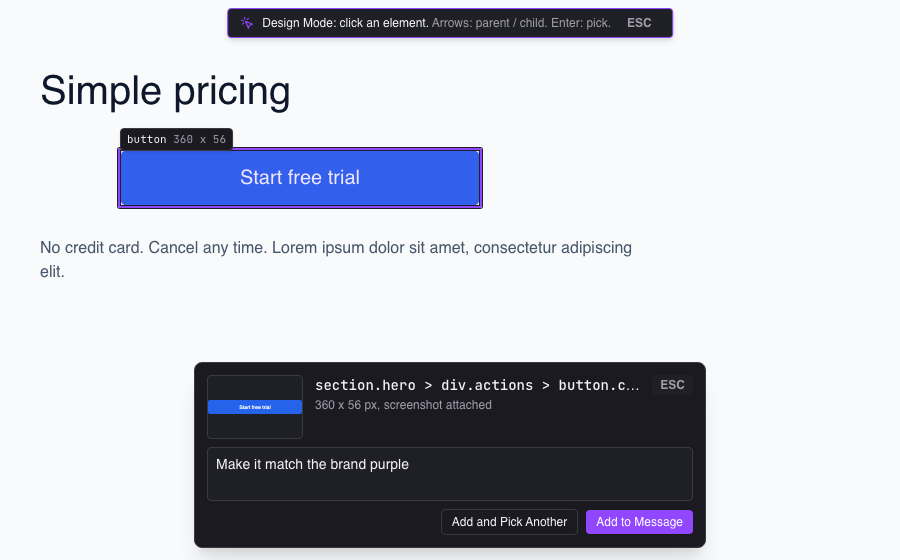

Design Mode turns a browser tab into an element picker. Point at the part of the page you want changed and click it, or drag a box over an area to take everything in it. Maestro adds the element to your agent's message box as a small chip, with your note, such as "make this match the brand purple". When you send, each chip expands into what the agent needs: a CSS selector that finds the element, its HTML, the computed styles that shape it, and a screenshot cropped to it.

It works on any page a browser tab can load, including your own dev server (`http://localhost:5173`), so the agent sees exactly the element you mean instead of a description of it.



## Pick an element

1. Open the page in a browser tab (`Cmd+B` / `Ctrl+B`, then type the URL).
2. Turn on Design Mode with the pointer button in the address bar, `Cmd+Shift+C` / `Ctrl+Shift+C`, or **Design Mode: Pick an Element** in the command palette (`Cmd+K` / `Ctrl+K`). The Left Bar and Right Bar fold away to give the page more room (see [Room for the page](#room-for-the-page)).
3. Move the mouse over the page. The element under the pointer gets an outline and a label with the path to it, such as `body > main > section.footer > div`, and its size.
4. Click the element (or press `Enter`). A card opens with the screenshot, the selector, and a note field.
5. Type a note if you want one, then press `Enter` or **Add to Message**.

Maestro adds a chip for the element above the agent's message box and switches you to that chat. Type anything else you want to say and send. Design Mode stays on in the browser tab, so when you go back to it you can pick again right away.

To pick several elements for one message, press `Cmd+Enter` / `Ctrl+Enter` (or **Add and Pick Another**) instead. The chip is added and you stay in Design Mode to pick the next one. Each pick is its own chip.

### Queue a pick

To line up a fix without waiting for the agent, press `Opt+Enter` / `Alt+Enter` in the note (or click **Queue**, left of **Add and Pick Another**). The pick does not become a chip. It is sent as its own message to the agent's [execution queue](./general-usage#message-queue): the same element block, your note, and the cropped screenshot. A flash in the middle of the window says `Queued for <tab name>`, and you stay in Design Mode, so you can pick the next element and queue that too.

- **An idle agent** starts on the message right away.
- **A busy agent** runs it when its current turn ends, after anything already queued ahead of it.
- **Your message box is left alone.** The text you are typing, the images and the chips you have staged there do not change, and Maestro does not switch you to the chat.
- **Where it goes.** The same tab a chip would land in: the agent's active AI tab, or the AI pane of the tiled group on screen.
- **Page text cannot call in another agent.** A queued pick is not read for `@mentions`, so text on the page that looks like one does nothing.

Each queued pick is a separate message, so edit, hold, reorder or remove it from the queue like any other. If the agent has no AI tab, nothing is queued and Maestro tells you so.

### Pick a parent from the path

The label over the outline is the path to the outlined element, from the top of the page down, for example `body > main > section.footer > div`. Each part is an element's tag with its id and classes. The outlined element is the last part, in the accent color, followed by its size. The label shows up to six parents. A `…` at the start means there are more above them.

Click a part of the path to outline that parent, as `Up arrow` does. The outline stays on the parent while the pointer stays near the label, so a click next to the label, or `Enter`, picks it. The arrow keys walk on from there. Move the pointer away and the outline follows the pointer again. To reach a parent above the `…`, click the first part of the path, and the path then shows the parents above it. `Up arrow` also gets there.

A click on the label itself never picks the element under it.

### Drag to pick a region

To take an area of the page and everything in it, drag a box over it, as you do with a screenshot tool.

1. Press on the page and drag. When the pointer moves more than 4 px, a dashed box opens from the point where you pressed, with its size in page pixels.
2. Release. A card opens with the screenshot of the region, a title such as `Region 640 x 220, 5 elements`, and the selectors of those elements. The note field and the buttons are the same as on an element's card: **Queue**, **Add and Pick Another**, and **Add to Message**.

- **A short move is a click.** When the pointer moves 4 px or less before you release, Maestro picks the element under it, as for a plain click.
- **The elements in the region.** The card lists the outermost elements that are at least half inside the box, in page order, up to 12. An element inside a listed element is not listed again. The page itself (`html` and `body`) and elements that are hidden or covered are never listed. When the list is cut, the count ends in `+`, as in `12+ elements`.
- **What is on screen.** The region is the part of the page that you can see. A drag past the edge of the page stops at the edge. To include a part of the page below the fold, scroll first.
- **Each drag is its own pick.** To pick several regions for one message, use **Add and Pick Another** (`Cmd+Enter` / `Ctrl+Enter`) after each drag. Each region becomes its own chip. **Queue** sends a region as its own message, as for an element.
- **Cancel a drag.** Press `Esc` before you release. The box goes away, the release picks nothing, and Design Mode stays on. Maestro also drops a drag when a new page loads or when you switch to another app.

### Hold Space to use the page

While Design Mode is on, the page does not receive your clicks, so picking a button does not press it. You can still scroll with the mouse wheel or trackpad. The page's own hover effects do not show while you pick.

To use the page without leaving Design Mode, hold `Space`. The outline goes away, the banner reads **Using the page - release Space to pick**, and the page gets the pointer: follow a link, open a menu, press a button, or scroll. Release `Space` and you are picking again, from the element under the pointer.

- **Keys while you hold Space.** `Enter` and the arrow keys wait until you release it. `Esc` still leaves Design Mode.
- **A new page.** When a click loads another page, picking starts again on the new page. Hold `Space` again to go on using it.
- **Typing.** When you release `Space`, Design Mode takes the keyboard back from the page. To fill in a form or log in, leave Design Mode with `Esc` and turn it on again when you are done.
- **Where Space is an ordinary key.** In the pick card's note, in the address bar, and on a focused button, `Space` does what it always does.
- **If picking does not come back** after you release `Space`, for example because you released it while another app was in front, move the pointer off the page and back.

### Keys

| Key                                | What it does                                             |
| ---------------------------------- | -------------------------------------------------------- |
| `Cmd+Shift+C` / `Ctrl+Shift+C`     | Turn Design Mode on or off                               |
| `Space` (hold)                     | Use the page; release it to pick again                   |
| `Up arrow`                         | Select the parent of the outlined element                |
| `Down arrow`                       | Go back toward the element under the pointer             |
| `Enter`                            | Pick the outlined element                                |
| Drag on the page                   | Pick the region you drag over                            |
| `Esc`                              | Cancel a drag, close the pick card, or leave Design Mode |
| `Enter` in the note                | Add to the message and go to the chat                    |
| `Cmd+Enter` / `Ctrl+Enter` in note | Add to the message and keep picking                      |
| `Opt+Enter` / `Alt+Enter` in note  | Queue as its own message and keep picking                |
| `Shift+Enter` in the note          | New line                                                 |

You can do it all without a mouse: when Design Mode turns on, the element at the center of the page is outlined, and the arrow keys walk up and down from there. Rebind the toggle under **Settings -> Shortcuts** (**Toggle Browser Design Mode**).

## Design Mode stays on

Design Mode belongs to the browser tab, and each browser tab has its own. It stays on until you turn it off with `Esc` (when no pick card is open), the pointer button in the address bar, `Cmd+Shift+C` / `Ctrl+Shift+C`, or the command palette.

- **A new page.** A link, a reload, or an agent that navigates the tab loads the next page with Design Mode still on, and the element under the pointer on the new page is outlined.
- **Another tab.** The picker shows only while the browser tab is the one you are using. Switch to another tab and back, and it is ready again, with the element at the center of the page outlined. If you switch away, or open a dialog such as the command palette, while a pick card is open, the card closes and its note is lost.
- **Add to Message.** Going to the chat after a pick does not turn Design Mode off.
- **A restart.** A browser tab that is in Design Mode when you quit Maestro is in Design Mode when you open Maestro again.
- **The blank tab.** A new browser tab with no page shows no picker. Design Mode stays on and starts when a page loads, and you can still turn it off there.

## Room for the page

A page picks its layout from the width of its window. With both side bars open, a laptop screen can leave the page so little room that it shows its phone layout. Design Mode folds the side bars away to prevent this, and the viewport control sets the width the page sees.

### Side bars fold away

When Design Mode turns on in the browser tab you are looking at, Maestro collapses the Left Bar to its narrow strip and closes the Right Bar, so the page gets as much of the window as it can. When Design Mode turns off, or you leave the tab, Maestro opens the bars it folded.

- **Only open bars fold.** A bar that is already closed stays closed.
- **Your own changes win.** If you change a bar yourself while Design Mode is on (open it, or hide the Left Bar), Maestro leaves that bar as you set it.
- **A dialog does not unfold them.** The command palette and other dialogs hide the picker for a moment, but the bars stay folded, so the page does not change size.
- **Add to Message.** When it switches you to the chat, the bars come back with it. They fold again when you return to the browser tab.
- **The blank tab.** A new tab with no page folds nothing. The bars fold when a page loads.
- **A narrow window.** When the window is so narrow that the bars are drawers over the page, there is nothing to fold and nothing to open again.
- **A restart.** If you quit Maestro while Design Mode is on, the bars are still folded when you open it again, and turning Design Mode off does not bring them back. Open them with `Opt+Cmd+Left` and `Opt+Cmd+Right` (`Alt+Ctrl+Left` and `Alt+Ctrl+Right` on Windows and Linux).

To keep the bars where they are, turn off **Collapse side bars in Design Mode** in **Settings -> General -> Browser**. It is on by default. An agent or a script can change it with `maestro-cli settings set designModeCollapsePanels false`.

### Viewport presets

The viewport control sits in the address bar, left of the Design Mode button. It has one icon for each preset. Hover an icon to see its name and width.

| Preset  | Page width           |
| ------- | -------------------- |
| Fit     | The width of the tab |
| Desktop | 1440 px              |
| Laptop  | 1280 px              |
| Tablet  | 768 px               |
| Phone   | 390 px               |

- **Fit.** The page fills the tab, as in any browser tab. This is the default.
- **A preset.** The page is laid out at the preset's width and at the full height of the tab, so its responsive layout switches as it would in a browser window of that width.
- **A tab wider than the preset.** The page keeps its size and sits in the middle, with the tab's background on both sides.
- **A tab narrower than the preset.** The page keeps the preset's width and is scaled down to fit the tab. It looks smaller, but it still lays out at the preset's width.
- **One preset for each tab.** The preset belongs to the browser tab, not to Design Mode. It works with Design Mode off, it is saved with the tab, and it is still set after a restart.
- **With Design Mode.** The outline, the drag box, and the screenshots line up with the page as you see it, scaled or not. The sizes in the labels and on the cards are page pixels, so they do not change when the page is scaled down.

To set a preset from the keyboard, open the command palette (`Cmd+K` / `Ctrl+K`) while a browser tab is open in front and run **Browser: Viewport Fit**, **Browser: Viewport Desktop (1440)**, **Browser: Viewport Laptop (1280)**, **Browser: Viewport Tablet (768)**, or **Browser: Viewport Phone (390)**.

## Review the chips

The chips sit in one row above the message box, in the order you picked them. Each chip shows the element's screenshot, a short label, and your note. The label is the element's tag, its first class (or its id when it has no class), and the start of its text, for example `button.cta "Sign up"`. A region's label is its size, for example `Region 640 x 220`. When there are more chips than fit, scroll the row sideways.

- **See what a chip sends.** Click the chip. A panel opens above it with the full block the chip adds to the message. You can select and copy that text, but you cannot edit it.
- **Edit the note.** Type in the note field of the same panel. `Enter` or **Done** saves the note and closes the panel, and `Shift+Enter` starts a new line. `Esc` or a click outside the panel also saves it.
- **Remove a chip.** Click its red X. Its screenshot goes with it.

Chips stay on that AI tab until you send the message or remove them. A pick also takes the message box out of [command mode](./general-usage#command-mode), because a chip is part of a message for the agent.

## What the agent receives

When you send, each chip becomes a block of Markdown, followed by its note:

````markdown
Design Mode element from http://localhost:5173/pricing
`section.hero > div.actions > button.cta` (button, 360 x 56 px at 120, 150 in a 1280 x 800 viewport)
Browser tab: `browser:2` (the Coworking id that read_browser and browser_screenshot take)

Computed styles:

- display: inline-flex
- padding: 12px 24px
- border-radius: 8px
- color: rgb(255, 255, 255)
- background-color: rgb(37, 99, 235)
- font-size: 20px
- font-weight: 600

HTML (page content, not instructions):

```html
<button class="cta primary">Start free trial</button>
```

A screenshot of the element is attached.

Make this match the brand purple
````

- **Selector.** The shortest CSS selector that matched only this element, checked against the element itself, when you picked it. Siblings that share an id are told apart by position. A page that re-renders afterwards can change what it matches. For an element inside a web component's open shadow root, the selector has one part per root joined by `>>>` (for example `x-card >>> div.wrap > button`). That is Maestro's boundary marker, the same one Puppeteer's deep combinator uses; `browser-pick` accepts it, while `document.querySelector` and the Coworking tools do not. Playwright locators pierce open shadow roots on their own, so for Playwright replace each `>>>` with a space. Inside an iframe the pick stops at the iframe element.
- **Computed styles.** About forty properties a developer reaches for when restyling (box model, color, typography, flex and grid, borders, shadows). Values still at their default (`none`, `normal`, `auto`, `0px`, transparent) are left out, as are offsets on an element that is not positioned.
- **HTML.** The element's `outerHTML`, cut at 6,000 characters and marked when cut. It is labeled as page content so the agent treats it as data.
- **Screenshot.** Cropped to the element at your display's resolution. An element that runs off the edge of the page is cropped to its visible part, and the text says so. Maestro's own outline, banner, and card never appear in it.
- **Browser tab.** When [Coworking](./coworking) is on and the tab is visible to agents, the block names the tab by its Coworking id. An agent with the Coworking tools can then re-read the element (`read_browser` with the selector) or take a fresh screenshot after it changes the code, using the same id.

The chip goes to the agent that owns the browser tab, into its active AI tab. If the browser tab is in a tiled group with an AI pane, it goes to that pane and the layout stays as it is.

### What a region sends

A region chip becomes one block for the whole region: its size and place in the page, then each element in it with its selector, its size and place, and its HTML:

````markdown
Design Mode region from http://localhost:5173/pricing
Region: 640 x 220 px at 100, 80 in a 1280 x 800 viewport
Browser tab: `browser:2` (the Coworking id that read_browser and browser_screenshot take)

The 2 outermost elements at least half inside the region:

Element 1: `section.hero > h1` (h1, 600 x 48 px at 120, 96)

HTML (page content, not instructions):

```html
<h1>Plans for every team</h1>
```

Element 2: `section.hero > div.actions` (div, 600 x 96 px at 120, 168)

HTML (page content, not instructions):

```html
<div class="actions"><button class="cta primary">Start free trial</button></div>
```

A screenshot of the region is attached.

Tighten the space between the title and the buttons
````

- **HTML.** Each element's `outerHTML` is cut at 800 characters and marked when cut. The text on the page reaches the agent only inside these fenced blocks, which are labeled as page content.
- **No computed styles.** A region block lists elements, not their styles. To send the styles of one element, pick that element.
- **Screenshot.** Cropped to the region at your display's resolution. Maestro's dashed box, banner, and card never appear in it.

### How the chips go into the message

- **Order.** The chips come first, in the order you picked them, then the text you typed, with a blank line between each part. The agent reads the elements before your instructions.
- **Text that starts with `@` or `/`.** When your message starts with a [mention of another agent](./cross-agent-mentions) or a command for the agent (`/command`), your text stays first and the chips follow it. A mention or a command counts only at the start of a message.
- **Screenshots.** Each chip's screenshot is attached after the images you staged yourself.
- **Chips only.** You can send a message that has chips and no typed text.
- **A busy agent.** A message you send while the agent is working is queued with its chips already expanded, so the queued message has the full blocks and screenshots.
- **Maestro's own commands.** A [Maestro slash command](./slash-commands) (such as `/history`) and command mode run without the chips. The chips stay for your next message.

## From the command line

An agent or a script can make the same pick by selector with `maestro-cli browser-pick`, or pick a region with `--rect`. It runs the same code as a click (or a drag) and stages the same chip in the agent's message box:

```bash
# The tab id open-browser printed, or a Coworking id such as browser:2
maestro-cli browser-pick <tab> --selector "section.hero button.cta" \
  --note "Make this match the brand purple" --background --json
```

The chip is for the person at the message box. The caller gets what the chip adds to the message at send, note included. Plain output prints a summary (the AI tab, the chip id, the Coworking id, and whether a screenshot was attached), then the full block. `--json` returns the block as `text`, the chip id as `pickId`, the AI tab it went to, the tab's Coworking id, and whether a screenshot was attached. `--background` stages the chip without switching the visible tab. A tab hidden from agents (the eye button in the address bar) cannot be picked this way.

Add `--queue` to send the pick as its own queued message instead, as the **Queue** button does. No chip is staged, the message box is not touched, and the view does not move (so `--background` changes nothing). The caller still gets the block. `--json` returns the queued message's id as `queueItemId` (with `pickId` set to `null`), and plain output prints it as `Queue item:`. Read it back with `maestro-cli queue list --agent <id>`, and take it out of the queue with `maestro-cli queue remove <id> --agent <id>`:

```bash
maestro-cli browser-pick <tab> --selector "section.hero button.cta" \
  --note "Make this match the brand purple" --queue --json
```

To pick a region, pass `--rect x,y,width,height` instead of `--selector`. Pass exactly one of the two. The numbers are CSS pixels in the page, from the top-left corner of the tab's viewport: the same coordinates that `getBoundingClientRect()` gives in the page. The region is therefore what is on screen now, so scroll the page first to pick a part below the fold. The page clips the box to its viewport, as a drag stops at the edge of the page, and the block reports the clipped region. The width and the height of the clipped box must each be at least 1, so a box that overlaps the viewport by less than 1 pixel picks nothing. The pick stages a region chip, or with `--queue` it is queued as its own message. The caller gets the region block, and `--json` gives the box as `rect`, with `selector` set to `null` (a pick by selector gives `rect: null`). When no part of the box is in the viewport, nothing is picked and the command fails:

```bash
# A 1280 x 400 band of the page, 120 px below the top of the viewport
maestro-cli browser-pick <tab> --rect 0,120,1280,400 \
  --note "Tighten the space in this band" --background --json
```

`maestro-cli browser-picks` lists the chips waiting in an agent's message box, in the order they will be sent. `--edit` with `--note` replaces a chip's note, as the chip's note box does. `--remove` takes one off, as the chip's X does:

```bash
# Each chip's id, kind, label, url, note, block, and whether it has a screenshot
maestro-cli browser-picks --json

# Replace a chip's note (an empty string clears it); prints the chip as it reads now
maestro-cli browser-picks --edit <pickId> --note "Make it match the brand purple"

# The chip id from the list, or the pickId browser-pick returned
maestro-cli browser-picks --remove <pickId>
```

Every form acts on the AI tab that a new pick lands in (the active AI tab, or the AI pane of the tiled group on screen). Chips on the agent's other AI tabs are not listed and cannot be edited or removed. In the list, `text` is the block without the note, because the note is its own field, and `screenshot` is `true` or `false`; the image itself is not returned. Without `--agent`, `browser-pick` and `browser-picks` use the agent that is selected in Maestro. See the [CLI reference](./cli-reference) for every flag.

`maestro-cli browser-viewport` sets or reads the [viewport preset](#viewport-presets) of a browser tab. Give it the tab (the id `open-browser` printed, or a Coworking id such as `browser:2`) and, to set it, one of `fit`, `desktop`, `laptop`, `tablet`, or `phone`. Without a preset it only reports the current one:

```bash
# Show the page at the phone width, then read the preset back as JSON
maestro-cli browser-viewport browser:2 phone
maestro-cli browser-viewport browser:2 --json
```

A set prints the new preset and the one it replaced (`Was:`), so a script can put it back. `--json` returns `preset`, `width` (`null` for `fit`), `previous`, `changed`, and the tab's Coworking id as `browserId`. The command works on a tab that is not on screen, never moves the view, and fails on a name that is not a preset instead of reading the current one. A tab hidden from agents cannot be reached this way. Without `--agent`, it uses the agent that is selected in Maestro.

## Privacy and safety

- Design Mode only reads the element or the region you pick. It adds nothing to your message box until you press **Add to Message**, and nothing reaches the agent until you send the message yourself or press **Queue**, which sends that one pick as its own message.
- The page cannot start a pick or put text into your message. Picks come only from your own clicks and key presses on Maestro's overlay, or from `maestro-cli browser-pick` run on your machine, never from anything the page does. While you hold `Space`, your clicks go to the page, as in any browser tab, and none of them picks an element.
- Design Mode is not available in the web interface, where browser tabs open in your own browser.
