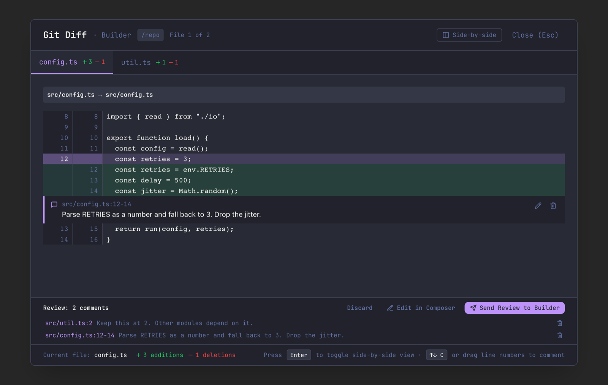

The Git Diff viewer shows what an agent changed in its working tree. You can review those changes the way you would review a colleague's pull request: pin a comment to a line or a range of lines, collect several comments across files, and send them back to the agent as one review.



Each comment the agent receives names the file and lines it is about (for example `src/app.ts:12-14`) and quotes the diff hunk it was left on. The agent can find the code without guessing, even after the file has moved on.

## Open the diff

- Press `Cmd+Shift+D` / `Ctrl+Shift+D` for the agent you are looking at.
- Right-click an agent in the Left Bar and pick **View Git Diff** for that agent.
- Hover the git status widget beside the branch pill and open the full diff from there.

A review goes to the agent the diff belongs to: the one you right-clicked, or the one you are looking at. The agent's name is in the viewer header and on the send button. Terminal-only agents have no conversation, so their diff opens without review comments.

## Leave a comment

**With the mouse:**

1. Click a line number. A comment box opens under that line.
2. For a range, press on the first line number and drag to the last, or click one line number and `Shift`+click another.
3. Type your comment (Markdown is fine) and press `Cmd+Enter` / `Ctrl+Enter`, or click **Add Comment**.

**With the keyboard:**

1. Press `Down` or `Up` to move a line cursor through the file. The first press lands on the first changed line.
2. Hold `Shift` with `Down` or `Up` to extend the cursor into a range.
3. Press `C` to open a comment box on the selected lines.
4. Press `Cmd+Enter` / `Ctrl+Enter` to save it.

A range stays inside one hunk: dragging or extending past the edge of a hunk stops at that edge.

Unified and side-by-side views both work. In side-by-side view, picking an unchanged line in the left column numbers it as in the previous version of the file.

## Line numbers

Line numbers refer to the current version of the file. A comment on removed lines only can't use those numbers, because the lines no longer exist, so it numbers them as in the previous version and says so: `src/app.ts:7 (previous version)`.

## Collect the review

Saved comments appear under the last line they cover. Every pending comment, across every file in the diff, is listed in the **Review** tray at the bottom of the viewer. Click a comment in the tray to jump to its file and edit it, or click the trash icon to remove it.

Comments stay until you send or discard them:

- Switching between file tabs in the viewer keeps them, including a comment you are still typing.
- Closing the viewer keeps them. Open the diff for the same repository again and they are back.
- Quitting Maestro clears them.

## Send the review

The tray has three actions:

| Action                     | What it does                                                                                                                                                                                     |
| -------------------------- | ------------------------------------------------------------------------------------------------------------------------------------------------------------------------------------------------ |
| **Send Review to (agent)** | Sends every comment as one message (`Cmd+Shift+Enter` / `Ctrl+Shift+Enter`). The review is queued, so a busy agent picks it up when its current turn ends. Maestro takes you to the agent's tab. |
| **Edit in Composer**       | Puts the review in the agent's message box instead, so you can reword it or add a note before you press Enter.                                                                                   |
| **Discard**                | Throws the review away. Click twice to confirm.                                                                                                                                                  |

If the review can't be delivered (the agent was removed, or has no AI tab), Maestro says so and keeps your comments.

## What the agent receives

The review arrives as one message. For two comments it looks like this:

````markdown
I reviewed your changes in the git diff and left 2 comments pinned to specific lines. Please address each one.

Each comment names the file and lines it is about, then quotes the diff hunk it was left on. Line numbers refer to the current version of the file, except where a comment says they refer to the previous version (the lines were removed).

## Comment 1 of 2

`src/app.ts:12-13`

```diff
@@ -10,4 +10,5 @@ export function load() {
 const config = read();
-const retries = 3;
+const retries = env.RETRIES;
+const delay = 500;
 return run(config);
```

Parse RETRIES as a number, and fall back to 3 when it is missing.

## Comment 2 of 2

`src/util.ts:4`

```diff
@@ -2,3 +2,3 @@
 export const a = 1;
-export const b = 2;
+export const b = 3;
```

Keep this at 2. Other modules depend on it.
````

A long hunk is trimmed to the commented lines plus five lines on each side, with `...` where lines were left out.

## Shortcuts

These work while the Git Diff viewer is open over an agent that can take a review.

| Action                                                                 | macOS                     | Windows/Linux             |
| ---------------------------------------------------------------------- | ------------------------- | ------------------------- |
| Move the line cursor                                                   | `Down` / `Up`             | `Down` / `Up`             |
| Extend the selection                                                   | `Shift+Down` / `Shift+Up` | `Shift+Down` / `Shift+Up` |
| Comment on the selected lines                                          | `C`                       | `C`                       |
| Save the comment                                                       | `Cmd+Enter`               | `Ctrl+Enter`              |
| Send the review                                                        | `Cmd+Shift+Enter`         | `Ctrl+Shift+Enter`        |
| Close the comment box, then clear the selection, then close the viewer | `Esc`                     | `Esc`                     |

The viewer's other keys still apply: `Enter` switches between unified and side-by-side view, and `Cmd+[` / `Cmd+]` (`Ctrl+[` / `Ctrl+]`) move between files.

## For agents and scripts

The review comments live in the viewer, which `maestro-cli` does not drive. An agent that wants to review another agent's work gets the same result without it: run `git diff` in that agent's directory, write the comments with `path:lines` and the hunk, and queue them into that agent's tab with `maestro-cli dispatch <agent> "<review>" --queue`.
