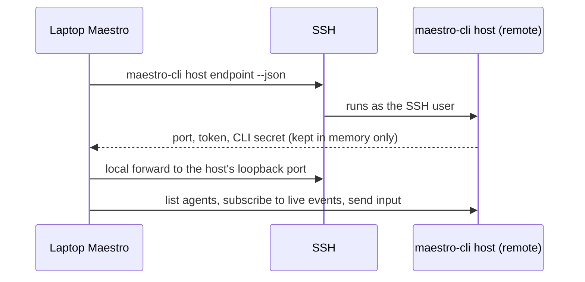

Federation lets a Maestro that runs on another machine **own** an agent. That Maestro, a headless `maestro-cli host`, runs the turns, the queue, Auto Run, and Cue. The Maestro on your laptop is a **mirror**: it shows the host's agents in the Left Bar, streams their output, and sends your input. Close the laptop and the host keeps working. Open it again and the mirror reloads the current state.

It is a Beta Encore Feature and starts **off**. In this version the laptop reaches the host over an SSH remote you already have. Nothing new listens on the network.

## SSH remote agent or federated agent

Maestro has two ways to use another machine. An [SSH remote agent](./ssh-remote-execution) is owned by your local Maestro, which starts the provider over SSH for each turn. A federated agent is owned by the Maestro on the remote.

|                                                          | SSH remote agent | Federated agent |
| -------------------------------------------------------- | ---------------- | --------------- |
| Who owns the agent                                       | Local Maestro    | Remote Maestro  |
| Turn survives the laptop closing                         | No               | Yes             |
| Auto Run and Cue run while the laptop is off             | No               | Yes             |
| Agents created on the remote Maestro are visible locally | No               | Yes             |
| Several clients can use the same agent                   | No               | Yes             |
| Needs Maestro on the other machine                       | No               | Yes             |

You can turn an existing SSH remote agent into a federated one. See [Lift an SSH agent onto its host](#lift-an-ssh-agent-onto-its-host).

## How it connects



- **SSH is the authentication.** On every connect the laptop reads the host's own port, token, and CLI secret over SSH. It keeps them in memory and never writes them to disk.
- **The host stays on loopback.** The laptop reaches it through an SSH local forward. No port is opened on the remote's network.
- **Opt-in per remote.** Maestro dials only SSH remotes that have their own Federation flag on. It never probes the others.
- **One at a time.** Maestro connects to the peers one after another, never at the same time, so a laptop with many remotes does not start an SSH storm.
- **The host is the only record.** Mirrored agents live in memory only. They are never written to your local agent store, so a disconnect or a removed remote cannot damage local data.

A remote with Federation on and a running host is called a **peer**. Its peer name is the remote's name, or its ID when two remotes share a name. A peer's agents are addressed as `peer:agent`, for example `build-box:docs`.

## Setup

### 1. Install Maestro on the host

The remote must already have `maestro-cli`. Maestro does not install it for you.

- **Mac:** install Maestro.app. The CLI ships inside it.
- **Linux:** install the [server bundle](./maestro-cue-server), or copy the CLI bundle by hand as described in [Installing on a Machine With No Desktop](./cli#installing-on-a-machine-with-no-desktop).

Install the provider CLIs your agents use (Claude Code, Codex, and so on) on the host too, and log in to them as the SSH user. When `maestro-cli` is missing, `remote-host status` and the Left Bar say so and name the fix.

### 2. Turn on the Encore Feature

Turn Federation on in **Settings > Plugins > Federation**, or run:

```bash
maestro-cli encore enable federation
```

While it is off, Federation leaves no trace: no Left Bar section, no palette commands, no Federation verbs in `maestro-cli --help`, and no SSH calls.

### 3. Flag the remote

Open **Settings > SSH Hosts**, edit the remote, and switch on **Federation**. The switch shows only while the Encore Feature is on. From the CLI, pass the remote's ID:

```bash
maestro-cli list ssh-remotes
maestro-cli update-ssh-remote 3f2a --federation on
```

### 4. Start the host

```bash
maestro-cli remote-host status build-box
maestro-cli remote-host start build-box
```

`remote-host start` runs `maestro-cli host start` on the remote, as the SSH user, when no host runs there. `remote-host status` reports whether Maestro is installed, whether a host runs, and whether its version differs from yours. Neither prints the host's token or secret. The desktop app does not start a stopped host for you: run `remote-host start`, then **Reconnect** the peer. To keep the host running across reboots, see [Durability](#durability).

### 5. See the host's agents

The Left Bar shows one group per peer, below your local groups. The group's dot shows the connection:

| Dot            | Connection                                                                     |
| -------------- | ------------------------------------------------------------------------------ |
| Green          | Connected                                                                      |
| Pulsing orange | Connecting or reconnecting                                                     |
| Red            | Connection lost, no host running, Maestro not installed, or the forward failed |

Each row carries a `PEER` marker. Right-click a row to copy its `peer:agent` target or to reconnect the peer. When the connection drops, the agents stay in the list, dimmed, with their last known state, and Maestro reconnects on its own. After the laptop wakes, it reconnects every peer and reloads its agents.

From the CLI:

```bash
maestro-cli list agents --peer build-box      # the agents on one peer
maestro-cli list agents --all-peers           # local agents, then every peer
maestro-cli federation peers                  # what the desktop mirrors, with connection state
maestro-cli federation reconnect build-box
```

## Drive a federated agent

Click a mirrored agent to open it. Its tabs, transcript, and live output come from the host. The composer works as it does for a local agent:

- **Send** a message. While a tab is busy, the message queues on the host, not here.
- **Stop** the running turn.
- **New tab**, **rename**, and **star** a tab, from the controls beside the tab strip.

Some things stay off, with a tooltip that says why, because the host does not serve them:

- **Slash commands.** They run in your local window, and the host receives plain messages only.
- **Shell command mode.** It would run the command on your laptop, not on the host.
- **Images.** The host receives text only for now.

A send while the peer is disconnected fails at once with an error toast. It is **never** queued here or sent later. Your draft stays in the composer.

The same actions work from the CLI with a `peer:agent` target, through the same code the desktop uses:

```bash
maestro-cli send build-box:docs "Summarize the open PRs"
maestro-cli interrupt build-box:docs
maestro-cli tab new --agent build-box:docs
maestro-cli tab star active --agent build-box:docs
```

`show agent`, `ask`, and `dispatch` also take a `peer:agent` target. [Agents on a Peer](./cli#agents-on-a-peer) lists every verb and the options a peer refuses.

## Lift an SSH agent onto its host

An SSH remote agent already runs its provider on the remote as the SSH user, so its provider session files are already there. A **lift** moves the agent onto the host on that remote:

- The host gets an agent with the same remote working directory, provider, model, effort, and arguments.
- Every visible tab moves with its transcript and its provider session ID, so the next turn resumes the same conversation. Queued messages move too.
- Non-secret custom env vars move. Secret ones stay on your laptop unless you choose to send them. The variable that selects the provider's config or session directory (such as `CLAUDE_CONFIG_DIR` or `CODEX_HOME`) always moves.
- Your local agent keeps its tabs and transcripts but becomes a pointer. Its Left Bar row shows `on <peer>`: click it to open the agent on its host. Sends to the local copy are refused.

From the desktop, right-click the agent in the Left Bar and choose **Move to Host**, or run **Move to Host** from the command palette. The action shows only while the agent's remote is a connected peer. It shows the plan (what moves and which env vars stay) before anything moves. From the CLI:

```bash
maestro-cli lift docs --dry-run    # the same plan, nothing moves
maestro-cli lift docs              # move it
maestro-cli lift docs --with-env   # also send secret env vars
```

A lift refuses, and moves nothing, while a tab is running a turn, when no host runs on the remote, or when the agent is not an SSH remote agent. The host's copy is made first. If the local agent cannot then be marked as moved, the host's copy is removed again, so the agent never runs in two places. A lift is one way: there is no automatic move back to an SSH agent. [Lift an SSH Agent Onto Its Host](./cli#lift-an-ssh-agent-onto-its-host) lists every refusal code.

## Durability

A host is only useful while it keeps running.

- **macOS sleep.** While the host has work in flight (a turn, an Auto Run, a group chat round, a consult, or a Cue run), it holds `caffeinate -i` so the Mac does not sleep mid-turn, and releases it when idle. `host start --no-prevent-sleep` turns this off. `host status --json` reports `preventingSleep`.
- **Linux logout.** systemd-logind can stop a user's processes when the SSH session that started them ends. When lingering is off for the user, `host start`, `host status`, and `remote-host status` print a warning with the fix, `loginctl enable-linger <user>`. Maestro never runs the fix for you.
- **Reboots and crashes.** `host start` detaches, but nothing starts it again after a reboot. [Run the Host as a Service](./cli#run-the-host-as-a-service) has a systemd user unit (`~/.config/systemd/user/maestro-host.service`) and a launchd agent (`~/Library/LaunchAgents`). Maestro does not install them.

<Warning>
Run the host as the same user your SSH agents run as. The host then reads the same provider logins and session files. A host that runs as another user cannot resume the sessions of a lifted agent.
</Warning>

## Known limits

- **Driving an agent means running commands as the host user.** Anyone who can send to a federated agent can make it do anything that agent's permissions allow, on the host, as the SSH user. Federation is for your own machines. Sharing an agent with another person is out of scope.
- **SSH is the only transport.** A peer must be an SSH remote you can already reach. There is no bundled tunnel, no pairing with a short code, and no offline invite link.
- **No re-export.** A host does not offer agents that it mirrors from a third Maestro.
- **No phone or web interface control.** The browser build of Maestro and the web interface do not show peers. Use the desktop app or the CLI.
- **No worktrees for host-owned agents.** You cannot create or scan worktrees for a mirrored agent.
- **No `@mention` of a mirrored agent** from a local composer. Use `maestro-cli ask peer:agent` instead.
- **Auto Run and Cue status are not mirrored.** They run on the host. Check them there with `maestro-cli` over SSH.
- **No Start Host control in the desktop app.** Start a stopped host with `maestro-cli remote-host start`.
