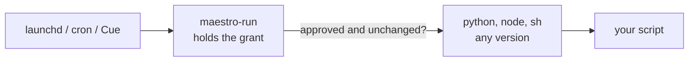

MaestroRun is a small macOS launcher that holds a Full Disk Access grant for your scheduled scripts. You grant access once, to MaestroRun. It then runs only the scripts you approved, and hands them the grant. This page covers the Maestro plugin that installs it and sets it up.

MaestroRun is an [Encore Feature](/encore-features), off by default, and available on macOS only. On Windows and Linux the plugin is not offered.

## The problem it solves

A script gets Full Disk Access through its interpreter. Homebrew and most version managers sign their interpreters ad hoc, and macOS pins a grant on an ad hoc binary to that one exact build. When Python or Node is upgraded, the grant is gone, and a LaunchAgent or cron job that worked yesterday fails with "Operation not permitted".

MaestroRun is signed with a Developer ID, so macOS stores its grant under the bundle identifier and the signing team. That grant survives every rebuild, move, and upgrade.



## Setup

Open **Settings > Plugins**, select **MaestroRun**, and turn it on. Its Settings tab walks three steps.

| Step                      | What happens                                                                                                                                                                                                                             |
| ------------------------- | ---------------------------------------------------------------------------------------------------------------------------------------------------------------------------------------------------------------------------------------- |
| 1. Install the launcher   | Maestro downloads the newest release for this Mac (Apple silicon or Intel) from GitHub, then verifies the checksum, the signature, and the notarization. Nothing from the download runs before those checks pass.                        |
| 2. Grant Full Disk Access | macOS has no prompt for this permission. **Open Full Disk Access** takes you to the list in System Settings; switch MaestroRun on. The tile turns green by itself. If MaestroRun is not in the list, reveal it in Finder and drag it in. |
| 3. Agents learn about it  | From this point, every local agent Maestro starts is told what MaestroRun is for and where the launcher is.                                                                                                                              |

Maestro installs to `~/Applications/MaestroRun.app`, which needs no administrator password. If you already put a copy in `/Applications`, Maestro uses and updates that one instead of adding a second.

<Note>
Agents are told nothing about MaestroRun until both the install and the grant are done. Turning the plugin on is not enough. If you later switch Full Disk Access off, agents stop being told about it within a few minutes.
</Note>

## Using it

Ask any agent to move a scheduled script onto MaestroRun, for example: "my nightly Mail export lost Full Disk Access again, put it on MaestroRun". The agent shows you the script path, the interpreter, and what protected data the script reads, and waits for your yes before it approves anything.

You can also drive the launcher yourself:

```bash
MR=~/Applications/MaestroRun.app/Contents/MacOS/maestro-run

# Approve a script at its current contents. Pick the interpreter by path.
$MR approve --interpreter /opt/homebrew/bin/python3 ~/tools/backup.py

# Run it. This is the line that goes in a LaunchAgent or a crontab.
$MR run ~/tools/backup.py --full

# See what is approved and whether anything changed.
$MR list
```

A script runs only while its contents match what was approved. Edit it and `run` refuses with exit code 126 until you approve it again.

## From the command line

Every button on the tile has a `maestro-cli` verb that reaches the same code. The Maestro app must be running.

```bash
maestro-cli encore enable maestroRun      # turn the plugin on (macOS only)
maestro-cli maestro-run status            # installed version, signature, Full Disk Access
maestro-cli maestro-run status --check-latest --json
maestro-cli maestro-run install           # install the newest release, or update
maestro-cli maestro-run grant             # open the Full Disk Access list and watch for the switch
maestro-cli maestro-run grant --reveal    # also show MaestroRun.app in Finder
```

## What it protects, and what it does not

MaestroRun is a registry and a tamper check. It is not a sandbox.

- A script that changed after approval does not run.
- Every allowed and denied run is written to `~/Library/Logs/MaestroRun/maestro-run.log`.
- Everything an approved script starts inherits every privacy permission MaestroRun holds. Give MaestroRun only what your scripts need.
- With the default per-user allowlist, another process running as you can approve its own script. Agents are instructed never to approve without your explicit yes, but that is a rule they follow, not something macOS enforces.

Read the [MaestroRun threat model](https://github.com/RunMaestro/MaestroRun/blob/main/docs/THREAT-MODEL.md) before you rely on it.

## Turning it off

Turning the plugin off stops telling agents about MaestroRun. It does not remove `MaestroRun.app`, its Full Disk Access grant, or your approved scripts, because your scheduled jobs may depend on all three. To remove MaestroRun completely, switch it off under **System Settings > Privacy & Security > Full Disk Access** and move `MaestroRun.app` to the Trash.
