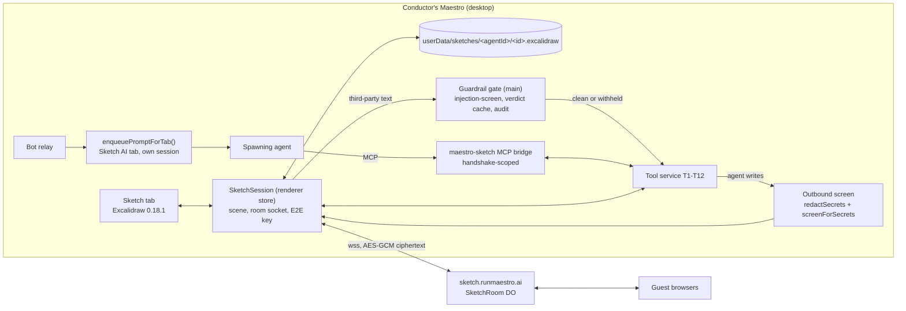
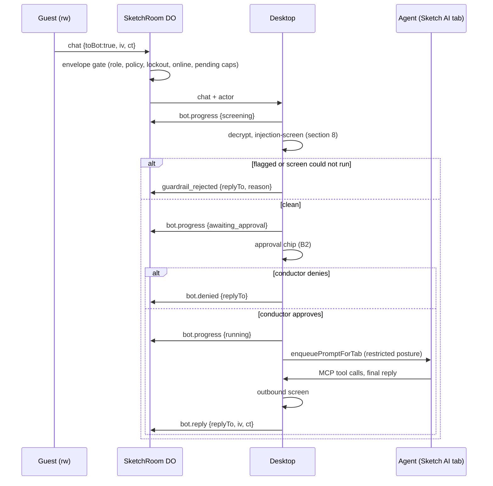
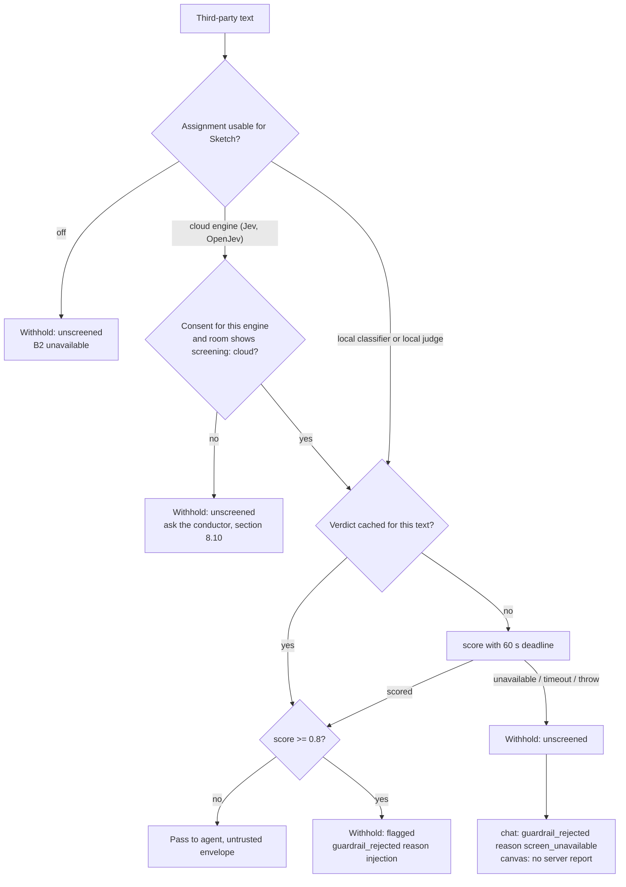

# Sketch Book: Desktop Half

Sketch Book is a collaborative Excalidraw whiteboard that an agent spawns inside Maestro. The conductor (the person running Maestro) can share it through RunMaestro.ai, so guests read and write it in realtime from a web link. The agent that spawned it can read and write the canvas, and answers `@bot` requests in the room chat.

This document is the build reference for the `Sketch-Book` playbook on `rc`. The hosted half (Worker, Durable Object, guest web client) is owned by the RunMaestro.ai repo. The shared message format is [sketch-book-wire-contract.md](sketch-book-wire-contract.md). When this file and the hosted spec disagree, the wire contract wins.

> [!IMPORTANT]
> **Build prerequisite.** Sketch Book is built on `rc` after the `acappella` branch merges into it. The guardrail gate (section 8) calls the acappella Local Models tasks `injection-screen` and `secret-screen`. Do not start the playbook before `git merge-base --is-ancestor origin/acappella HEAD` succeeds on `rc`.

## 1. Locked decisions

Pedram accepted Q1-Q13 and M1-M5 on 2026-10-15, then added the guardrail requirement. The ones that shape this half:

| Code       | Decision                                                                                                                                                                                                                                                                                   |
| ---------- | ------------------------------------------------------------------------------------------------------------------------------------------------------------------------------------------------------------------------------------------------------------------------------------------ |
| Shape      | A first-party Encore plugin (`sketchBook` flag, a tile in `src/shared/plugins/first-party.ts`) with a native `sketch` tab type. Not a sandboxed community plugin: the panel CSP, the 64 KB `ui.panelPost` cap and the trusted-only `net:connect` block Excalidraw.                         |
| Q2         | After a guest has edited the board, the conductor's own `@bot` turns run **restricted**. A one-click "Run with full access" on the desktop escalates one message. Escalation never carries over.                                                                                           |
| Q3         | Bot turns run in a **fresh provider session** per sketch, seeded with a short brief. Never the spawning tab's conversation.                                                                                                                                                                |
| Q4         | Team `@bot` runs restricted only. No full-access tier for anyone but the conductor.                                                                                                                                                                                                        |
| Q5         | An agent may create a Sketch Book (background tab). **Sharing is always a human action.**                                                                                                                                                                                                  |
| Q8         | No conductor rights from a plain browser. The conductor is the desktop holding the owner token.                                                                                                                                                                                            |
| Q11        | Sketch files live in `userData/sketches/<agentId>/<sketchId>.excalidraw`, with a "Save to project" action.                                                                                                                                                                                 |
| Q12        | Local agents only in v1. SSH-remote agents cannot open a Sketch Book (the MCP bridge is a local socket).                                                                                                                                                                                   |
| Q13        | No LAN or tunnel sharing in v1.                                                                                                                                                                                                                                                            |
| C1         | `@bot` while the desktop is offline is rejected by the server. Never queued.                                                                                                                                                                                                               |
| C2         | v1 ships B1 (conductor only) and B2 (read-write guests, the conductor approves each request). B3 (auto) waits for guest accounts.                                                                                                                                                          |
| A1         | `sketch share`, B2 approval, and full-access escalation exist on the CLI, but when the caller is an agent they raise a desktop confirmation instead of running.                                                                                                                            |
| M2 / A2    | The approval chip shows the server-stamped actor (`"Pedram" · guest, read-write link #3, not verified`), never the chosen name alone.                                                                                                                                                      |
| M5 / A3    | "A guest has edited" comes from `welcome.guestEdited` / `room.stats.guestEdited` (server op log), never from `customData`.                                                                                                                                                                 |
| G          | Every third-party input passes the guardrail gate (section 8) on the desktop before the agent sees it. It fails closed.                                                                                                                                                                    |
| G1-G4 (P1) | The default screen is a **local** classifier. A cloud System One engine (Jev or OpenJev) is allowed after a consent dialog that names the third party; a live switch to cloud asks again; guests are told with a `screening: "cloud"` notice and badge (section 8.10). Pedram, 2026-10-15. |
| D2 (P2)    | Screen `off`: the conductor's restricted `@bot` turns may read guest canvas text labelled unscreened; full-access turns may not (section 8.3 rule 7).                                                                                                                                      |
| D3 (P3-P5) | Guest images need per-image approval; flagged elements are withheld, not deleted, with one-click delete; a secret-screen model flag holds a reply for "Publish anyway".                                                                                                                    |
| D7         | An OpenJev server the conductor owns counts as `cloud`.                                                                                                                                                                                                                                    |
| H1         | After a switch to cloud, only guest text written at or after the server's `since` goes to the cloud engine (section 8.10).                                                                                                                                                                 |

## 2. Architecture



| Piece                                   | Location (new unless noted)                                                                                                                                                                 |
| --------------------------------------- | ------------------------------------------------------------------------------------------------------------------------------------------------------------------------------------------- |
| Shared types, wire parser, crypto       | `src/shared/sketch/` (`types.ts`, `protocol.ts`, `crypto.ts`, `attribution.ts`, `digest.ts`)                                                                                                |
| Main: store, guardrail, MCP bridge, IPC | `src/main/sketch/` (`sketch-store.ts`, `sketch-guardrail.ts`, `sketch-mcp-bridge.ts`, `sketch-mcp-server-script.ts`, `sketch-owner-auth.ts`), handlers in `src/main/ipc/handlers/sketch.ts` |
| Renderer: tab, session, room client     | `src/renderer/components/SketchBook/`, `src/renderer/stores/sketchSessionStore.ts`, `src/renderer/services/sketchRoomClient.ts`, `src/renderer/services/sketchBotRelay.ts`                  |
| CLI                                     | `src/cli/commands/sketch.ts`                                                                                                                                                                |
| First-party definition                  | `com.maestro.sketch-book` in `src/shared/plugins/first-party.ts`                                                                                                                            |

**Runtime owner.** One `SketchSession` per open sketch lives in a renderer store owned by the main window, not in the React tab. Closing the tab keeps the room socket and the bot online. Excalidraw text measurement needs a DOM, so element conversion (`convertToExcalidrawElements`, Mermaid import) runs in the renderer. Secondary windows only mount views of the session.

**Packaging.** `@excalidraw/excalidraw@0.18.1` (exact pin, the same version the hosted guest client pins) and `@excalidraw/mermaid-to-excalidraw@2.2.2`, both loaded with a dynamic `import()` so nothing loads until a sketch opens. Fonts and assets are bundled and served locally (`window.EXCALIDRAW_ASSET_PATH`). The default CDN fetch is forbidden: it breaks offline mode and leaks usage.

## 3. Plugin shape and spawning

- **Encore flag** `sketchBook`, off by default, registered per the gating checklist in `CLAUDE-PATTERNS.md` §12. Flag off: no tab type, no shortcut, no palette entry, no MCP server, no CLI verbs beyond a clear "Sketch Book is off" error.
- **Tab type.** `UnifiedTabRef['type']` gains `'sketch'` (`src/renderer/types/index.ts`). A `SketchTab` record holds `{ id, sketchId, name }`. It tiles, moves to another window, snoozes, and is named like any tab. A focus helper `sketchTabFocusFields()` joins `src/renderer/utils/tabHelpers/focusFields.ts`.
- **Three ways in:** a hotkey (pick a free chord with `findReservedShortcutCombo`, never relocate a taken one), a command palette entry "New Sketch Book", a hamburger menu item, plus the tab bar `+` menu. Shortcut docs ship in `docs/keyboard-shortcuts.md` in the same change.
- **Agent creation (Q5).** The `sketch_create` MCP tool and `maestro-cli sketch new` open the tab in the background. They never share.

### Binding record

```ts
interface SketchRecord {
	sketchId: string; // generateUUID()
	ownerAgentId: string; // the spawning agent; immutable
	name: string;
	filePath: string; // userData/sketches/<agentId>/<sketchId>.excalidraw
	createdAt: number;
	share: null | {
		roomId: string;
		keyEpoch: number;
		links: SketchLink[];
		botPolicy: 'conductor' | 'writers';
	};
	botSessionId?: string; // the fresh provider session for bot turns (Q3)
	guestEdited: boolean; // mirror of the server flag, never set locally
}
```

The record index is `userData/sketches/index.json`, written through `createKeyedWriteQueue()`. The AES room key and the owner token are sealed with `safeStorageSeal()` and never written in plaintext. Deleting an agent never deletes a sketch: the file stays, the room drops to read-only for the bot (`bot.presence {online:false}`), and the sketch shows "Owner agent removed".

## 4. Agent tools (T1-T12)

Transport: a `maestro-sketch` MCP server built on the Coworking bridge pattern (`src/main/coworking/`). It is an injected stdio subprocess that talks to a host-owned socket. The owning agent is resolved at the MCP handshake. **There is no active-session fallback** (the PR #948 privacy bug). An agent sees only sketches whose `ownerAgentId` is its own id.

| #   | Tool                     | Input                                                             | Output and rules                                                                                                                                                                                                                       |
| --- | ------------------------ | ----------------------------------------------------------------- | -------------------------------------------------------------------------------------------------------------------------------------------------------------------------------------------------------------------------------------- |
| T1  | `sketch_list`            | none                                                              | Sketches this agent owns: id, name, share state, collaborators online, `sceneVersion`                                                                                                                                                  |
| T2  | `sketch_create`          | `{name?}`                                                         | New sketch in a background tab. Never shared.                                                                                                                                                                                          |
| T3  | `sketch_read_scene`      | `{sketchId, format: 'summary' \| 'elements', elementIds?, bbox?}` | The summary resolves bound text, arrows as `A -> B`, frames and groups. Every element carries `author {id, kind, name}` from the envelope (section 7). Third-party text goes through the gate (section 8). Freedraw points are capped. |
| T4  | `sketch_changes`         | `{sketchId, sinceVersion}`                                        | Added, updated and deleted elements with `lastEditedBy`. Same gate as T3.                                                                                                                                                              |
| T5  | `sketch_add_elements`    | `{sketchId, elements: Skeleton[]}`                                | Excalidraw skeleton API. Max 500 elements per call. Outbound screen applies.                                                                                                                                                           |
| T6  | `sketch_update_elements` | `{sketchId, patches: [{id, baseVersion?, ...props}]}`             | A stale `baseVersion` is rejected and the current element is returned.                                                                                                                                                                 |
| T7  | `sketch_delete_elements` | `{sketchId, ids}`                                                 | `isDeleted` tombstones.                                                                                                                                                                                                                |
| T8  | `sketch_from_mermaid`    | `{sketchId, mermaid}`                                             | Through `@excalidraw/mermaid-to-excalidraw`. Outbound screen applies.                                                                                                                                                                  |
| T9  | `sketch_screenshot`      | `{sketchId, elementIds?, scale?}`                                 | PNG as MCP image content. **Withheld elements are excluded from the render** (section 8.4), so pixels cannot carry text the gate refused.                                                                                              |
| T10 | `sketch_export`          | `{sketchId, format: 'png' \| 'svg' \| 'json', path}`              | Writes inside the agent's cwd only (resolve the real path, refuse escapes). Withheld elements are excluded.                                                                                                                            |
| T11 | `sketch_focus`           | `{sketchId, elementIds}`                                          | Scrolls and zooms the humans' view.                                                                                                                                                                                                    |
| T12 | `sketch_chat_post`       | `{sketchId, text}`                                                | Posts as the bot. Outbound screen applies. Only during a bot turn or when the sketch is not shared.                                                                                                                                    |

Caps: 1 MB per response, writes go through a per-sketch rate guard, 64 KB per chat post. Each response carries `sceneVersion`.

**Following human edits.** Agents are turn-based. Every bot turn starts with a **change digest** since the agent's last read, built from T4 and passed through the gate. T4 is available mid-turn. An edit never starts a turn by itself.

## 5. Bot relay



- **Trigger.** A chat message with `toBot: true` (the client sets it for `@bot` or `@<agentName>`). The desktop trusts only the envelope `actor`, never anything inside the ciphertext.
- **Conductor messages.** Typed in the desktop Sketch tab, they start the turn locally at send time. The server echo is ignored. They skip the gate.
- **Delivery.** `enqueuePromptForTab()` into a dedicated AI tab "Sketch: <name>" on the owner agent (queued, never a direct spawn), on the sketch's own `botSessionId` (Q3). The prompt wraps third-party text in an untrusted-data envelope and starts with the change digest.
- **Reply.** The agent's final response, after the outbound screen, is sent as `bot.reply`, capped at 4,000 characters like chat (a longer answer is cut with "Full answer is on the board" and the rest goes into a text element). Canvas edits arrive live through T5-T8.
- **Late replies (Y3).** The server expires a `running` request after 120 min. The desktop does not stop the turn at that point; when it finishes, its `bot.reply` is still posted as bot chat. The same holds after a reconnect that the server treated as offline (X7).
- **Turn failure.** An errored or stopped turn sends `bot.failed {replyTo}` (wire contract X5), not `bot.denied`, so a crash on the conductor's side does not count against the guest.

### Turn posture

| Who asked                        | Posture                               | Notes                                                                                                                   |
| -------------------------------- | ------------------------------------- | ----------------------------------------------------------------------------------------------------------------------- |
| Conductor, `guestEdited = false` | Full (the agent's normal permissions) | Separate session (Q3)                                                                                                   |
| Conductor, `guestEdited = true`  | **Restricted**                        | "Run with full access" escalates this one message (Q2). From the CLI, an agent caller gets a desktop confirmation (A1). |
| Guest, B2                        | **Restricted** only (Q4)              | After the gate and the approval chip                                                                                    |

**Restricted** = the provider's existing read-only mode (`readOnlyArgs` in `src/shared/maestro-lib/providers/definitions.ts`, applied per turn) plus the `maestro-sketch` MCP server, with the cwd set to the agent's own working directory. A provider whose `readOnlyArgs` is empty cannot enforce this, so B2 is unavailable on it (greyed out with the reason). The playbook verifies that each supported provider's read-only mode still permits the `maestro-sketch` write tools (section 11, risk K1).

### B2 approval chip

- Shown in the Sketch tab chat pane and raised as a toast whose click jumps to the sketch.
- Content: the server-stamped actor line (A2), the decrypted request, the gate verdict ("Screened: clean, Prompt Guard 2, 0.04").
- Actions: **Run** (sends `bot.progress {running}`), **Deny** (`bot.denied`). Chips are rate-limited per cap: at most 3 visible, newer requests wait behind them.
- The chip disappears when the server reports the request expired (wire contract X3).

### Sleep, quit and crash

`powerMonitor` `suspend` and app `before-quit` send `bot.presence {online:false}` for every shared sketch before the socket closes. On `resume`, the session reconnects and sends `bot.presence {online:true}`. A crash closes the socket without the frame, so the server must treat a closed conductor socket as offline (wire contract X7).

## 6. Room client and sharing

- **Owner auth (M1).** The device confirm-and-poll flow against `/api/owners/register`, `/api/owners/confirm`, `/api/owners/status` on `sketch.runmaestro.ai`, through `fetchWithTimeout()`. Poll interval at least 5 s. The returned owner token is sealed with `safeStorageSeal()`.
- **Share.** Creates the room, generates the AES-GCM-128 key on the desktop, uploads an encrypted snapshot, and mints a link (`POST /api/rooms/:id/links`). Link format `https://sketch.runmaestro.ai/s/<roomId>#<key>.<cap>`. The link is copied with `flashCopiedToClipboard()`; nothing is shown in a toast.
- **Revoke, rotate, kick, unlock, unsuspend** live in the Room panel of the Sketch tab, which renders `room.stats` (hosted spec §8). The panel says that kick is temporary and revoke is the real fix.
- **Sync.** Outgoing scene changes are batched into `delta` frames (Excalidraw elements with a changed `version`), at most 30 per second. Incoming deltas are merged with Excalidraw's `reconcileElements`. On reconnect: `catchup {sinceSeq}` until `more` is false. Local edits made offline are sent after catchup.
- **Snapshots and files.** The desktop uploads a snapshot every ~200 ops or after 60 s idle, and on rotate. Snapshot and image bodies are raw binary `iv (12 bytes) || ct`, never base64 or JSON (Y2).
- **Screening flag.** `screening.set` goes out right after `welcome` and on every change; the server's `since` is stored per room (section 8.10, G4 and H1).
- **Crypto.** WebCrypto AES-GCM with a 128-bit key and a fresh 12-byte IV per frame. The desktop passes the hosted test vectors (`workers/sketch-room/test/vectors.json` in the RunMaestro.ai repo, copied into `src/__tests__/fixtures/sketch/vectors.json`).

## 7. Attribution

Every element is stamped in `onChange`, before broadcast, for display:

```ts
customData: {
	createdBy: { id: string; name: string; kind: 'conductor' | 'guest' | 'bot' };
	lastEditedBy: { id: string; name: string; kind: 'conductor' | 'guest' | 'bot'; onBehalfOf?: { id: string; name: string } };
	lastEditedAt: number;
}
```

- Stamping diffs element `version` against the last synced scene and sets `lastEditedBy` in the same version, so it causes no echo. The `isDeleted` tombstone records the deleter.
- Agent edits: `kind: 'bot'`, `id: 'agent:<maestroAgentId>'`, and `onBehalfOf` names the human whose request started the turn. Agent edits are sent with `delta.asBot: true` (wire contract X2) so the server op log stamps them as the bot.
- **Trust.** `customData` sits inside the ciphertext and any client can forge it. The desktop's authoritative author of an element version is the envelope `actor` of the op that delivered that version. `SketchSession` keeps an **author map** from incoming ops, never from `customData`:

  ```ts
  interface ElementAuthorship {
  	version: number;
  	actor: SketchActor; // envelope actor of the op that delivered this version
  	opSeq?: number; // absent when the version came from a snapshot
  	textHash: string; // sha256 of the screened fields (section 8.4)
  	guestTextAt?: number; // server ts of the latest op in which a GUEST changed the text fields
  	guestTouched: boolean; // a guest has ever changed this element's text; never cleared
  }
  ```

  T3, T4, the digest and the gate all read this map. A mismatch with `customData` is shown in the hover card.

- **Text authorship is separate from version authorship.** A conductor or bot op that only moves or restyles a guest's element (same `textHash`) must not launder the guest's text into conductor text. So an element is third-party for the gate when `guestTouched` is true, whoever wrote the latest version. `guestTextAt` is the H1 write time (section 8.10); it comes from the op's server `ts`, never a client clock.
- An element whose current version came from a snapshot and not from an op has an unknown author and no `guestTextAt`. It is treated as third-party and as written before any `since`.

## 8. Guardrail gate

The gate screens every third-party input before the agent can read it. It runs on the desktop, after decryption, in the main process. The server never sees plaintext (hosted spec §2) and only receives the counters the desktop reports.

### 8.1 What acappella provides (confirmed 2026-10-15 at `origin/acappella` `8271e58d89`)

| Item                  | Fact                                                                                                                                                                                                                                                                                                                                                                                         |
| --------------------- | -------------------------------------------------------------------------------------------------------------------------------------------------------------------------------------------------------------------------------------------------------------------------------------------------------------------------------------------------------------------------------------------- |
| Tasks                 | `injection-screen` and `secret-screen` in `LOCAL_MODEL_TASKS` (`src/shared/local-models/tasks.ts`). Both are System One tasks of kind `classifier`. **Default assignment is `off` for both.**                                                                                                                                                                                                |
| Injection entry point | `scoreCueInjectionText(request)` in `src/main/local-models/cue-injection-screen.ts`. Request `{text, variable, subscriptionName, agentId?}`. It is Cue-shaped; phase 04 extracts a neutral `scoreInjectionText()` (section 8.6).                                                                                                                                                             |
| Injection result      | `{status:'scored', score}` \| `{status:'off', reason}` \| `{status:'unavailable', reason, failPolicy?}`. Not `ok`: `ok` is the task router's status one layer down.                                                                                                                                                                                                                          |
| Threshold             | `DEFAULT_CUE_INJECTION_THRESHOLD = 0.8` in `src/shared/cue/injection-screen.ts`. Flag at score >= threshold.                                                                                                                                                                                                                                                                                 |
| Injection fail policy | `failPolicy: 'closed'` on the task.                                                                                                                                                                                                                                                                                                                                                          |
| Injection timeout     | `CUE_INJECTION_SCREEN_TIMEOUT_MS = 60_000`, on the classifier path only. The System One path is called without a signal, so the gate must apply its own deadline.                                                                                                                                                                                                                            |
| Secret entry point    | `screenForSecrets(parts)` in `src/main/local-models/secret-screen.ts`. Pattern scan (`scanForSecrets`, plus values of configured secret env vars) always runs. The model pass is extra coverage, `off` by default, never blocks, and times out after `SECRET_SCREEN_MODEL_TIMEOUT_MS = 30_000` (not 60 s). Never throws.                                                                     |
| Where it runs         | **In the main process.** ONNX Runtime is loaded in-process through `loadLocalRuntime()`; the shared `OnnxEncoderPool` keeps one session per model and unloads it after 5 idle minutes. No utility process, no worker thread. Text is cut into 512-token windows with a 64-token overlap, batched 16 per run, and the maximum window score wins.                                              |
| Models                | Llama Prompt Guard 2 22M (default, 77 MB, ONNX mirror `gravitee-io/Llama-Prompt-Guard-2-22M-onnx`) or DeBERTa v3 Prompt Injection v2 (713 MB, Apache-2.0). Classifiers run locally only; endpoints are refused.                                                                                                                                                                              |
| System One engines    | Jev (TypeSafe cloud, `api.typesafe.ai`), OpenJev (a server at a user URL), local judge (a local text model, uncalibrated). Jev answers in about 0.1 to 0.2 s with a 1.5 s default timeout; the local judge allows 30 s.                                                                                                                                                                      |
| Latency               | **Not measured in the repo for the classifier.** `classifier-e2e.test.ts` records cold and warm times but publishes no numbers. The same encoder pool measured BGE embeddings at 1,056 ms cold and about 1.2 ms per short document warm. Prompt Guard 2 22M is a comparable small encoder, so expect about 1 s cold and single-digit ms per window warm. Phase 04 measures it (section 8.7). |

### 8.2 Scope

| Input                                                                                | Third-party when                                             | Gate behaviour                                                                                                                          |
| ------------------------------------------------------------------------------------ | ------------------------------------------------------------ | --------------------------------------------------------------------------------------------------------------------------------------- |
| I1 `toBot` chat (B2)                                                                 | envelope `actor.kind = 'guest'`                              | Screened before the approval chip. Flag or failure: `guardrail_rejected {replyTo}` and the chip never appears.                          |
| I2 Canvas text: `text`, `originalText`, frame `name`, element `link`, embeddable URL | `guestTouched` is true, or the author is unknown (section 7) | Screened before T3, T4, T9, T10 or the digest can expose it.                                                                            |
| I3 Guest images                                                                      | uploaded by a guest                                          | Cannot be screened (the classifier reads text). **Withheld** from T3, T9 and T10 unless the conductor approves the image for the agent. |
| Conductor and bot input                                                              | always                                                       | Skips the injection gate. Bot output passes the outbound screen (8.5).                                                                  |

General room chat is never handed to the agent. A bot turn receives only the triggering message and the digest.

### 8.3 Decision rules



1. **Fail closed.** `off`, `unavailable`, a timeout, a throw, or a cloud engine without consent all mean the text is withheld from the agent. Nothing third-party reaches the agent unscreened, with one exception (rule 7).
2. **Local by default (G1).** The default screen is the local `injection-screen` classifier (Prompt Guard 2 22M, or DeBERTa v3). While the task is `off`, the B2 toggle is greyed out with the reason, a link to Settings > Models, and a one-click "Download Prompt Guard 2 (77 MB)" that also assigns it. If the screen becomes unusable while `botPolicy = writers`, the desktop sends `policy.set {botPolicy:'conductor'}` at once and says why in the Sketch tab.
3. **Cloud engines need consent (G2, G3).** Jev and OpenJev are allowed only under the rules in section 8.10. Without a valid consent for the engine in force, the gate treats the screen as unavailable.
4. **Explicit, never silent.** For I1 the desktop always ends with `guardrail_rejected`, `bot.denied`, `bot.failed` or `bot.reply`. The gate's own deadline is 60 s, far inside the server's 15 min pending TTL.
5. **Withheld, not deleted.** The desktop does not tombstone flagged elements. T3 and T4 return `{id, type, author, withheld: 'flagged' | 'unscreened'}` with no text. The digest says "1 element by "Sam" (guest) withheld: flagged". The Room panel lists flagged elements with a one-click delete for the conductor.
6. **Threshold.** `DEFAULT_CUE_INJECTION_THRESHOLD` (0.8), hoisted to a neutral constant in phase 04. No per-sketch override in v1.
7. **Screen off, conductor's restricted turns (D2).** When `injection-screen` is `off` (no model assigned), a conductor `@bot` turn that runs **restricted** may read guest canvas text, delivered inside the untrusted-data envelope and labelled `unscreened: true` per element, so the agent knows nobody checked it. On a **full-access** turn (escalated, or `guestEdited = false` with guest text present from a snapshot) the same text stays withheld. Rule 7 covers only `off`. `unavailable`, a timeout, a throw, a flag, a cloud engine without consent, and H1's pre-`since` text with no local model all stay withheld on every turn. Guest turns (B2) cannot happen while the screen is `off`. Guest images stay withheld under rule 7 (D3).

### 8.4 Canvas timing and the verdict cache

Excalidraw bumps an element's `version` on every keystroke and every move, so screening each version would scan the same text dozens of times and lock out guests for typing.

- **Cache key:** `sha256(screened fields)`, stored in main as `Map<textHash, Verdict>` (bounded LRU, 10,000 entries, cleared on model reassignment). A lookup by `elementId + version` resolves to a text hash through the session map. Moving or restyling an element never rescans it.
- **When it is screened:** eagerly, once the element's text has been unchanged for 3 s (so a flag reaches the server close to the edit), and on demand when T3, T4, T9, T10 or the digest needs it. On-demand screening of many elements runs as one batched call.
- **Server report rule:** at most **one** `guardrail_rejected {opSeq}` per `(actorId, elementId)`, using the `opSeq` of the op that delivered the first flagged version. An element whose flagged version came from a snapshot has no `opSeq`: it is withheld and logged locally, with no server report.
- **No canvas report for `screen_unavailable`.** An outage on the conductor's side must not count against a guest. The element is withheld locally only (wire contract X1).
- **Pixels.** T9 and T10 render with withheld elements and unapproved guest images removed, so a screenshot cannot carry text the gate refused.

### 8.5 Outbound screen (risk R3: the canvas as an exfiltration channel)

Every agent write that leaves the desktop (T5, T6, T8 text fields, T12, `bot.reply`) passes two steps before it is encrypted:

1. `redactSecrets()` replaces credential-shaped text.
2. `screenForSecrets()` runs its pattern pass, which also catches the values of the secret env vars Maestro is configured with (something `redactSecrets()` cannot know). A finding **refuses the write** and returns the finding kinds to the agent ("credential-shaped text in element label; remove it"), so the agent can retry. No partial write.

The `secret-screen` **model pass** runs only on `bot.reply` and T12 (once per message, not per element), because it can take up to 30 s. A model flag **holds** the message with a "Publish anyway" chip for the conductor and does not refuse it. The catalog classifiers are trained on prompt injection, not credentials, so a model flag is a reason to look, not proof (acappella `docs/local-models.md`). A model that cannot run adds a note and does not block. When the System One engine in force is cloud, the model pass runs only under the consent in section 8.10; without it the pass is skipped with a note (the pattern pass still decides).

T10 exports to the local disk are not screened: nothing leaves the machine.

### 8.6 Entry point extraction (phase 04)

`scoreCueInjectionText()` takes Cue-only fields. Phase 04 extracts:

```ts
// src/main/local-models/injection-screen.ts
export interface InjectionScoreRequest {
	text: string;
	/** Who is asking, for the decision record: 'cue' or 'sketch-book'. */
	purpose: 'cue' | 'sketch-book';
	/** Free-text context for the record (Cue: "<subscription>.<variable>"). */
	label: string;
	agentId?: string;
	/**
	 * Called with the resolved source BEFORE any text is sent. Returning false
	 * stops the call, which then resolves `unavailable`. Sketch Book uses it to
	 * enforce cloud consent (section 8.10); Cue omits it.
	 */
	allowSource?: (source: InjectionSourceInfo) => boolean;
	signal?: AbortSignal;
}
export interface InjectionSourceInfo {
	kind: 'local-classifier' | 'local-judge' | 'jev' | 'openjev';
	/** 'cloud' when the text leaves this machine. */
	locality: 'local' | 'cloud';
	/** OpenJev only: the server host, so consent can be bound to it. */
	host?: string;
	label: string;
}
export function resolveInjectionSource(): InjectionSourceInfo | { status: 'off' };
export function scoreInjectionText(request: InjectionScoreRequest): Promise<InjectionScore>;
```

`scoreCueInjectionText()` becomes a thin wrapper, so Cue behaviour and its tests stay unchanged. `resolveInjectionSource()` reads the assignment and the System One engine in force without sending anything, so the desktop can compute the room's `screening` value and check consent. The `signal` is passed to both the System One and the classifier paths: cloud engines have their own short timeout, but the System One path as a whole has none, so the gate's 60 s deadline still applies. `CueInjectionScore` is renamed `InjectionScore` and re-exported under the old name. `screenForSecrets()` gains the same `allowSource` option for its model pass (section 8.10).

### 8.7 Latency budget

| Case                                  | Budget             | Action if exceeded                                                                |
| ------------------------------------- | ------------------ | --------------------------------------------------------------------------------- |
| Warm, one chat message (<= 16 KB)     | p95 < 250 ms       | Investigate before shipping                                                       |
| Cold model load                       | <= 3 s             | `bot.progress {screening}` already covers it                                      |
| T3 on a 500-element scene, cache cold | <= 5 s             | Batch per 16 windows; return withheld `unscreened` for anything past the deadline |
| Any single call                       | 60 s hard deadline | `unavailable`                                                                     |

Phase 04 adds an e2e test (skipped without the model, like `classifier-e2e.test.ts`) that records these numbers in the test output.

### 8.8 Audit log

`userData/sketches/<agentId>/<sketchId>.audit.jsonl`, one line per decision: `ts, sketchId, subject (replyTo | elementId + version), actor {id, kind, capId}, status (clean | flagged | unscreened), score?, source label, locality (local | cloud), reported (bool)`. **Never the text, never an excerpt.** The Room panel reads it for "why was this withheld". `maestro-cli sketch audit <sketchId>` prints it.

### 8.9 Lockout interplay (hosted spec §7)

The server counts `guardrail_rejected` toward `deny_streak` and `guardrail_total`; 3 locks a guest, 5 on one cap suspends `toBot` for the link. `screen_unavailable` changes no locking counter (X1); the server counts it separately in `unavailableTotal` (Y4). The Room panel shows each actor's counters from `room.stats` with Unlock, Unsuspend, Kick and Revoke, and a banner "Your screen failed N guest requests" whenever any `unavailableTotal` is above 0.

### 8.10 Cloud screening: consent and disclosure (G1-G4)

The engine in force answers for every System One task, so one choice covers both `injection-screen` and the `secret-screen` model pass. "Cloud" means the System One engine is Jev (TypeSafe, `api.typesafe.ai`) or OpenJev (a server at a URL the conductor gives). A local classifier and the local judge are "local".

| #   | Rule                                                                                                                                                                                                                                                                                                                                                                                                                                                                                                                                                                                                                                                                                          |
| --- | --------------------------------------------------------------------------------------------------------------------------------------------------------------------------------------------------------------------------------------------------------------------------------------------------------------------------------------------------------------------------------------------------------------------------------------------------------------------------------------------------------------------------------------------------------------------------------------------------------------------------------------------------------------------------------------------- |
| G1  | The default is local. Nothing in Sketch Book proposes a cloud engine.                                                                                                                                                                                                                                                                                                                                                                                                                                                                                                                                                                                                                         |
| G2  | The first time a Sketch Book screen would use a cloud engine, a confirmation names the provider and its host and says what leaves the machine: **decrypted guest chat and canvas text, and the agent's replies before they are posted** (the secret-screen model pass). Acappella redacts secrets on the way out. Consent is stored per engine in the setting `sketchBook.cloudScreenConsent` as `{ jev?: {grantedAt}, openjev?: {host, grantedAt} }`. OpenJev consent is bound to its host: a new URL asks again. Revocable in Settings > Encore > Sketch Book.                                                                                                                              |
| G3  | When the engine in force changes to cloud while any shared sketch has a live room, the desktop asks again before the next guest text is sent, even if a consent is stored. Until the conductor confirms, every third-party input fails closed: chat gets `guardrail_rejected {reason:'screen_unavailable'}`, canvas text is withheld. The gate keeps its own 60 s deadline. After confirmation, H1 decides which guest text may go to the cloud engine.                                                                                                                                                                                                                                       |
| G4  | The desktop sends `screening.set {screening}` right after `welcome` and on every change (wire contract X10). The server answers with `screening {screening, since}` and keeps both in `welcome.screening` / `welcome.screeningSince`. **No guest text is sent to a cloud engine until `welcome.screening` or a `screening` frame says `cloud` for that room**, so a guest is always told first. Guests see a notice on join and a lasting badge "Screened by a cloud service" ("reported by the room owner"). A room whose screen is `off` reports `local`: the field says where guest text goes, and with the screen off it goes nowhere.                                                    |
| H1  | `since` (server ms) bounds what the cloud engine may see. Guest text is sent to it only when its write time is `>= since`: for canvas text, `guestTextAt` from the author map (section 7, the server `ts` of the latest guest op that changed the text); for chat, the `chat.ts`. Older guest text was written under a local-screening promise: it is screened by the local classifier if one is installed (the gate resolves the local source explicitly for it), otherwise withheld from the agent as `unscreened`. Text with no `guestTextAt` (snapshot-delivered) counts as older. Verdicts cached under a local source stay valid; a cloud verdict is never applied to pre-`since` text. |
| D7  | An OpenJev server the conductor owns still counts as `cloud`. Guests cannot verify who owns it.                                                                                                                                                                                                                                                                                                                                                                                                                                                                                                                                                                                               |

Consent and the room flag are separate on purpose. The consent protects the conductor (they chose the third party); the flag protects guests (they joined on an end-to-end promise and did not choose it).

CLI parity: `maestro-cli sketch screening-consent grant|revoke --engine jev|openjev`. `grant` from an agent caller raises a desktop confirmation (A1); `revoke` runs. `maestro-cli sketch stats` prints the room's `screening` value.

## 9. CLI parity

`maestro-cli sketch` verbs, one implementation with the UI (a service module in `src/main/sketch/` that both IPC and the WS bridge call):

| Verb                                                                                                      | Agent caller (`readCallerIdentity()`)                             |
| --------------------------------------------------------------------------------------------------------- | ----------------------------------------------------------------- |
| `new --agent <id> [--name] --background`                                                                  | Runs                                                              |
| `list [--agent]`, `read <sketchId> [--format]`, `export <sketchId> --format --output`, `audit <sketchId>` | Runs                                                              |
| `open <sketchId>`                                                                                         | Runs (moves the view, so `--background` is honoured)              |
| `share <sketchId> [--role rw\|ro] [--expires-days]`, `unshare`, `revoke-link`, `rotate`                   | **Desktop confirmation** (A1)                                     |
| `bot-policy <sketchId> conductor\|writers`                                                                | `writers` needs a desktop confirmation; `conductor` runs          |
| `approve <replyTo>`, `deny <replyTo>`, `escalate <replyTo>`                                               | **Desktop confirmation** for approve and escalate (A1); deny runs |
| `kick`, `unlock`, `unsuspend`                                                                             | `unlock` and `unsuspend` need a desktop confirmation; `kick` runs |
| `stats <sketchId>`                                                                                        | Runs                                                              |

Rows go in the Covered table of `docs/agent-guides/CLI-UI-PARITY.md`. The confirmation-gated verbs go there too, with the A1 reason.

## 10. Local and offline mode

Everything except sharing works with no RunMaestro.ai connection: creating, drawing, all agent tools T1-T11, autosave, export, Save to project, opening `.excalidraw` files from the project, and conductor `@bot` from the desktop tab. A sketch is local-first: the file on disk is the source of truth. Offline local ops are sent after catchup on reconnect. The guardrail gate runs offline (models are local).

## 11. Risks

| #   | Risk                                                                                                   | Mitigation                                                                                                                         |
| --- | ------------------------------------------------------------------------------------------------------ | ---------------------------------------------------------------------------------------------------------------------------------- |
| R1  | A remote user drives an agent with filesystem and shell access                                         | B1 default, B2 restricted plus approval, anonymous guests never auto-run                                                           |
| R2  | Prompt injection through canvas text, chat, or text in images                                          | The gate (section 8), withheld images, pixel exclusion in T9/T10, untrusted envelope in the prompt                                 |
| R3  | The canvas as an exfiltration channel                                                                  | Outbound screen (8.5), restricted posture has no network or shell                                                                  |
| R4  | The conductor's private context leaks into the room                                                    | Fresh `botSessionId` per sketch (Q3)                                                                                               |
| R5  | Spoofed sender inside the E2E payload                                                                  | Envelope actor only; author map from ops (section 7)                                                                               |
| R6  | Guests burning the conductor's model quota                                                             | B2 approval, server toBot caps, chip rate limit                                                                                    |
| R7  | False positives lock out an innocent guest                                                             | One report per element, no report for outages, conductor Unlock                                                                    |
| K1  | A provider's read-only mode blocks MCP write tools (Claude plan mode may deny non-read-only MCP tools) | Phase 06 verifies each provider live; a provider that blocks them cannot offer restricted turns                                    |
| K2  | The guardrail models are off by default, so most users have no B2 until they download one              | One-click download beside the greyed B2 toggle                                                                                     |
| R8  | With a cloud engine, guest plaintext reaches a third party although the room is end-to-end encrypted   | Conductor consent per engine (G2), re-ask on a live switch (G3), guest notice and badge published before the first cloud call (G4) |

## 12. Open questions

See the group chat report of 2026-10-15. Answers land here as locked decisions before phase 04 runs.

| #   | Status                                                                                                                                                                        |
| --- | ----------------------------------------------------------------------------------------------------------------------------------------------------------------------------- |
| P1  | **Resolved 2026-10-15:** cloud engines allowed with consent, local default (section 8.10).                                                                                    |
| P2  | **Resolved 2026-10-15 (D2):** with the screen off, the conductor's restricted turns see guest canvas text labelled unscreened; full-access turns do not (section 8.3 rule 7). |
| P3  | **Resolved 2026-10-15 (D3):** guest images withheld unless the conductor approves each one.                                                                                   |
| P4  | **Resolved 2026-10-15 (D3):** flagged elements are withheld from the agent, not tombstoned; one-click delete for the conductor.                                               |
| P5  | **Resolved 2026-10-15 (D3):** a secret-screen model flag holds a bot reply for "Publish anyway".                                                                              |
| P6  | **Resolved 2026-10-15 (D7):** an OpenJev server the conductor owns counts as `cloud`.                                                                                         |

No open questions remain for the desktop half.
