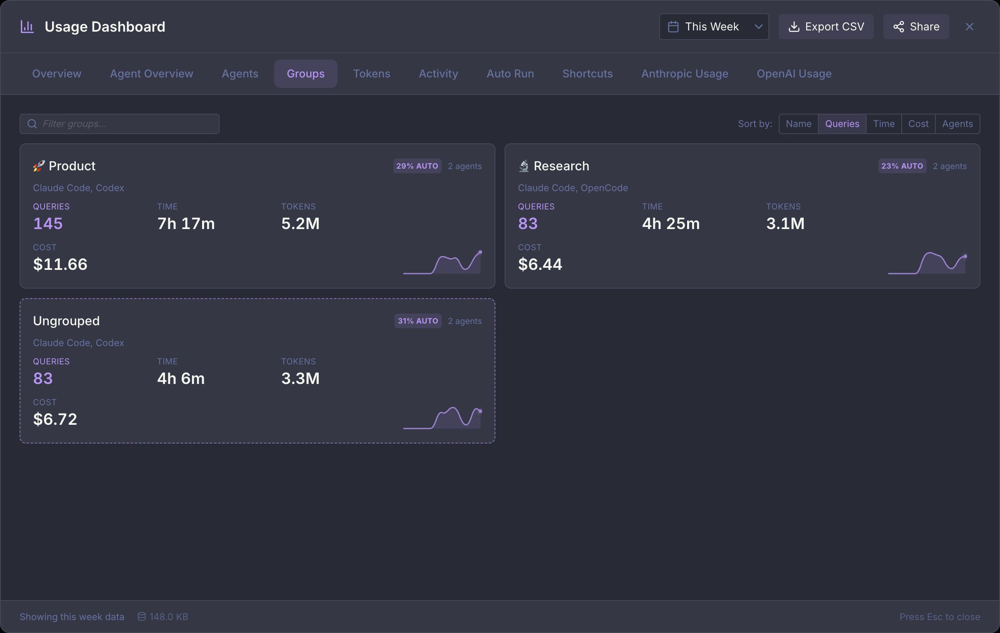

The Usage Dashboard shows analytics for the work your agents do in Maestro. It reports totals for a time range, compares providers and agents, and shows when the work happened.

<Note>
The dashboard records only activity that runs through Maestro. It has no data from before you started to use Maestro, and it does not see agents you run outside Maestro (for example, directly from a terminal). The one exception is the **Tokens** tab, which reads the transcripts that providers keep on disk. See [Tokens](#tokens).
</Note>

## Opening the Dashboard

The dashboard is part of the **Usage & Stats** [Encore Feature](./encore-features), which is on by default.

**Keyboard shortcut:**

- macOS: `Opt+Cmd+U`
- Windows/Linux: `Alt+Ctrl+U`

**From the menu:**

1. Click the hamburger menu (☰) in the top-left corner
2. Select **Usage Dashboard**

**From Quick Actions:**

- Press `Cmd+K` / `Ctrl+K` and search for "Usage Dashboard"

**From the command line:**

- `maestro-cli open usage-dashboard` opens it in the running app. Add `--tab <tab>` to open a specific tab. `maestro-cli open --list` shows the tab ids.

The dashboard opens on the tab you last viewed, and on your default time range. See [Time Range](#time-range).

## Dashboard Tabs

**Overview**, **Agent Overview**, **Agents**, **Groups**, **Tokens**, **Activity**, **Auto Run**, and **Shortcuts** are always present. Three more tabs appear only when they have something to show:

| Tab                 | Appears when                                                    |
| ------------------- | --------------------------------------------------------------- |
| **Cue**             | [Maestro Cue](./maestro-cue) is enabled alongside Usage & Stats |
| **Anthropic Usage** | at least one Claude account has reported plan quota details     |
| **OpenAI Usage**    | at least one Codex account has reported plan quota details      |

The quota tabs read what the provider reports about your plan window. An account that uses an API key instead of a plan login never produces one.

When the selected range has no recorded queries, only **Overview** and **Activity** show the "No usage data yet" message. The other tabs read other data (the live agent list, Auto Run records, Cue runs, transcripts, or plan quota), so they still show their content.

### Overview

The Overview tab summarizes the selected range. It shows these sections, from top to bottom.

**Activity Strip:** One cell for each day of the range, colored by the number of queries on that day. Idle days show as empty cells. The strip is one tab stop: use the arrow keys to move between days, and `Home` / `End` to go to the first or last day.

**Summary Cards:** Each card covers the selected range, except the cards that show a different scope beside the label.

| Card                          | What it shows                                                                                                                                                                 |
| ----------------------------- | ----------------------------------------------------------------------------------------------------------------------------------------------------------------------------- |
| **Agents** (now)              | Agents that exist now, with a breakdown by status. Terminal-only agents are not counted.                                                                                      |
| **Open Tabs** (now)           | Every tab open now (AI, file, browser, and terminal), with a breakdown by type.                                                                                               |
| **Total Queries**             | Agent turns in the range, with a sparkline.                                                                                                                                   |
| **Queries/Agent**             | Queries per active agent. An active agent is one that ran at least one query in the range.                                                                                    |
| **Tokens**                    | Input, output, and cache tokens from the per-turn records. When some queries have no token data, the card says how many of the queries are priced.                            |
| **Cost** / **Est. Cost**      | API-equivalent cost of those tokens. The label changes to **Est. Cost**, and the value gets a `~`, when some of the cost is estimated from model rates.                       |
| **Total Time**                | Total time spent on agent turns, with a sparkline.                                                                                                                            |
| **Avg Duration**              | Average time per query.                                                                                                                                                       |
| **Top Provider**              | The provider with the most queries, and its query count.                                                                                                                      |
| **Current Streak** (all time) | Consecutive days with at least one query, with your best streak. It counts all recorded history, so a short range does not cut it off.                                        |
| **Best Day**                  | The day with the most queries in the range.                                                                                                                                   |
| **Active Days**               | Days with at least one query, out of the days in the range.                                                                                                                   |
| **Image Annotations**         | Images you annotated in the range.                                                                                                                                            |
| **Interactive vs Delegated**  | How the range's AI **time** divides between prompts you typed and work that ran without you (Auto Run and Cue). A split bar shows the ratio. Hidden if the split cannot load. |

<Note>
Cue keeps its run history only for the number of days in its retention setting (14 days by default). When the range is longer, the **Interactive vs Delegated** card says that its Cue time covers only the retained days.
</Note>

**Tokens per Second:** Average and peak token speed for input, output, and the two combined. This row reads the same data as the [Token speed](#token-speed) section on the Tokens tab. Reading that data parses every agent transcript, which can be slow the first time. So the row shows a cached result, or a button that loads it. After you load it once, Maestro remembers the choice.

**Delegation Score (all time):** One number for how much of your AI work runs without you. Auto Run and Maestro Cue count as delegated. A turn you typed and waited on does not. It is a share of **time**, not of turns, because an Auto Run batch is a few long turns while an afternoon of chat is hundreds of short ones.

The track has milestones at 25%, 50%, 75%, and 100%:

- The **fill** goes to the highest milestone you have unlocked, and stays there. A period of hands-on work cannot take back a milestone you earned.
- The **marker** is your live score, which moves in both directions.

Under the track, Maestro names the next milestone and how much more delegated time it needs. The score covers all recorded history, so the range dropdown does not change it.

<Note>
Interactive and Auto Run records are never deleted, so they go back to your install. Cue run records are deleted after the Cue retention period. So the score takes its Cue time from a lifetime Cue time counter that this deletion does not touch.
</Note>

**Query Duration Percentiles:** p50, p75, p90, p95, p99, and maximum query time, with the same figures for each provider. These show the long tail that an average hides.

**Provider Comparison:** A horizontal bar for each provider. Toggle between **Queries**, **Time**, and **Avg Time** (average time per query, which replaces the old Agent Efficiency chart). The tooltip shows all three values. A provider that ran queries in worktree agents also gets a striped second row for those queries.

**Provider Trends Over Time:** Stacked bars that show how provider use changes across the range. Toggle between **Queries**, **Time**, and **Tokens**. Every day of the range has a slot, so a quiet period shows as a gap. On long ranges, days are grouped into equal blocks.

**Query Source:** A donut that splits the range's work by source:

- **Interactive** - prompts you typed
- **Auto Run** - Auto Run document work
- **Cue** - Maestro Cue runs (only when Maestro Cue is enabled)

Toggle between **Queries**, **Time**, and **Tokens**. Queries and Time use the same split as the **Interactive vs Delegated** card and the Delegation Score, so the three always agree. When the range is longer than Cue's retention, the chart says that the Cue slice covers only the retained days.

**Query Location:** A donut that splits queries between **Local** and **SSH Remote**. It appears only when at least one query in the range ran over SSH.

**Activity by Hour (Local Time)** and **Activity by Day of Week:** Two radial charts. Each slice's length shows its query count. The center names the peak hour and the peak day. This is the only place the Overview shows the peak hour.

### Agent Overview

The Agent Overview tab describes all your agents together. Terminal-only agents are not included.

- **Agent Statistics** - Total agents (with how many were active in the range, and how many are bookmarked), agents in Git repositories (with how many have worktrees), agents in plain folders, and local agents (with how many are remote). Below the cards, a bar for each provider shows how many agents use it. Everything except the "active" count describes your agents as they are now.
- **Agents Over Time** - How many agents existed on each day of the range, with the current count and the number of agents created and deleted in the range. It counts every agent still in the Left Bar from the day it was created, plus deleted agents from the day they were created to the day they were deleted.
- **Worktree Analytics** - Shown only when at least one worktree agent exists. Parent and worktree agent counts with a worktrees-per-parent ratio, the split of the range's queries between worktree agents and other agents, and one row per worktree branch with its query count and a 7-day sparkline. Queries from deleted worktree agents are collected in one **Deleted worktree agents** row, so the rows add up to the split.
- **Agent Usage** - One line per agent over the range, for the 10 agents with the most queries. All other agents are added together in one **Other agents** line, so the lines add up to the range total. Toggle between **Queries** and **Time**. Worktree agents draw as dashed lines, and an agent you deleted is labeled **Deleted agent**. Click a legend entry to show or hide its line.

<Tip>
Agent Overview and **Agents** answer different questions. Agent Overview shows all your agents together: how many, what kind, and how that changes. Agents shows one card per agent, with sorting, filters, and a detail view for each agent.
</Tip>

### Agents

The Agents tab shows one card for each agent that exists now. Deleted agents have no card. Each card shows the agent name, a live status dot, and three stats for the selected range: **Queries**, **Tabs** (AI tabs open now), and **Auto %** (the share of the agent's queries that came from Auto Run). Below the stats is a sparkline of the last 7 calendar days. Worktree agents show a dashed border, a **WT** badge, and their checked-out branch.

**Sorting:** The **Sort by** control orders the cards by **Queries** (the default), Name, Created, Recent, Tabs, Auto %, or Provider. Provider groups the cards one account at a time. The stat you sort on is highlighted on every card. The corner badge of a card normally shows the agent's age. Under **Recent**, it shows the time of the agent's last query, and agents with no query in the range go to the bottom.

**Filtering:** Several controls above the grid narrow the cards:

- The filter box narrows the cards as you type. Matching is fuzzy, so `cbst` finds "Cyber Stocks". It searches the agent name (with or without its leading emoji) and a worktree's branch name. Press `Esc` or click the **ESC** pill to clear the filter. While the box has text, `Esc` clears it and the dashboard stays open.
- The group dropdown shows only the agents in one Left Bar group, or the agents in no group (**Ungrouped**). It appears only when you have at least one group with agents in it.
- **Active only** shows only the agents that ran a query in the selected range.
- The provider account dropdown is described below.

When a filter is set and the sort is Name, the best match goes first. Other sorts keep their order.

**Provider accounts:** When your agents use more than one provider account, an **All providers** dropdown appears beside the filter box. It lists each account with the number of agents that use it (`Claude Code - smash (7)`, `Codex - Default account (3)`, `OpenCode (2)`). Select one to show only those agents. Every card also shows its account name as a badge. An agent that uses a plain `~/.claude` or `~/.codex` shows the provider instead (`Claude Code default`, `Codex default`), so the badges on a Claude card and a Codex card do not look the same. An account is the `CLAUDE_CONFIG_DIR` or `CODEX_HOME` that the agent runs against. Providers that keep one credential store show as one entry named after the provider. An agent that runs over SSH is filed under a separate account for its host (`smash @ myhost`), because the directory on that host holds the host's own login.

The **N agents** chip on each row of the Anthropic Usage and OpenAI Usage tabs opens this tab, filtered to that account. That chip counts only local agents.

**Tile size:** `+` and `-` change the size of the cards, and `0` sets the default size. The buttons beside the **Sort by** control do the same. A wider card shows more of a long agent name. A narrower card fits more agents on the screen. Maestro remembers the size. The Groups tab has its own separate size.

**Per-agent details:** Click a card to open a detail view for that agent. Every figure covers the selected range:

- The provider, the worktree branch, the path, and the first and last time the agent was active.
- **Total queries**, **Total time**, **Avg time per query**, and **Active days**.
- **Tokens & Cost**: total tokens, input and output, cache reads, and cost. A note shows when some queries have no token data. A separate line shows the agent's lifetime tokens and cost since it was created.
- **Daily Activity** for every day of the range.
- **Time per Query**: minimum, median, p95, and maximum.
- **Query Source**: the split between your prompts and Auto Run.
- **Auto Run**: **Runs**, **Tasks completed**, **Longest run**, and **Total run time** for the agent's Auto Runs in the range.
- The worktree relationship (the parent of a worktree, or the number of worktrees of a parent).
- The tab breakdown, described below.

Two buttons in the header take you to the agent:

- **Jump to Agent** closes the dashboard, selects the agent, and shows its AI transcript, even if you last left it on a terminal, file, or browser tab. It also expands the Left Bar section that contains the agent. If the agent no longer exists, a notification tells you so.
- **Agent Settings** opens the Edit Agent dialog on top of the dashboard. When you close it, you return to the stats you were reading.

The detail view can be resized: drag an edge or a corner, and double-click a resize handle to return to the default size. Maestro remembers the size.

#### Tab breakdown

The detail view also breaks the agent's activity down by AI tab, as a sortable table. The columns are **Tab**, **Queries**, **Time** (total agent time in that tab), **Auto %**, and **Last Active**, plus a 14-day sparkline. Click a column header to sort by it. The tab in focus has an **Active** chip, snoozed tabs have a **Snoozed** chip, and closed tabs have a **Closed** chip.

**Show** selects which tabs to list: **Open** (the default, tabs open on that agent now), **Last 10**, **Last 25**, or **All**. **All** can hold thousands of tabs on an agent with a long history, so it shows 32 rows per page with page controls. The other choices always fit on one page. When you change the filter or the sort, the table returns to the first page.

<Note>
Maestro records which tab sent each query, but tab _names_ are kept with the tab itself. A tab that is open, snoozed, or was closed since Maestro started shows its name. An older closed tab shows only a short ID (for example, `DEADBEEF`). This is why **Open** is the default: an agent that runs for a long time collects many old tabs that no longer have a name.
</Note>

### Groups

One tile for each Left Bar group, which adds up the activity of every agent in the group. Put a client's agents into a group, and this tab shows what that client cost.

Each tile shows the group's emoji and name, the providers its agents use, the number of agents, an **auto** badge for the Auto Run share, and four values: **Queries**, **Time**, **Tokens**, and **Cost**. Below them is a sparkline of the last 14 calendar days.

- **Filter groups** narrows the tiles by name.
- **Sort by** orders them by Queries (the default), Name, Time, Cost, or Agents.
- `+`, `-`, and `0` change the tile size, the same as on the Agents tab.
- Click a tile to open a detail view for the group. It shows the group totals, **Daily Activity**, and a sortable table of the agents in the group with the same values. The rows and the totals use the same calculation, so they always agree. Click a row (or press `Enter` on the agent name) to open that agent's detail view on top. `Esc` returns you to the group.

Two extra tiles make sure the tiles add up to the totals on the Overview:

- **Ungrouped** collects the agents that are in no group.
- **Deleted agents** collects the queries of agents that you deleted. These agents cannot be put in a group, and this tile cannot be clicked.

Both tiles have a dashed border and always go last. Empty groups are not shown.

<Note>
Tokens and cost exist only for turns recorded after the stats database started to store them. On an older install, earlier activity has query and time values but no tokens or cost. A tile tells you in its tooltip when only part of its queries are priced.
</Note>

### Tokens

Token use and cost, by agent, account, model, project, and time.

This tab has a different data source from the rest of the dashboard. The other tabs read Maestro's own records of what it ran. The Tokens tab reads the transcripts that each provider writes to disk, for the project folders your agents use. A conversation you ran outside Maestro in one of those folders is therefore counted too.

**Cards:**

- **API-equivalent Cost** - What these tokens would cost at API rates. Most plan accounts (for example, Claude Max or ChatGPT) are billed by subscription, so this is an estimate of value, not what you paid. Only some providers report a real cost. Maestro prices all other tokens from a built-in rate table, and marks those costs with `~`.
- **Input Tokens** - Fresh input only. Cache reads are not included, for every provider (Codex too), so no cached token counts twice.
- **Output Tokens**
- **Cache Reads** - With the share of input that came from the cache.

**Timeline:** Stacked bars of **Input**, **Output**, **Cache read**, and **Cache write** for each period. Cache reads are often much larger than the other values, so you can click a legend entry to hide that series and rescale the chart. Maestro remembers which series you hid. At least one series stays visible.

**By Agent**, **By Account**, **By Model**, and **By Project:** Ranked bars sized by cost, with the token count beside each bar.

**Footer:** The footer says how many conversations were read and what the totals leave out:

- A conversation's tokens count toward the period (day, week, or month) of its **last** activity.
- Agents that run over SSH are not counted, because their transcripts are on the remote host.
- Providers that keep no local transcripts are not counted.
- Some providers report partial token data, and the footer names them.

Click **Refresh** to read changed transcripts again.

**Multiple provider accounts:** If you use several accounts from separate provider homes, the **By Account** breakdown shows each account's use separately. Each row names its provider and its account (`Claude Code - Default account`, `Codex - project-acc-1`), so the default accounts of two providers never share a row. Hover over a row to see the account's full directory.

Which providers can split by account depends on whether the provider's CLI has a variable that selects its home directory:

| Provider      | Variable            | Default directory         |
| ------------- | ------------------- | ------------------------- |
| Claude Code   | `CLAUDE_CONFIG_DIR` | `~/.claude`               |
| Codex         | `CODEX_HOME`        | `~/.codex`                |
| Copilot-CLI   | `COPILOT_HOME`      | `~/.copilot`              |
| OpenCode      | none                | `~/.local/share/opencode` |
| Factory Droid | none                | `~/.factory`              |

OpenCode and Factory Droid have no account variable, so each shows as one row. Maestro finds an account from the variable set on an agent (or on the provider, in Settings), from your shell environment, and from `~/.<provider>-*` directories on disk. Accounts that share one transcript directory through a symlink are counted once.

A home is not always a login. `COPILOT_HOME` moves Copilot CLI's transcripts but does not move its login, so two Copilot homes show as two rows that bill one GitHub account. [Multiple Accounts](/multi-provider) explains what each provider's variable does and does not move.

The Overview's **Query Source** and **Provider Trends Over Time** charts also have a **Tokens** mode, which plots token use over the same range.

#### Token speed

How fast tokens moved, in tokens per second. The **Output / Input / Total** toggle selects which rate every chart in this section shows:

- **Average and peak cards** for input, output, and total.
- **Tokens per second over time**, with the average and the peak for each period (each hour on **Today**, and each day, week, or month on longer ranges).
- **Speed by provider** and **speed by model** over time, one line each. The model chart shows the six busiest models.
- **Speed by hour of day**, with the fastest and the slowest hour.
- **By Provider** and **By Model** tables with calls, average rates, and peak rates. Click a column header to sort.

How the numbers are calculated:

- **Per API call.** Each call is timed from the line that sent its request (your prompt, or the tool result before it) to the last line of its response. A whole turn is not used, because it includes tool runs and subagents. That measures how busy the agent was, not how fast the model was.
- **Averages are token-weighted.** All tokens divided by all measured call time, so a 2-minute call counts for more than a 2-second call.
- **A peak is the fastest model-hour.** That is one model's calls in one clock hour, across all agents, with at least 5 minutes of call time. A single call is not used: transcript lines are written per block, so a short call can seem to finish thousands of tokens in two seconds.
- **Input includes cache reads here.** Speed counts every prompt token a call processed, which is why input speed is hundreds of times higher than output speed.
- **Busiest hour** (under Peak Total) is the clock hour in which the most tokens finished across all agents together, divided by 3,600 seconds. Unlike a peak, it increases with the number of agents that run at the same time.

Speed is measured from Claude Code and Codex transcripts. Other providers do not record when each call started, so their calls are left out instead of counted as zero.

#### Resilience

How often a provider refused work (a quota limit or an overload) and [Agent Resilience](./agent-resilience) completed the turn anyway. The cards show **Outages Survived**, **Downtime Bridged** (the wait time of recovered outages), **Recovery Rate**, and **Auto-Retries Sent**. The **Outages Over Time** chart splits each day's outages into **Recovered** and **Stopped**. Maestro records an outage only when it ends.

### Activity

The Activity tab shows when and how you work over time.

**Prompts:** How often you prompt your agents. A prompt is a message you sent to an agent. Auto Run is not included, which is the difference from **Queries** (every agent turn). The cards show:

- **Total Prompts**, with the number of active days.
- **Average / Day**, and the average per active day.
- **Busiest Day** and **Quietest Active Day**, with the median day.
- **Streak in Range**, and the longest streak in the range.
- **Peak Hour**, and the most prompts you sent in one hour.
- **Time Between Prompts** (the median, while you work).
- **Working Stretches**. A break longer than 30 minutes starts a new stretch.

Below the cards are charts of prompts per day (with the range average and a 7-day rolling average), prompts by hour of day, the average for each weekday, and the full percentiles for prompts per day and time between prompts. Days are calendar days, and quiet days count as zero. Today is left out of the per-day figures because it is not complete. `maestro-cli stats` prints the same numbers, and `--json` puts them under `prompts`.

**Interactive vs Delegated:** Stacked bars, one per day, that split each day into interactive work and delegated work (Auto Run and Cue). Toggle between **Time** and **Queries**. Hover over a bar to see the day's Interactive, Auto Run, and Cue values, and its delegated share. On a long range, days are grouped into equal blocks, and quiet days show as gaps. When the range is longer than Cue's retention, the older days have no Cue data, and the chart says so.

**Activity Heatmap:** When the work happened, from real hourly data. The layout depends on the length of the range:

- Up to a week: one column per day and one row per hour.
- Up to about 90 days: one column per day and one row per 4-hour block.
- Longer: one column per week and one row per weekday.

Toggle between **Count** (queries) and **Duration** (time). The weekly layout also offers **Tokens**, because tokens are known only per day. The grid is one tab stop: the arrow keys move between cells, and `Home` / `End` go to the first or last column.

**Duration Trends:** The average query duration for each day (each week, for ranges longer than 120 days). Each average is weighted by the number of queries, so a day with one query does not move the line as much as a day with two hundred. A day with no queries is a gap in the line. Turn on smoothing to add a trailing average of the last 7 days (or 4 weeks). It uses only earlier days, never later ones.

### Auto Run

The Auto Run tab shows Auto Run work in the range.

**Auto Run Statistics:**

| Card                  | What it shows                                                                                  |
| --------------------- | ---------------------------------------------------------------------------------------------- |
| **Runs**              | Auto Runs that started in the range, with how many were goal runs and how many did not finish. |
| **Tasks Done**        | Checkboxes ticked, out of checkboxes attempted.                                                |
| **Avg Tasks/Run**     | Average tasks per finished document run.                                                       |
| **Success Rate**      | Tasks done out of tasks attempted.                                                             |
| **Avg Run**           | Average run time of finished runs.                                                             |
| **Avg Time per Task** | Run time for each ticked checkbox.                                                             |

Goal runs have no checkboxes, so they are counted separately and never added to the task totals. Runs that did not finish (still running, or Maestro quit before the run ended) count as runs, but are left out of the averages and the success rate.

**Tasks Completed Over Time** shows tasks done per day for the whole range. Hover over a bar to see the day's counts.

**Auto Run Wizard Statistics:** How you used the Auto Run wizard: **Time in the Wizard** (active time only), **Wizard Runs**, **Docs Produced**, **Tasks Written**, **Messages Sent**, and **Runs That Shipped**, with a **Wizard Runs Over Time** chart.

**Agent Turn Duration Percentiles:** p50 to maximum time for each agent turn.

**Agent Turns by Time of Day:** When Auto Run agent turns start, one bar per hour, with the three busiest hours highlighted.

<Note>
An **agent turn** is one run of an agent on a document, whether or not it ticked a checkbox. A **task** is a ticked checkbox. The percentiles and the time-of-day chart count agent turns, so turns that ticked nothing are included there. The cards count tasks.
</Note>

**Longest Auto Runs:** Every Auto Run in the range, longest first. The columns are **Duration**, **Started**, **Provider**, **Document**, **Tasks**, and **Project**. Click a column header to sort. A goal run shows its goal text with a **Goal** tag and a single percent. The table shows 25 rows. Click **Show more** to see the next 25.

**How a run's duration is measured:** the time from start to finish, minus any time the computer was asleep. It does not matter whether the Maestro window was visible. The agent runs in its own process and continues while you do other work, so a run you left alone is timed the same as one you watched.

Older builds also subtracted the time the window was hidden, which on macOS includes when it was minimized or fully covered by another app. That recorded the long overnight runs as too short, and some as zero. If your history is older than the fix, `scripts/repair-autorun-durations.mjs` rebuilds each affected run's duration from its task timestamps (a dry run by default; `--apply` writes the changes, after a backup). Runs with no recorded tasks cannot be rebuilt and stay as they are.

### Cue

The Cue tab shows [Maestro Cue](./maestro-cue) runs in the range. It appears only when Maestro Cue and Usage & Stats are both enabled.

A note at the top says how much run history Cue keeps. Cue deletes runs older than its **history retention** setting (14 days by default), which you change in the Cue Activity Log. When the selected range is longer than that, the note says that the tab shows only the retained days.

- **Trigger type chips** - One chip for each trigger type in the range. Turn a chip off to remove that trigger type from every panel below. This is useful when a frequent heartbeat trigger hides everything else.
- **Summary cards** - **Runs**, **Success Rate** (runs that succeeded and failed), **Run Time** (with the average), and **Total Tokens** when any run used tokens. Run time counts completed runs only.
- **Completed Run Duration Percentiles** - p50 to maximum run time of completed runs.
- **Runs Over Time** - Runs per hour or per day, split into completed and failed, with tokens drawn as a line when there are any.
- **By Hour of Day** - When Cue runs in the day. Hours with failures are colored as warnings.
- **By Trigger Type** - Runs for each trigger type.
- **By Pipeline** - A sortable table with **Runs**, **Success Rate**, **Avg Run Time**, **Run Time**, **Total Tokens**, and **Total Cost** for each pipeline. Run time and its average count completed runs only.
- **Tokens by Provider** - Shown when any run used tokens.
- **Slowest Runs** - The slowest finished runs, with **Subscription**, **Provider**, **Status**, **Started**, **Duration**, and **Tokens**. A run that Maestro closed after a crash is not listed, because its time was downtime, not run time.

### Shortcuts

How much of the keyboard you use. The tab labels which figures follow the range and which do not.

- **Keyboard Mastery (all time)** - Your mastery level and how many of the bound shortcuts you have used at least once. The range does not change it.
- **Shortcut Firings** and **Peak Day** - Shortcut presses in the selected range, and the day with the most presses.
- **Daily Firings** - Presses per day for every day of the range.
- **Most Used Shortcuts** - Presses per shortcut in the selected range. Maestro started to record presses per shortcut in stats schema v14, so older presses count in Daily Firings but not here.
- **Unused Shortcuts (all time)** - Bound shortcuts you have never pressed. This is the shortest path to working faster.

The mastery figure counts only shortcuts that have a key bound to them. An action with no key assigned cannot be pressed, so it is not in the total and not in the unused list. The same numbers drive the mastery bar in the keyboard shortcuts help, so the two always agree.

### Anthropic Usage

One row for each Claude account (`CLAUDE_CONFIG_DIR`), with a bar for each quota window: **Session window** (when Claude reports one), **Week (all models)**, and the weekly window for the model tier that Claude meters separately (for example, **Week (Opus)**). Each bar shows when the window resets. Accounts that log in to the same Anthropic account share one quota, and a chip says so.

### OpenAI Usage

One row for each Codex account (`CODEX_HOME`), with its plan badge, its email, and a bar for each quota window: **Session (5h)**, **Weekly**, and any per-model limits that the account reports. Each bar shows when the window resets.

#### Common controls

The two quota tabs work the same way:

- **Refresh** reads the quota again. `Cmd+R` / `Ctrl+R` does the same while the tab is open. A dropdown beside it sets an automatic refresh interval.
- A window whose reset time has passed shows 0% with **reset, awaiting sample** until the next refresh reads it.
- The **N agents** chip shows how many local agents use the account. Click it to open the Agents tab, filtered to that account. Agents that run over SSH are not counted, because on the remote host that directory holds the host's own login.
- A row that the last refresh could not update shows a **stale** chip with the time its bars were read.
- A logged-out account shows a **Log in** button instead of bars.
- You can hide an account. **Show all** brings hidden accounts back.

An account keeps its row after you move every agent off it, which is what you usually do when that plan reaches its limit. The row keeps the last reading, marked **stale**, so you can watch for the reset without an agent on that account. Maestro remembers an account because it sampled it for a real agent, and it removes the row only when the account directory is gone from disk.

#### Usage resets

OpenAI sometimes gives Codex accounts **reset credits**. When you redeem a credit, the account's used windows open again at once, instead of at their reset time. Codex shows this only in its own terminal UI, so Maestro shows it here: an account with credits has a **Usage resets** block under its bars, which lists each credit with its expiry date and a **Reset now** button.

Maestro always asks before it redeems a credit, because credits are limited, expire (usually about a month after they are given), and cannot be refunded. Maestro spends the credit that expires first, so no credit expires while others wait. Then it reads your usage again, so the bars show the open windows.

<Warning>
A reset credit opens again only the windows that are used now. If you redeem one while your windows are almost empty, the credit is spent and resets nothing. Maestro reads this from the account (the header says `2 available · 0 would take effect now`) and says so in the confirmation, but it does not stop you: they are your credits.
</Warning>

An account with no credits shows no block.

#### Automatic resets

An agent can redeem a credit by itself when it reaches a limit. The toggle is in the agent's **Codex Settings**, under Reasoning Effort, in the New Agent and Edit Agent dialogs:

**Redeem a reset credit when this agent hits its usage limit** - off by default.

When it is on, an agent that stops at a plan quota limit spends one credit, and its usual auto-retry continues the work when the window is open. Every automatic redemption shows a notification that names the agent and how many windows opened.

The automatic reset is more careful than the button:

| It runs only when                               | Because                                                                         |
| ----------------------------------------------- | ------------------------------------------------------------------------------- |
| The agent runs on Codex and the toggle is on    | No other provider has reset credits, and the default is off                     |
| The stop is a real plan quota limit             | A reset cannot fix a crash or an authentication failure                         |
| The account confirms that the reset would apply | It does not spend a credit that would reset nothing, or when it cannot tell     |
| It has not already reset for this outage        | One limit must not use up all your credits, one error at a time                 |
| The agent runs locally                          | Over SSH, the credits read here belong to this computer, not to the remote host |

Turn it off and the **Reset now** button still works the same way.

## Time Range

Use the time range dropdown at the top of the dashboard to select the period that the tabs show:

| Range             | What it covers                                                |
| ----------------- | ------------------------------------------------------------- |
| **Today**         | Today only                                                    |
| **Last 7 Days**   | The last seven whole local days, today included               |
| **Last 30 Days**  | The last 30 whole local days, today included                  |
| **Last 90 Days**  | The last 90 whole local days, today included                  |
| **Last 365 Days** | The last 365 whole local days, today included                 |
| **All Time**      | Everything since the stats database was created or last reset |

The ranges follow calendar days, not calendar weeks or months. **Last 7 Days** always starts at midnight six days before today. When Maestro knows the date of the first recorded query, **All Time** shows it, for example "All Time (since Jul 10, 2026)".

Some figures do not follow the range. Their labels say so: **now** for live values (Agents, Open Tabs, Agent Statistics), and **all time** for the streak, the Delegation Score, keyboard mastery, and unused shortcuts. The plan quota tabs show the current quota windows.

The dashboard opens on your default range each time. To change the default, open **Settings** (`Cmd+,` / `Ctrl+,`), go to the **Plugins** tab, open **Usage & Stats**, and set **Default lookback window**. The default is **Last 7 Days**.

## Keyboard Navigation

| Shortcut                           | Action                                                                                        |
| ---------------------------------- | --------------------------------------------------------------------------------------------- |
| `Cmd+Shift+[` / `Ctrl+Shift+[`     | Previous tab                                                                                  |
| `Cmd+Shift+]` / `Ctrl+Shift+]`     | Next tab                                                                                      |
| `Left` / `Up` and `Right` / `Down` | Previous and next tab, while the tab strip has focus                                          |
| `Tab`                              | From the tab strip, go to the first section                                                   |
| `Down` or `Tab`                    | Next section, while a section has focus                                                       |
| `Up` or `Shift+Tab`                | Previous section (or back to the tab strip from the first section), while a section has focus |
| `Home` / `End`                     | First or last section, while a section has focus                                              |
| `+` / `-` / `0`                    | Bigger, smaller, or default tile size on the Agents and Groups tabs                           |
| `Cmd+R` / `Ctrl+R`                 | Refresh the quota on the Anthropic Usage and OpenAI Usage tabs                                |
| `Esc`                              | Clear the Agents filter, close the open detail view, or close the dashboard                   |

The section keys work only when the section itself has focus. When a control inside a section has focus (a toggle, a sortable header, a chart), the keys belong to that control: `Tab` moves through the section's controls, and the arrow keys move inside the Activity Strip and the Activity Heatmap.

## Exporting Data

Click **Export** at the top of the dashboard and select a format. Both formats cover the selected range and contain the same fields: a value in a JSON row is a column in the CSV.

| Format   | What you get                                                                                                            |
| -------- | ----------------------------------------------------------------------------------------------------------------------- |
| **JSON** | One file with every table and the dashboard totals. Best for scripts and `jq`.                                          |
| **CSV**  | A `.zip` with one CSV per table, plus `export-info.json` with the totals, notes, and row counts. Best for spreadsheets. |

The export contains:

- Your agents, with the agent name and group name beside the agent id on every row.
- Query events, with per-turn tokens and cost.
- Auto Run runs and tasks, agent lifecycle (created and deleted), Agent Resilience outages, wizard runs, daily shortcut presses, and multi-window use.
- The delegation totals and the split for each day.
- Token use by agent, model, project, account, and over time, and token speed by provider, model, hour of day, and over time.
- When Maestro Cue is on: Cue runs, and the Cue tab's totals by pipeline, agent, subscription, trigger type, hour of day, and over time.

Cue keeps only its retained days of run history, so a longer range includes only those Cue runs. If the token or Cue data cannot be read, the export still completes, and a note says what is missing. A notification confirms where the file was saved and how many rows it contains.

## From the Command Line

Every figure on the dashboard is also available from `maestro-cli`, which reads the same data as the running app. The commands that take `-r, --range` accept `day`, `week`, `month`, `quarter`, `year`, or `all` (`week` by default). Add `--json` for machine-readable output.

| Command                        | What it shows                                                                                   |
| ------------------------------ | ----------------------------------------------------------------------------------------------- |
| `maestro-cli stats`            | The dashboard totals for a range, including the Prompts figures                                 |
| `maestro-cli stats-tokens`     | Token use, cost, and token speed by provider and model. `--refresh` reads changed transcripts   |
| `maestro-cli stats-delegation` | The interactive, Auto Run, and Cue split for a range and for each day                           |
| `maestro-cli stats-cue`        | The Cue tab. `--exclude-trigger <type>` works like the trigger type chips                       |
| `maestro-cli stats-plan-usage` | The last plan quota reading for each Claude and Codex account. `--provider claude` or `codex`   |
| `maestro-cli stats-agents`     | Agents Over Time: agents for each day, with created and deleted counts                          |
| `maestro-cli stats-activity`   | Auto Runs, wizard runs, resilience outages, and shortcut presses for a range and each day       |
| `maestro-cli stats-export`     | The Export button. `-o <path>` is required, and `-f csv` (default) or `-f json` sets the format |
| `maestro-cli stats-indexing`   | The progress of a usage data scan. See [Upgrading Usage Data](#upgrading-usage-data)            |
| `maestro-cli stats-query`      | A read-only SQL query against the stats database                                                |

## Reopening the Dashboard

The dashboard keeps the last result for each time range. When you close it and open it again, the last numbers show at once and then refresh in place.

## Upgrading Usage Data

When an update changes how Maestro counts tokens or cost, Maestro reads your provider transcripts again, one time. This starts the first time you open the dashboard, About, or the Agent Sessions browser. With a lot of history, this can take a few minutes. A window shows the progress: how many transcripts are done, how much data is left, and the time remaining.

- Click **Continue in background** (or press `Esc`) to make it a card in the bottom-right corner. Click the card to see the details again, or **X** to hide it until the next scan.
- The app stays responsive while the scan runs, because the reading happens in the background.
- Progress is saved as it goes. If you quit during a scan, the next launch continues from where it stopped.
- Run **Show Usage Data Scan Progress** from the command palette to show the window again.
- From a terminal, `maestro-cli stats-indexing` shows the same progress. Add `--wait` to wait until it finishes.

## Data Collection

### What's Tracked

Usage & Stats records this data in a local stats database:

- **Query events** - Each agent turn: the agent, the provider, the source (interactive or Auto Run), the start time and duration, the project path, the AI tab, whether it ran over SSH or in a worktree, and the tokens and cost when the provider reports them.
- **Auto Run runs and tasks** - Each Auto Run, and each agent turn on a document in that run.
- **Agent lifecycle** - When each agent was created and deleted.
- **Image annotations** - When you annotate an image.
- **Shortcut presses** - Presses per day, and presses per shortcut per day.
- **Multi-window use** - For each day, how many windows you opened and the most that were open at the same time.
- **Resilience outages** - Each Agent Resilience outage, recorded when it ends.
- **Wizard runs** - Each Auto Run wizard conversation, with its counts of messages, documents, and tasks.

Two more sources feed the dashboard but are not in the stats database:

- **Cue runs** are kept in Maestro Cue's own database, and are deleted after the Cue history retention period.
- **Token totals on the Tokens tab** are read from the provider transcripts on disk.

### What's NOT Tracked

- The text of your prompts and the agent responses
- The contents of files
- Activity outside Maestro (except that the Tokens tab reads provider transcripts, as described above)

### Data Retention

Maestro never deletes stats automatically. There is no retention period for the stats database, so **All Time** goes back to when the database was created. Only Cue runs have a retention period (see [Cue](#cue)).

If Maestro finds that the stats database is damaged when it starts, it replaces it with a backup copy or with a new, empty database. It then shows a **Usage Statistics Reset** notification one time. The notification stays until you dismiss it, because it explains why history is missing from the dashboard.

### Enabling and Disabling Collection

Usage & Stats is an [Encore Feature](./encore-features) that is on by default. To turn it off:

1. Open **Settings** (`Cmd+,` / `Ctrl+,`)
2. Go to the **Plugins** tab
3. Open **Usage & Stats**
4. Click **Disable**

When it is off, Maestro stops recording new data, and the dashboard is not available. Your existing data is kept. Maestro does not fill in the activity from the time recording was off.

## Accessibility

The Usage Dashboard uses Maestro's colorblind-friendly chart palette (Wong, _Nature Methods_ 2011) when **Color Blind Mode** is enabled in **Settings → Display → Accessibility**. Agent and source colors change to a high-contrast set tested against protanopia, deuteranopia, and tritanopia.

See [Configuration → Accessibility](./configuration#accessibility) for everything the toggle changes in the rest of the app.

## Additional Features

**Real-time updates:** The dashboard refreshes when Maestro records new data. Each panel refreshes only when a table it reads changes, so a shortcut press does not reload the Overview charts. A burst of changes causes one refresh, about a second after the changes stop. An **Updated** indicator shows briefly beside the title when new data arrives. The Tokens tab is an exception: it reads transcripts, so it refreshes when you open it or click **Refresh**.

**Footer:** The footer has three parts:

- On the left: the range that is shown ("Showing Last 30 Days", or "No queries in this range"), and the size of the stats database.
- In the center: a short summary of what the current tab shows. It changes with the tab and with your filters: `24 of 84 agents` when you narrow the Agents grid, `126 runs · 12 pipelines · 8 failed` on Cue, `3 accounts · peak window 87%` on a quota tab. It is a fast way to see that a filter is on when the grid looks emptier than you expect. A tab with nothing to report yet (still loading, or an empty range) leaves the center empty.
- On the right: the `Esc` hint to close the dashboard.

**Share achievements:** The share button at the top of the dashboard makes an achievement card that you can share.

## Tips

- **Check the Activity Heatmap** to see your most productive hours
- **Look at the radial charts on the Overview** to find your peak hour and peak day
- **Use Provider Comparison in Avg Time mode** to see if one provider is consistently faster
- **Watch the Delegation Score** to see how much of your work runs without you
- **Export regularly** if you want to track long-term trends in another tool
- **Change the time range** to focus on recent activity or see the full history
