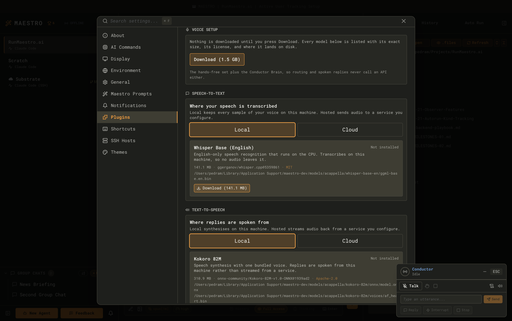
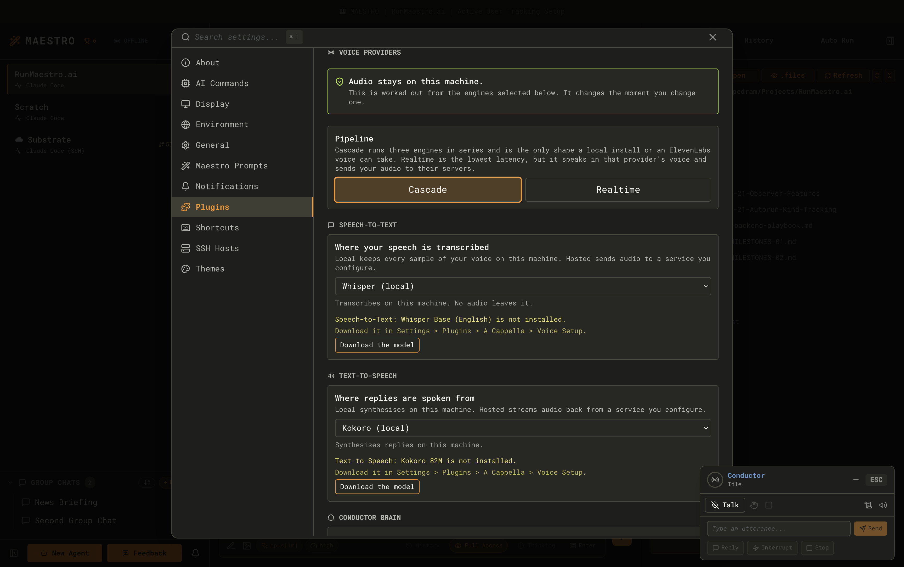
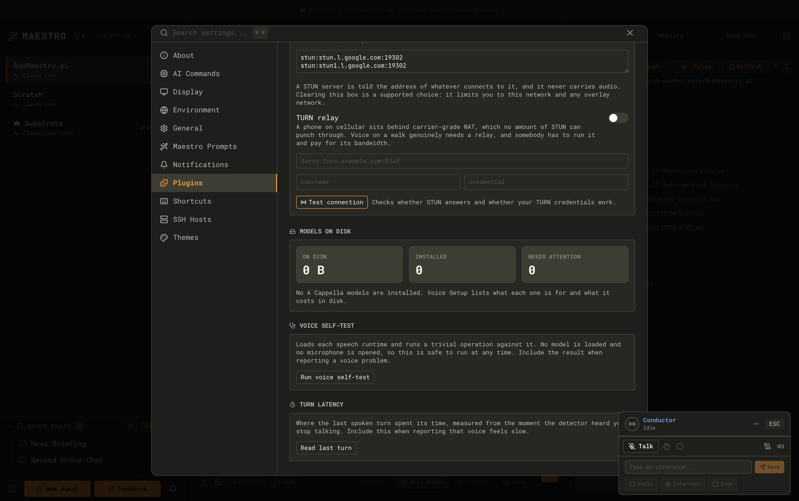
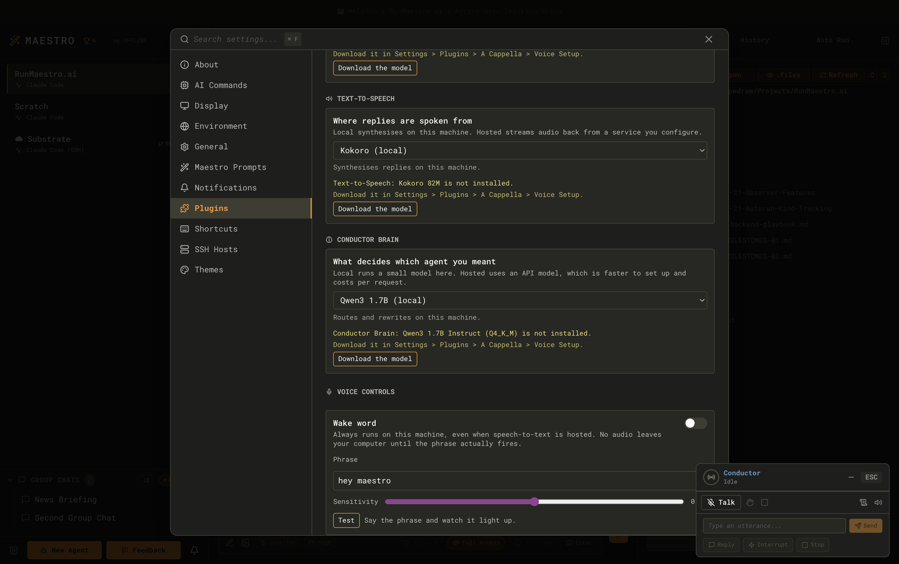
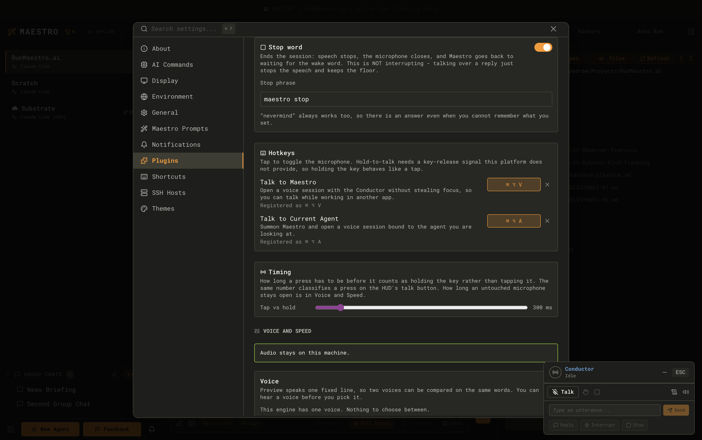
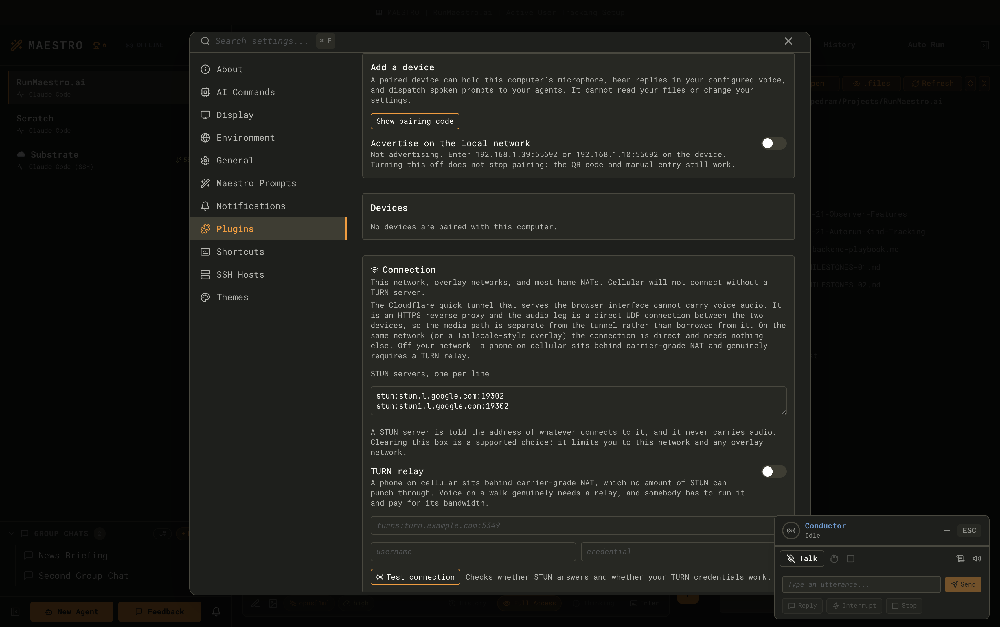

A Cappella is Maestro's voice interface. You say something, Maestro works out which agent and which tab you meant, sends it there, and reads the reply back to you. You can drive it with a wake word, with a global hotkey from inside another application, or from a paired phone across the room.

It is a **front end for the agents you already have**, not a second assistant. It does not think about your code, it does not answer questions itself, and it never invents an agent to talk to. Every utterance ends up in an ordinary Maestro tab that you can scroll back through afterwards.

<Note>
	A Cappella is an **Encore Feature** and it is in **Beta**. It is off by default. While it is off, no
	microphone is opened, no model is downloaded, no hotkey is registered, no Bonjour advert is
	published, and no voice UI renders anywhere in the app.
</Note>

## Turning it on

1. Open **Settings** (`Cmd+,` / `Ctrl+,`) and go to the **Plugins** tab.
2. Find the **A Cappella** card and enable it. A confirmation sheet lists what the feature reads before anything is switched on.
3. Select the card to open its detail pane. The **Settings** sub-tab holds every voice panel: Voice Setup, Voice Providers, Voice Controls, Voice and Speed, Paired Devices, and Models.

Enabling the feature only makes those panels reachable. **Nothing is downloaded and no device is opened until you ask for it**: models arrive when you press Download, and the microphone opens at your first real session.

## Where your audio goes

This is the only question that really matters when you configure a voice assistant, so Maestro computes the answer from your actual selection rather than writing it into help text. The sentence at the top of **Voice Providers** and **Voice and Speed** is derived from the providers you picked, and it updates the moment you change a slot.

There are three independent slots plus one alternative pipeline shape:

| Slot                | What it does                                              | Default |
| ------------------- | --------------------------------------------------------- | ------- |
| **Speech-to-Text**  | Turns what you said into words                            | Local   |
| **Text-to-Speech**  | Turns the reply into sound                                | Local   |
| **Conductor Brain** | Decides which agent and tab you meant, and shapes replies | Local   |

Each slot is configured and validated on its own. A missing speech model does not stop you using a hosted Brain, and **no path anywhere silently substitutes one provider for another**. If a slot cannot run, the session refuses with a specific reason instead of quietly routing your microphone somewhere you did not choose.

### The providers, and what leaves your machine

| Provider                               | Slot            | Leaves this machine               |
| -------------------------------------- | --------------- | --------------------------------- |
| Parakeet (local)                       | Speech-to-Text  | Nothing                           |
| Whisper (local)                        | Speech-to-Text  | Nothing                           |
| OpenAI (hosted)                        | Speech-to-Text  | **Your audio**, to OpenAI         |
| System voice (built in)                | Text-to-Speech  | Nothing                           |
| OpenAI (hosted)                        | Text-to-Speech  | The reply text, to OpenAI         |
| ElevenLabs (hosted)                    | Text-to-Speech  | The reply text, to ElevenLabs     |
| Built-in (keyword routing)             | Conductor Brain | Nothing                           |
| OpenAI (hosted)                        | Conductor Brain | Your transcripts, to OpenAI       |
| Anthropic (hosted)                     | Conductor Brain | Your transcripts, to Anthropic    |
| Mock providers                         | Any             | Nothing (no microphone, no model) |
| **OpenAI Realtime** (speech-to-speech) | All three       | **Your audio**, to OpenAI         |

**The defaults need one download and no key.** Speech recognition is Parakeet on this machine: fast, English-only, and it gets names, casing, and punctuation right. Whisper stays in the list as a smaller, less accurate alternative. Replies are spoken by the voice already built into your computer (`say` on macOS, the Windows speech API, `espeak-ng` on Linux). Routing is the built-in keyword router: it sends an utterance to the agent you named, or to the agent you are talking to, and reads the first sentences of the reply back as written. Switch the Brain to a hosted model when you want it to understand a request rather than match a name.

**One OpenAI key runs a whole hosted trio.** Switching every slot to hosted picks OpenAI for all three, so you do not need a second account to hear replies. ElevenLabs stays in the Text-to-Speech list for anyone who prefers its voices.

**Realtime is a pipeline shape, not a fourth slot.** Choosing it replaces all three slots with one speech-to-speech API: the lowest latency available, in exchange for your audio going to OpenAI and the assistant speaking in that provider's voice.

Hosted providers need an API key, entered in **Voice Providers**. Keys are stored per service and validated when you add them.

<Note>
	The **wake word is always local and never optional**. While only the wake detector is running, no
	audio frame reaches a hosted provider, whichever speech-to-text engine you picked. That is enforced
	in the type system and re-checked at runtime, not left to discipline.
</Note>

<Note>
	The Conductor Brain can also be a model on one of your own model servers (Ollama, LM Studio, any
	OpenAI-compatible endpoint). Add the server in **Settings > Models > Sources**, and its models appear
	in the **Conductor Brain** picker. Picking one assigns it to the Local Models **Voice routing**
	task, so the picker and that task always show the same choice. Your transcripts are then sent to
	that server, and the line at the top of Voice Providers names it. See
	[Voice routing](./local-models#voice-routing).
</Note>

<Note>
	**Kokoro**, a neural voice that runs on this machine, is a Text-to-Speech choice once you download
	it (326 MB, from [Local Models](./local-models#the-neural-voice)). The system voice stays the
	default because it needs no download. A **local model** can be the Conductor Brain: download
	**Qwen3.5 4B** in [Local Models](./local-models#the-small-text-models) and pick it under Conductor
	Brain. It sends a request to the agent you name in about a second, and nothing leaves this
	machine. The smaller Qwen3 1.7B is not offered there, because it does not.
</Note>

## Downloading the models

The first time you switch A Cappella on, Maestro offers to set it up: one dialog listing what voice
needs, what each piece costs, and a single **Download** button. That one button fetches both the
models and the engine that reads them, because a model without its engine does nothing. Nothing is
fetched until you press it, and **Later** is a real answer - voice stays enabled and unconfigured,
and every refusal afterwards names the missing piece rather than saying "voice unavailable". To
reopen the walkthrough at any point, run **Set Up Voice Models** from the command palette.

Local speech recognition needs model files. **Voice Setup** (Settings -> Plugins -> A Cappella) lists
every one with its exact size, license, source repository, and install path before it downloads
anything, and mounting the panel makes zero network calls. The system voice and the built-in router
download nothing. To manage these models alongside the embedding, classifier, and text models other
features use, open [Local Models](./local-models).

<Warning>
	**The engine is downloaded, not bundled.** Speech recognition and the wake word run on ONNX
	Runtime, which does not ship inside the installer: it is about 100 MB that nobody who leaves voice
	switched off should have to carry. Voice Setup fetches it from a pinned release checked against a
	hash recorded in the app, and it is listed alongside the models so the size on the button is the
	size you actually download.
</Warning>

| Model                       | Role           | Size     | License    |
| --------------------------- | -------------- | -------- | ---------- |
| Parakeet TDT 0.6B (English) | Speech-to-Text | 661.3 MB | CC-BY-4.0  |
| openWakeWord Base           | Wake word      | 2.4 MB   | Apache-2.0 |

Voice Setup offers them as one bundle, **Local speech**, and the button always shows the total of what is still **missing** rather than the size of the whole set. With the ONNX Runtime engine the first download is roughly 765 MB. Whisper Base (208.5 MB, Apache-2.0) is offered on its own row if you pick it as your recogniser.

Every file is downloaded from a pinned revision and checked against a SHA-256 recorded in the app, so a model that was tampered with in transit fails to install rather than quietly running.

### Disk usage and getting the space back

Models install under `models` inside Maestro's user data directory. The **Models** page shows the total footprint, each model's size, when it was installed, and when it was last verified, with **Remove** and **Re-verify** next to each one.

The voice models are also listed in **Settings -> [Local Models](./local-models)**, with every other model Maestro can run. It is the same install: a model downloaded from either place shows in both, and Local Models shows which voice slot or task uses each one.

When you switch A Cappella **off**, the Models page stays visible and offers to reclaim the disk. It deletes only the A Cappella model directory, and it confirms first.

## Wake word and stop word

Both live in **Voice Controls**.

### Wake word

- Default phrase: **"hey jarvis"**, the phrase a trained detector ships for. Say it and a Conductor session opens without stealing focus from whatever you are working in.
- **Detection** picks how the phrase is heard. **Trained model** (the default) is tiny and nearly free on the CPU, but it only knows phrases it has a model for: "hey jarvis" out of the box, plus any phrase you [train from your own voice](#training-your-own-wake-phrase). **Transcription** works for any phrase you type with no training: the local speech model transcribes each burst of speech and matches the phrase in the text, at the cost of keeping that model loaded (about 1 GB) while hands-free is on.
- **Sensitivity** is a single slider. Higher fires more easily.
- **Test** runs the detector with no session behind it, so you can tune the sensitivity by saying the phrase instead of guessing, restarting, and guessing again. A test run closes the microphone on its own after 15 seconds.
- **Per-agent wake phrases.** Any agent can be given its own phrase, and saying it opens a session bound directly to that agent, skipping routing entirely.

The trained-model engine needs the openWakeWord front end (2.4 MB) plus the phrase's own detector: the 1.3 MB download for "hey jarvis", or the one you trained. If either is missing, or the phrase has no detector, **Test** says exactly which instead of listening to nothing.

### Training your own wake phrase

Any phrase can be a wake phrase if you teach it to Maestro. Type the phrase, press **Train** under it, and work down the dialog:

1. **Say the phrase.** Press **Record** and say the phrase, wait a second, and say it again. Every time you say it becomes one recording; there is no button per take. About 20 is the target and 8 is the minimum. Say it the ways you really will: closer to the microphone and further away, quicker, quieter. **Remove last** drops a take that was a cough.
2. **Read the passage aloud.** About 30 seconds of ordinary speech (12 is the minimum). This is how Maestro learns what is NOT the phrase. The passage uses each word of your phrase separately, never the whole phrase, so "hey, how is it going" does not wake it. Do not say the whole phrase in this step.
3. **Train.** It takes a few seconds. Nothing is downloaded or uploaded.

The result is one of three verdicts, with the numbers behind it:

| Verdict                              | What it means                                                                                                       |
| ------------------------------------ | ------------------------------------------------------------------------------------------------------------------- |
| Stands well apart from other speech  | Every recording sounds more like the other recordings than anything in the passage does, with room to spare.        |
| Usable. Expect to adjust sensitivity | They are apart, but not by much. Use **Test** and the sensitivity slider.                                           |
| Too close to other speech            | Something in the passage sounds as much like the phrase as the phrase does. Record more, or choose a longer phrase. |

Press **Test** in the dialog to try it straight away, and **Improve** later to add recordings and train again. Training always uses every recording you have made.

Things worth knowing:

- **It learns your voice.** It compares what the microphone hears with your own recordings, so it mostly responds to you and may not respond to someone else saying the same words. A downloaded phrase like "hey jarvis" was trained on thousands of voices and works for anyone.
- **Longer phrases work better.** Two or three words with distinct sounds ("hey maestro", "okay scout") stand apart from ordinary speech far more than one short word does.
- **Your recordings stay on this machine.** They are kept, so that adding more next week retrains from all of them, and they are never sent anywhere. **Delete recordings and model** in the dialog removes them, and works even with voice switched off.
- **Detection must be set to Trained model.** Transcription matches the phrase in text and does not use what you trained.
- **A trained phrase outranks a downloaded one.** If you train "hey jarvis" yourself, your recordings are what is used.

From the command line, `maestro-cli voice wake` does the same things: `record` and `stop` use the microphone, `add` takes WAV files instead, and `train`, `status`, `list`, and `remove` do what their names say. See the [CLI guide](./cli#voice).

### Stop word

The stop word is a separate control in its own card, because it is a different action from interrupting.

|             | Barge-in (just start talking)   | Stop word     |
| ----------- | ------------------------------- | ------------- |
| Means       | "stop talking, I am still here" | "we are done" |
| Speech      | Cancelled                       | Cancelled     |
| Microphone  | Stays open                      | Closes        |
| The session | Keeps going                     | Ends          |

- Default stop phrase: **"maestro stop"**.
- **"nevermind" is always armed and cannot be edited.** A stop word you have to remember is not a stop word, so this one is the same in every install and works even if you have never opened the settings.

Wake phrases are only listened for while the session is cold, and stop phrases only while it is running, so saying the wake word mid-answer can never stack a second session on top of the first.

## Who you are talking to

A session is in one of three modes, shown as **Tab / Agent / Conductor** under the HUD's header. Click one to switch, or press `Tab` while the HUD is up to step to the next one (`Shift+Tab` steps back); the session keeps running and the new mode applies from the next thing you say. A completion popup, a shell line, and an editor that indents with `Tab` all keep the key.

| Mode          | Where your words go                                                                                                                                | Who decides                                                                   |
| ------------- | -------------------------------------------------------------------------------------------------------------------------------------------------- | ----------------------------------------------------------------------------- |
| **Tab**       | One tab, word for word. Naming another agent is just part of the message.                                                                          | Nobody: the Conductor is skipped entirely, which also makes it the fastest    |
| **Agent**     | One agent. The current tab, a new tab ("open a new tab about the auth bug"), or a tab you name ("back to the migration tab"). Never another agent. | The Conductor picks the tab, never the agent, and never answers for the agent |
| **Conductor** | Any agent and any tab. "Ask the backend agent to run the tests" goes to the backend agent.                                                         | The Conductor picks both, and asks when it is unsure                          |

Switching binds to what is on screen: **Agent** means the agent you are looking at, and **Tab** means the tab in front of it. Clicking the mode that is already on does the same thing, which is how you point a session at what you are looking at when it was opened somewhere else. The header always names where the next sentence will land.

**Tab** and **Agent** then follow you. Click another agent and Agent mode talks to that one; click another tab, or another agent, and Tab mode talks to the tab now in front. Looking at a file, terminal, or browser tab does not move anything: the conversation behind it is still the one you are talking to. **Conductor** mode is bound to nothing, and a conversation about a document stays with its document, so neither moves. A session that an agent's own wake phrase opened stays with that agent until you go somewhere else.

A session started from the [Quick Chat](./quick-chat#talking-to-it) window's microphone is outside these three modes. It is locked to that chat: every sentence is sent to it word for word, the switch does not apply, and it ends when the Quick Chat window is put away.

How a session starts decides its first mode: the **Talk to Maestro** hotkey, the wake word, and the HUD's **Talk** button on a fresh start open in **Conductor** mode; the composer microphone, the **Talk to Current Agent** hotkey, and the Left Bar menu open in **Agent** mode. After that, the HUD's talk button reopens in whatever mode you last used.

## The two hotkeys

Both are system-wide, both ship bound, and both only register while A Cappella is on.

| Hotkey                    | Default                    | What it does                                                                                  |
| ------------------------- | -------------------------- | --------------------------------------------------------------------------------------------- |
| **Talk to Maestro**       | `Cmd+Alt+V` / `Ctrl+Alt+V` | Opens a Conductor session **without stealing focus**, so you can talk while working elsewhere |
| **Talk to Current Agent** | `Cmd+Alt+A` / `Ctrl+Alt+A` | Brings Maestro forward and opens a session bound to the agent you are looking at              |

Rebind either one in **Voice Controls** or in the **Shortcuts** tab; they are two views of the same binding, not two settings. Voice Controls also shows each hotkey's **real registration state**, which matters because a combination another application already owns is the commonest way a global shortcut silently does nothing.

<Note>
	**The hotkeys are tap-to-toggle on every platform today.** Press once to open the floor, press again
	to close it. Electron reports key presses but not key releases, so true press-and-hold on a global
	hotkey would need a native module Maestro does not ship. Rather than fake it, Voice Controls says
	which behaviour you are getting. The HUD's talk button and a paired phone's button do have a real
	release event, so press-and-hold works there: switch the HUD to push-to-talk with its hand button.
</Note>

You can also start a session from the microphone under the **Send button** in the composer, the **command palette** (`Cmd+K` / `Ctrl+K`, then "Talk to..."), or by right-clicking an agent in the **Left Bar**.

## Talking to a document

Point a session at one file and the conversation is about that file. Three ways in, all doing the same thing:

- The **microphone in the File Preview toolbar**, on any file you have open. It is also the stop button while that file's session is running.
- **Talk with Document** in the **Files panel** right-click menu.
- **File: Talk with Document** in the command palette, while a file preview is the active tab.

The conversation is held with the agent whose workspace the file is in. The first thing you say opens a new tab named after the file, with the document handed over as the core context, and everything after that continues in the same tab, even if you click away to another one. The agent is not limited to the file: it reads whatever else it needs and uses its tools normally. It just starts from your document rather than from nothing.

The HUD names the **file** rather than the agent while a document session is running, because what you want confirmed before speaking is which document you are talking about.

A document conversation is an ordinary AI tab, tagged with the file it is about, and it is the **same conversation the chat bubble types into** - see [Chatting with a document](./file-preview#chatting-with-a-document). So you can ask something out loud, type the follow-up, and read both in either place. It also survives a restart: come back to the file tomorrow and the conversation is still there.

<Note>
	The microphone hides itself when A Cappella is off, and for any file with no text in it: images
	(SVG included), audio and video, and compiled binaries and archives. You can also hide the toolbar
	button on its own in **Settings → Display → File Edit & Preview**; the right-click entry and the
	palette command stay.
</Note>

## While a session is running

A small draggable HUD appears. It remembers where you put it.

Opening a blocking dialog temporarily hides the HUD without ending the session or closing the microphone. The HUD returns when the last blocking dialog closes.

A filled microphone marks where your next sentence goes: the pinned tab and its agent in **Tab** mode, the agent in **Agent** mode, or the Maestro wordmark in **Conductor** mode. A separate marker shows the tab where the last voice prompt landed.

The indicator has six states, told apart by shape and motion as well as colour: **idle**, **paused** (the session is open and the microphone is closed), **listening** (with a live input level), **thinking**, **speaking**, and **error**. Under `prefers-reduced-motion` all of it goes static.

### The control row

| Control         | What it does                                                                                                                                     |
| --------------- | ------------------------------------------------------------------------------------------------------------------------------------------------ |
| **Talk button** | Hands-free: click to open the microphone, click again to shut it. Push-to-talk: hold while you speak, release to send. It never ends the session |
| **Hand**        | Switches between hands-free and push-to-talk. The choice is remembered                                                                           |
| **Timer chip**  | Shows the send wait and opens the send panel: a slider for the wait and a field for the send phrase. Hands-free only                             |
| **Stop square** | Cuts off a reply that is being spoken and keeps the session. Available only while the assistant is speaking                                      |
| **Transcript**  | Shows or hides the scrollback                                                                                                                    |
| **Speaker**     | Mutes spoken replies for this session. They still appear in the transcript                                                                       |

**Hands-free** keeps the microphone open. A request is sent when you end it with a send phrase ("go maestro" by default) or when you pause for the **send wait**. The wait's default comes from **Voice Controls** (the settle window, or the long backstop when requests are held for a send phrase). The timer chip opens a slider that changes it for the conversation you are in without touching that default: drag from 1s to 2m, and drag back onto the default stop, or click **Default**, to return to it. The wait you picked is dropped when you close the HUD.

The same panel has the **send phrase** field. "go maestro" is the only phrase that ships, because it is not something you say by accident; everyday phrases such as "send it" or "go ahead" end ordinary sentences and would send a request early. Type your own phrase, or several separated by commas, and press `Enter`. Unlike the wait this is the stored setting, the same list as **Send phrases** in **Voice Controls**, so it stays after the HUD closes. A phrase is heard only at the end of a sentence and is removed before the request is sent. Empty the field to send on the pause alone.

**Push-to-talk** opens the microphone only while the talk button is held. A pause in the middle of the sentence sends nothing; letting go sends all of it. A session started some other way in this mode (the composer microphone, the palette) opens with the microphone closed and waits for the first hold.

- **Only `Esc` closes the HUD**, from the keyboard or the ESC pill, and closing ends the session. Shutting the microphone with the talk button keeps the session, its transcript, and its mode. A session that ends on its own (the idle timeout, the stop word) leaves the HUD where it was, showing a closed microphone one click from open.
- **Minimize collapses the HUD and leaves the session running**, microphone included. The Left Bar shows the indicator, and the composer microphone brings the HUD back; it does not end the session.
- The **transcript** panel shows what was heard, what was sent, and which agent and tab each turn landed in. Route chips jump you straight to that tab, reopening it if you had closed or snoozed it.
- A session that hears nothing goes cold on its own. The idle timeout defaults to **60 seconds** and is adjustable.

**Voice and Speed** controls what the assistant sounds like: voice, speaking rate (0.7x to 1.4x), and its own volume, separate from the system volume. Every one of them applies to the **next spoken sentence**, so you can audition a change without restarting a conversation.

**Background announcements** decide whether an agent finishing in the background gets spoken about. The default is **Auto**: yes in a Conductor session, where you are supervising a fleet and a finished agent is the news you are waiting for; no inside a session bound to one agent or one document, where another agent talking over your conversation is an interruption you did not ask for.

## Microphone permission

Maestro asks for the microphone at your **first real session**, never at launch and never when you switch the Encore Feature on.

| Platform | Behaviour                                                                                                 |
| -------- | --------------------------------------------------------------------------------------------------------- |
| macOS    | A real permission prompt. Once denied, the recovery is System Settings, and Maestro links there directly. |
| Windows  | Maestro can read the permission state but cannot prompt. The OS privacy setting is the only recovery.     |
| Linux    | No permission system to query. A failure is reported when the capture attempt fails.                      |

A denied microphone is reported as a denied microphone, with its own reason and its own fix. It is never collapsed into a generic "voice unavailable" next to 1.5 GB of perfectly good models.

## Pairing a phone

A paired device becomes a remote microphone and speaker for this computer. It is not a second brain: the session, the routing, and the agents all stay on the desktop.

<Note>
	The iOS app is specified but not yet built. What ships today is the **browser reference client**, a
	small dependency-free page that speaks the identical protocol. See
	[the client specification](https://github.com/RunMaestro/Maestro/tree/main/docs/ios-client) for the
	native app design.
</Note>

### The flow

1. In **Paired Devices**, press **Show pairing code**. Maestro displays a QR code and a 6-character pairing code, good for **two minutes** and spent by the first device that claims it.
2. Scan it from the device. For the browser reference client, open `http://<desktop-host>:<port>/<token>/acappella` and paste the payload behind the QR code.
3. **Approve the request on the desktop.** Knowing the code is not enough. It buys the device a row in a dialog showing its name and platform, and nothing else.
4. Compare the four-character fingerprint shown on both screens. Matching fingerprints mean nothing got in between.

A paired device can hold this computer's microphone, hear replies in your configured voice, and dispatch spoken prompts to your agents. It cannot read your files or change your settings. The device's token is stored as a salted hash, never in plain text.

**Revoke** is per-device and takes effect on a live connection immediately, tearing down the audio and closing the voice session rather than waiting for the next connect. There is also one control that drops every device at once.

### Discovery

Maestro can advertise itself over Bonjour so a device on the same network finds it without anyone typing an address. It is a convenience and never the connection itself: the QR code carries the addresses directly, and manual host entry always works. The advert carries the app version, protocol version, machine name, and pairing fingerprint, and never a token or a pairing code. You can switch it off.

### Whether it will actually connect

Each connected device shows the connection path it actually won, in plain words.

| Path                    | Needs                                | Works                                               |
| ----------------------- | ------------------------------------ | --------------------------------------------------- |
| Direct (LAN or overlay) | Nothing                              | Same WiFi or wire, or over Tailscale-style overlays |
| Direct (through NAT)    | A STUN server                        | Most home networks                                  |
| Relayed (TURN)          | **A TURN server you run or pay for** | Cellular, hotel WiFi, corporate networks            |

If you already run an overlay network such as Tailscale, that is the whole answer: both machines have a routable address for each other and the connection is direct from anywhere. The pairing QR carries every local address the desktop has, overlay addresses included.

<Warning>
	**A phone on a mobile network needs a TURN server.** Carrier-grade NAT does not support the
	hole punching that STUN relies on, so no amount of STUN gets through it. And **the Cloudflare quick
	tunnel that serves Maestro's browser interface cannot carry this audio**: it is an HTTPS reverse
	proxy, while the media leg is a direct UDP association between the two devices. Signaling goes
	through the tunnel fine, which is why "the tunnel is up" tells you nothing about whether audio will
	flow.
</Warning>

## Troubleshooting

| Symptom                                              | Likely cause                                                                                                                                    |
| ---------------------------------------------------- | ----------------------------------------------------------------------------------------------------------------------------------------------- |
| The hotkey does nothing                              | Another application owns the combination. Voice Controls shows the real registration state and names the conflict.                              |
| The wake word never fires                            | The openWakeWord model is not installed, or the sensitivity is too low. Use **Test** to tune it by voice.                                       |
| A phrase you trained fires too easily, or not enough | Move the sensitivity slider and use **Test**. If it still misfires, press **Improve** and add recordings in the conditions where it goes wrong. |
| A session refuses to start                           | Open Voice Providers. Each slot reports its own specific reason: a missing model, a missing key, or a denied microphone.                        |
| Speech works but replies are silent                  | Check the assistant volume in Voice and Speed. It is separate from the system volume and has its own floor.                                     |
| A phone pairs but no audio arrives                   | The media path is separate from signaling. Check the connection path shown on the device row; cellular needs TURN.                              |
| Voice was disabled but disk is still in use          | The Models page stays available when the feature is off, and offers to reclaim the model directory.                                             |

Two tools on the **Models** page are worth reaching for before filing a bug, and both are safe to run at any time:

- **Run voice self-test** loads each speech runtime and runs a trivial operation against it. No model is loaded and no microphone is opened. Include the result when you report a voice problem.
- **Read last turn** shows where the last spoken turn actually spent its time, from the moment the detector heard you stop talking. Include this when you report that voice feels slow.

## Related

- [Encore Features](./encore-features) - how optional features are gated
- [Keyboard Shortcuts](./keyboard-shortcuts) - the full shortcut and global hotkey list
- [Remote Control](./remote-control) - the browser interface and the Cloudflare tunnel
- [Configuration](./configuration) - where Maestro stores its data
