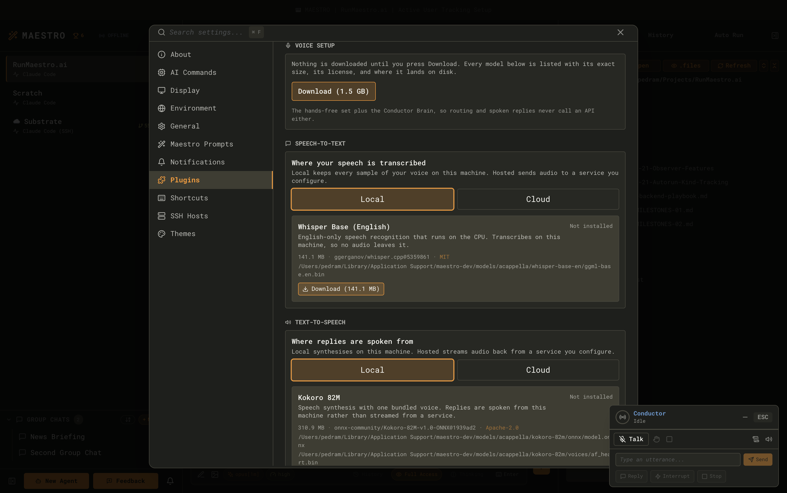
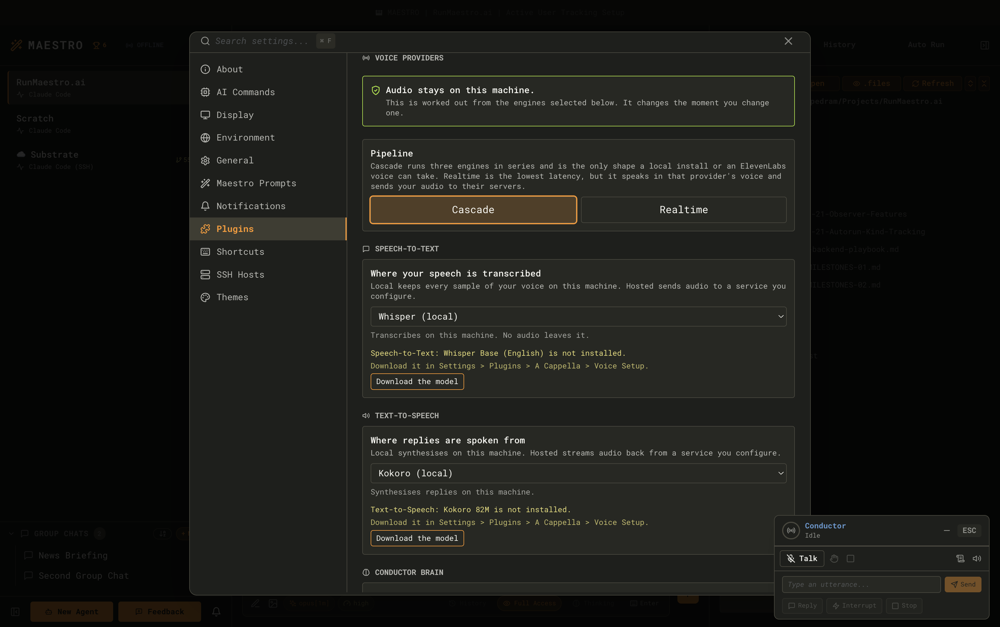
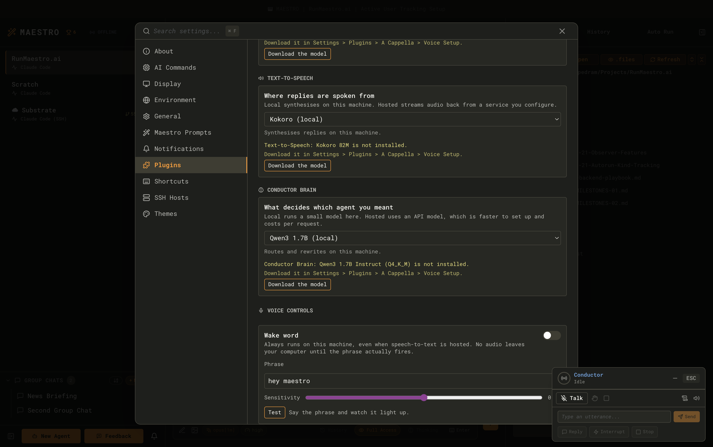
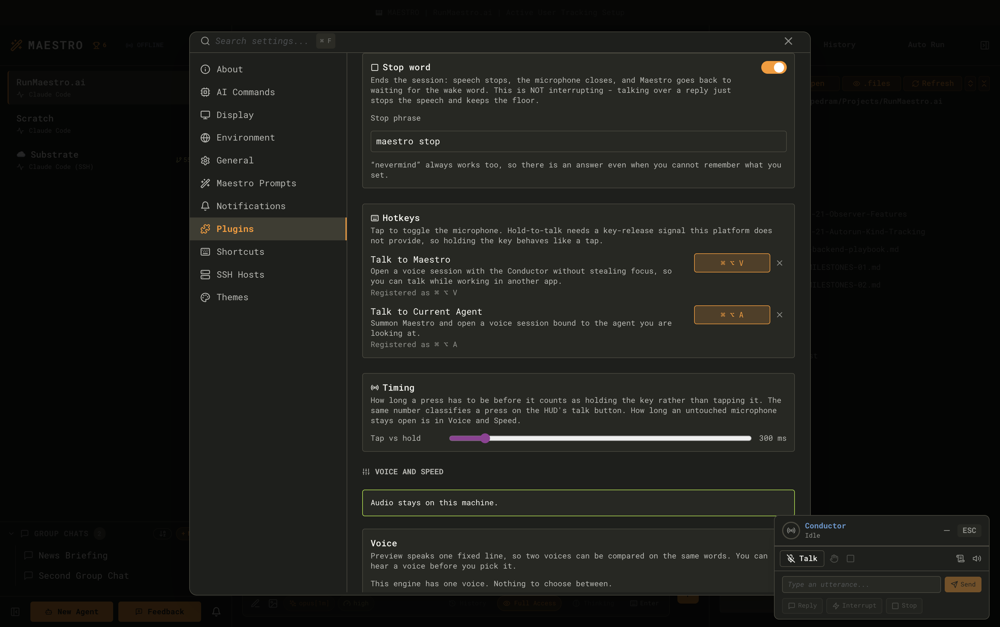
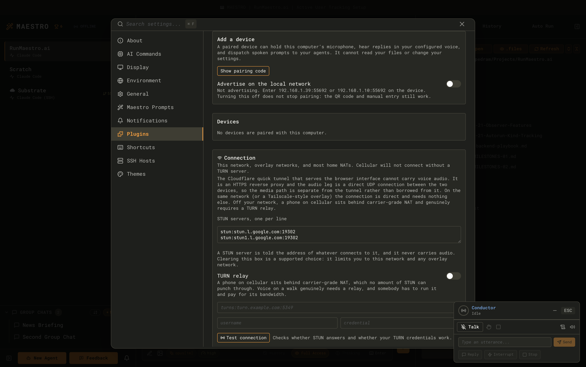

A Cappella is Maestro's voice interface. You say something, Maestro works out which agent and which tab you meant, sends it there, and reads the reply back to you. You can drive it with a wake word, with a global hotkey from inside another application, or from a paired phone across the room.

It is a **front end for the agents you already have**, not a second assistant. It does not think about your code, it does not answer questions itself, and it never invents an agent to talk to. Every utterance ends up in an ordinary Maestro tab that you can scroll back through afterwards.

<Note>
	A Cappella is an **Encore Feature** and it is in **Beta**. It is off by default. While it is off, no
	microphone is opened, no model is downloaded, no hotkey is registered, no Bonjour advert is
	published, and no voice UI renders anywhere in the app.
</Note>

## Turning it on

1. Open **Settings** (`Cmd+,` / `Ctrl+,`) and go to the **Plugins** tab.
2. Find the **A Cappella** card and enable it. A confirmation sheet lists what the feature reads before anything is switched on. When you confirm, the **Set up voice** dialog opens (see [Downloading the models](#downloading-the-models)).
3. Select the card to open its detail pane. It has three sub-tabs: **Help**, **Settings**, and **Permissions**. The **Settings** sub-tab holds, in order, **Microphone**, **Voice setup**, **Voice Controls**, **Voice and Speed**, **Voice session**, **Idle timeout**, **Paired Devices**, **Voice diagnostics**, **Voice self-test**, and **Turn latency**. Manage voice model files in **Settings -> Models -> Library -> Speech**.

From the command line: `maestro-cli encore enable aCappella` (or `disable`). The aliases `a-cappella`, `acappella`, `voice`, and `voice-mode` also work.

Enabling the feature only makes those panels reachable. **Nothing is downloaded and no device is opened until you ask for it**: models arrive when you press Download, and the microphone opens at your first real session.

Turning A Cappella off ends the session, releases both hotkeys, and stops the wake word. Paired devices disconnect but stay paired. Downloaded models stay until you remove them.

While it is off, `maestro-cli voice` refuses most verbs with: _A Cappella is switched off. Turn it on with "maestro-cli encore enable aCappella", or in Settings > Plugins._ These still work while it is off: `voice status`, `voice stop`, `voice self-test`, `voice input`, `voice credentials`, the `voice devices` verbs except `test-connection`, and the `voice wake` verbs except `record`, `add`, and `train`. `voice providers set`, `voice voices set`, and `voice wake-phrase` save the setting and print that the running app applies it at the next start.

<Note>
	**A Cappella runs in the desktop app only.** The [web interface](./remote-control) refuses every
	voice call, and A Cappella cannot be switched on from a browser. A phone or browser can still act
	as the desktop's microphone through [Pairing a phone](#pairing-a-phone).
</Note>

## Where your audio goes

The privacy statement in **Voice setup** is computed from the active providers and updates when you change them. It reads one of: _Audio stays on this machine._, _Audio is sent to OpenAI._, or _Audio stays on this machine. Text is sent to ..._ naming each destination. It also notes that your agents use the providers configured for each agent. **Voice and Speed** also shows where reply text goes for the active speech engine, including OpenAI Realtime when Cloud is selected.

Choose a preset in **Voice setup**:

| Preset                                                    | Providers                                                                                                        |
| --------------------------------------------------------- | ---------------------------------------------------------------------------------------------------------------- |
| **On this Mac** (**On this computer** on other platforms) | Local Parakeet transcription, built-in routing, and the system voice. Clears the Voice routing model assignment. |
| **Cloud**                                                 | OpenAI Realtime handles speech and replies in an OpenAI voice. Microphone audio goes to OpenAI.                  |
| **Custom**                                                | Pick Transcription, Brain, and Voice independently, including ElevenLabs and VoiceStudio.                        |

Cloud preserves your custom provider choices so you can return to them with Custom. Existing mixed configurations open as Custom without rewriting settings. The local preset restores the default providers; it keeps voice speed, volume, and unrelated model assignments.

There are three independent slots plus one alternative pipeline shape. **Custom** shows them as **Transcription**, **Brain**, and **Voice**:

| Slot (Custom label)                | What it does                                              | Default                    |
| ---------------------------------- | --------------------------------------------------------- | -------------------------- |
| Speech-to-Text (**Transcription**) | Turns what you said into words                            | Parakeet (local)           |
| Conductor Brain (**Brain**)        | Decides which agent and tab you meant, and shapes replies | Built-in (keyword routing) |
| Text-to-Speech (**Voice**)         | Turns the reply into sound                                | System voice (built in)    |

From the command line, `maestro-cli voice providers list` shows what each slot runs and what it could run. `maestro-cli voice providers set <slot> <provider-id>` picks one: the slot is `stt`, `tts`, `brain`, or `realtime`, or use `pipeline` with `cascade` or `realtime`.

Each slot is configured and validated on its own. A missing speech model does not stop you using a hosted Brain, and **no path anywhere silently substitutes one provider for another**. If a slot cannot run, the session refuses with a specific reason instead of quietly routing your microphone somewhere you did not choose.

### The providers, and what leaves your machine

| Provider                               | Id                     | Slot            | Leaves this machine                    |
| -------------------------------------- | ---------------------- | --------------- | -------------------------------------- |
| Parakeet (local)                       | `parakeet-local`       | Speech-to-Text  | Nothing                                |
| Whisper (local)                        | `whisper-local`        | Speech-to-Text  | Nothing                                |
| Local Models Dictation                 | `dictation-local`      | Speech-to-Text  | Nothing (the local Dictation model)    |
| OpenAI (hosted)                        | `openai-stt`           | Speech-to-Text  | **Your audio**, to OpenAI              |
| Microphone check (no transcription)    | `echo-stt`             | Speech-to-Text  | Nothing                                |
| System voice (built in)                | `system-tts`           | Text-to-Speech  | Nothing                                |
| Kokoro (local neural voice)            | `kokoro-local`         | Text-to-Speech  | Nothing                                |
| VoiceStudio (local voices)             | `voicestudio-tts`      | Text-to-Speech  | Nothing                                |
| OpenAI (hosted)                        | `openai-tts`           | Text-to-Speech  | The reply text, to OpenAI              |
| ElevenLabs (hosted)                    | `elevenlabs-tts`       | Text-to-Speech  | The reply text, to ElevenLabs          |
| Built-in (keyword routing)             | `mock-brain`           | Conductor Brain | Nothing                                |
| Local model                            | `qwen3-local`          | Conductor Brain | Nothing                                |
| Model endpoint                         | `endpoint-brain`       | Conductor Brain | Your transcripts, to your model server |
| OpenAI (hosted)                        | `openai-brain`         | Conductor Brain | Your transcripts, to OpenAI            |
| Anthropic (hosted)                     | `anthropic-brain`      | Conductor Brain | Your transcripts, to Anthropic         |
| Mock (typed input), Mock (silent)      | `mock-stt`, `mock-tts` | Any             | Nothing (no microphone, no model)      |
| **OpenAI Realtime** (speech-to-speech) | `openai-realtime`      | All three       | **Your audio**, to OpenAI              |

The **Local model** and **Model endpoint** Brains are not picked by id: they follow the model assigned to the **Voice routing** task (`maestro-cli models assign voice-routing <source>`).

**The defaults need one download and no key.** Speech recognition is Parakeet on this machine: fast, English-only, and it gets names, casing, and punctuation right. Whisper stays in the list as a smaller, less accurate alternative. Replies are spoken by the voice already built into your computer (`say` on macOS, the Windows speech API, `espeak-ng` on Linux). Routing is the built-in keyword router: it sends an utterance to the agent you named, or to the agent you are talking to, and reads the first sentences of the reply back as written. Switch the Brain to a hosted model when you want it to understand a request rather than match a name.

**One OpenAI key runs the Cloud preset.** To combine hosted transcription or routing with ElevenLabs, VoiceStudio, or another voice, choose Custom.

**Realtime is a pipeline shape, not a fourth slot.** Choosing it replaces all three slots with one speech-to-speech API: the lowest latency available, in exchange for your audio going to OpenAI and the assistant speaking in that provider's voice.

Hosted providers need an API key, entered in **Voice setup** beside the provider that needs it, with **Save**, **Test**, **Remove**, and a **Get a key** link. Keys are stored per service in the operating system keychain only, never in a settings file, and **Test** asks the service whether the key works. From the command line, `maestro-cli voice credentials` manages the same keys for `openai`, `elevenlabs`, and `anthropic`: `list` (never prints a key), `set <service>` (reads the key from standard input, so it stays out of shell history), `test <service>` (add `--stdin` to test a key before storing it), and `clear <service>`.

### Choosing a voice

The **Voice** list in **Voice and Speed** shows the voices offered by the selected speech engine. When metadata is available, filter by **Gender**, **Language**, or **Region**. Missing metadata appears as **Unknown**. Filtering leaves your current voice selected, even when it is hidden from the list. **Clear filters** restores the full list. Each voice has a **Preview** button that speaks one fixed line, so two voices can be compared on the same words.

From the command line: `maestro-cli voice voices list`, `maestro-cli voice voices set <voice-id>`, and `maestro-cli voice voices preview [voice-id] [--text <text>]`. A preview is refused while a session is live.

### VoiceStudio voices

Configure VoiceStudio under **Settings -> Models -> Sources -> VoiceStudio**. Set the **Local service URL**, **Speech engine** (default `voxcpm2`), and **Sampling seed** (default 11), then use **Check connection** and **Save source**. The default URL is `http://127.0.0.1:3900`; only loopback addresses are accepted. Maestro connects to an existing VoiceStudio service and does not start it.

Choose **Custom** in **Voice setup**, select **VoiceStudio** for Voice (`maestro-cli voice providers set tts voicestudio-tts`), then select a profile in the **Voice** list of **Voice and Speed** (`maestro-cli voice voices set <name>`). **Refresh voices** reloads the profiles. A profile name must be unique; Maestro stores the name so it survives profile exports and imports. If the service or selected profile is unavailable, the session reports the problem instead of switching voices. Source changes made during a voice session apply after it ends.

### Recognition vocabulary

The current agent, agent names, tab titles, and the word "Maestro" provide recognition hints automatically, up to 128 terms. Custom terms have no field in Settings; add them from the command line, for example `maestro-cli settings set acappella.providers.vocabulary '["Kubernetes","Postgres"]'`. Recognizers that support vocabulary prompts (OpenAI hosted transcription) receive these terms; this does not change where recognition runs. The optional **Dictation vocabulary correction** assignment under **Models > Assignments** also checks finalized voice transcripts. It is off by default and preserves the original text when correction fails or is ambiguous.

<Note>
	The **wake word is always local and never optional**. While only the wake detector is running, no
	audio frame reaches a hosted provider, whichever speech-to-text engine you picked. That is enforced
	in the type system and re-checked at runtime, not left to discipline.
</Note>

<Note>
	The Conductor Brain can also be a model on one of your own model servers (Ollama, LM Studio, any
	OpenAI-compatible endpoint). Add the server in **Settings > Models > Sources**, and its models appear
	in the **Conductor Brain** picker. Picking one assigns it to the Local Models **Voice routing**
	task, so the picker and that task always show the same choice. Your transcripts are then sent to
	that server, and the privacy statement in Voice setup names it. See
	[Voice routing](./local-models#voice-routing).
</Note>

<Note>
	**Kokoro**, a neural voice that runs on this machine, is a Text-to-Speech choice once you download
	it (326 MB, from [Local Models](./local-models#the-neural-voice)). The system voice stays the
	default because it needs no download. A **local model** can be the Conductor Brain: download
	**Qwen3.5 4B** in [Local Models](./local-models#the-small-text-models) and pick it under Conductor
	Brain. It sends a request to the agent you name in about a second, and nothing leaves this
	machine. The smaller Qwen3 1.7B is not offered there, because it does not.
</Note>

## Downloading the models

Every time you switch A Cappella on, Maestro offers to set it up: the **Set up voice** dialog lists
what voice needs, what each piece costs, and a single **Download** button that shows the size. That
one button fetches both the models and the engine that reads them, because a model without its
engine does nothing. Nothing is fetched until you press it, and **Later** is a real answer - voice
stays enabled and unconfigured, and every refusal afterwards names the missing piece rather than
saying "voice unavailable". **More options** shows the pieces one by one. When everything is in
place, the dialog says _Voice is ready. Open it from the microphone in the composer, or say your
wake word._

To reopen the dialog at any point, run **Set Up Voice Models** from the command palette, or
`maestro-cli open voice-setup`. To see and fetch the same set from the command line, run
`maestro-cli voice setup` (it downloads nothing) and `maestro-cli voice setup --download`.

If a session starts before the models are in place, the HUD shows **Voice setup needed** with a
**Set up voice** button that downloads what is missing.

The system voice and the built-in router download nothing. To manage these models alongside the
embedding, classifier, and text models other features use, open **Settings -> Models -> Library ->
Speech** (the **Manage voice models** button on the **Microphone** card goes there), or see
[Local Models](./local-models).

<Warning>
	**The engine is downloaded, not bundled.** Speech recognition and the wake word run on ONNX
	Runtime, which does not ship inside the installer: it is about 100 MB that nobody who leaves voice
	switched off should have to carry. The Set up voice dialog fetches it from a pinned release checked
	against a hash recorded in the app, and it is listed alongside the models so the size on the button
	is the size you actually download.
</Warning>

| Model                       | Role           | Size     | License         |
| --------------------------- | -------------- | -------- | --------------- |
| Parakeet TDT 0.6B (English) | Speech-to-Text | 661.3 MB | CC-BY-4.0       |
| openWakeWord Base           | Wake word      | 2.4 MB   | Apache-2.0      |
| Hey Jarvis                  | Wake word      | 1.3 MB   | CC-BY-NC-SA-4.0 |

The dialog offers them as one bundle, **Local speech**, and the button always shows the total of what is still **missing** rather than the size of the whole set. The models come to about 634 MB and the ONNX Runtime engine to about 108 MB, so the first download is roughly 740 MB. Whisper Base (English) (208.5 MB, Apache-2.0) is offered in **Settings -> Models -> Library -> Speech** if you pick it as your recogniser, and Kokoro (326 MB) if you pick it as your voice.

Every file is downloaded from a pinned revision and checked against a SHA-256 recorded in the app, so a model that was tampered with in transit fails to install rather than quietly running.

### Disk usage and getting the space back

Models install under `models` inside Maestro's user data directory. The voice models are listed in **Settings -> Models -> Library**, with every other model Maestro can run, and that is where you remove them. It is the same install: a model downloaded from either place shows in both, and the Library shows which voice slot or task uses each one. See [Local Models](./local-models).

Your own wake phrase recordings are kept separately, under `acappella/wake-phrases` in the user data directory, and paired devices under `acappella/devices.json`.

## Wake word and stop word

Both live in **Voice Controls**.

### Wake word

- The **Wake word** switch is **off** by default. The wake word always runs on this machine, even when speech-to-text is hosted, and no audio leaves your computer until the phrase actually fires.
- **Phrase**: default **"Hey Jarvis"**, the phrase a trained detector ships for. **Reset** restores it after an edit. Say it and a Conductor session opens without stealing focus from whatever you are working in. It is not listened for while a session is live. From the command line: `maestro-cli settings set acappella.controls.wakePhrase "hey scout"`.
- **Detection** picks how the phrase is heard. **Trained model** (the default) is tiny and nearly free on the CPU, but it only knows phrases it has a model for: "hey jarvis" out of the box, plus any phrase you [train from your own voice](#training-your-own-wake-phrase). **Transcription** works for any phrase you type with no training: the local speech model transcribes each burst of speech and matches the phrase in the text, at the cost of keeping that model loaded (about 1 GB) while hands-free is on.
- **Sensitivity** is a single slider from 0 to 1, default 0.5. Higher fires more easily.
- **Test** runs the detector with no session behind it, so you can tune the sensitivity by saying the phrase instead of guessing, restarting, and guessing again. A test run closes the microphone on its own after 15 seconds. From the command line: `maestro-cli voice wake test [phrase] [--seconds <1-60>] [--sensitivity <0-1>]` (10 seconds by default; the sensitivity is tried, not saved).
- **Per-agent phrases.** Use **Add agent** to choose an agent and give it a phrase, or set it in the agent's **Edit Agent** dialog under **Voice Wake Phrase**. **Remove phrase** clears it. From the command line: `maestro-cli voice wake-phrase list`, `set <agent> <phrase>`, and `clear <agent>`.

<Warning>
	**Per-agent phrases are saved but not yet listened for.** In this build the detector hears only
	the main **Phrase**, and a wake always opens a Conductor session. To reach one agent by voice, say
	the main phrase and name the agent, or use the **Talk to Current Agent** hotkey.
</Warning>

The trained-model engine needs the openWakeWord front end (2.4 MB) plus the phrase's own detector: the 1.3 MB download for "hey jarvis", or the one you trained. If either is missing, or the phrase has no detector, **Test** says exactly which instead of listening to nothing.

### Training your own wake phrase

Any phrase can be a wake phrase if you teach it to Maestro. Type the phrase, press **Train** under it, and work down the dialog:

1. **Say the phrase.** Press **Record** and say the phrase, wait a second, and say it again. Every time you say it becomes one recording; there is no button per take. About 20 is the target, 8 is the minimum, and 60 is the most kept. **Stop** ends the recording, **Record more** adds to it, and **Remove last** drops a take that was a cough. A take shorter than a quarter second or longer than 2.5 seconds is refused (_Too short to be the phrase. Say it again._), and a recording left idle closes after 45 seconds.
2. **Read this aloud.** About 30 seconds of ordinary speech (12 is the minimum). This is how Maestro learns what is NOT the phrase. The passage uses each word of your phrase separately, never the whole phrase, so "hey, how is it going" does not wake it. Do not say the whole phrase in this step. **Start over** discards the passage.
3. **Train.** It takes a few seconds. Nothing is downloaded or uploaded. **Train again** retrains after you add recordings.

The result is one of three verdicts, with the numbers behind it:

| Verdict                              | What it means                                                                                                       |
| ------------------------------------ | ------------------------------------------------------------------------------------------------------------------- |
| Stands well apart from other speech  | Every recording sounds more like the other recordings than anything in the passage does, with room to spare.        |
| Usable. Expect to adjust sensitivity | They are apart, but not by much. Use **Test** and the sensitivity slider.                                           |
| Too close to other speech            | Something in the passage sounds as much like the phrase as the phrase does. Record more, or choose a longer phrase. |

Press **Test** in the dialog to try it straight away, and **Improve** later to add recordings and train again. Training always uses every recording you have made.

Things worth knowing:

- **It learns your voice.** It compares what the microphone hears with your own recordings, so it mostly responds to you and may not respond to someone else saying the same words. A downloaded phrase like "hey jarvis" was trained on thousands of voices and works for anyone.
- **Longer phrases work better.** Two or three words with distinct sounds ("hey maestro", "okay scout") stand apart from ordinary speech far more than one short word does.
- **Your recordings stay on this machine.** They are kept, so that adding more next week retrains from all of them, and they are never sent anywhere. **Delete recordings and model** in the dialog removes them, and works even with voice switched off.
- **Detection must be set to Trained model.** Transcription matches the phrase in text and does not use what you trained.
- **A trained phrase outranks a downloaded one.** If you train "hey jarvis" yourself, your recordings are what is used.

From the command line, `maestro-cli voice wake` does the same things. `record [phrase]` and `stop` use the microphone (add `--other-speech` to record the passage instead), `add <phrase> <files...>` takes WAV files instead (up to 32 MB each; `--other-speech` marks them as the passage), `undo` drops the newest take, `clear-background` drops the passage, and `train`, `status`, `list`, and `remove <phrase>` do what their names say. See the [CLI guide](./cli#voice).

### Stop word

The stop word is a separate control in its own card, because it is a different action from interrupting.

|             | Barge-in (just start talking)   | Stop word     |
| ----------- | ------------------------------- | ------------- |
| Means       | "stop talking, I am still here" | "we are done" |
| Speech      | Cancelled                       | Cancelled     |
| Microphone  | Stays open                      | Closes        |
| The session | Keeps going                     | Ends          |

- The **Stop word** switch is on by default, with **Stop phrase** **"maestro stop"**.
- **"nevermind" is always armed and cannot be edited.** A stop word you have to remember is not a stop word, so this one is the same in every install.

<Warning>
	**The spoken stop word is not heard from the desktop microphone in this build.** The settings are
	saved, but only a [paired device's](#pairing-a-phone) stop control ends a session this way today.
	On the desktop, end the session with `Esc`, the second press of a voice hotkey, or
	`maestro-cli voice stop`.
</Warning>

Wake phrases are only listened for while the session is cold, so saying the wake word mid-answer can never stack a second session on top of the first.

### Interrupting a reply (barge-in)

Start talking over a reply, press the HUD's stop square, press a voice hotkey while it speaks, or run `maestro-cli voice stop-reply`. Speech stops and the session keeps going. A sound in the first quarter second of a reply is ignored, so the reply's own start does not cut itself off.

## Who you are talking to

A session is in one of three modes, shown as **Tab / Agent / Conductor** under the HUD's header. Click one to switch, or press `Tab` while the HUD is up to step to the next one (`Shift+Tab` steps back); the session keeps running and the new mode applies from the next thing you say. A completion popup, a shell line, and an editor that indents with `Tab` all keep the key. From the command line: `maestro-cli voice scope <conductor|agent|tab> [--agent <id>] [--tab <id>]` (the active agent and selected tab by default).

Tab and Agent need an agent to talk to. With none open, the switch flashes _Open an agent first_. If the tab a Tab session is talking to is closed, the session says: _The tab this voice session is talking to no longer exists. Switch to Agent mode or pick another tab._

| Mode          | Where your words go                                                                                                                                | Who decides                                                                   |
| ------------- | -------------------------------------------------------------------------------------------------------------------------------------------------- | ----------------------------------------------------------------------------- |
| **Tab**       | One tab, word for word. Naming another agent is just part of the message.                                                                          | Nobody: the Conductor is skipped entirely, which also makes it the fastest    |
| **Agent**     | One agent. The current tab, a new tab ("open a new tab about the auth bug"), or a tab you name ("back to the migration tab"). Never another agent. | The Conductor picks the tab, never the agent, and never answers for the agent |
| **Conductor** | Any agent and any tab. "Ask the backend agent to run the tests" goes to the backend agent.                                                         | The Conductor picks both, and asks when it is unsure                          |

Switching binds to what is on screen: **Agent** means the agent you are looking at, and **Tab** means the tab in front of it. Clicking the mode that is already on does the same thing, which is how you point a session at what you are looking at when it was opened somewhere else. The header always names where the next sentence will land.

**Tab** and **Agent** then follow you. Click another agent and Agent mode talks to that one; click another tab, or another agent, and Tab mode talks to the tab now in front. Looking at a file, terminal, or browser tab does not move anything: the conversation behind it is still the one you are talking to. **Conductor** mode is bound to nothing, and a conversation about a document stays with its document, so neither moves.

A session started from the [Quick Chat](./quick-chat#talking-to-it) window's microphone is outside these three modes. It is locked to that chat: every sentence is sent to it word for word, the switch does not apply, and it ends when the Quick Chat window is put away. Tap the microphone to start or end it, or hold it to talk. From the command line: `maestro-cli voice start --quick-chat` (pick its agent with `maestro-cli quick-chat agent <id>`); `voice scope` is refused for it. If Quick Chat is switched off, the microphone says _Quick Chat is turned off. Turn it on in Settings > Plugins to talk to it._

The **Talk to group chat** button in a Group Chat binds voice to that room's moderator. Spoken requests use the same queue and read-only choice as typed messages. Only the moderator's final reply is spoken; participant replies remain in the chat. The HUD shows **Group Chat** and names the room, and keeps that destination fixed. If the room cannot take the request you hear why: _This group chat no longer exists._, _The group chat queue is paused. Resume it in Group Chat._, or, after 30 minutes, _The group chat is still working. Its reply remains in the chat._

How a session starts decides its first mode: the **Talk to Maestro** hotkey, the wake word, and the HUD's **Talk** button on a fresh start open in **Conductor** mode; the **Talk to Current Agent** hotkey and the Left Bar menu open in **Agent** mode. The agent composer microphone uses **Default voice mode** on the **Voice session** card, which defaults to **Agent**. After that, the HUD's talk button reopens in whatever mode you last used.

From the command line, `maestro-cli voice start` opens a session on the Conductor by default. Add `--agent <id>` for an agent, `--tab <id>` for one tab (`active` for the selected tab), `--conductor`, `--document <path> --agent <id>` for a document, or `--quick-chat`. Add `--paused` to open with the microphone shut, as push-to-talk does.

### Things you can say

There is no fixed command list: the Conductor reads what you said. Some phrasings have a fixed meaning:

| Say                                                                                              | What happens                                                                                                                                             |
| ------------------------------------------------------------------------------------------------ | -------------------------------------------------------------------------------------------------------------------------------------------------------- |
| "no the other one", "not that one", "wrong tab", "wrong agent", "wrong one" (the whole sentence) | Moves the last request to another agent. With several to choose from it asks, for example _Backend, or Docs?_ Not in Tab mode, Quick Chat, or Group Chat |
| "say that again", "repeat that"                                                                  | Speaks the last reply again                                                                                                                              |
| "tell me more", "go on", "more"                                                                  | Speaks the next part of the last reply, or _That's everything it said._                                                                                  |
| "what was the file"                                                                              | Names the file the last reply was about, or says _It did not name a file._                                                                               |
| "show me that", "open it", "pull up the diff"                                                    | Brings the tab the last reply came from on screen                                                                                                        |

When the Conductor is unsure it asks, for example _Which agent or tab should take that?_ or names two choices. If you name a tab you closed, it asks whether to reopen it. The prompt the Conductor follows can be edited in **Settings -> Maestro Prompts**.

## The two hotkeys

Both are system-wide, both ship bound, and both only register while A Cappella is on.

| Hotkey                    | Default                    | What it does                                                                                  |
| ------------------------- | -------------------------- | --------------------------------------------------------------------------------------------- |
| **Talk to Maestro**       | `Cmd+Alt+V` / `Ctrl+Alt+V` | Opens a Conductor session **without stealing focus**, so you can talk while working elsewhere |
| **Talk to Current Agent** | `Cmd+Alt+A` / `Ctrl+Alt+A` | Brings Maestro forward and opens a session bound to the agent you are looking at              |

Press a hotkey once to open a session, and press it again to close the microphone and end the session. Pressed while a reply is being spoken, it stops the reply and listens instead.

Rebind either one under **Hotkeys** in **Voice Controls** or in the **Shortcuts** tab; they are two views of the same binding, not two settings. Voice Controls also shows each hotkey's **real registration state**, which matters because a combination another application already owns is the commonest way a global shortcut silently does nothing. The state reads **Registered as** the chord, **Not set**, _... is already used by another Maestro hotkey_, _... is already taken by another app. Pick a different combo._, or _... could not be registered._

**Tap vs hold** under **Timing** sets how long a press on the document chat and Quick Chat microphones must last to count as a hold (300 ms by default, 100 to 2000 ms).

<Note>
	**The hotkeys are tap-to-toggle on every platform today.** Press once to open the floor, press again
	to close it. Electron reports key presses but not key releases, so true press-and-hold on a global
	hotkey would need a native module Maestro does not ship. Rather than fake it, Voice Controls says
	which behaviour you are getting. The HUD's talk button and a paired phone's button do have a real
	release event, so press-and-hold works there: switch the HUD to push-to-talk with its hand button.
</Note>

You can also start a session from:

- The microphone under the **Send** button in the composer (**Talk to this agent**). It uses **Default voice mode**. Tab mode needs an open AI tab, or it says _Open an AI tab before starting Tab voice mode._ With A Cappella off, the same place offers dictation instead.
- The **command palette** (`Cmd+K` / `Ctrl+K`): **Talk to** the agent you are looking at (its subtext names your wake phrase), or **Talk to the Conductor**.
- Right-clicking an agent in the **Left Bar**: **Talk to this agent**, or **End voice session** while one is bound to it.
- The command line: `maestro-cli voice start` (see [Who you are talking to](#who-you-are-talking-to)).

The palette also has **Show Voice HUD** (while it is minimized), **Show Voice Transcript** / **Hide Voice Transcript**, **End Voice Session** (while a session is bound to the agent you are looking at), and **Set Up Voice Models**.

If a session cannot start, a **Voice session could not start** notice says why.

## Talking to a document

Point a session at one file and the conversation is about that file. Three ways in, all doing the same thing:

- The **microphone in the document chat**, opened from the bottom-left chat button in the preview. Tap it to start or stop, or hold it to speak and release to send.
- **Talk with Document** in the **Files panel** right-click menu.
- **File: Talk with Document** in the command palette, while a file preview is the active tab.

Starting a document session opens the file preview and its chat panel before recording begins. Closing the panel or leaving the preview ends its document voice session. Releasing a microphone hold sends the utterance and keeps the session.

The conversation is held with the agent whose workspace the file is in. Spoken turns use the same document conversation as the preview's chat panel, creating one (a tab named after the file) when needed. The document is handed over as the core context. The agent reads whatever else it needs and uses its tools normally.

The panel names the **file** and owns its microphone and transcript. Document sessions do not show a separate voice HUD. With no agent to talk to, a notice says _Open an agent before talking about_ the file.

From the command line: `maestro-cli voice start --document <path> --agent <id>`. A document session takes no `--tab`.

A document conversation is an ordinary AI tab, tagged with the file it is about, and it is the **same conversation the chat bubble types into** - see [Chatting with a document](./general-usage#chatting-with-a-document). So you can ask something out loud, type the follow-up, and read both in either place. It also survives a restart: come back to the file tomorrow and the conversation is still there.

<Note>
	Talk with Document is offered only when A Cappella is on and the file has text to read.
	With A Cappella off, the chat microphone uses dictation when available. Images (SVG included),
	audio and video, compiled binaries, and archives do not offer document chat.
</Note>

## While a session is running

A small voice HUD appears without taking focus. It is its own window, floating over other apps and Spaces, even while Maestro is minimized. Drag its title strip to move it; resize its edges to change its size. Both position and size are remembered, and **Reset HUD position** on the **Voice session** card puts it back at the bottom right. The header names where the next sentence goes (the agent and tab, the file, **Quick Chat**, the group chat, or **Conductor**) and, while a long reply is spoken, how far through it is.

`maestro-cli voice status` reports whether A Cappella is on, the live session's state and where it is talking to, whether the microphone is open, the send wait, and whether each slot is ready.

Opening a blocking dialog temporarily hides the HUD without ending the session or closing the microphone. The HUD returns when the last blocking dialog closes.

A filled microphone marks where your next sentence goes: the pinned tab and its agent in **Tab** mode, the agent in **Agent** mode, or the Maestro wordmark in **Conductor** mode. A separate marker shows the tab where the last voice prompt landed.

The indicator has six states, told apart by shape and motion as well as colour: **idle**, **paused** (the session is open and the microphone is closed), **listening** (with a live input level), **thinking**, **speaking**, and **error**. Under `prefers-reduced-motion` all of it goes static.

### The control row

| Control         | What it does                                                                                                                                                                                                                              | Command line                                          |
| --------------- | ----------------------------------------------------------------------------------------------------------------------------------------------------------------------------------------------------------------------------------------- | ----------------------------------------------------- |
| **Talk button** | Hands-free (**Listening** / **Not listening**): click to open the microphone, click again to shut it. Push-to-talk (**Hold to talk**): hold while you speak, release to send. `Enter` and `Space` also hold it. It never ends the session | `voice listen on`, `voice listen off [--send]`        |
| **Hand**        | Switches between **Hands-free** and **Push-to-talk**. The choice is remembered                                                                                                                                                            | `settings set acappella.ui.listenMode push-to-talk`   |
| **Timer chip**  | Shows the send wait and opens the send panel: a slider for the wait and a field for the send phrase. Hands-free only                                                                                                                      | `voice wait <ms>` (0 to 120000), `voice wait default` |
| **Stop square** | Cuts off a reply that is being spoken and keeps the session. Available only while the assistant is speaking                                                                                                                               | `voice stop-reply`                                    |
| **Transcript**  | Shows or hides the scrollback. The latest line stays visible when it is hidden                                                                                                                                                            | Palette: **Show Voice Transcript**                    |
| **Speaker**     | Mutes spoken replies for this session. They still appear in the transcript. Not saved across restarts                                                                                                                                     | `voice mute`, `voice unmute`                          |
| **Microphone**  | Picks the input device (**System default** or a named microphone)                                                                                                                                                                         | `voice input list`, `voice input set <id>`            |

Every command in the table is a `maestro-cli` verb. `maestro-cli voice volume <0.1-1>` sets the reply volume, and `maestro-cli voice send` sends what you said now, as the **Send now** button does.

**Hands-free** keeps the microphone open. A request is sent when you end it with a send phrase ("go maestro" by default) or when you pause for the **send wait**. The wait's default comes from **Voice Controls** (the settle window, or the long backstop when requests are held for a send phrase). The timer chip opens a slider that changes it for the conversation you are in without touching that default: drag from 1s to 2m, and drag back onto the default stop, or click **Default**, to return to it. The wait you picked is dropped when you close the HUD. While a request is held you see _Say "go maestro" to send, or it sends in_ a countdown, and a **Send now** button (`maestro-cli voice send`).

Three settings under **Timing** in **Voice Controls** shape when a request is sent:

- **Wait for me to say send** (off by default) holds every request until you say a send phrase. **Send after** (30 seconds, 5 to 120) is the backstop that sends it anyway.
- **Finish my thought** (900 ms, 0 to 3000, 0 is off) waits that much longer after you stop talking, so a short pause mid-thought does not send half a sentence. By default a request goes about 1.6 seconds after you stop.
- **Talk it through first** (off by default) makes the Conductor answer you instead of sending every sentence to an agent, and hand work over only once you have described something doable. Off, each sentence is a command.

The same panel has the **send phrase** field. "go maestro" is the only phrase that ships, because it is not something you say by accident; everyday phrases such as "send it" or "go ahead" end ordinary sentences and would send a request early. Type your own phrase, or several separated by commas, and press `Enter`. Unlike the wait this is the stored setting, the same list as **Send phrases** in **Voice Controls**, so it stays after the HUD closes. A phrase is heard only at the end of a sentence and is removed before the request is sent. Empty the field to send on the pause alone.

**Push-to-talk** opens the microphone only while the talk button is held. A pause in the middle of the sentence sends nothing; letting go sends all of it. A session started some other way in this mode (the composer microphone, the palette) opens with the microphone closed and waits for the first hold.

**Hold while busy** pauses microphone input while the conversation is working and resumes it when the destination is free. It is on by default and applies to agent conversations and Group Chat. Change it with the toggle in the HUD or on the **Voice session** card. While it holds, the HUD shows **Paused**. A microphone you closed yourself, including a push-to-talk microphone after release, stays closed.

With **Hold while busy** off, the HUD can keep a request pending for the exact destination tab while you speak additions in the same scope. Maestro retries when the destination is free. Group Chat accepts another spoken message into its submission queue. The HUD says _Session is busy, send is pending._ **Force Send** allows delivery beside other working tabs when **forced parallel execution** is enabled in Settings. It still waits if the destination tab itself is busy. The toggle resets when the voice session ends.

- **Close ends the session.** Press `Esc` or the HUD's ESC pill (**End voice session (Esc)**), or run `maestro-cli voice stop`. Shutting the microphone with the talk button keeps the session, its transcript, and its mode. A session that ends on its own (the idle timeout) leaves the HUD where it was, showing a closed microphone one click from open.
- **Minimize hides the HUD and leaves the session running**, microphone included. The Left Bar shows a voice indicator in its place; click it, the composer microphone, or **Show Voice HUD** in the palette to bring the HUD back. None of them ends the session. **Minimize the HUD** on the **Voice session** card picks when it minimizes: **Only when I ask** (the default) or **When the turn ends**.
- The **transcript** panel shows what was heard, what was sent, and which agent and tab each turn landed in, with each line marked **You**, **Agent**, or **Maestro**. Route chips (**new tab**, **back to tab**, **current tab**) jump you straight to that tab, reopening it if you had closed or snoozed it. **Live transcript** on the **Voice session** card (off by default) shows it from the start.
- A session that hears nothing goes cold on its own. **Idle timeout** defaults to **60 seconds** and goes from 5 seconds to 30 minutes (`maestro-cli settings set acappella.controls.idleTimeoutMs 120000`).

**Voice and Speed** controls what the assistant sounds like: **Voice**, **Speed** (1.00x, from 0.7x to 1.4x), and **Volume** (100%, down to 10%), separate from the system volume (`maestro-cli voice volume <0.1-1>`). Every one of them applies to the **next spoken sentence**, so you can audition a change without restarting a conversation.

**Background completions** (**Auto**, **Always**, or **Never**) decide whether an agent finishing in the background gets spoken about. The default is **Auto**: yes in a Conductor session, where you are supervising a fleet and a finished agent is the news you are waiting for; no inside a session bound to one agent or one document, where another agent talking over your conversation is an interruption you did not ask for.

## Microphone permission

Maestro asks for the microphone at your **first real session**, never at launch and never when you switch the Encore Feature on.

| Platform | Behaviour                                                                                                                            |
| -------- | ------------------------------------------------------------------------------------------------------------------------------------ |
| macOS    | A real permission prompt. Once denied, the recovery is System Settings, and the HUD's **Open Privacy Settings** button goes there.   |
| Windows  | Maestro can read the permission state but cannot prompt. The OS privacy setting is the only recovery (**Open Microphone Settings**). |
| Linux    | No permission system to query. A failure is reported when the capture attempt fails.                                                 |

A denied microphone is reported as a denied microphone, with its own reason and its own fix. It is never collapsed into a generic "voice unavailable" next to perfectly good models. The HUD says one of: _Maestro does not have microphone access yet._, _No microphone was found._, _The microphone was disconnected._, or _Audio capture is unavailable on this system._

## Pairing a phone

A paired device becomes a remote microphone and speaker for this computer. It is not a second brain: the session, the routing, and the agents all stay on the desktop.

<Note>
	The iOS app is specified but not yet built. What ships today is the **browser reference client**, a
	small dependency-free page that speaks the identical protocol. See
	[the client specification](https://github.com/RunMaestro/Maestro/tree/main/docs/ios-client) for the
	native app design.
</Note>

### The flow

1. In **Paired Devices**, press **Show pairing code**. Maestro displays a QR code, a 6-character pairing code, a fingerprint, and the addresses and port the device can reach. The code is good for **two minutes**, spent by the first device that claims it, and only one device can wait for approval at a time.
2. Scan it from the device. For the browser reference client, open `http://<desktop-host>:<port>/<token>/acappella` and paste the JSON behind the QR code into the payload box.
3. **Approve the request on the desktop.** Knowing the code is not enough. It buys the device a prompt (_NAME wants to pair_) with **Approve** and **Deny**, and nothing else. The prompt waits 60 seconds. There is no command-line approval, by design: pairing needs a person at the desktop.
4. Compare the fingerprint (two groups of four characters) shown on both screens. Matching fingerprints mean nothing got in between.

A device that fails to pair hears why: the code does not match, has already been used, or has expired; another device is already waiting; or the device is not paired with this computer, or its pairing was revoked. Five failed attempts on one connection close it with _Too many failed attempts._ The browser reference client has no wake word.

A paired device can hold this computer's microphone, hear replies in your configured voice, and dispatch spoken prompts to your agents. It cannot read your files or change your settings. The device's token is stored as a salted hash, never in plain text.

The **Devices** list shows each paired device, whether it is connected, how it connected, and which one is holding the microphone. **Rename** changes its name. **Revoke** is per-device and takes effect on a live connection immediately, tearing down the audio and closing the voice session rather than waiting for the next connect. **Forget** deletes a revoked device's record. **Disconnect all** drops every live connection and keeps the pairings; **Revoke all** ends every pairing.

From the command line: `maestro-cli voice devices list`, `rename <device> <name>`, `revoke <device>`, `forget <device>`, `revoke-all`, and `disconnect`. `revoke`, `forget`, and `revoke-all` ask first unless you pass `--yes`.

### Discovery

Maestro can advertise itself over Bonjour so a device on the same network finds it without anyone typing an address. It is a convenience and never the connection itself: the QR code carries the addresses directly, and manual host entry always works. The advert carries the app version, protocol version, machine name, and pairing fingerprint, and never a token or a pairing code. **Advertise on the local network** is **off** by default; switching it off does not stop pairing. From the command line: `maestro-cli voice devices discovery on` (or `off`).

### Whether it will actually connect

Each connected device shows the connection path it actually won, in plain words.

| Path                    | Needs                                | Works                                               |
| ----------------------- | ------------------------------------ | --------------------------------------------------- |
| Direct (LAN or overlay) | Nothing                              | Same WiFi or wire, or over Tailscale-style overlays |
| Direct (through NAT)    | A STUN server                        | Most home networks                                  |
| Relayed (TURN)          | **A TURN server you run or pay for** | Cellular, hotel WiFi, corporate networks            |

The connection settings under **Paired Devices** hold **STUN servers, one per line**, and a **TURN relay** switch (off by default) with the TURN server URL, username, and credential. **Test connection** (`maestro-cli voice devices test-connection`) checks which paths this computer can offer.

If you already run an overlay network such as Tailscale, that is the whole answer: both machines have a routable address for each other and the connection is direct from anywhere. The pairing QR carries every local address the desktop has, overlay addresses included.

<Warning>
	**A phone on a mobile network needs a TURN server.** Carrier-grade NAT does not support the
	hole punching that STUN relies on, so no amount of STUN gets through it. And **the Cloudflare quick
	tunnel that serves Maestro's browser interface cannot carry this audio**: it is an HTTPS reverse
	proxy, while the media leg is a direct UDP association between the two devices. Signaling goes
	through the tunnel fine, which is why "the tunnel is up" tells you nothing about whether audio will
	flow.
</Warning>

## Settings at a glance

All of these are in **Settings -> Plugins -> A Cappella -> Settings**. Any of them can also be read and written with `maestro-cli settings get` / `settings set acappella.<path>` (see the [CLI guide](./cli#voice)).

| Card                | Setting                                                                | Default                        |
| ------------------- | ---------------------------------------------------------------------- | ------------------------------ |
| **Microphone**      | **Microphone**                                                         | System default                 |
| **Voice setup**     | Preset (**On this Mac** / **On this computer**, **Cloud**, **Custom**) | On this Mac / On this computer |
| **Voice Controls**  | **Wake word**                                                          | Off                            |
| **Voice Controls**  | **Phrase**                                                             | Hey Jarvis                     |
| **Voice Controls**  | **Detection**                                                          | Trained model                  |
| **Voice Controls**  | **Sensitivity**                                                        | 0.5                            |
| **Voice Controls**  | **Stop word** / **Stop phrase**                                        | On / maestro stop              |
| **Voice Controls**  | **Talk to Maestro** / **Talk to Current Agent** hotkeys                | `Cmd+Alt+V` / `Cmd+Alt+A`      |
| **Voice Controls**  | **Tap vs hold**                                                        | 300 ms                         |
| **Voice Controls**  | **Talk it through first**                                              | Off                            |
| **Voice Controls**  | **Wait for me to say send** / **Send after**                           | Off / 30 s                     |
| **Voice Controls**  | **Send phrases**                                                       | go maestro                     |
| **Voice Controls**  | **Finish my thought**                                                  | 900 ms                         |
| **Voice and Speed** | **Voice**                                                              | The engine's default voice     |
| **Voice and Speed** | **Speed** / **Volume**                                                 | 1.00x / 100%                   |
| **Voice and Speed** | **Background completions**                                             | Auto                           |
| **Voice session**   | **Hold while busy**                                                    | On                             |
| **Voice session**   | **Default voice mode**                                                 | Agent                          |
| **Voice session**   | **Listening mode**                                                     | Hands-free                     |
| **Voice session**   | **Live transcript**                                                    | Off                            |
| **Voice session**   | **Minimize the HUD**                                                   | Only when I ask                |
| **Idle timeout**    | **Idle timeout**                                                       | 60 s                           |
| **Paired Devices**  | **Advertise on the local network**                                     | Off                            |
| **Paired Devices**  | **TURN relay**                                                         | Off                            |

## Troubleshooting

| Symptom                                              | Likely cause                                                                                                                                                                                                                                                                       |
| ---------------------------------------------------- | ---------------------------------------------------------------------------------------------------------------------------------------------------------------------------------------------------------------------------------------------------------------------------------- |
| The hotkey does nothing                              | Another application owns the combination. Voice Controls shows the real registration state and names the conflict.                                                                                                                                                                 |
| The wake word never fires                            | **Wake word** is off, the openWakeWord model is not installed, or the sensitivity is too low. Use **Test** to tune it by voice.                                                                                                                                                    |
| A phrase you trained fires too easily, or not enough | Move the sensitivity slider and use **Test**. If it still misfires, press **Improve** and add recordings in the conditions where it goes wrong.                                                                                                                                    |
| A session refuses to start                           | Open **Voice setup**, or run `maestro-cli voice status`. Each slot reports its own specific reason, for example _Transcription: Parakeet TDT 0.6B (English) is not installed._ with _Download it in Settings > Models > Library > Speech._, a missing key, or a denied microphone. |
| Speech works but replies are silent                  | Check **Volume** in Voice and Speed, and the HUD's speaker (mute). The volume is separate from the system volume and has its own floor.                                                                                                                                            |
| A phone pairs but no audio arrives                   | The media path is separate from signaling. Check the connection path shown on the device row; cellular needs TURN.                                                                                                                                                                 |
| Voice was disabled but disk is still in use          | Downloaded models stay when the feature is off. Remove them in **Settings -> Models -> Library**.                                                                                                                                                                                  |

Four cards at the end of the A Cappella settings are worth reaching for before filing a bug, and all are safe to run at any time:

- **Voice diagnostics** lists recent voice events. **Copy diagnostics** copies them, **Show all** expands the list, and **Clear** empties it.
- **Run voice self-test** (on **Voice self-test**) loads each speech runtime and runs a trivial operation against it, reporting PASS, FAIL, or MISSING for each. No model is loaded and no microphone is opened. **Copy result** copies it, and `maestro-cli voice self-test` runs the same check, even with voice switched off. Include the result when you report a voice problem.
- **Read last turn** (on **Turn latency**) shows where the last spoken turn actually spent its time, from the moment the detector heard you stop talking. **Copy timings** copies it, and `maestro-cli voice latency` prints the same. Include this when you report that voice feels slow.

## Related

- [Encore Features](./encore-features) - how optional features are gated
- [Keyboard Shortcuts](./keyboard-shortcuts) - the full shortcut and global hotkey list
- [Remote Control](./remote-control) - the browser interface and the Cloudflare tunnel
- [Configuration](./configuration) - where Maestro stores its data
- [Local Models](./local-models) - the speech models, the neural voice, and the Voice routing task
- [Quick Chat](./quick-chat) - the Quick Chat window and its microphone
- [CLI guide](./cli#voice) - every `maestro-cli voice` verb
